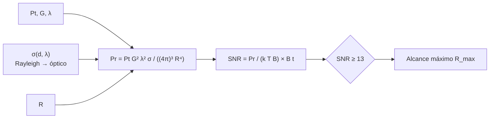

# B118-C04 — Detección por radar

<!-- nav:top -->
[🏠 Programa](../../../../README.md) · [📚 Bloque B118](../../../tronco-comun/B118-trafico-espacial-y-sostenibilidad-orbital.md) · [← Anterior: B118-C03 — Detección y seguimiento óptico](../B118-C03-deteccion-y-seguimiento-optico/CLASE.md) · [Siguiente: B118-C05 — Conjunciones orbitales →](../B118-C05-conjunciones-orbitales/CLASE.md)
<!-- /nav -->

## 1. Ubicación, nivel y alcance

Clase 4 del bloque B118. Nivel N3. Cuarta clase del tramo «Conocer el entorno». El radar emite su propia señal y no depende del Sol. Aquí aplicas la **ecuación del radar** a un radar **hipotético** (100 kW, 40 dBi, 1,3 GHz), calculas la sección eficaz de esferas pequeñas con un modelo de dos regímenes y obtienes el alcance máximo para una relación señal-ruido dada. Todos los parámetros son **ilustrativos**. **Esta clase es educativa: no constituye asesoría legal, regulatoria, financiera ni operativa y no sustituye la lectura del texto normativo vigente ni a un profesional habilitado.**

## 2. Por qué esta clase existe

Para los desechos pequeños en LEO el radar es el sensor más usado, pero su alcance cae rápido con el tamaño. La decisión central: **¿hasta qué distancia ve un radar un objeto de un tamaño dado, y cuánto pierde cuando el objeto se aleja?**

## 3. Lo que podrás hacer al terminar

1. Aplicar la ecuación del radar `Pr = Pt G² λ² σ / ((4π)³ R⁴)`.
2. Calcular la sección eficaz de una esfera en régimen de Rayleigh, de transición y óptico.
3. Comprobar que al duplicar el rango la SNR cae por 16 (cociente `16,000`).
4. Obtener el alcance máximo por bisección para una SNR mínima de 13.
5. Verificar que el alcance escala como `σ^(1/4)`.
6. Separar lo ilustrativo (radar, modelo de `σ`) de lo estándar no consultado (CODATA, ecuación del radar).

La evidencia es la **ficha de alcance de un radar hipotético** del ejercicio 12 (sección 20).

## 4. Con qué llegas y cómo comprobarlo

1. ¿Qué es una sección eficaz de radar?
2. ¿Qué es la ganancia de una antena en dBi?
3. ¿Qué es la constante de Boltzmann?
4. ¿Qué es la longitud de onda?
5. ¿Qué es una bisección?

<details>
<summary>Ver respuestas</summary>

1. El área equivalente que devolvería la misma potencia si reflejara de forma isótropa. 2. `10 log₁₀` del cociente de su directividad respecto a una antena isótropa. 3. `k = 1,380649 × 10⁻²³ J/K`. 4. `λ = c/f`. 5. Un método de búsqueda de una raíz en un intervalo.
</details>

Con cuatro o cinco aciertos, sigue; si no, repasa los prerrequisitos.

## 5. Un caso de contexto y casos de referencia

Las directrices IADC Rev. 4 (consultadas) incluyen, en su revisión de enero de 2025, recomendaciones sobre la capacidad de seguimiento de objetos espaciales pequeños: es la motivación de por qué importa el límite de detección. El **ejemplo conductor** es una esfera de 10 cm a 1,3 GHz, con `λ = 23,06 cm` y `k r = 1,36`, es decir, en la transición entre el régimen de Rayleigh y el óptico.

## 6. Vocabulario

La **sección eficaz** `σ` mide la reflectividad al radar. El **régimen de Rayleigh** ocurre cuando el objeto es mucho menor que `λ` y `σ ∝ r⁶/λ⁴`. El **régimen óptico** ocurre cuando es mucho mayor y `σ ≈ π r²`. La **SNR** compara la potencia recibida con el ruido `k T B`. El **alcance máximo** es la distancia en la que la SNR cae al mínimo.

## 7. Modelo mental



*Descripción textual:* la potencia recibida crece con la sección eficaz y cae con la cuarta potencia del rango; al compararla con el ruido térmico se obtiene la SNR y, invirtiendo, el alcance.

Analogía: gritar en una cueva y oír el eco: la voz se debilita al ir y al volver, de ahí el `R⁴`. Límite: el modelo es monoestático, sin atmósfera, con ganancia y ruido constantes y una esfera perfecta.

## 8. La explicación, paso a paso

### 8.1 Sección eficaz

Con `x = k r = 2π r/λ`: si `x < 0,5`, `σ = 9π r² x⁴` (Rayleigh); si `x ≥ 2`, `σ = π r²` (óptico); entre ambos se interpola en escala log-log (**modelo ilustrativo**). Resultados a 1,3 GHz: 1 cm → `2,435 × 10⁻⁷ m²`; 10 cm → `6,697 × 10⁻³ m²`; 1 m → `0,785 m²`.

### 8.2 Ecuación del radar

`SNR = Pt G² λ² σ t / ((4π)³ R⁴ k T)` con `T = 100 K`, ancho de banda `B = 1 kHz` e integración coherente de 1 s. Para el objeto de 10 cm: **31,1 dB a 1000 km** y **19,1 dB a 2000 km**, un cociente de 16,000 (= 2⁴).

### 8.3 Alcance máximo

Para SNR ≥ 13: 1 cm → **246 km**; 10 cm → **3162 km**; 1 m → **10406 km**. El cociente 10 cm/1 cm vale 12,8785 y coincide con `(σ₁₀/σ₁)^(1/4) = 12,8785`.

### 8.4 Diámetro mínimo

A 1000 km con SNR ≥ 13 el diámetro mínimo es **2,55 cm**. Un radar mejor (más potencia o ganancia) lo reduce muy despacio: duplicar `Pt` solo mejora el alcance por `2^(1/4) = 1,19`.

## 9. Magnitudes, símbolos y unidades

| Símbolo | Qué es | Unidad | Valor / nota |
|---|---|---|---|
| `Pt` | potencia transmitida | W | 10⁵ (ilustrativa) |
| `G` | ganancia de antena | dBi | 40 (ilustrativa) |
| `λ` | longitud de onda | cm | 23,06 |
| `σ` | sección eficaz | m² | 6,70 × 10⁻³ (10 cm) |
| `R_max` | alcance máximo (SNR ≥ 13) | km | 3162 (10 cm) |

## 10. Convenciones y referencias

Potencias en W, ganancias en dBi, frecuencias en Hz, rangos en m (km en las tablas). `k = 1,380649 × 10⁻²³ J/K` (CODATA, no consultado en la clase). `T = 100 K` es la temperatura de ruido del sistema. Ninguna cifra describe un radar real.

## 11. De dónde sale lo que afirmamos

| ID | Fuente | Localizador | Respalda | Estado |
|---|---|---|---|---|
| S3 | IADC Space Debris Mitigation Guidelines, IADC-02-01 Rev. 4 (enero de 2025), presentadas como A/AC.105/C.1/2025/CRP.9 (3 de febrero de 2025) — https://www.unoosa.org/res/oosadoc/data/documents/2025/aac_105c_12025crp/aac_105c_12025crp_9_0_html/AC105_C1_2025_CRP09E.pdf (consultada 2026-11-11; PDF leído con PyMuPDF) | sección 5.5 y recomendaciones de seguimiento | las directrices recomiendan prever la capacidad de seguimiento de objetos pequeños en grandes constelaciones | Consultada |
| — | Ecuación del radar monoestática, dispersión de Rayleigh y óptica | — | todo el cálculo | No consultada (relaciones estándar; verificadas por la ley R⁴ exacta y por la ley σ^(1/4)) |
| — | Radar de 100 kW, 40 dBi, 1,3 GHz | — | alcances | Ilustrativo |

Límites: no se consultó ningún radar de vigilancia ni sus especificaciones; el modelo de la sección eficaz es una interpolación simple; la cita de la IADC es una motivación, no un respaldo del cálculo.

## 12. Cómo ver los resultados

| Magnitud | Valor |
|---|---|
| `σ` 10 cm | 6,70 × 10⁻³ m² |
| Alcance 1 cm | 246 km |
| Alcance 10 cm | 3162 km |
| Alcance 1 m | 10406 km |
| SNR a 1000 km | 31,1 dB |
| `D_min` a 1000 km | 2,55 cm |

Descripción larga: el alcance sube unas 13 veces al pasar de 1 a 10 cm y solo unas 3 veces de 10 cm a 1 m, porque a partir de la transición `σ` crece como el área y no como `r⁶`.

## 13. Ejemplo trabajado

**Paso 1 · Longitud de onda.** `λ = c/f = 299 792 458/1,3 × 10⁹ = 0,2306 m`.

**Paso 2 · Parámetro.** `x = 2π × 0,05/0,2306 = 1,36` (transición).

**Paso 3 · Cociente de alcances.** `σ(10 cm)/σ(1 cm) = 27508` → `(…)^(1/4) = 12,878`.

**Paso 4 · Escala.** Dos veces más lejos → `2⁴ = 16` veces menos potencia (`12 dB`).

## 14. Distintas formas de describir el problema

**Por potencia:** `Pr`. **Por razón:** SNR en dB. **Por alcance:** `R_max`. **Por tamaño:** `D_min`. **Por régimen:** Rayleigh, transición, óptico.

## 15. Práctica guiada

**Ejercicio 1 · con los pasos indicados.** ¿Cuántos dB pierde la señal al duplicar el rango? *Pasos:* `R⁴` y `10 log₁₀`.

<details><summary>Solución comentada</summary>

`10 log₁₀ 16 = 12,04 dB`.
</details>

**Ejercicio 2 · con una pista.** Calcula `λ` para 2,9 GHz. *Pista:* `c/f`.

<details><summary>Solución comentada</summary>

`0,1034 m`.
</details>

**Ejercicio 3 · casi autónomo.** Si `σ` se multiplica por 16, ¿cuánto crece el alcance?

<details><summary>Solución comentada</summary>

`16^(1/4) = 2`: el doble.
</details>

## 16. Práctica autónoma, transferencia e integrador

**Ejercicio 4 · autónomo.** Si `Pt` se multiplica por 10, ¿cuánto crece el alcance?

<details><summary>Solución comentada</summary>

`10^(1/4) = 1,778`.
</details>

**Ejercicio 5 · autónomo.** Un objeto está a 1500 km con SNR de 20 dB. ¿SNR a 3000 km?

<details><summary>Solución comentada</summary>

`20 − 12,04 = 7,96 dB`.
</details>

**Ejercicio 6 · autónomo.** ¿Qué alcance tiene el radar para 10 cm según el laboratorio y es mayor que el diámetro de la Tierra?

<details><summary>Solución comentada</summary>

3162 km; no (el diámetro es 12 756 km).
</details>

**Ejercicio 7 · autónomo.** Con `x = 0,3`, ¿qué régimen aplica y qué ley de escala sigue `σ` con `r`?

<details><summary>Solución comentada</summary>

Rayleigh; `σ ∝ r⁶` (`r² · x⁴`).
</details>

**Ejercicio 8 · autónomo.** ¿Por qué un objeto de 1 cm en LEO es tan difícil de ver?

<details><summary>Solución comentada</summary>

Porque `σ` es 2,4 × 10⁻⁷ m² y el alcance es 246 km, menor que la altitud de muchas órbitas.
</details>

**Ejercicio 9 · transferencia.** **Transferencia.** Un operador sostiene que un nuevo radar «ve todo lo mayor de 5 cm». ¿Qué falta?

<details><summary>Solución comentada</summary>

Frecuencia, potencia, ganancia, tiempo de integración, rango y probabilidad de detección; sin ellos la afirmación no es verificable.
</details>

**Ejercicio 10 · transferencia.** **Transferencia.** ¿Por qué se combinan radar y óptica en una red de vigilancia?

<details><summary>Solución comentada</summary>

El radar ve en cualquier iluminación en LEO; la óptica llega más lejos (GEO) con poca potencia (B118-C03); cubren zonas distintas.
</details>

**Ejercicio 11 · transferencia.** **Transferencia.** Tu colega quiere duplicar el alcance duplicando la potencia. ¿Qué le dices?

<details><summary>Solución comentada</summary>

Que solo ganaría 19 %; para duplicar el alcance hace falta 16 veces más potencia o `σ`.
</details>

**Ejercicio 12 · integrador.** **Integrador.** Elabora tu *ficha de alcance de un radar hipotético*: parámetros ilustrativos, `σ` de tres tamaños, SNR a 1000 y 2000 km, alcances máximos y la lista de qué es estándar no consultado e ilustrativo.

<details><summary>Solución comentada</summary>

Secciones 8.1–8.4 y la salida del laboratorio.
</details>

## 17. Laboratorio

El script [radar.py](radar.py) calcula la sección eficaz, la SNR y los alcances máximos de un radar hipotético (**comprueba** `R⁻⁴` exacto y el alcance proporcional a `σ^(1/4)`).

**Datos:** radar **hipotético ilustrativo**; modelo de `σ` ilustrativo; `k` de CODATA no consultada. **Predice antes de ejecutar:** ¿cuántas veces cae la SNR al duplicar el rango? (16 veces.) **Ejecución del 2026-11-11 (Python 3.12.9):**

```text
Python 3.12.9 (biblioteca estandar)
Radar HIPOTETICO: Pt = 100 kW, G = 40 dBi, f = 1.3 GHz, T = 100 K, B = 1 kHz, integracion 1 s; todo ILUSTRATIVO.
Longitud de onda: 23.06 cm; k r de una esfera de 10 cm: 1.36
Seccion eficaz (modelo de dos regimenes): 1 cm 2.435e-07 m^2; 10 cm 6.697e-03 m^2; 1 m 7.854e-01 m^2
Rango maximo para SNR >= 13: 1 cm 246 km; 10 cm 3162 km; 1 m 10406 km
Cociente de rangos 10 cm / 1 cm = 12.8785; esperado (sigma ratio)^(1/4) = 12.8785
SNR del objeto de 10 cm a 1000 km: 31.1 dB; a 2000 km: 19.1 dB; cociente 16.000
Diametro minimo a 1000 km con SNR >= 13: 2.55 cm
Pruebas superadas (R^-4 exacto; rango ~ sigma^(1/4)).
```

```bash
python programa/clases/B118/B118-C04-deteccion-por-radar/radar.py
```

**Límites:** una sola frecuencia, sin atmósfera ni ruido del cielo, sin pérdidas ni ganancia variable, esferas perfectas.

## 18. Errores frecuentes y cómo corregirlos

**Olvidar la cuarta potencia del rango.** Se corrige con 8.2.

**Usar `σ = π r²` para objetos mucho menores que `λ`.** Se corrige con 8.1.

**Esperar que doblar la potencia doble el alcance.** Se corrige con 8.4.

**Citar un alcance sin parámetros del radar.** Se corrige con el ejercicio 9.

## 19. Cómo sabrás que vas bien

Tras la sección 8: ¿qué cociente de SNR esperabas al duplicar el rango y cuál obtuviste? Si dudas, repasa el ejemplo 13. Tras el laboratorio: ¿qué comprueba? (ver la sección 17).

## 20. Qué entregas y cómo se evalúa

El producto es tu **ficha de alcance de un radar hipotético** (ejercicio 12).

| Criterio | Inicial | En desarrollo | Logrado | Destacado |
|---|---|---|---|---|
| Conceptos | Los confunde | Parciales | Calcula `σ`, SNR y alcance | Explica los límites del modelo |
| Cálculo | Sin unidades | Con errores | Tablas completas con unidades | Calcula casos nuevos |
| Numérico | Sin comprobar | Un caso | Contraste con una segunda vía | Interpreta las diferencias |
| Fuentes | Sin fuente | Sin fecha | Fuentes con fecha, versión y estado | Declara lo ilustrativo y lo no consultado |
| Límites | No los nombra | Uno | Tres | Discute qué falta del modelo |

**Condiciones críticas (no se compensan con promedio):** rotular los datos sintéticos e ilustrativos como tales; no presentar un modelo como observación; citar solo lo consultado, con su versión y fecha; no usar la ficha como asesoría legal, regulatoria o financiera.

## 21. Ética, seguridad y límites

Clase educativa: **no constituye asesoría legal, regulatoria ni financiera** ni orienta decisiones operativas reales, y no sustituye la lectura del texto normativo vigente (se cita siempre la versión y la fecha consultadas) ni la opinión de un especialista habilitado. Los modelos son simplificados y sus datos son sintéticos o ilustrativos. Accesibilidad: tablas equivalentes a las gráficas, fórmulas en texto, ejercicios sin conexión.

## 22. Para cerrar y seguir

La SNR cae por 16 al duplicar el rango y el alcance máximo del radar hipotético para 10 cm es 3162 km, para 1 cm solo 246 km. Queda una pregunta: una vez vistos los objetos, ¿cómo se sabe que dos van a cruzarse?

**Glosario español–inglés.** sección eficaz de radar · *radar cross section* · ecuación del radar · *radar equation* · régimen de Rayleigh · *Rayleigh regime* · alcance máximo · *maximum range* · ganancia de antena · *antenna gain*.

**Continuidad.** [B118-C05](../B118-C05-conjunciones-orbitales/CLASE.md) estudia las conjunciones orbitales.

**Referencias:** ver sección 11.

<!-- nav:bottom -->
---

[← Anterior: B118-C03 — Detección y seguimiento óptico](../B118-C03-deteccion-y-seguimiento-optico/CLASE.md) · [📚 Bloque B118](../../../tronco-comun/B118-trafico-espacial-y-sostenibilidad-orbital.md) · [Siguiente: B118-C05 — Conjunciones orbitales →](../B118-C05-conjunciones-orbitales/CLASE.md)
<!-- /nav -->
