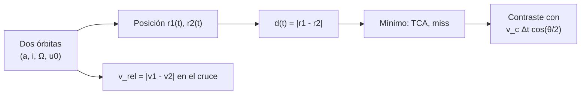

# B118-C05 — Conjunciones orbitales

<!-- nav:top -->
[🏠 Programa](../../../../README.md) · [📚 Bloque B118](../../../tronco-comun/B118-trafico-espacial-y-sostenibilidad-orbital.md) · [← Anterior: B118-C04 — Detección por radar](../B118-C04-deteccion-por-radar/CLASE.md) · [Siguiente: B118-C06 — Probabilidad de colisión →](../B118-C06-probabilidad-de-colision/CLASE.md)
<!-- /nav -->

## 1. Ubicación, nivel y alcance

Clase 5 del bloque B118. Nivel N3. Primera clase del tramo «Conjunciones y evasión». Una conjunción es un acercamiento entre dos objetos. Aquí calculas, con dos satélites **sintéticos** en órbitas circulares de 700 km (inclinaciones de 98° y 82°), el **instante de máxima aproximación (TCA), la distancia de paso y la velocidad relativa**, y los verificas con una fórmula geométrica y con la expresión analítica de la velocidad relativa. **Esta clase es educativa: no constituye asesoría legal, regulatoria, financiera ni operativa y no sustituye la lectura del texto normativo vigente ni a un profesional habilitado.**

## 2. Por qué esta clase existe

La alerta de conjunción es el producto básico del tráfico espacial. Su geometría explica por qué los encuentros son tan rápidos y por qué un pequeño desfase en el tiempo produce un cambio grande en la distancia. La decisión central: **¿a qué distancia pasan dos objetos y con qué velocidad relativa, y cómo cambia con el retraso de uno de ellos?**

## 3. Lo que podrás hacer al terminar

1. Propagar dos órbitas circulares con la solución kepleriana.
2. Hallar el TCA por barrido y refinamiento (sección áurea).
3. Comparar la velocidad relativa `2 v sin(Δi/2) = 2,0888 km/s` con la numérica.
4. Obtener la distancia de paso como `v_c · Δt · cos(θ/2)` y comprobar su linealidad con el retraso.
5. Reconocer que dos órbitas que se cruzan generan encuentros a más de 2 km/s.
6. Separar lo calculado (dos cuerpos) de lo no modelado (perturbaciones, incertidumbre).

La evidencia es la **ficha geométrica de una conjunción** del ejercicio 12 (sección 20).

## 4. Con qué llegas y cómo comprobarlo

1. ¿Qué es una órbita circular?
2. ¿Qué es el movimiento medio?
3. ¿Qué es la inclinación?
4. ¿Qué es el TCA?
5. ¿Qué es la sección áurea?

<details>
<summary>Ver respuestas</summary>

1. Una de excentricidad cero: radio y velocidad constantes. 2. `n = √(μ/a³)`, la velocidad angular media. 3. El ángulo entre el plano orbital y el ecuatorial. 4. El instante de máxima aproximación (*time of closest approach*). 5. Un método de búsqueda del mínimo de una función unimodal.
</details>

Con cuatro o cinco aciertos, sigue; si no, repasa los prerrequisitos.

## 5. Un caso de contexto y casos de referencia

Las directrices de la COPUOS (2010, consultadas) piden estimar y limitar la probabilidad de colisión accidental con objetos conocidos y considerar un ajuste del instante de lanzamiento o una maniobra de evasión si los datos orbitales indican una colisión potencial (directriz 3). El **ejemplo conductor** es el de los dos satélites sintéticos: tienen la misma altitud, se cruzan en el nodo ascendente y el segundo llega 2 s después que el primero. Los datos son sintéticos.

## 6. Vocabulario

Una **conjunción** es un acercamiento entre dos objetos. El **TCA** es el instante de mínima distancia. La **distancia de paso** (*miss distance*) es esa mínima distancia. La **velocidad relativa** `v_rel` es la diferencia vectorial de velocidades. Un **encuentro** es la situación geométrica completa. Un **nodo** es el cruce de una órbita con el plano ecuatorial.

## 7. Modelo mental



*Descripción textual:* de las dos órbitas se obtienen las posiciones en cada instante; el mínimo de la distancia da el TCA y la distancia de paso, y la velocidad relativa se contrasta con la fórmula analítica.

Analogía: dos autos que cruzan una intersección con dos segundos de diferencia; el tiempo de diferencia por la velocidad da la distancia de paso. Límite: aquí ambos van a la misma rapidez y sus trayectorias son rectas locales; la realidad añade curvatura, perturbaciones e incertidumbre.

## 8. La explicación, paso a paso

### 8.1 Geometría

Ambos satélites tienen `a = 7078,137 km`, periodo 98,77 min y velocidad circular `v_c = 7,5043 km/s`. Sus inclinaciones son 98° y 82° con el mismo nodo; las órbitas se cruzan en el nodo. El ángulo entre las velocidades en ese punto es `θ = Δi = 16°`.

### 8.2 Velocidad relativa

`v_rel = 2 v_c sin(Δi/2) = 2,0888 km/s` (analítica) frente a `2,0888 km/s` (numérica): coinciden a `10⁻⁶`.

### 8.3 Distancia de paso

Con un retraso `Δt = 2 s` del segundo satélite, cerca del cruce las trayectorias son rectas: `|P₁ − P₂|²/v_c² = t² + (t−Δt)² − 2t(t−Δt)cos θ`. El mínimo está en `t = Δt/2` y vale `miss = v_c Δt cos(θ/2) = 14,8625 km`. El TCA numérico ocurre en `t = 1,000 s` con `miss = 14,8625 km`.

### 8.4 Linealidad

Con `Δt = 4 s` el paso sube a **29,7250 km** (cociente 2,0000): la distancia es proporcional al retraso. Un error de 1 s en el momento de llegada equivale a casi 7,4 km de distancia.

## 9. Magnitudes, símbolos y unidades

| Símbolo | Qué es | Unidad | Valor / nota |
|---|---|---|---|
| `a` | semieje mayor | km | 7078,137 |
| `v_c` | velocidad circular | km/s | 7,5043 |
| `Δi` | diferencia de inclinación | grados | 16 |
| `v_rel` | velocidad relativa | km/s | 2,0888 |
| `miss` | distancia de paso | km | 14,8625 (retraso de 2 s) |

## 10. Convenciones y referencias

Sistema inercial geocéntrico (ECI) con el plano ecuatorial como referencia. Dos cuerpos, sin perturbaciones. `GM = 398 600,4418 km³/s²` (valor convencional, no consultado en esta clase). Tolerancias: 10⁻⁶ relativa en `v_rel` y 1 % en la distancia de paso. Datos sintéticos.

## 11. De dónde sale lo que afirmamos

| ID | Fuente | Localizador | Respalda | Estado |
|---|---|---|---|---|
| S1 | Space Debris Mitigation Guidelines of the Committee on the Peaceful Uses of Outer Space (UNOOSA, Viena, 2010; COPUOS 2007, resolución 62/217 de la Asamblea General) — https://www.unoosa.org/documents/pdf/psa/bsti/COPUOS_SPACE_DEBRIS_MITIGATION_GUIDELINES.pdf (consultada 2026-11-11; PDF leído con PyMuPDF) | directriz 3 | estimar y limitar la probabilidad de colisión accidental con objetos conocidos; considerar el ajuste del lanzamiento o una maniobra de evasión si los datos indican una colisión potencial | Consultada |
| — | Mecánica kepleriana de dos cuerpos y fórmula `2 v sin(Δi/2)` | — | todo el cálculo | No consultada (relaciones estándar; contrastadas numéricamente) |
| — | Dos satélites sintéticos | — | geometría del encuentro | Sintético |

Límites: de las directrices se leyó el texto completo (12 páginas); la mecánica orbital y la constante `GM` son estándar y no se consultaron.

## 12. Cómo ver los resultados

| Magnitud | Valor |
|---|---|
| Periodo | 98,77 min |
| `v_rel` analítica / numérica | 2,0888 / 2,0888 km/s |
| TCA | 1,000 s |
| Distancia de paso (2 s) | 14,8625 km |
| Distancia de paso (4 s) | 29,7250 km |

Descripción larga: la distancia de paso es proporcional al retraso; la velocidad relativa de más de 2 km/s hace que el encuentro dure unos segundos.

## 13. Ejemplo trabajado

**Paso 1 · Velocidad circular.** `v_c = √(398 600,4418/7078,137) = 7,5043 km/s`.

**Paso 2 · Velocidad relativa.** `2 × 7,5043 × sin 8° = 2,0888 km/s`.

**Paso 3 · Distancia de paso.** `7,5043 × 2 × cos 8° = 14,8625 km`.

**Paso 4 · TCA.** `t = Δt/2 = 1 s` después del cruce del primero.

## 14. Distintas formas de describir el problema

**Por geometría:** rectas locales que se cruzan. **Por tiempo:** retraso `Δt`. **Por velocidad:** `v_rel`. **Por distancia:** `miss`. **Por mínimo:** TCA.

## 15. Práctica guiada

**Ejercicio 1 · con los pasos indicados.** Calcula `v_c` a 700 km de altitud. *Pasos:* `a = 6378,137 + 700`, `√(μ/a)`.

<details><summary>Solución comentada</summary>

`7,5043 km/s`.
</details>

**Ejercicio 2 · con una pista.** Calcula `v_rel` para `Δi = 16°`. *Pista:* `2 v sin(Δi/2)`.

<details><summary>Solución comentada</summary>

`2,0888 km/s`.
</details>

**Ejercicio 3 · casi autónomo.** Calcula la distancia de paso con un retraso de 1 s.

<details><summary>Solución comentada</summary>

`7,431 km`.
</details>

## 16. Práctica autónoma, transferencia e integrador

**Ejercicio 4 · autónomo.** ¿Qué retraso da una distancia de paso de 1 km?

<details><summary>Solución comentada</summary>

`1/(7,504 × cos 8°) = 0,135 s`.
</details>

**Ejercicio 5 · autónomo.** Si `Δi = 90°` (órbitas perpendiculares), ¿cuánto vale `v_rel`?

<details><summary>Solución comentada</summary>

`2 v sin 45° = 10,613 km/s` (≈ `√2 v_c`).
</details>

**Ejercicio 6 · autónomo.** Si `Δi = 0` (órbitas coplanares), ¿qué valor tiene `v_rel` y qué pasa con la distancia?

<details><summary>Solución comentada</summary>

`v_rel = 0` en el cruce; la distancia depende solo del desfase a lo largo de la traza.
</details>

**Ejercicio 7 · autónomo.** ¿Cuántos segundos dura un encuentro a 2,09 km/s dentro de 1 km?

<details><summary>Solución comentada</summary>

`2/2,0888 = 0,96 s`.
</details>

**Ejercicio 8 · autónomo.** ¿Por qué el TCA está en `Δt/2` y no en `Δt`?

<details><summary>Solución comentada</summary>

Porque minimiza `t² + (t−Δt)² − 2t(t−Δt)cos θ`; por simetría el punto medio equilibra ambas distancias al cruce.
</details>

**Ejercicio 9 · transferencia.** **Transferencia.** Una incertidumbre de 5 s en el momento de paso, ¿qué incertidumbre lineal produce?

<details><summary>Solución comentada</summary>

`37,2 km` en la distancia de paso: el tiempo domina la incertidumbre.
</details>

**Ejercicio 10 · transferencia.** **Transferencia.** ¿Por qué los operadores calculan el TCA antes de la hora, y no esperan al cruce?

<details><summary>Solución comentada</summary>

Porque una maniobra necesita horas de antelación (B118-C07); el TCA se predice y se actualiza con cada observación.
</details>

**Ejercicio 11 · transferencia.** **Transferencia.** Un compañero dice «a 2 km/s un choque es suave». ¿Qué corriges?

<details><summary>Solución comentada</summary>

La energía cinética relativa es `½ m v²`: a 2 km/s un gramo tiene unos 2000 J; el choque es destructivo.
</details>

**Ejercicio 12 · integrador.** **Integrador.** Elabora tu *ficha geométrica de una conjunción*: parámetros, `v_rel` analítica y numérica, TCA, distancia de paso, comprobación con el retraso doble y lista de qué es sintético, estándar no consultado y consultado.

<details><summary>Solución comentada</summary>

Secciones 8.1–8.4 y la salida del laboratorio.
</details>

## 17. Laboratorio

El script [conjuncion.py](conjuncion.py) propaga dos satélites sintéticos, halla el TCA y la distancia de paso, y los contrasta con la fórmula geométrica (**comprueba** `v_rel` a 10⁻⁶ y la distancia de paso a 1 %).

**Datos:** órbitas **sintéticas**; `GM` convencional no consultado; directrices de la COPUOS **consultadas**. **Predice antes de ejecutar:** ¿qué cociente esperas entre las distancias de paso con retraso de 4 s y de 2 s? (2, por linealidad.) **Ejecución del 2026-11-11 (Python 3.12.9):**

```text
Python 3.12.9 (biblioteca estandar)
Dos satelites SINTETICOS en orbita circular de 700 km (inc 98 y 82 grados, mismo RAAN); dos cuerpos, sin perturbaciones.
Periodo 98.77 min; velocidad circular 7.5043 km/s
Velocidad relativa en el nodo: analitica 2 v sin(di/2) = 2.0888 km/s; numerica 2.0888 km/s
TCA (retraso de 2 s): t = 1.000 s respecto al nodo; distancia de paso = 14.8625 km
Distancia de paso por geometria de rectas: 14.8625 km
Con retraso de 4 s: 29.7250 km (cociente 2.0000; esperado 2 en el limite lineal)
Pruebas superadas (v_rel analitica = numerica; TCA numerico = geometria lineal a 1 %).
```

```bash
python programa/clases/B118/B118-C05-conjunciones-orbitales/conjuncion.py
```

**Límites:** dos cuerpos, sin arrastre ni achatamiento; órbitas circulares coplanares en el nodo; sin incertidumbre.

## 18. Errores frecuentes y cómo corregirlos

**Confundir distancia de paso con distancia en el instante de la alerta.** Se corrige con 8.3: el TCA es el mínimo.

**Suponer que la velocidad relativa es la suma de las velocidades.** Se corrige con el ejercicio 5.

**Ignorar el retraso temporal como fuente principal de la distancia.** Se corrige con 8.4.

**Creer que un choque a 2 km/s es leve.** Se corrige con el ejercicio 11.

## 19. Cómo sabrás que vas bien

Tras la sección 8: ¿qué distancia esperabas y cuál obtuviste? Si dudas, repasa el ejemplo 13. Tras el laboratorio: ¿qué comprueba? (ver la sección 17).

## 20. Qué entregas y cómo se evalúa

El producto es tu **ficha geométrica de una conjunción** (ejercicio 12).

| Criterio | Inicial | En desarrollo | Logrado | Destacado |
|---|---|---|---|---|
| Conceptos | Los confunde | Parciales | Calcula TCA, miss y `v_rel` | Explica los límites del modelo |
| Cálculo | Sin unidades | Con errores | Tablas completas con unidades | Calcula casos nuevos |
| Numérico | Sin comprobar | Un caso | Contraste con una segunda vía | Interpreta las diferencias |
| Fuentes | Sin fuente | Sin fecha | Fuentes con fecha, versión y estado | Declara lo ilustrativo y lo no consultado |
| Límites | No los nombra | Uno | Tres | Discute qué falta del modelo |

**Condiciones críticas (no se compensan con promedio):** rotular los datos sintéticos e ilustrativos como tales; no presentar un modelo como observación; citar solo lo consultado, con su versión y fecha; no usar la ficha como asesoría legal, regulatoria o financiera.

## 21. Ética, seguridad y límites

Clase educativa: **no constituye asesoría legal, regulatoria ni financiera** ni orienta decisiones operativas reales, y no sustituye la lectura del texto normativo vigente (se cita siempre la versión y la fecha consultadas) ni la opinión de un especialista habilitado. Los modelos son simplificados y sus datos son sintéticos o ilustrativos. Accesibilidad: tablas equivalentes a las gráficas, fórmulas en texto, ejercicios sin conexión.

## 22. Para cerrar y seguir

Dos satélites sintéticos que se cruzan con 2 s de diferencia pasan a 14,9 km con una velocidad relativa de 2,09 km/s. Queda una pregunta: si las posiciones tienen incertidumbre, ¿cuál es la probabilidad de que choquen?

**Glosario español–inglés.** conjunción · *conjunction* · instante de máxima aproximación · *time of closest approach* · distancia de paso · *miss distance* · velocidad relativa · *relative velocity* · nodo ascendente · *ascending node*.

**Continuidad.** [B118-C06](../B118-C06-probabilidad-de-colision/CLASE.md) estudia la probabilidad de colisión.

**Referencias:** ver sección 11.

<!-- nav:bottom -->
---

[← Anterior: B118-C04 — Detección por radar](../B118-C04-deteccion-por-radar/CLASE.md) · [📚 Bloque B118](../../../tronco-comun/B118-trafico-espacial-y-sostenibilidad-orbital.md) · [Siguiente: B118-C06 — Probabilidad de colisión →](../B118-C06-probabilidad-de-colision/CLASE.md)
<!-- /nav -->
