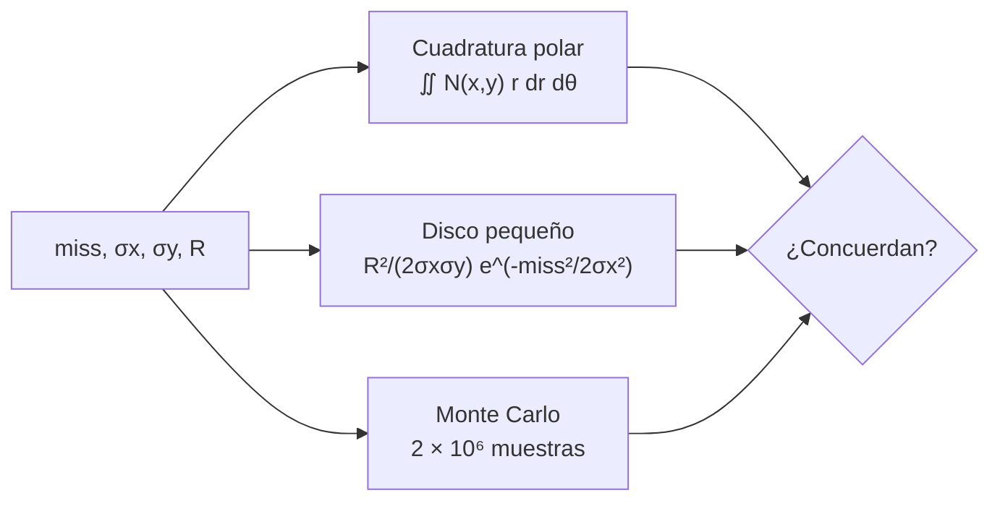

# B118-C06 — Probabilidad de colisión

<!-- nav:top -->
[🏠 Programa](../../../../README.md) · [📚 Bloque B118](../../../tronco-comun/B118-trafico-espacial-y-sostenibilidad-orbital.md) · [← Anterior: B118-C05 — Conjunciones orbitales](../B118-C05-conjunciones-orbitales/CLASE.md) · [Siguiente: B118-C07 — Estrategias de evasión →](../B118-C07-estrategias-de-evasion/CLASE.md)
<!-- /nav -->

## 1. Ubicación, nivel y alcance

Clase 6 del bloque B118. Nivel N4. Segunda clase del tramo «Conjunciones y evasión». La probabilidad de colisión `Pc` convierte una distancia de paso y una incertidumbre en un número. Aquí integras una **gaussiana 2D sobre el disco de radio combinado** en el plano de encuentro, por tres vías (cuadratura, aproximación de disco pequeño y Monte Carlo), y ves el fenómeno de la **dilución**: más incertidumbre puede dar una `Pc` menor. Los eventos son **sintéticos**. **Esta clase es educativa: no constituye asesoría legal, regulatoria, financiera ni operativa y no sustituye la lectura del texto normativo vigente ni a un profesional habilitado.**

## 2. Por qué esta clase existe

Las alertas se priorizan por `Pc`, pero ese número depende de la covarianza que se suponga. La decisión central: **¿cuándo es fiable una `Pc` y cuándo es baja solo porque la incertidumbre es enorme?**

## 3. Lo que podrás hacer al terminar

1. Plantear la `Pc` como integral de una gaussiana 2D sobre un disco en el plano de encuentro.
2. Calcular la `Pc` por cuadratura polar, por aproximación de disco pequeño y por Monte Carlo.
3. Comprobar que las tres vías coinciden (relación `0,9992` en el caso A).
4. Reconocer la dilución: la `Pc` máxima aparece con una incertidumbre intermedia.
5. Aplicar `Pc ≈ R²/(2σₓσᵧ)` con miss cero y verificar su exactitud.
6. Rotular que ni los eventos ni los umbrales son reales.

La evidencia es la **ficha de probabilidad de colisión de dos eventos** del ejercicio 12 (sección 20).

## 4. Con qué llegas y cómo comprobarlo

1. ¿Qué es una gaussiana 2D?
2. ¿Qué es un plano de encuentro?
3. ¿Qué es el radio combinado?
4. ¿Qué es una integral en coordenadas polares?
5. ¿Qué es el error estándar de Monte Carlo?

<details>
<summary>Ver respuestas</summary>

1. Una distribución normal en dos variables, aquí con desviaciones `σₓ` y `σᵧ` independientes. 2. El plano perpendicular a la velocidad relativa que contiene los dos objetos en el TCA. 3. La suma de los radios equivalentes de los dos objetos. 4. `∬ f r dr dθ`. 5. `√(k)/n` para un conteo `k` de `n` ensayos.
</details>

Con cuatro o cinco aciertos, sigue; si no, repasa los prerrequisitos.

## 5. Un caso de contexto y casos de referencia

Las directrices de la COPUOS (2010, consultadas) piden estimar y limitar la probabilidad de colisión (directriz 3), pero **no dan una fórmula ni un umbral**; las directrices IADC Rev. 4 (consultadas) tampoco. El **ejemplo conductor** son dos eventos sintéticos: el caso A (miss 200 m, sigmas 150 × 100 m, radio 10 m) y el caso B (miss 50 m, sigmas 60 × 40 m, radio 20 m). Los umbrales operativos de ninguna agencia se consultaron.

## 6. Vocabulario

La **probabilidad de colisión** `Pc` es la probabilidad de que la posición relativa caiga en el disco de radio `R`. El **radio combinado** `R` suma los radios de ambos objetos. La **covarianza** `(σₓ, σᵧ)` describe la incertidumbre de la posición relativa en el plano. La **dilución** es la caída de `Pc` al crecer la incertidumbre muy por encima del tamaño del disco. El **disco pequeño** es la aproximación en la que la gaussiana es casi constante en el disco.

## 7. Modelo mental



*Descripción textual:* los mismos datos de entrada pasan por tres métodos independientes; si concuerdan, el cálculo es fiable dentro de su tolerancia.

Analogía: lanzar dardos con puntería borrosa a un blanco pequeño; si la dispersión es enorme la probabilidad de acertar baja, no porque el blanco esté lejos sino porque los dardos van a todas partes. Límite: se supone covarianza constante, gaussiana e independiente en los dos ejes, y encuentro corto (movimiento rectilíneo).

## 8. La explicación, paso a paso

### 8.1 La integral

`Pc = (1/2πσₓσᵧ) ∬_disco exp[−½((x−m)²/σₓ² + y²/σᵧ²)] dx dy`, con `m` el desfase (miss) y `R` el radio del disco.

### 8.2 Tres vías

**Caso A** (miss 200 m, `σ` 150 × 100 m, `R` 10 m): cuadratura `1,3693 × 10⁻³`; disco pequeño `1,3704 × 10⁻³`; relación `0,9992`. **Caso B** (miss 50 m, `σ` 60 × 40 m, `R` 20 m): cuadratura `0,05686`; Monte Carlo `0,05668 ± 0,00017`.

### 8.3 Dilución

Con miss 200 m, `R` 10 m y sigma isótropa: 20 m → `2,15 × 10⁻²²`; 100 m → `6,78 × 10⁻⁴`; 200 m → `7,58 × 10⁻⁴`; 800 m → `7,57 × 10⁻⁵`; 1600 m → `1,94 × 10⁻⁵`. El máximo está en `σ = 200 m`: con una incertidumbre pequeña el objeto «seguro» pasa lejos; con una enorme, la probabilidad se reparte.

### 8.4 Miss cero

Con miss 0 y `σ` 150 × 100 m, `R` 10 m: cuadratura `3,3273 × 10⁻³` frente a `R²/(2σₓσᵧ) = 3,3333 × 10⁻³`.

## 9. Magnitudes, símbolos y unidades

| Símbolo | Qué es | Unidad | Valor / nota |
|---|---|---|---|
| `m` | distancia de paso | m | 200 (caso A) |
| `σₓ`, `σᵧ` | desviaciones de la posición relativa | m | 150, 100 |
| `R` | radio combinado | m | 10 |
| `Pc` | probabilidad de colisión | adimensional | 1,369 × 10⁻³ |
| `σ*` | sigma de dilución máxima | m | 200 |

## 10. Convenciones y referencias

Plano de encuentro: `x` a lo largo del desfase, `y` perpendicular. Longitudes en m, `Pc` adimensional. Cuadratura polar de 300 × 300 puntos (120 × 120 en el barrido); Monte Carlo con semilla 118 y 2 × 10⁶ muestras. Datos sintéticos; la covarianza se toma como dato.

## 11. De dónde sale lo que afirmamos

| ID | Fuente | Localizador | Respalda | Estado |
|---|---|---|---|---|
| S1 | Space Debris Mitigation Guidelines of the Committee on the Peaceful Uses of Outer Space (UNOOSA, Viena, 2010; COPUOS 2007, resolución 62/217 de la Asamblea General) — https://www.unoosa.org/documents/pdf/psa/bsti/COPUOS_SPACE_DEBRIS_MITIGATION_GUIDELINES.pdf (consultada 2026-11-11; PDF leído con PyMuPDF) | directriz 3 | estimar y limitar la probabilidad de colisión accidental con objetos conocidos | Consultada |
| S3 | IADC Space Debris Mitigation Guidelines, IADC-02-01 Rev. 4 (enero de 2025), presentadas como A/AC.105/C.1/2025/CRP.9 (3 de febrero de 2025) — https://www.unoosa.org/res/oosadoc/data/documents/2025/aac_105c_12025crp/aac_105c_12025crp_9_0_html/AC105_C1_2025_CRP09E.pdf (consultada 2026-11-11; PDF leído con PyMuPDF) | sección 5.4 | la IADC pide estimar y limitar la probabilidad de colisión accidental con objetos conocidos durante la vida orbital | Consultada |
| — | Fórmulas de `Pc` 2D (cuadratura, disco pequeño) y literatura de Chan o Alfano | — | todo el cálculo | No consultada (relaciones estándar; contrastadas por tres vías) |
| — | Umbrales operativos de `Pc` de agencias | — | decisión de maniobra | No consultada |
| — | Eventos A y B | — | casos numéricos | Sintético |

Límites: ni las directrices de la COPUOS ni las de la IADC dan la fórmula o un umbral de `Pc`; los métodos son estándar y no se consultaron en una fuente concreta.

## 12. Cómo ver los resultados

| Magnitud | Valor |
|---|---|
| Caso A, cuadratura | 1,369 × 10⁻³ |
| Caso A, disco pequeño | 1,370 × 10⁻³ |
| Caso B, cuadratura | 0,05686 |
| Caso B, Monte Carlo | 0,05668 ± 0,00017 |
| `σ*` de dilución | 200 m |

Descripción larga: las tres vías coinciden; la curva de `Pc` frente a `σ` sube hasta unos 200 m y después cae, y con `σ` de 20 m es prácticamente cero.

## 13. Ejemplo trabajado

**Paso 1 · Datos.** Caso A: miss 200 m, `σₓ` 150 m, `σᵧ` 100 m, `R` 10 m.

**Paso 2 · Exponencial.** `exp(−½ (200/150)²) = 0,4111`.

**Paso 3 · Prefactor.** `R²/(2σₓσᵧ) = 100/(2 × 150 × 100) = 0,00333`.

**Paso 4 · Producto.** `Pc ≈ 1,3704 × 10⁻³` (cuadratura: `1,3693 × 10⁻³`).

## 14. Distintas formas de describir el problema

**Por integral:** cuadratura. **Por aproximación:** disco pequeño. **Por simulación:** Monte Carlo. **Por barrido:** dilución. **Por límite:** miss cero.

## 15. Práctica guiada

**Ejercicio 1 · con los pasos indicados.** Calcula `R²/(2σₓσᵧ)` para `R` = 10 m, `σₓ` = 150 m, `σᵧ` = 100 m. *Pasos:* numerador y denominador.

<details><summary>Solución comentada</summary>

`100/30 000 = 0,00333`.
</details>

**Ejercicio 2 · con una pista.** Calcula el factor `exp(−½ (m/σₓ)²)` con `m` = 200 m y `σₓ` = 150 m.

<details><summary>Solución comentada</summary>

`0,4111`.
</details>

**Ejercicio 3 · casi autónomo.** Con esos dos factores obtén la `Pc` aproximada. *Pista:* multiplícalos.

<details><summary>Solución comentada</summary>

`1,370 × 10⁻³`.
</details>

## 16. Práctica autónoma, transferencia e integrador

**Ejercicio 4 · autónomo.** Si `R` se duplica, ¿cuánto crece la `Pc` (disco pequeño)?

<details><summary>Solución comentada</summary>

Cuatro veces: depende de `R²`.
</details>

**Ejercicio 5 · autónomo.** Si `σₓ` y `σᵧ` se duplican con miss cero, ¿cuánto cae la `Pc`?

<details><summary>Solución comentada</summary>

Cuatro veces: depende de `1/(σₓσᵧ)`.
</details>

**Ejercicio 6 · autónomo.** Con miss cero, `R` = 5 m y `σ` = 50 × 50 m, calcula la `Pc`.

<details><summary>Solución comentada</summary>

`25/(2 × 2500) = 0,0050`.
</details>

**Ejercicio 7 · autónomo.** ¿Cuántos sigmas de error estándar separan el Monte Carlo (0,05668) de la cuadratura (0,05686) en el caso B?

<details><summary>Solución comentada</summary>

`|0,05668 − 0,05686| / 0,00017 = 1,06`.
</details>

**Ejercicio 8 · autónomo.** ¿Por qué con `σ` = 20 m la `Pc` del caso del barrido es casi cero aunque la incertidumbre sea pequeña?

<details><summary>Solución comentada</summary>

Porque el miss (200 m) son 10 sigmas: el disco queda en la cola, `exp(−50)`.
</details>

**Ejercicio 9 · transferencia.** **Transferencia.** Un operador reporta `Pc = 10⁻⁸` con una covarianza gigantesca. ¿Es una buena noticia?

<details><summary>Solución comentada</summary>

No necesariamente: puede ser dilución; hay que mirar la covarianza y mejorar las observaciones.
</details>

**Ejercicio 10 · transferencia.** **Transferencia.** ¿Por qué se usa el radio combinado y no el área de cada objeto por separado?

<details><summary>Solución comentada</summary>

Porque la colisión ocurre si los centros están a menos de la suma de los radios; el disco combinado representa esa condición en el plano de encuentro.
</details>

**Ejercicio 11 · transferencia.** **Transferencia.** Tu equipo propone «maniobrar si `Pc > 10⁻⁴`» citando la ONU. ¿Qué respondes?

<details><summary>Solución comentada</summary>

Que el texto de la COPUOS consultado no da ese umbral; es un valor de política de cada operador o agencia, que habría que citar de su fuente.
</details>

**Ejercicio 12 · integrador.** **Integrador.** Elabora tu *ficha de probabilidad de colisión de dos eventos*: datos, `Pc` por tres vías, comparación en errores estándar, curva de dilución y lista de qué es consultado, estándar no consultado y sintético.

<details><summary>Solución comentada</summary>

Secciones 8.1–8.4 y la salida del laboratorio.
</details>

## 17. Laboratorio

El script [pc.py](pc.py) calcula la `Pc` de dos eventos sintéticos por cuadratura, disco pequeño y Monte Carlo y barre la incertidumbre (**comprueba** el acuerdo de las tres vías y el máximo de dilución).

**Datos:** eventos **sintéticos**; cuadratura y Monte Carlo propios; ninguna fórmula consultada en una fuente concreta. **Predice antes de ejecutar:** ¿en qué `σ` isótropa será máxima la `Pc` para miss 200 m? (en torno a 200 m, del orden del miss.) **Ejecución del 2026-11-11 (Python 3.12.9):**

```text
Python 3.12.9 (biblioteca estandar)
Eventos SINTETICOS en el plano de encuentro; relaciones estandar de la Pc 2D (no consultadas en una fuente concreta).
Caso A: miss 200 m, sigmas 150 x 100 m, R 10 m
  Pc cuadratura = 1.3693e-03; disco pequeno = 1.3704e-03; relacion 0.9992
Caso B: miss 50 m, sigmas 60 x 40 m, R 20 m
  Pc cuadratura = 0.05686; Monte Carlo (2e6) = 0.05668 +- 0.00017
Dilucion (miss 200 m, R 10 m, sigma isotropica):
  sigma    20 m  Pc = 2.1477e-22
  sigma    50 m  Pc = 7.1865e-06
  sigma   100 m  Pc = 6.7837e-04
  sigma   200 m  Pc = 7.5793e-04
  sigma   400 m  Pc = 2.7574e-04
  sigma   800 m  Pc = 7.5718e-05
  sigma  1600 m  Pc = 1.9379e-05
Pc maxima en sigma = 200 m (no en la covarianza mas pequena)
Miss 0, 150 x 100 m, R 10 m: cuadratura 3.3273e-03; R^2/(2 sx sy) = 3.3333e-03
Pruebas superadas (tres vias de calculo concordantes; maximo de dilucion).
```

```bash
python programa/clases/B118/B118-C06-probabilidad-de-colision/pc.py
```

**Límites:** covarianza gaussiana, constante e isótropa en el barrido; encuentro corto; sin correlaciones ni incertidumbre de forma del objeto.

## 18. Errores frecuentes y cómo corregirlos

**Pensar que menos `Pc` siempre es más seguro.** Se corrige con 8.3.

**Usar el área en vez del radio en la fórmula.** Se corrige con el ejercicio 4.

**Citar un umbral de maniobra como si lo fijara la ONU.** Se corrige con el ejercicio 11.

**Aplicar el disco pequeño cuando `R` no es pequeño frente a `σ`.** Se corrige con la comparación de 8.2.

## 19. Cómo sabrás que vas bien

Tras la sección 8: ¿qué `Pc` esperabas en el caso A y cuál obtuviste? Si dudas, repasa el ejemplo 13. Tras el laboratorio: ¿qué comprueba? (ver la sección 17).

## 20. Qué entregas y cómo se evalúa

El producto es tu **ficha de probabilidad de colisión de dos eventos** (ejercicio 12).

| Criterio | Inicial | En desarrollo | Logrado | Destacado |
|---|---|---|---|---|
| Conceptos | Los confunde | Parciales | Calcula `Pc` y explica la dilución | Explica los límites del modelo |
| Cálculo | Sin unidades | Con errores | Tablas completas con unidades | Calcula casos nuevos |
| Numérico | Sin comprobar | Un caso | Contraste con una segunda vía | Interpreta las diferencias |
| Fuentes | Sin fuente | Sin fecha | Fuentes con fecha, versión y estado | Declara lo ilustrativo y lo no consultado |
| Límites | No los nombra | Uno | Tres | Discute qué falta del modelo |

**Condiciones críticas (no se compensan con promedio):** rotular los datos sintéticos e ilustrativos como tales; no presentar un modelo como observación; citar solo lo consultado, con su versión y fecha; no usar la ficha como asesoría legal, regulatoria o financiera.

## 21. Ética, seguridad y límites

Clase educativa: **no constituye asesoría legal, regulatoria ni financiera** ni orienta decisiones operativas reales, y no sustituye la lectura del texto normativo vigente (se cita siempre la versión y la fecha consultadas) ni la opinión de un especialista habilitado. Los modelos son simplificados y sus datos son sintéticos o ilustrativos. Accesibilidad: tablas equivalentes a las gráficas, fórmulas en texto, ejercicios sin conexión.

## 22. Para cerrar y seguir

La `Pc` del caso A es 1,37 × 10⁻³ por tres vías coincidentes, y su valor máximo frente a la incertidumbre aparece en torno a 200 m. Queda una pregunta: si la `Pc` es alta, ¿cuánto hay que maniobrar para bajarla?

**Glosario español–inglés.** probabilidad de colisión · *collision probability* · plano de encuentro · *encounter plane* · covarianza · *covariance* · dilución · *probability dilution* · radio combinado · *combined hard-body radius*.

**Continuidad.** [B118-C07](../B118-C07-estrategias-de-evasion/CLASE.md) estudia las estrategias de evasión.

**Referencias:** ver sección 11.

<!-- nav:bottom -->
---

[← Anterior: B118-C05 — Conjunciones orbitales](../B118-C05-conjunciones-orbitales/CLASE.md) · [📚 Bloque B118](../../../tronco-comun/B118-trafico-espacial-y-sostenibilidad-orbital.md) · [Siguiente: B118-C07 — Estrategias de evasión →](../B118-C07-estrategias-de-evasion/CLASE.md)
<!-- /nav -->
