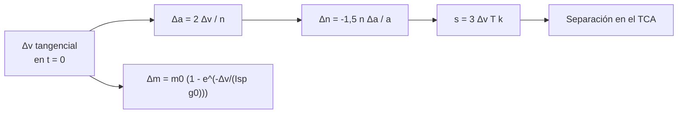

# B118-C07 — Estrategias de evasión

<!-- nav:top -->
[🏠 Programa](../../../../README.md) · [📚 Bloque B118](../../../tronco-comun/B118-trafico-espacial-y-sostenibilidad-orbital.md) · [← Anterior: B118-C06 — Probabilidad de colisión](../B118-C06-probabilidad-de-colision/CLASE.md) · [Siguiente: B118-C08 — Propagación de incertidumbre en conjunciones →](../B118-C08-propagacion-de-incertidumbre-en-conjunciones/CLASE.md)
<!-- /nav -->

## 1. Ubicación, nivel y alcance

Clase 7 del bloque B118. Nivel N4. Tercera clase del tramo «Conjunciones y evasión». Una maniobra de evasión desplaza a un satélite a lo largo de su traza para que, en el TCA, el otro objeto pase lejos. Aquí calculas, con un satélite **sintético** de 550 km, la **velocidad (Δv) necesaria para una separación dada**, su coste en combustible y cómo se encarece esperar, y lo verificas con una propagación kepleriana exacta. Masa e impulso específico son **ilustrativos**. **Esta clase es educativa: no constituye asesoría legal, regulatoria, financiera ni operativa y no sustituye la lectura del texto normativo vigente ni a un profesional habilitado.**

## 2. Por qué esta clase existe

La evasión es la respuesta operativa a una conjunción, pero cada maniobra cuesta combustible y vida útil. La decisión central: **¿cuánto Δv hace falta para lograr una separación dada y cuánto más cuesta decidir tarde?**

## 3. Lo que podrás hacer al terminar

1. Deducir que un Δv tangencial produce una separación a lo largo de la traza `s = 3 Δv T k` tras `k` órbitas.
2. Verificar la fórmula con Kepler (relación `1,0001`).
3. Obtener el Δv para 5 km de separación tras 2 órbitas (`0,145 m/s`).
4. Calcular el combustible con la ecuación de Tsiolkovsky.
5. Ver que el Δv cae como `1/k` al dar más órbitas de antelación.
6. Reconocer que la maniobra no cambia la incertidumbre de las posiciones.

La evidencia es la **ficha de maniobra de evasión** del ejercicio 12 (sección 20).

## 4. Con qué llegas y cómo comprobarlo

1. ¿Qué es un impulso tangencial?
2. ¿Qué es el periodo orbital?
3. ¿Qué es la ecuación de Tsiolkovsky?
4. ¿Por qué un impulso hacia delante eleva la órbita?
5. ¿Qué es un TCA?

<details>
<summary>Ver respuestas</summary>

1. Un cambio de velocidad en la dirección del movimiento. 2. `T = 2π √(a³/μ)`. 3. `Δm = m₀ (1 − exp(−Δv/(Isp g₀)))`. 4. Aumenta la energía y, con ella, el semieje mayor y el periodo. 5. El instante de máxima aproximación.
</details>

Con cuatro o cinco aciertos, sigue; si no, repasa los prerrequisitos.

## 5. Un caso de contexto y casos de referencia

La directriz 3 de la COPUOS (2010, consultada) indica que, si los datos orbitales señalan una colisión potencial, se debe considerar el ajuste del instante de lanzamiento o una maniobra de evasión en órbita. El **ejemplo conductor** es un satélite sintético de 500 kg e Isp 220 s en una órbita circular de 550 km que ejecuta un impulso tangencial de 0,2 m/s dos órbitas antes del TCA.

## 6. Vocabulario

Una **maniobra de evasión** cambia la órbita para evitar una conjunción. El **Δv** es la variación de velocidad. La **deriva a lo largo de la traza** es el desplazamiento que se acumula por la diferencia de periodo. El **Isp** (impulso específico) mide la eficiencia del propulsor. La **ecuación de Tsiolkovsky** relaciona Δv y masa de propelente. Una **órbita de antelación** es una vuelta completa antes del TCA.

## 7. Modelo mental



*Descripción textual:* un impulso tangencial cambia el semieje y con él el movimiento medio; la diferencia de fase se acumula con las órbitas y produce la separación a lo largo de la traza; el mismo Δv da el consumo por Tsiolkovsky.

Analogía: dos corredores en una pista circular; si uno acelera apenas, tras varias vueltas la distancia entre ambos crece. Límite: aquí la órbita es circular, no hay arrastre y el impulso es instantáneo.

## 8. La explicación, paso a paso

### 8.1 La fórmula

Un impulso `Δv` tangencial en una órbita circular cambia el semieje en `Δa = 2 Δv/n`. El movimiento medio cambia `Δn = −1,5 n Δa/a`; tras `k` órbitas la separación a lo largo de la traza es `s = a Δn T k ≈ 3 Δv T k`, con `T = 5739,0 s`.

### 8.2 Contraste con Kepler

Con `Δv = 0,20 m/s` y `k = 2`: `s_lineal = 6,887 km` y `s_exacta = 6,888 km` (relación 1,0001). El signo contrario da la separación opuesta (cociente -0,9998).

### 8.3 Δv para 5 km

`Δv = 5 km/(3 T k) = 0,1452 m/s` para `k = 2`; la propagación exacta devuelve 5,000 km. Combustible (500 kg, Isp 220 s): **33,65 g**.

### 8.4 El coste de esperar

Δv para 5 km según las órbitas disponibles: 0,5 órbitas → 0,581 m/s; 1 → 0,290 m/s; 2 → 0,145 m/s; 4 → 0,073 m/s. Dar el doble de antelación reduce a la mitad el Δv.

### 8.5 Qué no resuelve

Con la `Pc` de B118-C06 (miss inicial 100 m, `σ` 300 × 100 m, `R` 10 m) la `Pc` pasa de 1,58 × 10⁻³ a 8,00 × 10⁻⁶⁴ con 5 km de separación; pero eso supone que la covarianza **no crece** y que la maniobra no tiene error. En la realidad se debe vigilar que no cree una conjunción nueva.

## 9. Magnitudes, símbolos y unidades

| Símbolo | Qué es | Unidad | Valor / nota |
|---|---|---|---|
| `T` | periodo | s | 5739,0 |
| `Δv` | impulso tangencial | m/s | 0,20 |
| `s` | separación a lo largo de la traza | km | 6,888 |
| `Isp` | impulso específico | s | 220 (ilustrativo) |
| `Δm` | propelente | g | 33,65 (para 5 km) |

## 10. Convenciones y referencias

Plano orbital inercial; impulso en `t = 0` en `x = a`. Longitudes en km, velocidades en m/s (km/s en el código). `GM = 398 600,4418 km³/s²` (convencional, no consultado). `g₀ = 9,80665 m/s²`. Datos sintéticos e ilustrativos; no sirve para planificar maniobras reales.

## 11. De dónde sale lo que afirmamos

| ID | Fuente | Localizador | Respalda | Estado |
|---|---|---|---|---|
| S1 | Space Debris Mitigation Guidelines of the Committee on the Peaceful Uses of Outer Space (UNOOSA, Viena, 2010; COPUOS 2007, resolución 62/217 de la Asamblea General) — https://www.unoosa.org/documents/pdf/psa/bsti/COPUOS_SPACE_DEBRIS_MITIGATION_GUIDELINES.pdf (consultada 2026-11-11; PDF leído con PyMuPDF) | directriz 3 | considerar el ajuste del instante de lanzamiento o una maniobra de evasión si los datos orbitales indican una colisión potencial | Consultada |
| — | Dinámica relativa (Clohessy–Wiltshire), Kepler y Tsiolkovsky | — | todo el cálculo | No consultada (relaciones estándar; contrastadas con Kepler exacto) |
| — | Masa de 500 kg, Isp 220 s | — | combustible | Ilustrativo |

Límites: de la directriz solo se usa la recomendación general; los valores de Δv y de masa no provienen de ninguna misión ni de ningún procedimiento operativo.

## 12. Cómo ver los resultados

| Magnitud | Valor |
|---|---|
| `s` exacta / lineal (2 órbitas, 0,2 m/s) | 6,888 / 6,887 km |
| Δv para 5 km (2 órbitas) | 0,1452 m/s |
| Combustible | 33,65 g |
| Δv con 0,5 órbitas | 0,581 m/s |
| Δv con 4 órbitas | 0,073 m/s |

Descripción larga: el Δv necesario cae como el inverso del número de órbitas disponibles; el combustible es pequeño porque el impulso es de decímetros por segundo.

## 13. Ejemplo trabajado

**Paso 1 · Periodo.** `T = 5739,0 s`.

**Paso 2 · Separación por órbita.** `3 Δv T = 3 × 0,0002 × 5739,0 = 3,443 km` por órbita.

**Paso 3 · Dos órbitas.** `6,887 km` (la propagación exacta da 6,888 km).

**Paso 4 · Δv para 5 km.** `5/(3 × 5739,0 × 2) × 1000 = 0,1452 m/s`.

## 14. Distintas formas de describir el problema

**Por fórmula:** `s = 3 Δv T k`. **Por propagación:** Kepler exacto. **Por combustible:** Tsiolkovsky. **Por tiempo:** órbitas de antelación. **Por riesgo:** `Pc` antes y después.

## 15. Práctica guiada

**Ejercicio 1 · con los pasos indicados.** Calcula la separación por órbita para `Δv` = 0,1 m/s con `T` = 5739 s. *Pasos:* `3 Δv T`.

<details><summary>Solución comentada</summary>

`3 × 0,0001 × 5739 = 1,722 km`.
</details>

**Ejercicio 2 · con una pista.** Calcula `Δv` para 2 km tras 1 órbita. *Pista:* `s/(3 T k)`.

<details><summary>Solución comentada</summary>

`2/(3 × 5739) × 1000 = 0,116 m/s`.
</details>

**Ejercicio 3 · casi autónomo.** Calcula el propelente para `Δv` = 0,5 m/s con 500 kg e Isp 220 s.

<details><summary>Solución comentada</summary>

`500 × (1 − exp(−0,5/2157,5)) = 115,9 g`.
</details>

## 16. Práctica autónoma, transferencia e integrador

**Ejercicio 4 · autónomo.** Si se dispone de 3 órbitas, ¿cuánto Δv ahorras frente a 1 para la misma separación?

<details><summary>Solución comentada</summary>

Un tercio: `Δv ∝ 1/k`.
</details>

**Ejercicio 5 · autónomo.** Si el impulso es hacia atrás, ¿qué ocurre con la separación?

<details><summary>Solución comentada</summary>

Cambia de signo: el satélite queda detrás (cociente de simetría ≈ −1).
</details>

**Ejercicio 6 · autónomo.** Con el periodo de 5739,0 s, ¿cuántas órbitas caben en 6 h?

<details><summary>Solución comentada</summary>

`21600/5739,0 = 3,76`.
</details>

**Ejercicio 7 · autónomo.** ¿Por qué el combustible es tan pequeño en esta clase?

<details><summary>Solución comentada</summary>

Porque separaciones de km con varias órbitas de antelación exigen solo decímetros por segundo.
</details>

**Ejercicio 8 · autónomo.** ¿Qué magnitud cambia si el impulso es radial en vez de tangencial?

<details><summary>Solución comentada</summary>

Casi no produce deriva secular; solo oscila (es un cambio de excentricidad): sirve para maniobras de corta antelación.
</details>

**Ejercicio 9 · transferencia.** **Transferencia.** ¿Por qué esperar a último momento encarece la maniobra?

<details><summary>Solución comentada</summary>

Porque quedan menos órbitas para acumular deriva y el Δv crece como `1/k`; además hay menos tiempo para verificar la nueva órbita.
</details>

**Ejercicio 10 · transferencia.** **Transferencia.** Un equipo dice «con 0,1 m/s siempre nos salvamos». ¿Qué falta?

<details><summary>Solución comentada</summary>

El número de órbitas de antelación, el periodo y la separación necesaria; sin ellos el Δv no determina el resultado.
</details>

**Ejercicio 11 · transferencia.** **Transferencia.** ¿Qué riesgo nuevo introduce una maniobra?

<details><summary>Solución comentada</summary>

Crear una conjunción con otro objeto, un error de ejecución y consumo de vida útil; por eso se vuelve a evaluar la órbita posterior.
</details>

**Ejercicio 12 · integrador.** **Integrador.** Elabora tu *ficha de maniobra de evasión*: fórmula, contraste con Kepler, Δv y combustible para 5 km, tabla de Δv según la antelación, efecto en la `Pc` y lista de qué es ilustrativo y estándar no consultado.

<details><summary>Solución comentada</summary>

Secciones 8.1–8.5 y la salida del laboratorio.
</details>

## 17. Laboratorio

El script [evasion.py](evasion.py) propaga con Kepler un satélite sintético tras un impulso tangencial y compara la separación con `3 Δv T k` (**comprueba** la fórmula a 2 %, la simetría de signo y el objetivo de 5 km).

**Datos:** satélite **sintético**; masa 500 kg e Isp 220 s **ilustrativos**; dinámica de dos cuerpos estándar no consultada. **Predice antes de ejecutar:** ¿qué Δv necesitas para 5 km con 2 órbitas de antelación? (del orden de 0,15 m/s.) **Ejecución del 2026-11-11 (Python 3.12.9):**

```text
Python 3.12.9 (biblioteca estandar)
Satelite SINTETICO en orbita circular de 550 km; masa 500 kg e Isp 220 s ILUSTRATIVOS; dos cuerpos sin arrastre.
Periodo 5739.0 s; maniobra tangencial de 0.20 m/s
Separacion a lo largo de la traza tras 2 orbitas: exacta 6.888 km; lineal 3 dv T k = 6.887 km; relacion 1.0001
dv necesario para 5 km tras 2 orbitas: 0.1452 m/s (comprobado: 5.000 km)
Simetria del signo: -0.9998 (esperado -1)
Combustible (Tsiolkovsky) para ese dv: 33.65 g
dv necesario segun las orbitas disponibles antes del TCA:
  0.5 orbitas -> 0.581 m/s
  1.0 orbitas -> 0.290 m/s
  2.0 orbitas -> 0.145 m/s
  4.0 orbitas -> 0.073 m/s
Pc antes (miss 100 m) = 1.577e-03; despues (5 km a lo largo) = 8.001e-64
Pruebas superadas (formula lineal vs Kepler a 2 %; simetria de signo; objetivo de 5 km).
```

```bash
python programa/clases/B118/B118-C07-estrategias-de-evasion/evasion.py
```

**Límites:** órbita circular, sin arrastre ni achatamiento, impulso instantáneo y sin error de ejecución; la covarianza no crece.

## 18. Errores frecuentes y cómo corregirlos

**Creer que un Δv grande siempre es mejor.** Se corrige con 8.4: el tiempo importa más.

**Olvidar que el signo del impulso invierte la separación.** Se corrige con el ejercicio 5.

**Suponer que la maniobra elimina la incertidumbre.** Se corrige con 8.5.

**Usar la fórmula lineal con impulsos radiales.** Se corrige con el ejercicio 8.

## 19. Cómo sabrás que vas bien

Tras la sección 8: ¿qué Δv esperabas y cuál obtuviste? Si dudas, repasa el ejemplo 13. Tras el laboratorio: ¿qué comprueba? (ver la sección 17).

## 20. Qué entregas y cómo se evalúa

El producto es tu **ficha de maniobra de evasión** (ejercicio 12).

| Criterio | Inicial | En desarrollo | Logrado | Destacado |
|---|---|---|---|---|
| Conceptos | Los confunde | Parciales | Calcula Δv, deriva y combustible | Explica los límites del modelo |
| Cálculo | Sin unidades | Con errores | Tablas completas con unidades | Calcula casos nuevos |
| Numérico | Sin comprobar | Un caso | Contraste con una segunda vía | Interpreta las diferencias |
| Fuentes | Sin fuente | Sin fecha | Fuentes con fecha, versión y estado | Declara lo ilustrativo y lo no consultado |
| Límites | No los nombra | Uno | Tres | Discute qué falta del modelo |

**Condiciones críticas (no se compensan con promedio):** rotular los datos sintéticos e ilustrativos como tales; no presentar un modelo como observación; citar solo lo consultado, con su versión y fecha; no usar la ficha como asesoría legal, regulatoria o financiera.

## 21. Ética, seguridad y límites

Clase educativa: **no constituye asesoría legal, regulatoria ni financiera** ni orienta decisiones operativas reales, y no sustituye la lectura del texto normativo vigente (se cita siempre la versión y la fecha consultadas) ni la opinión de un especialista habilitado. Los modelos son simplificados y sus datos son sintéticos o ilustrativos. Accesibilidad: tablas equivalentes a las gráficas, fórmulas en texto, ejercicios sin conexión.

## 22. Para cerrar y seguir

Con dos órbitas de antelación bastan 0,15 m/s (34 g de propelente) para 5 km de separación; con media órbita harían falta 0,58 m/s. Queda una pregunta: ¿qué tan bien conocemos las posiciones que usamos para decidir?

**Glosario español–inglés.** maniobra de evasión · *collision avoidance maneuver* · impulso específico · *specific impulse* · deriva a lo largo de la traza · *along-track drift* · ecuación del cohete · *rocket equation* · antelación · *lead time*.

**Continuidad.** [B118-C08](../B118-C08-propagacion-de-incertidumbre-en-conjunciones/CLASE.md) estudia la propagación de incertidumbre en conjunciones.

**Referencias:** ver sección 11.

<!-- nav:bottom -->
---

[← Anterior: B118-C06 — Probabilidad de colisión](../B118-C06-probabilidad-de-colision/CLASE.md) · [📚 Bloque B118](../../../tronco-comun/B118-trafico-espacial-y-sostenibilidad-orbital.md) · [Siguiente: B118-C08 — Propagación de incertidumbre en conjunciones →](../B118-C08-propagacion-de-incertidumbre-en-conjunciones/CLASE.md)
<!-- /nav -->
