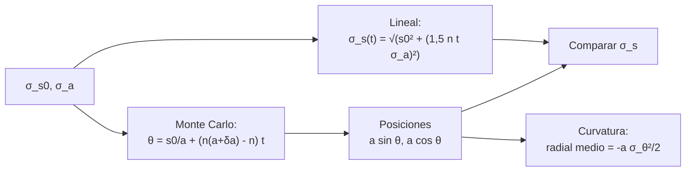

# B118-C08 — Propagación de incertidumbre en conjunciones

<!-- nav:top -->
[🏠 Programa](../../../../README.md) · [📚 Bloque B118](../../../tronco-comun/B118-trafico-espacial-y-sostenibilidad-orbital.md) · [← Anterior: B118-C07 — Estrategias de evasión](../B118-C07-estrategias-de-evasion/CLASE.md) · [Siguiente: B118-C09 — Generación de desechos →](../B118-C09-generacion-de-desechos/CLASE.md)
<!-- /nav -->

## 1. Ubicación, nivel y alcance

Clase 8 del bloque B118. Nivel N4. Cuarta clase del tramo «Conjunciones y evasión». La incertidumbre inicial de una órbita no se queda quieta: crece, sobre todo a lo largo de la traza. Aquí propagas una incertidumbre **sintética** (0,1 km a lo largo de la traza y 0,02 km en el semieje, en una órbita de 550 km) por la vía lineal y por **Monte Carlo**, y ves cuándo la región de incertidumbre se **curva** (forma de banana) y la covarianza lineal deja de describirla. **Esta clase es educativa: no constituye asesoría legal, regulatoria, financiera ni operativa y no sustituye la lectura del texto normativo vigente ni a un profesional habilitado.**

## 2. Por qué esta clase existe

La `Pc` de B118-C06 depende de la covarianza en el TCA, que sale de propagar la incertidumbre hasta ese instante. La decisión central: **¿hasta cuándo es válida una covarianza lineal y cuándo hay que propagar muestras?**

## 3. Lo que podrás hacer al terminar

1. Calcular el crecimiento lineal `σ_s(t) = √(s₀² + (1,5 n t σ_a)²)`.
2. Propagar 40 000 muestras con la diferencia exacta de movimiento medio.
3. Comprobar el acuerdo entre la fórmula lineal y el Monte Carlo (menos de 3 %).
4. Calcular la curvatura media `−a σ_θ²/2` y compararla con la simulación.
5. Estimar el tiempo en que la curvatura media llega a 1 km (unos 41 días en este caso).
6. Reconocer qué no cubre el modelo: errores de modelo de fuerzas y de observación.

La evidencia es la **ficha de crecimiento de incertidumbre** del ejercicio 12 (sección 20).

## 4. Con qué llegas y cómo comprobarlo

1. ¿Qué es una covarianza?
2. ¿Qué es el movimiento medio?
3. ¿Qué es una linealización?
4. ¿Qué es una región de incertidumbre en forma de banana?
5. ¿Qué es un Monte Carlo?

<details>
<summary>Ver respuestas</summary>

1. La matriz que resume la dispersión y la correlación de una variable aleatoria. 2. `n = √(μ/a³)`. 3. Aproximar una función por su tangente cerca de un punto. 4. Una región curvada que sigue el arco orbital, no un elipsoide. 5. Un cálculo basado en muestras aleatorias.
</details>

Con cuatro o cinco aciertos, sigue; si no, repasa los prerrequisitos.

## 5. Un caso de contexto y casos de referencia

Space-Track (documentación consultada el 2026-11-11) advierte de que los TLE públicos son elementos medios que no deben usarse para la predicción de conjunciones, justamente porque no traen covarianza ni modelo de error. El **ejemplo conductor** es un objeto sintético con `σ_s0 = 0,1 km` y `σ_a = 0,02 km` cuya incertidumbre a lo largo de la traza pasa de 0,1 a unos 20 km en una semana.

## 6. Vocabulario

Una **covarianza** resume la incertidumbre. La **incertidumbre a lo largo de la traza** domina porque un error en el semieje cambia el periodo. La **región en banana** es la forma curva que adopta la incertidumbre en coordenadas cartesianas cuando es grande. **Propagar** es llevar las muestras o la covarianza a un instante posterior. El **sistema RTN** tiene ejes radial, transversal y normal.

## 7. Modelo mental



*Descripción textual:* la incertidumbre inicial se propaga por la vía lineal y por muestras con la diferencia exacta de movimiento medio; se comparan las desviaciones a lo largo de la traza y se mide la curvatura de la nube.

Analogía: corredores que parten juntos con velocidades ligeramente distintas; al principio forman un grupo, luego una fila a lo largo de la pista, y como la pista es curva la fila deja de ser recta. Límite: aquí solo hay dos fuentes de error y ninguna perturbación.

## 8. La explicación, paso a paso

### 8.1 Crecimiento lineal

`n = 1,0948 × 10⁻³ rad/s` (periodo 5739,0 s). `σ_s(t) = √(s₀² + (1,5 n t σ_a)²)`: a 0,5 días 1,422 km; a 1 día 2,840 km; a 3 días 8,514 km; a 7 días 19,865 km; a 14 días 39,729 km.

### 8.2 Monte Carlo

Con 40 000 muestras: 1,433; 2,861; 8,581; 20,023; 40,045 km. La diferencia con la fórmula es menor que 1 % en cada fila.

### 8.3 Curvatura

La nube se curva: el desplazamiento radial medio es `−a σ_θ²/2`. A 7 días vale -0,0289 km (teoría -0,0285 km); a 14 días -0,1157 km (teoría -0,1139 km). Una covarianza lineal en RTN diría que ese valor es cero.

### 8.4 El tiempo crítico

La curvatura media llega a 1 km cuando `σ_s = 118 km`, es decir, a los **41,5 días**. Antes de eso la covarianza lineal sirve; después hay que propagar muestras o usar coordenadas curvilíneas.

## 9. Magnitudes, símbolos y unidades

| Símbolo | Qué es | Unidad | Valor / nota |
|---|---|---|---|
| `s₀` | incertidumbre inicial a lo largo | km | 0,1 (sintética) |
| `σ_a` | incertidumbre del semieje | km | 0,02 (sintética) |
| `n` | movimiento medio | rad/s | 1,0948 × 10⁻³ |
| `σ_s(7 d)` | incertidumbre a lo largo | km | 19,865 |
| `t_crit` | tiempo de curvatura 1 km | días | 41,5 |

## 10. Convenciones y referencias

Órbita circular de 550 km; `a = 6928,137 km`. Longitudes en km, tiempo en días o s. `GM = 398 600,4418 km³/s²` (convencional, no consultado). Muestras con semilla 118. Datos sintéticos. La covarianza solo cubre dos fuentes de error.

## 11. De dónde sale lo que afirmamos

| ID | Fuente | Localizador | Respalda | Estado |
|---|---|---|---|---|
| S5 | Space-Track.org, documentación (operado por Space Forces-Space; 18.º y 19.º Escuadrón de Defensa Espacial) — https://www.space-track.org/documentation (consultada 2026-11-11; página leída con WebFetch) | página de documentación | los TLE públicos son elementos medios y Space-Track advierte que no deben usarse para la predicción de conjunciones | Consultada |
| — | Propagación de covarianza y no linealidad en conjunciones | — | todo el cálculo | No consultada (relaciones estándar; contrastadas con Monte Carlo) |
| — | Incertidumbres iniciales | — | crecimiento | Sintético |

Límites: de Space-Track solo se leyó la advertencia general sobre los TLE; no se consultó ninguna covarianza real ni modelo de error de un catálogo.

## 12. Cómo ver los resultados

| Magnitud | Valor |
|---|---|
| `σ_s` lineal a 7 días | 19,865 km |
| `σ_s` Monte Carlo a 7 días | 20,023 km |
| Radial medio a 7 días | -0,0289 km |
| `t_crit` | 41,5 días |

Descripción larga: la desviación crece casi linealmente con el tiempo; el desplazamiento radial medio crece con su cuadrado y pasa de 0,03 km a 7 días a 0,12 km a 14 días.

## 13. Ejemplo trabajado

**Paso 1 · Movimiento medio.** `n = √(398 600,4418/6928,137³) = 1,0948 × 10⁻³ rad/s`.

**Paso 2 · Crecimiento por semieje.** `1,5 × n × 604 800 s × 0,02 km = 19,864 km`.

**Paso 3 · Total.** `√(0,1² + 19,864²) = 19,865 km`.

**Paso 4 · Curvatura.** `σ_θ = 19,865/6928 = 0,00287`; `a σ_θ²/2 = 0,0285 km`.

## 14. Distintas formas de describir el problema

**Por fórmula:** lineal. **Por muestras:** Monte Carlo. **Por forma:** banana. **Por tiempo:** días de propagación. **Por fuente:** posición inicial o semieje.

## 15. Práctica guiada

**Ejercicio 1 · con los pasos indicados.** Calcula `1,5 n t σ_a` para 1 día. *Pasos:* `t = 86 400 s`.

<details><summary>Solución comentada</summary>

`1,5 × 1,095 × 10⁻³ × 86 400 × 0,02 = 2,838 km`.
</details>

**Ejercicio 2 · con una pista.** Calcula `σ_s` a 1 día con `s₀` = 0,1 km. *Pista:* suma en cuadratura.

<details><summary>Solución comentada</summary>

`2,840 km`.
</details>

**Ejercicio 3 · casi autónomo.** ¿Cuántas veces crece `σ_s` de 7 a 14 días?

<details><summary>Solución comentada</summary>

`2,00`: casi 2 (crecimiento lineal).
</details>

## 16. Práctica autónoma, transferencia e integrador

**Ejercicio 4 · autónomo.** Si `σ_a` se reduce a la mitad, ¿cómo cambia `σ_s` a 7 días?

<details><summary>Solución comentada</summary>

Aproximadamente a la mitad, porque domina el término del semieje.
</details>

**Ejercicio 5 · autónomo.** Calcula la curvatura media para `σ_s` = 40 km. *Pasos:* `σ_θ = 40/6928`.

<details><summary>Solución comentada</summary>

`6928 × (40/6928)²/2 = 0,115 km`.
</details>

**Ejercicio 6 · autónomo.** Compara la fórmula lineal (8,514 km) con el Monte Carlo (8,581 km) a 3 días.

<details><summary>Solución comentada</summary>

Diferencia 0,79 %.
</details>

**Ejercicio 7 · autónomo.** ¿Qué pasa con la curvatura si el tiempo se duplica?

<details><summary>Solución comentada</summary>

Se cuadruplica (depende de `σ_θ²`).
</details>

**Ejercicio 8 · autónomo.** ¿Por qué el error en el semieje domina sobre el error en la posición?

<details><summary>Solución comentada</summary>

Porque cambia el periodo y el error de fase se acumula con el tiempo.
</details>

**Ejercicio 9 · transferencia.** **Transferencia.** Un proveedor entrega una covarianza gaussiana a 14 días. ¿Qué verificas?

<details><summary>Solución comentada</summary>

Que la incertidumbre a lo largo de la traza no sea tan grande que la banana importe (≥ 100 km); si lo es, pedir muestras o una representación no lineal.
</details>

**Ejercicio 10 · transferencia.** **Transferencia.** ¿Cómo afecta esto a la `Pc` de B118-C06?

<details><summary>Solución comentada</summary>

Una covarianza gaussiana que ignora la banana puede subestimar o sobrestimar la `Pc`; hay que contrastar con Monte Carlo.
</details>

**Ejercicio 11 · transferencia.** **Transferencia.** ¿Qué otras fuentes de error no incluye el modelo?

<details><summary>Solución comentada</summary>

Arrastre y presión de radiación mal modelados, errores de medición correlacionados y maniobras desconocidas.
</details>

**Ejercicio 12 · integrador.** **Integrador.** Elabora tu *ficha de crecimiento de incertidumbre*: parámetros, tabla lineal frente a Monte Carlo, curvatura teórica y simulada, tiempo crítico y lista de qué es sintético y estándar no consultado.

<details><summary>Solución comentada</summary>

Secciones 8.1–8.4 y la salida del laboratorio.
</details>

## 17. Laboratorio

El script [incertidumbre.py](incertidumbre.py) propaga 40 000 muestras sintéticas y compara el crecimiento lineal con el Monte Carlo y la curvatura con `−a σ_θ²/2` (**comprueba** 3 % en `σ_s` y 10 % en la curvatura).

**Datos:** incertidumbres **sintéticas**; `GM` convencional no consultado; advertencia de Space-Track **consultada**. **Predice antes de ejecutar:** ¿cuánto vale `σ_s` a 7 días? (unos 20 km.) **Ejecución del 2026-11-11 (Python 3.12.9):**

```text
Python 3.12.9 (biblioteca estandar)
Incertidumbre SINTETICA: s0 = 0.1 km a lo largo, sigma_a = 0.02 km, orbita circular de 550 km; 40000 muestras, semilla 118.
Movimiento medio n = 1.094824e-03 rad/s; periodo 5739.0 s
 dias   sigma_s lineal [km]  sigma_s MC [km]  radial medio MC [km]  -a sig^2/2 [km]
  0.5             1.422            1.433              -0.0001          -0.0001
  1.0             2.840            2.861              -0.0006          -0.0006
  3.0             8.514            8.581              -0.0053          -0.0052
  7.0            19.865           20.023              -0.0289          -0.0285
 14.0            39.729           40.045              -0.1157          -0.1139
Una sigma a lo largo de 118 km hace que la curvatura media llegue a 1 km: ocurre a los 41.5 dias
Pruebas superadas (crecimiento lineal vs Monte Carlo a 3 %; curvatura = a sigma^2/2 a 10 %).
```

```bash
python programa/clases/B118/B118-C08-propagacion-de-incertidumbre-en-conjunciones/incertidumbre.py
```

**Límites:** órbita circular, error solo en fase y semieje, sin perturbaciones; la curvatura se evalúa para la media, no para la forma completa.

## 18. Errores frecuentes y cómo corregirlos

**Suponer que la incertidumbre crece igual en las tres direcciones.** Se corrige con 8.1: domina la traza.

**Usar una covarianza lineal a tiempos largos.** Se corrige con 8.4.

**Olvidar que la curvatura depende del cuadrado de `σ`.** Se corrige con el ejercicio 7.

**Confundir la dispersión con el sesgo.** Se corrige con 8.3: la media radial cambia.

## 19. Cómo sabrás que vas bien

Tras la sección 8: ¿qué `σ_s` esperabas a 7 días y cuál obtuviste? Si dudas, repasa el ejemplo 13. Tras el laboratorio: ¿qué comprueba? (ver la sección 17).

## 20. Qué entregas y cómo se evalúa

El producto es tu **ficha de crecimiento de incertidumbre** (ejercicio 12).

| Criterio | Inicial | En desarrollo | Logrado | Destacado |
|---|---|---|---|---|
| Conceptos | Los confunde | Parciales | Propaga y explica la banana | Explica los límites del modelo |
| Cálculo | Sin unidades | Con errores | Tablas completas con unidades | Calcula casos nuevos |
| Numérico | Sin comprobar | Un caso | Contraste con una segunda vía | Interpreta las diferencias |
| Fuentes | Sin fuente | Sin fecha | Fuentes con fecha, versión y estado | Declara lo ilustrativo y lo no consultado |
| Límites | No los nombra | Uno | Tres | Discute qué falta del modelo |

**Condiciones críticas (no se compensan con promedio):** rotular los datos sintéticos e ilustrativos como tales; no presentar un modelo como observación; citar solo lo consultado, con su versión y fecha; no usar la ficha como asesoría legal, regulatoria o financiera.

## 21. Ética, seguridad y límites

Clase educativa: **no constituye asesoría legal, regulatoria ni financiera** ni orienta decisiones operativas reales, y no sustituye la lectura del texto normativo vigente (se cita siempre la versión y la fecha consultadas) ni la opinión de un especialista habilitado. Los modelos son simplificados y sus datos son sintéticos o ilustrativos. Accesibilidad: tablas equivalentes a las gráficas, fórmulas en texto, ejercicios sin conexión.

## 22. Para cerrar y seguir

La incertidumbre a lo largo de la traza pasa de 0,1 km a 20 km en 7 días y la curvatura llega a 1 km a los 41 días. Queda una pregunta: ¿de dónde vienen los objetos cuya trayectoria intentamos seguir?

**Glosario español–inglés.** covarianza · *covariance* · propagación de incertidumbre · *uncertainty propagation* · banana · *banana-shaped region* · movimiento medio · *mean motion* · Monte Carlo · *Monte Carlo*.

**Continuidad.** [B118-C09](../B118-C09-generacion-de-desechos/CLASE.md) estudia cómo se generan los desechos.

**Referencias:** ver sección 11.

<!-- nav:bottom -->
---

[← Anterior: B118-C07 — Estrategias de evasión](../B118-C07-estrategias-de-evasion/CLASE.md) · [📚 Bloque B118](../../../tronco-comun/B118-trafico-espacial-y-sostenibilidad-orbital.md) · [Siguiente: B118-C09 — Generación de desechos →](../B118-C09-generacion-de-desechos/CLASE.md)
<!-- /nav -->
