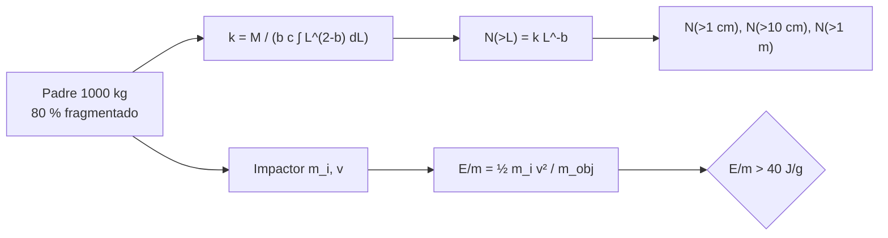

# B118-C09 — Generación de desechos

<!-- nav:top -->
[🏠 Programa](../../../../README.md) · [📚 Bloque B118](../../../tronco-comun/B118-trafico-espacial-y-sostenibilidad-orbital.md) · [← Anterior: B118-C08 — Propagación de incertidumbre en conjunciones](../B118-C08-propagacion-de-incertidumbre-en-conjunciones/CLASE.md) · [Siguiente: B118-C10 — Síndrome de Kessler como escenario →](../B118-C10-sindrome-de-kessler-como-escenario/CLASE.md)
<!-- /nav -->

## 1. Ubicación, nivel y alcance

Clase 9 del bloque B118. Nivel N3. Primera clase del tramo «Desechos, fin de vida y reentrada». Los desechos nacen de rupturas, colisiones y abandono de objetos con energía almacenada. Aquí construyes un **modelo ilustrativo de fragmentación** (ley de potencias de tamaños con masa conservada) para un objeto padre de 1000 kg y calculas la **energía relativa** que separa una colisión catastrófica de una que no lo es. El modelo y el umbral son **ilustrativos**. **Esta clase es educativa: no constituye asesoría legal, regulatoria, financiera ni operativa y no sustituye la lectura del texto normativo vigente ni a un profesional habilitado.**

## 2. Por qué esta clase existe

La directriz 5 de la COPUOS dice que la mayor parte de los desechos catalogados proviene de fragmentaciones; entender cuántos fragmentos produce un evento y de qué tamaño es la base de los escenarios futuros. La decisión central: **¿cuántos fragmentos relevantes genera un evento y cuándo es «catastrófico»?**

## 3. Lo que podrás hacer al terminar

1. Parametrizar una distribución de fragmentos `N(>L) = k L^-b` que conserve la masa del padre.
2. Calcular `k` y los conteos para 1 cm, 10 cm y 1 m (`4244`, `107` y `2,7`).
3. Verificar la masa por integración numérica y por muestreo (400 realizaciones).
4. Calcular la energía relativa `E/m` de un impacto y compararla con el umbral ilustrativo de 40 J/g.
5. Entender por qué la masa de los fragmentos la dominan unos pocos grandes.
6. Rotular el modelo como ilustrativo y el umbral como no consultado.

La evidencia es la **ficha de fragmentación ilustrativa** del ejercicio 12 (sección 20).

## 4. Con qué llegas y cómo comprobarlo

1. ¿Qué es una ley de potencias?
2. ¿Qué es la energía cinética?
3. ¿Qué significa conservar la masa?
4. ¿Qué es una integral numérica?
5. ¿Qué es una desviación típica?

<details>
<summary>Ver respuestas</summary>

1. Una relación `N = k L^-b`. 2. `½ m v²`. 3. Que la suma de masas de los fragmentos no supere la del objeto padre. 4. Una suma de áreas de rectángulos que aproxima el área bajo una curva. 5. Una medida de la dispersión alrededor de la media.
</details>

Con cuatro o cinco aciertos, sigue; si no, repasa los prerrequisitos.

## 5. Un caso de contexto y casos de referencia

La directriz 5 de la COPUOS (2010, consultada) afirma que, con mucha diferencia, el mayor porcentaje de los desechos catalogados proviene de la fragmentación de naves y etapas, y que la mayoría de las rupturas fueron involuntarias; la directriz 3 añade que, a medida que aumentan el número y la masa de los desechos, la principal fuente de nuevos desechos probablemente serán las colisiones. El **ejemplo conductor** es un objeto de 1000 kg alcanzado por un impactor de 1 kg a 10 km/s: `E/m = 50,0 J/g`.

## 6. Vocabulario

Una **fragmentación** es la ruptura de un objeto en piezas. Una colisión es **catastrófica** si destruye al objetivo; el umbral habitual se expresa como energía por masa del objetivo. La **ley de potencias de tamaños** describe cuántos fragmentos hay por encima de un diámetro. La **conservación de la masa** limita el modelo. La **energía relativa** `E/m` es la energía cinética del impactor dividida por la masa del objetivo.

## 7. Modelo mental



*Descripción textual:* la masa fragmentada fija la constante de la ley de potencias; de ella salen los conteos por tamaño; por otro lado, la energía del impactor por masa del objetivo decide si el evento es catastrófico.

Analogía: romper una taza; hay pocos pedazos grandes y muchísimos pedacitos, y la masa total se reparte con un puñado de pedazos grandes. Límite: la ley de potencias, la densidad y la fracción fragmentada son supuestos ilustrativos.

## 8. La explicación, paso a paso

### 8.1 Constante y conteos

`N(>L) = k L^-b` con `b = 1,6` entre 1 cm y 1 m. Si los fragmentos son esferas de densidad `ρ = 500 kg/m³`, `m(L) = ρπ L³/6`. La masa total entre `L_min` y `L_max` es `k b c ∫ L^(2−b) dL`, con `c = ρπ/6`. Con 800 kg fragmentados (80 % del padre): **k = 2,6780**, `N(>1 cm) = 4244`, `N(>10 cm) = 107`, `N(>1 m) = 2,68`.

### 8.2 Verificación de masa

Integral numérica: 800,000 kg (objetivo 800). Un muestreo concreto de 4242 fragmentos da 571,6 kg, y 400 realizaciones dan **794,3 ± 251,5 kg**: la masa la dominan los pocos fragmentos grandes, por eso una realización puede desviarse mucho del valor esperado.

### 8.3 Energía relativa

`E/m = ½ m_i v² / m_obj`. Impactor de 1 kg a 10 km/s sobre 1000 kg: **50,0 J/g**, por encima del umbral ilustrativo de 40 J/g (catastrófica). Impactor de 10 g: 0,50 J/g (no catastrófica). La masa de impactor que alcanza 40 J/g sobre 1000 kg a 10 km/s es **0,80 kg**.

### 8.4 Qué no dice la clase

No distingue entre colisión y explosión, ni la dispersión de velocidades de los fragmentos, ni las órbitas resultantes; y el umbral de 40 J/g es una cifra habitual que **no se consultó**.

## 9. Magnitudes, símbolos y unidades

| Símbolo | Qué es | Unidad | Valor / nota |
|---|---|---|---|
| `b` | pendiente de la ley | adimensional | 1,6 (ilustrativa) |
| `k` | constante de la ley | objetos·m^b | 2,6780 |
| `ρ` | densidad de fragmentos | kg/m³ | 500 (ilustrativa) |
| `N(>10 cm)` | fragmentos mayores de 10 cm | objetos | 107 |
| `E/m` | energía relativa | J/g | 50,0 |

## 10. Convenciones y referencias

Diámetros en m, masas en kg, energías en J (por g del objetivo en `E/m`). Muestreo por inversión de la CDF truncada con semillas 118 y 1000–1399. Todos los parámetros son ilustrativos y el modelo no representa un evento real.

## 11. De dónde sale lo que afirmamos

| ID | Fuente | Localizador | Respalda | Estado |
|---|---|---|---|---|
| S1 | Space Debris Mitigation Guidelines of the Committee on the Peaceful Uses of Outer Space (UNOOSA, Viena, 2010; COPUOS 2007, resolución 62/217 de la Asamblea General) — https://www.unoosa.org/documents/pdf/psa/bsti/COPUOS_SPACE_DEBRIS_MITIGATION_GUIDELINES.pdf (consultada 2026-11-11; PDF leído con PyMuPDF) | directrices 3 y 5 | la mayor parte de los desechos catalogados proviene de fragmentaciones; con más masa y número de desechos las colisiones serían la principal fuente nueva | Consultada |
| — | Umbral de colisión catastrófica de 40 J/g | — | clasificación del evento | No consultado (cifra habitual) |
| — | Modelos de fragmentación de la NASA (NASA SBM) | — | comparación | No consultada |
| — | Ley de potencias, densidad y fracción del 80 % | — | conteos | Ilustrativo |

Límites: la directriz da la tendencia cualitativa, no los parámetros; el modelo de fragmentación y el umbral son ilustrativos.

## 12. Cómo ver los resultados

| Magnitud | Valor |
|---|---|
| `k` | 2,6780 |
| `N(>1 cm)` | 4244 |
| `N(>10 cm)` | 107 |
| Masa por integral | 800,000 kg |
| Masa media de 400 muestreos | 794,3 ± 251,5 kg |
| `E/m` (1 kg a 10 km/s) | 50,0 J/g |

Descripción larga: hay miles de fragmentos de 1 cm, un centenar de 10 cm y unos tres mayores de 1 m; la masa de una muestra individual oscila bastante porque la dominan los pocos fragmentos grandes.

## 13. Ejemplo trabajado

**Paso 1 · Integral.** Con `b = 1,6`: `∫₀,₀₁¹ L^0,4 dL = (1 − 0,01^1,4)/1,4 = 0,7132`.

**Paso 2 · Constante.** `k = 800/(b c ∫) = 800/(1,6 × 261,80 × 0,7132) = 2,678`.

**Paso 3 · Conteo.** `N(>10 cm) = k × 0,1^−1,6 = 107`.

**Paso 4 · Energía.** `½ × 1 × (10 000)²/(1000 × 1000) = 50,0 J/g`.

## 14. Distintas formas de describir el problema

**Por tamaño:** `N(>L)`. **Por masa:** integral. **Por energía:** `E/m`. **Por realización:** muestreo. **Por veredicto:** catastrófica o no.

## 15. Práctica guiada

**Ejercicio 1 · con los pasos indicados.** Calcula `E/m` de un impactor de 0,5 kg a 8 km/s sobre un objetivo de 500 kg. *Pasos:* `½ m v²` y divide entre 500 000 g.

<details><summary>Solución comentada</summary>

`½ × 0,5 × 8000² / 500 000 = 32,0 J/g`.
</details>

**Ejercicio 2 · con una pista.** ¿Es catastrófica según el umbral ilustrativo? *Pista:* compara con 40 J/g.

<details><summary>Solución comentada</summary>

Sí si es mayor que 40; aquí 16 J/g: no.
</details>

**Ejercicio 3 · casi autónomo.** Calcula la masa del impactor que da 40 J/g sobre 1000 kg a 10 km/s.

<details><summary>Solución comentada</summary>

`2 × 40 × 10⁶/(10⁴)² = 0,80 kg`.
</details>

## 16. Práctica autónoma, transferencia e integrador

**Ejercicio 4 · autónomo.** ¿Cuántos fragmentos mayores de 10 cm predice el modelo y cuántos tuvo el muestreo de semilla 118?

<details><summary>Solución comentada</summary>

107 frente a 93 (el muestreo corta en 1 m: el modelo da `104` entre 10 cm y 1 m, y el resto es variación aleatoria).
</details>

**Ejercicio 5 · autónomo.** Si `b` aumentara a 2, ¿habría más o menos fragmentos grandes en proporción?

<details><summary>Solución comentada</summary>

Menos: una pendiente mayor concentra más masa en fragmentos pequeños.
</details>

**Ejercicio 6 · autónomo.** ¿Qué pasa con `N(>1 cm)` si el padre fragmentado fuera de 400 kg?

<details><summary>Solución comentada</summary>

Se reduce a la mitad: `2122`.
</details>

**Ejercicio 7 · autónomo.** La desviación de la masa en 400 realizaciones es 251 kg. ¿Qué sugiere?

<details><summary>Solución comentada</summary>

Que una realización individual no representa la media: unos pocos fragmentos grandes dominan.
</details>

**Ejercicio 8 · autónomo.** ¿Qué dice la directriz 5 de la COPUOS sobre el origen de los desechos catalogados?

<details><summary>Solución comentada</summary>

Que la mayor parte proviene de la fragmentación de naves y etapas, en su mayoría por ruptura involuntaria.
</details>

**Ejercicio 9 · transferencia.** **Transferencia.** Un reporte afirma «el evento creó 10 000 fragmentos». ¿Qué preguntas haces?

<details><summary>Solución comentada</summary>

Qué tamaño mínimo cuentan, qué sensor los vio, y si son seguidos o estimados por modelo.
</details>

**Ejercicio 10 · transferencia.** **Transferencia.** ¿Por qué un impactor pequeño a 10 km/s puede destruir un satélite grande?

<details><summary>Solución comentada</summary>

Porque la energía crece con el cuadrado de la velocidad: 1 kg a 10 km/s equivale a 50 MJ.
</details>

**Ejercicio 11 · transferencia.** **Transferencia.** ¿Por qué la ONU recomienda evitar destruir intencionalmente objetos en órbita?

<details><summary>Solución comentada</summary>

Porque genera desechos de larga vida (directriz 4); si es inevitable, a altitudes bajas para limitar la vida de los fragmentos.
</details>

**Ejercicio 12 · integrador.** **Integrador.** Elabora tu *ficha de fragmentación ilustrativa*: la ley, `k` y los conteos, la masa verificada por dos vías, la energía relativa de dos impactos y la lista de qué es consultado, ilustrativo y no consultado.

<details><summary>Solución comentada</summary>

Secciones 8.1–8.4 y la salida del laboratorio.
</details>

## 17. Laboratorio

El script [fragmentacion.py](fragmentacion.py) calcula `k`, los conteos, la masa por integral y por 400 muestreos y la energía relativa de dos impactos (**comprueba** la masa a 1e-3 kg por integral y la media de los muestreos).

**Datos:** modelo de fragmentación **ilustrativo**; umbral de 40 J/g **no consultado**; directrices de la COPUOS **consultadas** para el contexto. **Predice antes de ejecutar:** ¿cuánto vale la masa media de 400 muestreos? (cerca de 800 kg, con gran dispersión.) **Ejecución del 2026-11-11 (Python 3.12.9):**

```text
Python 3.12.9 (biblioteca estandar)
Modelo ILUSTRATIVO de fragmentacion (ley de potencias b = 1.6, rho = 500 kg/m^3); umbral 40 J/g no consultado.
k = 2.6780; N(>1 cm) = 4244; N(>10 cm) = 107; N(>1 m) = 2.68
Masa por integral numerica: 800.000 kg (objetivo 800)
Fragmentos muestreados: 4242; masa de la muestra: 571.6 kg; con L > 10 cm: 93
400 realizaciones: masa media 794.3 kg, desviacion 251.5 kg (la masa la dominan pocos fragmentos grandes)
E/m del objetivo (1000 kg) con impactor de 1 kg a 10 km/s: 50.0 J/g (catastrofica)
Con impactor de 10 g: 0.50 J/g (no catastrofica)
Masa de impactor a 10 km/s que alcanza 40 J/g sobre 1000 kg: 0.800 kg
Pruebas superadas (masa conservada por integral a 1e-3 kg; media de 400 muestreos dentro de 4 errores estandar + 25 kg).
```

```bash
python programa/clases/B118/B118-C09-generacion-de-desechos/fragmentacion.py
```

**Límites:** una sola ley de potencias, fragmentos esféricos de densidad única, sin distribución de velocidades ni de formas.

## 18. Errores frecuentes y cómo corregirlos

**Tomar el umbral de 40 J/g como norma.** Se corrige con la sección 11: no consultado.

**Creer que una realización representa la media.** Se corrige con 8.2.

**Contar fragmentos sin decir su tamaño mínimo.** Se corrige con el ejercicio 9.

**Olvidar elevar la velocidad al cuadrado.** Se corrige con el ejemplo 13.

## 19. Cómo sabrás que vas bien

Tras la sección 8: ¿qué `E/m` esperabas y cuál obtuviste? Si dudas, repasa el ejemplo 13. Tras el laboratorio: ¿qué comprueba? (ver la sección 17).

## 20. Qué entregas y cómo se evalúa

El producto es tu **ficha de fragmentación ilustrativa** (ejercicio 12).

| Criterio | Inicial | En desarrollo | Logrado | Destacado |
|---|---|---|---|---|
| Conceptos | Los confunde | Parciales | Calcula `k`, conteos y `E/m` | Explica los límites del modelo |
| Cálculo | Sin unidades | Con errores | Tablas completas con unidades | Calcula casos nuevos |
| Numérico | Sin comprobar | Un caso | Contraste con una segunda vía | Interpreta las diferencias |
| Fuentes | Sin fuente | Sin fecha | Fuentes con fecha, versión y estado | Declara lo ilustrativo y lo no consultado |
| Límites | No los nombra | Uno | Tres | Discute qué falta del modelo |

**Condiciones críticas (no se compensan con promedio):** rotular los datos sintéticos e ilustrativos como tales; no presentar un modelo como observación; citar solo lo consultado, con su versión y fecha; no usar la ficha como asesoría legal, regulatoria o financiera.

## 21. Ética, seguridad y límites

Clase educativa: **no constituye asesoría legal, regulatoria ni financiera** ni orienta decisiones operativas reales, y no sustituye la lectura del texto normativo vigente (se cita siempre la versión y la fecha consultadas) ni la opinión de un especialista habilitado. Los modelos son simplificados y sus datos son sintéticos o ilustrativos. La clase no estima el riesgo de ningún evento real. Accesibilidad: tablas equivalentes a las gráficas, fórmulas en texto, ejercicios sin conexión.

## 22. Para cerrar y seguir

Un padre de 1000 kg que pierde 800 kg en fragmentos da unos 107 fragmentos mayores de 10 cm en este modelo ilustrativo, y un impacto de 1 kg a 10 km/s (50 J/g) pasa del umbral de 40 J/g. Queda una pregunta: ¿qué ocurre si las colisiones generan más colisiones?

**Glosario español–inglés.** fragmentación · *fragmentation* · colisión catastrófica · *catastrophic collision* · ley de potencias · *power law* · energía relativa · *energy-to-mass ratio* · objeto padre · *parent object*.

**Continuidad.** [B118-C10](../B118-C10-sindrome-de-kessler-como-escenario/CLASE.md) estudia el síndrome de Kessler como escenario.

**Referencias:** ver sección 11.

<!-- nav:bottom -->
---

[← Anterior: B118-C08 — Propagación de incertidumbre en conjunciones](../B118-C08-propagacion-de-incertidumbre-en-conjunciones/CLASE.md) · [📚 Bloque B118](../../../tronco-comun/B118-trafico-espacial-y-sostenibilidad-orbital.md) · [Siguiente: B118-C10 — Síndrome de Kessler como escenario →](../B118-C10-sindrome-de-kessler-como-escenario/CLASE.md)
<!-- /nav -->
