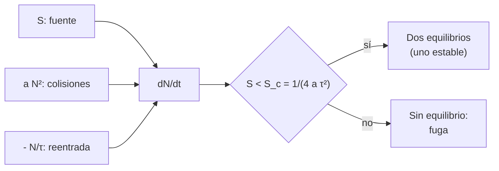

# B118-C10 — Síndrome de Kessler como escenario

<!-- nav:top -->
[🏠 Programa](../../../../README.md) · [📚 Bloque B118](../../../tronco-comun/B118-trafico-espacial-y-sostenibilidad-orbital.md) · [← Anterior: B118-C09 — Generación de desechos](../B118-C09-generacion-de-desechos/CLASE.md) · [Siguiente: B118-C11 — Diseño para mitigación de desechos →](../B118-C11-diseno-para-mitigacion-de-desechos/CLASE.md)
<!-- /nav -->

## 1. Ubicación, nivel y alcance

Clase 10 del bloque B118. Nivel N4. Segunda clase del tramo «Desechos, fin de vida y reentrada». El «síndrome de Kessler» describe una cascada: las colisiones generan fragmentos que causan nuevas colisiones. Aquí estudias un **modelo de cero dimensiones ilustrativo** `dN/dt = S + aN² − N/τ`, hallas sus equilibrios y el umbral crítico de la fuente, y ves cómo las condiciones iniciales deciden entre estabilizarse y desbocarse. Es un **escenario**, no una predicción. **Esta clase es educativa: no constituye asesoría legal, regulatoria, financiera ni operativa y no sustituye la lectura del texto normativo vigente ni a un profesional habilitado.**

## 2. Por qué esta clase existe

El término cuadrático de las colisiones cambia la naturaleza del problema: por debajo de cierta fuente hay un equilibrio estable; por encima, no hay equilibrio. La decisión central: **¿qué parámetro (fuente, vida orbital, tasa de colisión) lleva el sistema al umbral y cómo se lee un escenario sin confundirlo con un pronóstico?**

## 3. Lo que podrás hacer al terminar

1. Plantear `dN/dt = S + aN² − N/τ` y explicar cada término.
2. Calcular los equilibrios y la fuente crítica `S_c = 1/(4aτ²) = 800` objetos/año.
3. Integrar con Runge–Kutta 4 y verificar la convergencia al equilibrio estable.
4. Mostrar que una población inicial por encima del equilibrio inestable se desboca.
5. Calcular el efecto de reducir la fuente a la mitad.
6. Rotular el modelo como escenario ilustrativo y no como pronóstico.

La evidencia es la **ficha de escenarios de cascada de colisiones** del ejercicio 12 (sección 20).

## 4. Con qué llegas y cómo comprobarlo

1. ¿Qué es un equilibrio de una ecuación diferencial?
2. ¿Cuándo es estable un equilibrio?
3. ¿Qué es una bifurcación?
4. ¿Qué es Runge–Kutta 4?
5. ¿Qué es la vida orbital?

<details>
<summary>Ver respuestas</summary>

1. Un valor de `N` en el que `dN/dt = 0`. 2. Cuando una pequeña perturbación decae. 3. Un valor de un parámetro en el que cambia el número o la estabilidad de los equilibrios. 4. Un método numérico de cuarto orden para integrar ecuaciones diferenciales. 5. El tiempo que un objeto tarda en reentrar.
</details>

Con cuatro o cinco aciertos, sigue; si no, repasa los prerrequisitos.

## 5. Un caso de contexto y casos de referencia

La directriz 3 de la COPUOS (2010, consultada) afirma que, según numerosos estudios, a medida que aumentan el número y la masa de los desechos la principal fuente de nuevos desechos será probablemente las colisiones; y el texto de la IADC Rev. 4 (consultado) dice que las colisiones accidentales impulsarán el aumento futuro de la población. El artículo de Kessler y Cour-Palais (1978) **no se consultó**. El **ejemplo conductor** usa `τ = 25 años`, `a = 5 × 10⁻⁷ /(objeto·año)` y `S = 300 objetos/año`, valores **ilustrativos**.

## 6. Vocabulario

Un **escenario** es una trayectoria condicionada a supuestos. La **fuente** `S` es la tasa de entrada de objetos. La **vida orbital** `τ` es el tiempo medio de permanencia. El **término cuadrático** `aN²` representa los fragmentos por colisión. Un **equilibrio estable** atrae las trayectorias cercanas; uno **inestable** las repele. La **fuga** (*runaway*) es el crecimiento sin cota.

## 7. Modelo mental



*Descripción textual:* tres términos (entrada, colisiones, reentrada) determinan la derivada de la población; si la fuente es menor que el valor crítico hay dos equilibrios, y si no, la población crece sin cota.

Analogía: una bañera con grifo, desagüe y un goteo que aumenta con el nivel; si el grifo es suave se estabiliza, pero si pasa de cierto caudal el nivel sube sin parar. Límite: el modelo es de una sola capa y sin estructura de tamaños.

## 8. La explicación, paso a paso

### 8.1 Equilibrios

`aN² − N/τ + S = 0` → `N = [1/τ ± √(1/τ² − 4aS)]/(2a)`. Existen si `S ≤ S_c = 1/(4aτ²) = 800,0 objetos/año`, con `N_crit = 1/(2aτ) = 40000`.

### 8.2 Casos

| S (obj/año) | equilibrios (estable, inestable) | N a los 300 años desde 10 000 |
|---|---|---|
| 300 | 8377, 71623 | 8377 |
| 700 | 25858, 54142 | 25711 |
| 800 (crítica) | 40000 (doble) | 34545 (convergencia lenta) |
| 1000 | no hay | tope en 255,2 años |

Sin colisiones (`a = 0`) y `S = 300` el equilibrio sería `Sτ = 7500`: las colisiones lo elevan a 8377.

### 8.3 Dependencia de las condiciones iniciales

Con `S = 300` el equilibrio inestable es 71623. Desde 60000 el sistema vuelve a 8399; desde 70907 (por debajo del umbral) a 8793; desde 72339 (por encima) se desboca y alcanza el tope en 141,9 años.

### 8.4 Reducir la fuente

Con `S = 150` el equilibrio estable baja a **3944** (menos de la mitad: el término cuadrático también se reduce).

## 9. Magnitudes, símbolos y unidades

| Símbolo | Qué es | Unidad | Valor / nota |
|---|---|---|---|
| `τ` | vida orbital | años | 25 (ilustrativa) |
| `a` | tasa de colisiones | 1/(objeto·año) | 5 × 10⁻⁷ (ilustrativa) |
| `S_c` | fuente crítica | objetos/año | 800 |
| `N_crit` | población en la bifurcación | objetos | 40000 |
| `N*` | equilibrio estable (S = 300) | objetos | 8377 |

## 10. Convenciones y referencias

Una sola capa; tiempo en años; integración RK4 con paso 0,05 años y tope de 10⁷ objetos. Todos los parámetros son ilustrativos; el modelo no representa ninguna capa real ni ofrece pronóstico.

## 11. De dónde sale lo que afirmamos

| ID | Fuente | Localizador | Respalda | Estado |
|---|---|---|---|---|
| S1 | Space Debris Mitigation Guidelines of the Committee on the Peaceful Uses of Outer Space (UNOOSA, Viena, 2010; COPUOS 2007, resolución 62/217 de la Asamblea General) — https://www.unoosa.org/documents/pdf/psa/bsti/COPUOS_SPACE_DEBRIS_MITIGATION_GUIDELINES.pdf (consultada 2026-11-11; PDF leído con PyMuPDF) | directriz 3 | con más desechos, las colisiones serían la principal fuente nueva de desechos | Consultada |
| S3 | IADC Space Debris Mitigation Guidelines, IADC-02-01 Rev. 4 (enero de 2025), presentadas como A/AC.105/C.1/2025/CRP.9 (3 de febrero de 2025) — https://www.unoosa.org/res/oosadoc/data/documents/2025/aac_105c_12025crp/aac_105c_12025crp_9_0_html/AC105_C1_2025_CRP09E.pdf (consultada 2026-11-11; PDF leído con PyMuPDF) | sección 5.4 | las colisiones accidentales impulsarán el aumento futuro de la población de desechos | Consultada |
| — | Kessler y Cour-Palais (1978), «Collision frequency of artificial satellites» | — | el escenario original | No consultado |
| — | Parámetros `τ`, `a`, `S` | — | los equilibrios | Ilustrativo |
| — | Modelos de población (LEGEND, DAMAGE) | — | comparación | No consultados |

Límites: las directrices dan la tendencia, no el modelo; el artículo original no se consultó; la dinámica de una sola variable no captura las clases de tamaño ni las capas.

## 12. Cómo ver los resultados

| Magnitud | Valor |
|---|---|
| `S_c` | 800 objetos/año |
| Equilibrio estable (S = 300) | 8377 |
| Equilibrio inestable (S = 300) | 71623 |
| Tope con S = 1000 | 255,2 años |
| Equilibrio con S = 150 | 3944 |

Descripción larga: para fuentes pequeñas la población converge; cerca de `S_c` la convergencia es muy lenta; por encima no hay equilibrio y la población crece hasta el tope.

## 13. Ejemplo trabajado

**Paso 1 · Fuente crítica.** `S_c = 1/(4 × 5×10⁻⁷ × 625) = 800`.

**Paso 2 · Discriminante con S = 300.** `1/τ² − 4aS = 0,0016 − 0,0006 = 0,001`.

**Paso 3 · Equilibrios.** `N = (0,04 ∓ 0,0316)/(10⁻⁶) = 8377` y `71623`.

**Paso 4 · Comprobación.** Con `N = 8377`: `S + aN² − N/τ ≈ 0`.

## 14. Distintas formas de describir el problema

**Por ecuación:** `dN/dt`. **Por equilibrios:** estable e inestable. **Por parámetro:** `S_c`. **Por simulación:** RK4. **Por condición inicial:** cuenca de atracción.

## 15. Práctica guiada

**Ejercicio 1 · con los pasos indicados.** Calcula `S_c` si `τ` = 20 años y `a` = 5×10⁻⁷. *Pasos:* `1/(4aτ²)`.

<details><summary>Solución comentada</summary>

`1/(4 × 5×10⁻⁷ × 400) = 1250`.
</details>

**Ejercicio 2 · con una pista.** Con `S` = 300 sin colisiones (`a` = 0) y `τ` = 25, ¿cuánto vale el equilibrio? *Pista:* `Sτ`.

<details><summary>Solución comentada</summary>

`7500`.
</details>

**Ejercicio 3 · casi autónomo.** Calcula `N_crit = 1/(2aτ)`.

<details><summary>Solución comentada</summary>

`40000`.
</details>

## 16. Práctica autónoma, transferencia e integrador

**Ejercicio 4 · autónomo.** Con `S` = 800, ¿cuántos equilibrios hay?

<details><summary>Solución comentada</summary>

Uno doble, en `N_crit`.
</details>

**Ejercicio 5 · autónomo.** Si `τ` se reduce a 12,5 años (órbita más baja), ¿cómo cambia `S_c`?

<details><summary>Solución comentada</summary>

Se cuadruplica: `3200` objetos/año.
</details>

**Ejercicio 6 · autónomo.** Si `a` se duplica, ¿cómo cambia `S_c`?

<details><summary>Solución comentada</summary>

Se reduce a la mitad.
</details>

**Ejercicio 7 · autónomo.** ¿Qué le pasa a la población si empieza en 80 000 con `S` = 300?

<details><summary>Solución comentada</summary>

Se desboca: supera el equilibrio inestable (71623).
</details>

**Ejercicio 8 · autónomo.** ¿Por qué el equilibrio con colisiones es mayor que `Sτ`?

<details><summary>Solución comentada</summary>

Porque cada colisión añade fragmentos; las colisiones elevan la población estable.
</details>

**Ejercicio 9 · transferencia.** **Transferencia.** Un titular dice «ya estamos en el síndrome de Kessler». ¿Qué falta para afirmarlo?

<details><summary>Solución comentada</summary>

Un modelo calibrado con datos, una definición de qué capa y qué clase de tamaños, y las incertidumbres; este escenario no basta.
</details>

**Ejercicio 10 · transferencia.** **Transferencia.** ¿Por qué las políticas de mitigación apuntan a `S` y a `τ`?

<details><summary>Solución comentada</summary>

Porque reducir la fuente y acortar la vida orbital alejan al sistema del umbral `S_c = 1/(4aτ²)`.
</details>

**Ejercicio 11 · transferencia.** **Transferencia.** ¿Qué parámetro del modelo es más difícil de conocer en la realidad?

<details><summary>Solución comentada</summary>

La tasa de colisiones `a`, porque depende de las áreas, las velocidades y la población por tamaño.
</details>

**Ejercicio 12 · integrador.** **Integrador.** Elabora tu *ficha de escenarios de cascada de colisiones*: la ecuación, los equilibrios y `S_c`, la tabla de casos, el efecto de las condiciones iniciales y la lista de qué es consultado, no consultado e ilustrativo, con el aviso de que no es un pronóstico.

<details><summary>Solución comentada</summary>

Secciones 8.1–8.4 y la salida del laboratorio.
</details>

## 17. Laboratorio

El script [kessler.py](kessler.py) integra con RK4 el modelo para varias fuentes y condiciones iniciales y lo compara con los equilibrios analíticos (**comprueba** la convergencia a 0,5 % y la fuga por encima del umbral).

**Datos:** modelo y parámetros **ilustrativos**; el artículo de Kessler y Cour-Palais **no consultado**; directrices **consultadas** solo para el contexto. **Predice antes de ejecutar:** ¿qué ocurre con `S` = 1000? (no hay equilibrio: la población alcanza el tope en unos 255 años.) **Ejecución del 2026-11-11 (Python 3.12.9):**

```text
Python 3.12.9 (biblioteca estandar)
ESCENARIO ILUSTRATIVO: dN/dt = S + a N^2 - N/tau con tau = 25 anios, a = 5e-7 /(objeto anio); no es una prediccion.
Fuente critica S_c = 1/(4 a tau^2) = 800.0 objetos/anio; poblacion en la bifurcacion = 40000
 S [obj/anio]  equilibrios (estable, inestable)       N(300 anios) desde 10000   tiempo al tope
       300.0  8377, 71623                                   8377   -
       700.0  25858, 54142                                 25711   -
       800.0  40000, 40000                                 34545   -
      1000.0  no hay                                    10000000   255.2 anios
Sin colisiones (a = 0) con S = 300: N = S tau = 7500; con colisiones el equilibrio estable es 8377
Umbral inestable con S = 300: 71623 objetos
  N0 =     60000 -> N(300 anios) =       8399
  N0 =     70907 -> N(300 anios) =       8793
  N0 =     72339 -> N(300 anios) =   10000000 (tope en 141.9 anios)
Si la fuente baja a 150 obj/anio, el equilibrio estable es 3944
Pruebas superadas (convergencia al equilibrio analitico a 0.5 %; fuga por encima del umbral).
```

```bash
python programa/clases/B118/B118-C10-sindrome-de-kessler-como-escenario/kessler.py
```

**Límites:** una sola variable, parámetros constantes, sin tamaños ni capas ni feedback de maniobras.

## 18. Errores frecuentes y cómo corregirlos

**Tomar el escenario como pronóstico.** Se corrige con la sección 11 y el ejercicio 9.

**Olvidar que hay un equilibrio inestable.** Se corrige con 8.3.

**Reducir solo la fuente y olvidar la vida orbital.** Se corrige con el ejercicio 10.

**Citar a Kessler sin haberlo leído.** Se corrige con la tabla de fuentes.

## 19. Cómo sabrás que vas bien

Tras la sección 8: ¿qué equilibrio esperabas y cuál obtuviste? Si dudas, repasa el ejemplo 13. Tras el laboratorio: ¿qué comprueba? (ver la sección 17).

## 20. Qué entregas y cómo se evalúa

El producto es tu **ficha de escenarios de cascada de colisiones** (ejercicio 12).

| Criterio | Inicial | En desarrollo | Logrado | Destacado |
|---|---|---|---|---|
| Conceptos | Los confunde | Parciales | Halla equilibrios y `S_c` | Explica los límites del modelo |
| Cálculo | Sin unidades | Con errores | Tablas completas con unidades | Calcula casos nuevos |
| Numérico | Sin comprobar | Un caso | Contraste con una segunda vía | Interpreta las diferencias |
| Fuentes | Sin fuente | Sin fecha | Fuentes con fecha, versión y estado | Declara lo ilustrativo y lo no consultado |
| Límites | No los nombra | Uno | Tres | Discute qué falta del modelo |

**Condiciones críticas (no se compensan con promedio):** rotular los datos sintéticos e ilustrativos como tales; no presentar un modelo como observación; citar solo lo consultado, con su versión y fecha; no usar la ficha como asesoría legal, regulatoria o financiera.

## 21. Ética, seguridad y límites

Clase educativa: **no constituye asesoría legal, regulatoria ni financiera** ni orienta decisiones operativas reales, y no sustituye la lectura del texto normativo vigente (se cita siempre la versión y la fecha consultadas) ni la opinión de un especialista habilitado. Los modelos son simplificados y sus datos son sintéticos o ilustrativos. Los escenarios no son pronósticos y no deben citarse como tales. Accesibilidad: tablas equivalentes a las gráficas, fórmulas en texto, ejercicios sin conexión.

## 22. Para cerrar y seguir

En el escenario ilustrativo la fuente crítica es 800 objetos/año: por debajo hay un equilibrio estable (con S = 300, 8377) y por encima la población se desboca. Queda una pregunta: ¿cómo se diseña un satélite para no sumar a la fuente?

**Glosario español–inglés.** síndrome de Kessler · *Kessler syndrome* · equilibrio estable · *stable equilibrium* · bifurcación · *bifurcation* · vida orbital · *orbital lifetime* · escenario · *scenario*.

**Continuidad.** [B118-C11](../B118-C11-diseno-para-mitigacion-de-desechos/CLASE.md) estudia el diseño para la mitigación de desechos.

**Referencias:** ver sección 11.

<!-- nav:bottom -->
---

[← Anterior: B118-C09 — Generación de desechos](../B118-C09-generacion-de-desechos/CLASE.md) · [📚 Bloque B118](../../../tronco-comun/B118-trafico-espacial-y-sostenibilidad-orbital.md) · [Siguiente: B118-C11 — Diseño para mitigación de desechos →](../B118-C11-diseno-para-mitigacion-de-desechos/CLASE.md)
<!-- /nav -->
