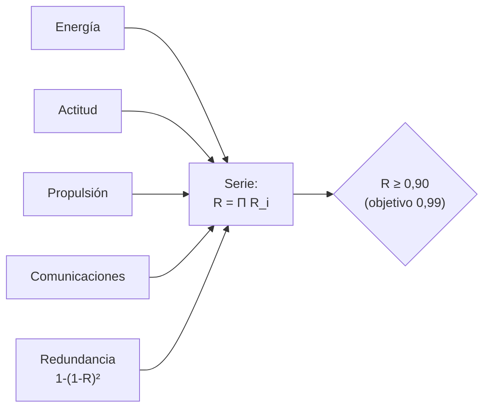

# B118-C11 — Diseño para mitigación de desechos

<!-- nav:top -->
[🏠 Programa](../../../../README.md) · [📚 Bloque B118](../../../tronco-comun/B118-trafico-espacial-y-sostenibilidad-orbital.md) · [← Anterior: B118-C10 — Síndrome de Kessler como escenario](../B118-C10-sindrome-de-kessler-como-escenario/CLASE.md) · [Siguiente: B118-C12 — Disposición al fin de vida →](../B118-C12-disposicion-al-fin-de-vida/CLASE.md)
<!-- /nav -->

## 1. Ubicación, nivel y alcance

Clase 11 del bloque B118. Nivel N4. Tercera clase del tramo «Desechos, fin de vida y reentrada». Diseñar para mitigar desechos es un problema de ingeniería con requisitos verificables. Aquí abordas la **fiabilidad de la disposición posmisión (PMD)** de un satélite **sintético**: cuatro funciones en serie (energía, actitud, propulsión, comunicaciones) con tasas de fallo **ilustrativas**, la meta de la IADC (≥ 0,90 y objetivo 0,99) y el efecto de la redundancia. **Esta clase es educativa: no constituye asesoría legal, regulatoria, financiera ni operativa y no sustituye la lectura del texto normativo vigente ni a un profesional habilitado.**

## 2. Por qué esta clase existe

Una disposición solo es posible si el satélite sigue funcionando al final de su vida. La probabilidad de éxito de la PMD no es la fiabilidad de la misión, sino la de las funciones necesarias para disponer. La decisión central: **¿qué fiabilidad por función exige una meta de 0,90 o 0,99 y dónde conviene poner redundancia?**

## 3. Lo que podrás hacer al terminar

1. Calcular la fiabilidad de una cadena en serie con tasas de fallo exponenciales.
2. Obtener la fiabilidad requerida por función (`0,9740` para 0,90 y `0,9975` para 0,99 con cuatro funciones iguales).
3. Calcular el efecto de duplicar funciones críticas (redundancia en paralelo).
4. Verificar las fórmulas con un Monte Carlo de 200 000 ensayos.
5. Calcular el tiempo de operación máximo para cumplir 0,90 sin redundancia (2,34 años).
6. Separar lo consultado (meta de la IADC) de lo ilustrativo (tasas de fallo).

La evidencia es la **ficha de presupuesto de fiabilidad de disposición** del ejercicio 12 (sección 20).

## 4. Con qué llegas y cómo comprobarlo

1. ¿Qué es una tasa de fallo constante?
2. ¿Qué es un sistema en serie?
3. ¿Qué es un sistema en paralelo?
4. ¿Qué es la pasivación?
5. ¿Qué es un error estándar binomial?

<details>
<summary>Ver respuestas</summary>

1. Un `λ` tal que la fiabilidad es `R(t) = exp(−λt)`. 2. Uno que falla si falla cualquiera de sus partes: `R = ΠRᵢ`. 3. Uno que falla solo si fallan todas las copias: `R = 1 − Π(1 − Rᵢ)`. 4. Eliminar toda la energía almacenada de la nave al fin de la misión. 5. `√(p(1−p)/n)`.
</details>

Con cuatro o cinco aciertos, sigue; si no, repasa los prerrequisitos.

## 5. Un caso de contexto y casos de referencia

Las directrices IADC Rev. 4 (enero de 2025, consultadas) piden que la probabilidad de disposición posmisión exitosa sea al menos del 90 % con un objetivo del 99 % o más, y que en las grandes constelaciones se considere una probabilidad mayor. Las directrices de la COPUOS (2010, consultadas) piden diseñar para evitar modos de falla que lleven a rupturas accidentales (directriz 2) y agotar o hacer seguras las fuentes de energía almacenada (directriz 5). El **ejemplo conductor** es un satélite con tasas `(0,010; 0,015; 0,012; 0,008)` por año que opera 7 años.

## 6. Vocabulario

La **disposición posmisión** (PMD) es el conjunto de acciones para retirar o dejar segura la nave. La **fiabilidad** `R(t)` es la probabilidad de funcionar hasta `t`. Un **modo de falla** es la forma en que una función deja de operar. La **redundancia** duplica una función. El **presupuesto de fiabilidad** reparte la meta entre las funciones. La **pasivación** descarga baterías, ventea tanques y detiene volantes.

## 7. Modelo mental



*Descripción textual:* las cuatro funciones necesarias forman una cadena en serie; su producto es la probabilidad de poder disponer; la redundancia en las más débiles lo eleva.

Analogía: cuatro eslabones de una cadena; la cadena sirve si todos resisten, y duplicar los dos más débiles es más eficaz que reforzar los fuertes. Límite: se supone independencia entre fallas y tasa constante, lo que no ocurre en la realidad (fallas comunes, mortalidad infantil).

## 8. La explicación, paso a paso

### 8.1 Cadena en serie

Con `λ = (0,010; 0,015; 0,012; 0,008)` 1/año y `t = 7` años: fiabilidades por función 0,9324; 0,9003; 0,9194; 0,9455. En serie: **0,7298**, y el Monte Carlo da 0,7295 ± 0,0010. No se cumple la meta de 0,90.

### 8.2 Presupuesto

Para llegar a 0,90 con cuatro funciones iguales cada una necesita 0,9740; para 0,99, 0,9975. Sin redundancia, la meta de 0,90 se cumple solo hasta `t = −ln 0,90/Σλ = 2,34` años de operación.

### 8.3 Redundancia

Duplicando propulsión y actitud (las dos más débiles): fórmula 0,8672; Monte Carlo 0,8684 ± 0,0008. Mejora, pero sigue por debajo de 0,90: hay que mejorar también energía y comunicaciones o acortar la vida de diseño.

### 8.4 Qué no incluye

Fallas de causa común (una sola llamarada puede dañar dos copias), degradación con el tiempo, y la fiabilidad de la propia pasivación. Es un presupuesto de la forma, no una evaluación de un diseño real.

## 9. Magnitudes, símbolos y unidades

| Símbolo | Qué es | Unidad | Valor / nota |
|---|---|---|---|
| `λ` | tasa de fallo | 1/año | 0,008 a 0,015 (ilustrativas) |
| `t` | años de operación | años | 7 |
| `R_serie` | fiabilidad de la PMD | adimensional | 0,7298 |
| `R_req` | fiabilidad por función (0,90) | adimensional | 0,9740 |
| `t_max` | operación máxima para 0,90 | años | 2,34 |

## 10. Convenciones y referencias

Fiabilidades adimensionales; tiempos en años. Monte Carlo con semilla 118 y 200 000 ensayos. Independencia entre funciones. Tasas de fallo ilustrativas: no provienen de ningún satélite ni de ninguna base de datos.

## 11. De dónde sale lo que afirmamos

| ID | Fuente | Localizador | Respalda | Estado |
|---|---|---|---|---|
| S3 | IADC Space Debris Mitigation Guidelines, IADC-02-01 Rev. 4 (enero de 2025), presentadas como A/AC.105/C.1/2025/CRP.9 (3 de febrero de 2025) — https://www.unoosa.org/res/oosadoc/data/documents/2025/aac_105c_12025crp/aac_105c_12025crp_9_0_html/AC105_C1_2025_CRP09E.pdf (consultada 2026-11-11; PDF leído con PyMuPDF) | sección 5.3.2 | probabilidad de disposición exitosa de al menos 90 % con objetivo de 99 % o más; en grandes constelaciones, mayor probabilidad | Consultada |
| S1 | Space Debris Mitigation Guidelines of the Committee on the Peaceful Uses of Outer Space (UNOOSA, Viena, 2010; COPUOS 2007, resolución 62/217 de la Asamblea General) — https://www.unoosa.org/documents/pdf/psa/bsti/COPUOS_SPACE_DEBRIS_MITIGATION_GUIDELINES.pdf (consultada 2026-11-11; PDF leído con PyMuPDF) | directrices 2 y 5 | diseñar para evitar rupturas accidentales y agotar la energía almacenada | Consultada |
| — | Tasas de fallo de componentes espaciales | — | fiabilidades | Ilustrativo (no consultadas bases como MIL-HDBK-217) |
| — | ISO 24113 y estándares ECSS de mitigación | — | requisitos de diseño | No consultados |

Límites: la meta de la IADC se consultó en el PDF; las normas ISO y ECSS no; las tasas de fallo y la independencia son supuestos del ejercicio.

## 12. Cómo ver los resultados

| Magnitud | Valor |
|---|---|
| Fiabilidad en serie (7 años) | 0,7298 |
| Monte Carlo | 0,7295 ± 0,0010 |
| Con redundancia en propulsión y actitud | 0,8672 |
| Por función para 0,90 / 0,99 | 0,9740 / 0,9975 |
| `t_max` para 0,90 | 2,34 años |

Descripción larga: la cadena en serie queda en 0,73 a los 7 años; duplicar las dos funciones más débiles la sube a 0,87; para 0,90 sin redundancia no se debe operar más de 2,3 años.

## 13. Ejemplo trabajado

**Paso 1 · Suma de tasas.** `Σλ = 0,010 + 0,015 + 0,012 + 0,008 = 0,045`.

**Paso 2 · Fiabilidad en serie.** `exp(−0,045 × 7) = 0,7298`.

**Paso 3 · Redundancia.** Propulsión: `1 − (1 − 0,9194)² = 0,9935`.

**Paso 4 · Tiempo máximo.** `−ln(0,90)/0,045 = 2,34` años.

## 14. Distintas formas de describir el problema

**Por tasa:** `λ`. **Por función:** `Rᵢ`. **Por arquitectura:** serie o paralelo. **Por meta:** 0,90 o 0,99. **Por simulación:** Monte Carlo.

## 15. Práctica guiada

**Ejercicio 1 · con los pasos indicados.** Calcula `R` de una función con `λ` = 0,02/año a 5 años. *Pasos:* `exp(−λt)`.

<details><summary>Solución comentada</summary>

`exp(−0,1) = 0,9048`.
</details>

**Ejercicio 2 · con una pista.** Calcula `R` en serie de dos funciones con 0,95 y 0,90. *Pista:* producto.

<details><summary>Solución comentada</summary>

`0,855`.
</details>

**Ejercicio 3 · casi autónomo.** Duplica en paralelo una función de 0,90. ¿Qué fiabilidad obtiene?

<details><summary>Solución comentada</summary>

`1 − 0,1² = 0,99`.
</details>

## 16. Práctica autónoma, transferencia e integrador

**Ejercicio 4 · autónomo.** ¿Qué fiabilidad por función se necesita para 0,99 con tres funciones iguales?

<details><summary>Solución comentada</summary>

`0,99^(1/3) = 0,9967`.
</details>

**Ejercicio 5 · autónomo.** Con `Σλ` = 0,045/año, ¿hasta cuándo se cumple 0,95?

<details><summary>Solución comentada</summary>

`−ln 0,95/0,045 = 1,14` años.
</details>

**Ejercicio 6 · autónomo.** La fórmula en serie da 0,7298 y el Monte Carlo 0,7295. ¿Es coherente?

<details><summary>Solución comentada</summary>

Sí: la diferencia es menor que el error estándar (0,0010) multiplicado por 3.
</details>

**Ejercicio 7 · autónomo.** ¿Por qué conviene duplicar primero las funciones de menor fiabilidad?

<details><summary>Solución comentada</summary>

Porque su fallo domina la probabilidad total de que la cadena falle.
</details>

**Ejercicio 8 · autónomo.** ¿Qué meta de la IADC aplica y cuál es el objetivo?

<details><summary>Solución comentada</summary>

Al menos 0,90 con un objetivo de 0,99 o más.
</details>

**Ejercicio 9 · transferencia.** **Transferencia.** Un proveedor declara «fiabilidad de 0,99 de la misión». ¿Es la PMD?

<details><summary>Solución comentada</summary>

No necesariamente: la PMD exige que las funciones de disposición sigan operando después de la misión.
</details>

**Ejercicio 10 · transferencia.** **Transferencia.** ¿Qué falla común puede invalidar una redundancia?

<details><summary>Solución comentada</summary>

Una causa que afecte a las dos copias a la vez, como una tormenta solar o un defecto de lote; el modelo la ignora.
</details>

**Ejercicio 11 · transferencia.** **Transferencia.** ¿Por qué se pasiva la nave aunque la PMD tenga éxito?

<details><summary>Solución comentada</summary>

Porque si la PMD falla, la energía almacenada (baterías, tanques) puede causar una ruptura (directriz 5 de la COPUOS).
</details>

**Ejercicio 12 · integrador.** **Integrador.** Elabora tu *ficha de presupuesto de fiabilidad de disposición*: tasas, fiabilidad en serie y con redundancia, comparación con la meta de la IADC, tiempo máximo y la lista de qué es consultado, ilustrativo y no consultado.

<details><summary>Solución comentada</summary>

Secciones 8.1–8.4 y la salida del laboratorio.
</details>

## 17. Laboratorio

El script [confiabilidad.py](confiabilidad.py) calcula la fiabilidad de una cadena en serie y con redundancia, la fiabilidad requerida por función y la contrasta con un Monte Carlo (**comprueba** 3 errores estándar y el tiempo máximo exacto).

**Datos:** tasas de fallo **ilustrativas**; meta de la IADC Rev. 4 **consultada**; ISO 24113 y ECSS **no consultados**. **Predice antes de ejecutar:** ¿cumple 0,90 la cadena a los 7 años? (no, queda cerca de 0,73.) **Ejecución del 2026-11-11 (Python 3.12.9):**

```text
Python 3.12.9 (biblioteca estandar)
Tasas de fallo ILUSTRATIVAS (1/anio): energia 0.01, actitud 0.015, propulsion 0.012, comunicaciones 0.008; meta IADC Rev.4 (consultada): >= 0.90, objetivo 0.99.
Fiabilidad por funcion a 7 anios: energia 0.9324, actitud 0.9003, propulsion 0.9194, comunicaciones 0.9455
Cadena en serie a 7 anios: 0.7298; Monte Carlo (2e5): 0.7295 +- 0.0010
Fiabilidad por funcion requerida para 0.90 con 4 funciones iguales: 0.9740; para 0.99: 0.9975
Con propulsion y actitud duplicadas: formula 0.8672; Monte Carlo 0.8684 +- 0.0008
Tiempo maximo de operacion para cumplir 0.90 sin redundancia: 2.34 anios
Pruebas superadas (formula en serie y paralelo contra Monte Carlo a 3 errores estandar).
```

```bash
python programa/clases/B118/B118-C11-diseno-para-mitigacion-de-desechos/confiabilidad.py
```

**Límites:** fallas independientes y tasa constante; sin degradación, sin fallas comunes ni fiabilidad de la maniobra de disposición en sí.

## 18. Errores frecuentes y cómo corregirlos

**Confundir la fiabilidad de la misión con la de la disposición.** Se corrige con el ejercicio 9.

**Suponer que la redundancia elimina todo riesgo.** Se corrige con el ejercicio 10.

**Usar tasas de fallo sin citar su origen.** Se corrige con la sección 11.

**Multiplicar probabilidades de eventos dependientes.** Se corrige con 8.4.

## 19. Cómo sabrás que vas bien

Tras la sección 8: ¿qué fiabilidad esperabas y cuál obtuviste? Si dudas, repasa el ejemplo 13. Tras el laboratorio: ¿qué comprueba? (ver la sección 17).

## 20. Qué entregas y cómo se evalúa

El producto es tu **ficha de presupuesto de fiabilidad de disposición** (ejercicio 12).

| Criterio | Inicial | En desarrollo | Logrado | Destacado |
|---|---|---|---|---|
| Conceptos | Los confunde | Parciales | Calcula `R` en serie y paralelo | Explica los límites del modelo |
| Cálculo | Sin unidades | Con errores | Tablas completas con unidades | Calcula casos nuevos |
| Numérico | Sin comprobar | Un caso | Contraste con una segunda vía | Interpreta las diferencias |
| Fuentes | Sin fuente | Sin fecha | Fuentes con fecha, versión y estado | Declara lo ilustrativo y lo no consultado |
| Límites | No los nombra | Uno | Tres | Discute qué falta del modelo |

**Condiciones críticas (no se compensan con promedio):** rotular los datos sintéticos e ilustrativos como tales; no presentar un modelo como observación; citar solo lo consultado, con su versión y fecha; no usar la ficha como asesoría legal, regulatoria o financiera.

## 21. Ética, seguridad y límites

Clase educativa: **no constituye asesoría legal, regulatoria ni financiera** ni orienta decisiones operativas reales, y no sustituye la lectura del texto normativo vigente (se cita siempre la versión y la fecha consultadas) ni la opinión de un especialista habilitado. Los modelos son simplificados y sus datos son sintéticos o ilustrativos. Accesibilidad: tablas equivalentes a las gráficas, fórmulas en texto, ejercicios sin conexión.

## 22. Para cerrar y seguir

La cadena de cuatro funciones llega a 0,73 a los 7 años; con redundancia, 0,87; la meta de la IADC es 0,90. Queda una pregunta: aun si la disposición funciona, ¿a qué altitud conviene dejar el satélite?

**Glosario español–inglés.** disposición posmisión · *post-mission disposal* · fiabilidad · *reliability* · redundancia · *redundancy* · pasivación · *passivation* · modo de falla · *failure mode*.

**Continuidad.** [B118-C12](../B118-C12-disposicion-al-fin-de-vida/CLASE.md) estudia la disposición al fin de vida.

**Referencias:** ver sección 11.

<!-- nav:bottom -->
---

[← Anterior: B118-C10 — Síndrome de Kessler como escenario](../B118-C10-sindrome-de-kessler-como-escenario/CLASE.md) · [📚 Bloque B118](../../../tronco-comun/B118-trafico-espacial-y-sostenibilidad-orbital.md) · [Siguiente: B118-C12 — Disposición al fin de vida →](../B118-C12-disposicion-al-fin-de-vida/CLASE.md)
<!-- /nav -->
