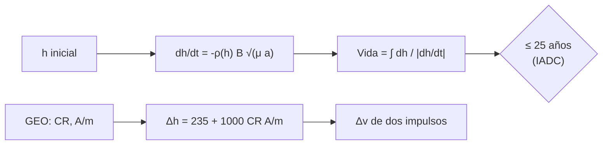

# B118-C12 — Disposición al fin de vida

<!-- nav:top -->
[🏠 Programa](../../../../README.md) · [📚 Bloque B118](../../../tronco-comun/B118-trafico-espacial-y-sostenibilidad-orbital.md) · [← Anterior: B118-C11 — Diseño para mitigación de desechos](../B118-C11-diseno-para-mitigacion-de-desechos/CLASE.md) · [Siguiente: B118-C13 — Desorbitación controlada →](../B118-C13-desorbitacion-controlada/CLASE.md)
<!-- /nav -->

## 1. Ubicación, nivel y alcance

Clase 12 del bloque B118. Nivel N3. Cuarta clase del tramo «Desechos, fin de vida y reentrada». Al terminar la misión hay que sacar el satélite de las regiones protegidas. Aquí calculas la **vida orbital por arrastre** con una atmósfera exponencial **ilustrativa** y la comparas con el límite de 25 años de la IADC, y calculas la **elevación mínima del perigeo en GEO** (235 km + 1000 CR A/m) con el Δv de dos impulsos. Las cifras normativas son las del texto consultado; el resto es ilustrativo. **Esta clase es educativa: no constituye asesoría legal, regulatoria, financiera ni operativa y no sustituye la lectura del texto normativo vigente ni a un profesional habilitado.**

## 2. Por qué esta clase existe

La disposición es la principal medida de mitigación: en LEO, que la vida residual sea corta; en GEO, que el satélite quede por encima de la región protegida. La decisión central: **¿desde qué altitud se puede dejar un satélite en LEO para que decaiga en 25 años, y cuánta elevación necesita un satélite de GEO?**

## 3. Lo que podrás hacer al terminar

1. Integrar la caída por arrastre `dh/dt = −ρ B √(μa)` y obtener la vida orbital.
2. Comprobar la solución numérica con la analítica de una atmósfera exponencial (menos de 10 %).
3. Hallar la altitud inicial con 25 años de vida residual (629 km) y con 5 años (533 km) en este modelo ilustrativo.
4. Aplicar `Δh = 235 km + 1000 CR A/m` y calcular el Δv de dos impulsos.
5. Relacionar `e ≤ 0,003` con la diferencia apogeo–perigeo (253 km).
6. Separar los valores normativos (consultados) de la atmósfera (ilustrativa).

La evidencia es la **ficha de disposición en LEO y GEO** del ejercicio 12 (sección 20).

## 4. Con qué llegas y cómo comprobarlo

1. ¿Qué es el coeficiente balístico?
2. ¿Qué es la altura de escala `H`?
3. ¿Qué es una transferencia de Hohmann?
4. ¿Qué es el coeficiente de presión de radiación `CR`?
5. ¿Qué región protegida de GEO define la IADC?

<details>
<summary>Ver respuestas</summary>

1. `B = Cd A/m`, que mide la sensibilidad al arrastre. 2. La altura sobre la cual la densidad cae un factor `e`. 3. Dos impulsos tangenciales entre dos órbitas circulares. 4. Un factor entre 1 y 2 que indica cómo refleja la superficie la luz solar. 5. 35 786 km ± 200 km de altitud y ± 15° de latitud.
</details>

Con cuatro o cinco aciertos, sigue; si no, repasa los prerrequisitos.

## 5. Un caso de contexto y casos de referencia

Las directrices IADC Rev. 4 (enero de 2025, consultadas) piden, para objetos que atraviesan la región protegida LEO (hasta 2000 km), desorbitar mediante una reentrada directa o una órbita de decaimiento con vida residual lo más corta posible y no mayor de 25 años; y, para GEO, una elevación mínima del perigeo de `235 km + 1000 CR A/m` con `e ≤ 0,003`. El plazo de 5 años de la FCC (FCC 22-74) **solo se conoce por el resumen de una búsqueda**. El **ejemplo conductor** usa `B = 0,022 m²/kg` y `CR = 1,3`.

## 6. Vocabulario

La **vida orbital residual** es el tiempo hasta la reentrada. El **coeficiente balístico** `B = Cd A/m`. La **región protegida LEO** llega a 2000 km. La **región protegida GEO** abarca ± 200 km y ± 15°. La **elevación del perigeo** es el aumento de la altitud mínima en la órbita de disposición. La **órbita cementerio** es la de disposición sobre GEO. `A/m` es la razón área-masa.

## 7. Modelo mental



*Descripción textual:* en LEO la vida orbital sale de integrar la caída por arrastre y se compara con 25 años; en GEO la fórmula de la IADC da la elevación mínima y de ella el Δv.

Analogía: una pelota que rueda hacia un precipicio con rozamiento creciente; cuanto más arriba empieza, más tarda. Límite: la atmósfera real cambia con la actividad solar y el modelo usa una sola exponencial.

## 8. La explicación, paso a paso

### 8.1 Vida orbital en LEO

Con `ρ(h) = ρ₀ exp(−(h−400)/H)`, `ρ₀ = 3×10⁻¹² kg/m³`, `H = 60 km` y `B = 0,022 m²/kg`, la vida desde cada altitud (numérica / analítica): 450 km 1,26 / 1,27 años; 550 km 6,69 / 6,68; 650 km 35,2 / 35,1; 700 km 80,8 / 80,5. **Cada 50 km de más multiplica la vida por unos 2,3.**

### 8.2 Altitud para 25 años

La altitud inicial que da 25 años es **629,3 km**; para 5 años, **532,5 km**. Con `B` doble el límite sube a 671,1 km: un satélite «ligero» (más `A/m`) puede disponer desde más arriba.

### 8.3 GEO

`Δh = 235 + 1000 × 1,3 × A/m`: con `A/m` = 0,005 → 241,5 km (8,77 m/s); 0,010 → 248,0 km (9,00 m/s); 0,020 → 261,0 km (9,47 m/s); 0,050 → 300,0 km (10,88 m/s). Los 235 km son 200 km de la región más 35 km de descenso por perturbaciones (texto de la IADC).

### 8.4 Excentricidad

Con `a = 42164 km` y `e = 0,003`, la diferencia apogeo–perigeo es `2ae = 253 km`.

## 9. Magnitudes, símbolos y unidades

| Símbolo | Qué es | Unidad | Valor / nota |
|---|---|---|---|
| `ρ₀` | densidad a 400 km | kg/m³ | 3×10⁻¹² (ilustrativa) |
| `H` | altura de escala | km | 60 (ilustrativa) |
| `B` | coeficiente balístico | m²/kg | 0,022 |
| `h₂₅` | altitud para 25 años | km | 629,3 |
| `Δh` | elevación en GEO | km | 248,0 (A/m = 0,01) |

## 10. Convenciones y referencias

Altitud sobre el radio ecuatorial (6378,137 km en el código; la IADC usa 6378 km). `GM = 398 600,4418 km³/s²` (convencional, no consultado). Años de 365,25 días. Regiones: LEO hasta 2000 km; GEO 35 786 ± 200 km y ± 15° de latitud (IADC). La atmósfera es una exponencial ilustrativa, no un modelo real.

## 11. De dónde sale lo que afirmamos

| ID | Fuente | Localizador | Respalda | Estado |
|---|---|---|---|---|
| S3 | IADC Space Debris Mitigation Guidelines, IADC-02-01 Rev. 4 (enero de 2025), presentadas como A/AC.105/C.1/2025/CRP.9 (3 de febrero de 2025) — https://www.unoosa.org/res/oosadoc/data/documents/2025/aac_105c_12025crp/aac_105c_12025crp_9_0_html/AC105_C1_2025_CRP09E.pdf (consultada 2026-11-11; PDF leído con PyMuPDF) | secciones 3.3.2, 5.3.1 y 5.3.2 | regiones protegidas; vida residual en LEO no mayor de 25 años; elevación del perigeo en GEO de 235 km + 1000 CR A/m y e ≤ 0,003 | Consultada |
| S9 | FCC 22-74, Second Report and Order (29 de septiembre de 2022), plazo de 5 años para la desorbitación en LEO — https://www.fcc.gov/node/248988 (consultada 2026-11-11; solo resumen de una búsqueda web; el texto no se abrió) | resumen de búsqueda | la FCC adoptó el 29 de septiembre de 2022 un plazo de 5 años (no verificado en el texto) | Consultada parcialmente |
| — | Modelos de atmósfera (NRLMSISE, JB2008) | — | densidad real | No consultados |
| — | Atmósfera exponencial, `B`, `CR`, `A/m` | — | vidas y Δh | Ilustrativo |

Límites: los valores de la IADC se consultaron en el PDF de la Rev. 4; la regla de la FCC solo por un resumen; la atmósfera no es real y no hay actividad solar.

## 12. Cómo ver los resultados

| Magnitud | Valor |
|---|---|
| Vida a 550 km | 6,69 años |
| Vida a 700 km | 80,8 años |
| `h₂₅` | 629,3 km |
| `h₅` | 532,5 km |
| `Δh` GEO (0,01) | 248,0 km; 9,00 m/s |

Descripción larga: la vida se multiplica por unas 2,3 cada 50 km; el Δv de disposición en GEO está en torno a 9 m/s, mucho menor que cualquier maniobra de LEO.

## 13. Ejemplo trabajado

**Paso 1 · Densidad a 550 km.** `3×10⁻¹² × exp(−150/60) = 2,46 × 10⁻¹³ kg/m³`.

**Paso 2 · Vida analítica.** `H/(ρ B √(μa)) = 6,68` años.

**Paso 3 · GEO.** `235 + 1000 × 1,3 × 0,01 = 248,0 km`.

**Paso 4 · Excentricidad.** `2 × 42164 × 0,003 = 253 km`.

## 14. Distintas formas de describir el problema

**Por altitud:** vida orbital. **Por balística:** `B`. **Por región:** LEO o GEO. **Por elevación:** `Δh`. **Por Δv:** dos impulsos.

## 15. Práctica guiada

**Ejercicio 1 · con los pasos indicados.** Calcula `Δh` en GEO con `CR` = 1,2 y `A/m` = 0,02. *Pasos:* `235 + 1000 CR A/m`.

<details><summary>Solución comentada</summary>

`235 + 1000 × 1,2 × 0,02 = 259,0 km`.
</details>

**Ejercicio 2 · con una pista.** Calcula `2ae` con `e` = 0,001 en GEO. *Pista:* `a ≈ 42 164 km`.

<details><summary>Solución comentada</summary>

`84 km`.
</details>

**Ejercicio 3 · casi autónomo.** ¿Cuál es el límite de altitud de la región protegida LEO?

<details><summary>Solución comentada</summary>

2000 km.
</details>

## 16. Práctica autónoma, transferencia e integrador

**Ejercicio 4 · autónomo.** ¿En qué factor aumenta la vida orbital de 550 a 600 km en el modelo?

<details><summary>Solución comentada</summary>

`2,30`.
</details>

**Ejercicio 5 · autónomo.** ¿Qué le ocurre al límite de 25 años si el satélite tiene más `A/m` (más arrastre)?

<details><summary>Solución comentada</summary>

Sube: con `B` doble pasa de 629 a 671 km.
</details>

**Ejercicio 6 · autónomo.** ¿Cuántos años aproximados tiene un satélite a 629 km?

<details><summary>Solución comentada</summary>

25, por construcción.
</details>

**Ejercicio 7 · autónomo.** ¿Qué porcentaje del Δh mínimo en GEO es la parte fija (235 km) con `A/m` = 0,01?

<details><summary>Solución comentada</summary>

`235/248,0 = 94,8 %`.
</details>

**Ejercicio 8 · autónomo.** ¿Qué región protegida de GEO define la IADC en latitud?

<details><summary>Solución comentada</summary>

De −15° a +15°.
</details>

**Ejercicio 9 · transferencia.** **Transferencia.** Un operador dice «dejamos el satélite a 800 km, cumple 25 años». ¿Qué verificas?

<details><summary>Solución comentada</summary>

Con la atmósfera del modelo a 800 km la vida excede los 25 años; hay que usar un modelo real de atmósfera y condiciones solares.
</details>

**Ejercicio 10 · transferencia.** **Transferencia.** ¿Por qué la elevación de GEO depende de `A/m`?

<details><summary>Solución comentada</summary>

Porque la presión de radiación solar perturba más a los objetos con más área por masa y puede devolverlos a la región.
</details>

**Ejercicio 11 · transferencia.** **Transferencia.** Tu equipo cita el plazo de 5 años como norma. ¿Qué respondes?

<details><summary>Solución comentada</summary>

Que solo se conoce por un resumen; antes de citarlo hay que leer el texto de FCC 22-74 y su ámbito de aplicación.
</details>

**Ejercicio 12 · integrador.** **Integrador.** Elabora tu *ficha de disposición en LEO y GEO*: tabla de vidas numérica y analítica, altitud para 25 y 5 años, elevación y Δv en GEO, y la lista de qué es consultado (con versión y fecha), ilustrativo y no consultado.

<details><summary>Solución comentada</summary>

Secciones 8.1–8.4 y la salida del laboratorio.
</details>

## 17. Laboratorio

El script [disposicion.py](disposicion.py) integra la caída por arrastre, la compara con la solución analítica, busca la altitud para 25 y 5 años y calcula la elevación y el Δv en GEO (**comprueba** 10 % entre vidas y la elevación de 248 km).

**Datos:** atmósfera exponencial **ilustrativa**; fórmulas y regiones de la IADC Rev. 4 **consultadas**. **Predice antes de ejecutar:** ¿qué altitud da 25 años de vida con este modelo? (algo más de 600 km.) **Ejecución del 2026-11-11 (Python 3.12.9):**

```text
Python 3.12.9 (biblioteca estandar)
Atmosfera exponencial ILUSTRATIVA (rho0 = 3e-12 kg/m^3 a 400 km, H = 60 km); B = 0.022 m^2/kg. Elevacion GEO segun IADC Rev.4 (consultada).
 h [km]   vida numerica [anios]   vida analitica [anios]
   450                  1.256                  1.271
   500                  2.906                  2.913
   550                  6.687                  6.678
   600                 15.358                 15.311
   650                 35.237                 35.105
   700                 80.816                 80.491
Altitud inicial con vida residual de 25 anios: 629.3 km; de 5 anios: 532.5 km; con B doble (25 anios): 671.1 km
GEO: elevacion minima del perigeo 235 + 1000 CR A/m (CR = 1.3) y dv de dos impulsos:
  A/m = 0.005 m^2/kg ->  241.5 km ; dv =  8.77 m/s
  A/m = 0.010 m^2/kg ->  248.0 km ; dv =  9.00 m/s
  A/m = 0.020 m^2/kg ->  261.0 km ; dv =  9.47 m/s
  A/m = 0.050 m^2/kg ->  300.0 km ; dv = 10.88 m/s
Con e <= 0.003, apogeo - perigeo <= 253 km (a = 42164 km)
Pruebas superadas (vida numerica = analitica a 10 %; mayor B permite disponer desde mas arriba; formula GEO 248 km).
```

```bash
python programa/clases/B118/B118-C12-disposicion-al-fin-de-vida/disposicion.py
```

**Límites:** atmósfera exponencial única, sin variación solar, órbita circular, sin sustentación; no es una predicción de vida real.

## 18. Errores frecuentes y cómo corregirlos

**Aplicar el límite de 25 años a una atmósfera real sin un modelo adecuado.** Se corrige con el ejercicio 9.

**Olvidar que la elevación en GEO depende de `A/m`.** Se corrige con 8.3.

**Confundir altitud y radio orbital.** Se corrige con la sección 10.

**Citar la regla de 5 años como texto leído.** Se corrige con el ejercicio 11.

## 19. Cómo sabrás que vas bien

Tras la sección 8: ¿qué altitud esperabas para 25 años y cuál obtuviste? Si dudas, repasa el ejemplo 13. Tras el laboratorio: ¿qué comprueba? (ver la sección 17).

## 20. Qué entregas y cómo se evalúa

El producto es tu **ficha de disposición en LEO y GEO** (ejercicio 12).

| Criterio | Inicial | En desarrollo | Logrado | Destacado |
|---|---|---|---|---|
| Conceptos | Los confunde | Parciales | Calcula vidas y `Δh` | Explica los límites del modelo |
| Cálculo | Sin unidades | Con errores | Tablas completas con unidades | Calcula casos nuevos |
| Numérico | Sin comprobar | Un caso | Contraste con una segunda vía | Interpreta las diferencias |
| Fuentes | Sin fuente | Sin fecha | Fuentes con fecha, versión y estado | Declara lo ilustrativo y lo no consultado |
| Límites | No los nombra | Uno | Tres | Discute qué falta del modelo |

**Condiciones críticas (no se compensan con promedio):** rotular los datos sintéticos e ilustrativos como tales; no presentar un modelo como observación; citar solo lo consultado, con su versión y fecha; no usar la ficha como asesoría legal, regulatoria o financiera.

## 21. Ética, seguridad y límites

Clase educativa: **no constituye asesoría legal, regulatoria ni financiera** ni orienta decisiones operativas reales, y no sustituye la lectura del texto normativo vigente (se cita siempre la versión y la fecha consultadas) ni la opinión de un especialista habilitado. Los modelos son simplificados y sus datos son sintéticos o ilustrativos. Las cifras de la IADC son recomendaciones voluntarias; la obligación depende de cada licencia o regulación nacional, que no se consultó. Accesibilidad: tablas equivalentes a las gráficas, fórmulas en texto, ejercicios sin conexión.

## 22. Para cerrar y seguir

En el modelo ilustrativo, desde 629 km se decae en 25 años; en GEO, con `A/m` = 0,01 la elevación mínima es 248 km con 9,0 m/s. Queda una pregunta: ¿y si no se puede esperar a que el arrastre haga el trabajo?

**Glosario español–inglés.** vida orbital residual · *residual orbital lifetime* · coeficiente balístico · *ballistic coefficient* · región protegida · *protected region* · órbita cementerio · *graveyard orbit* · perigeo · *perigee*.

**Continuidad.** [B118-C13](../B118-C13-desorbitacion-controlada/CLASE.md) estudia la desorbitación controlada.

**Referencias:** ver sección 11.

<!-- nav:bottom -->
---

[← Anterior: B118-C11 — Diseño para mitigación de desechos](../B118-C11-diseno-para-mitigacion-de-desechos/CLASE.md) · [📚 Bloque B118](../../../tronco-comun/B118-trafico-espacial-y-sostenibilidad-orbital.md) · [Siguiente: B118-C13 — Desorbitación controlada →](../B118-C13-desorbitacion-controlada/CLASE.md)
<!-- /nav -->
