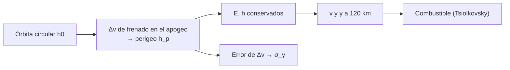

# B118-C13 — Desorbitación controlada

<!-- nav:top -->
[🏠 Programa](../../../../README.md) · [📚 Bloque B118](../../../tronco-comun/B118-trafico-espacial-y-sostenibilidad-orbital.md) · [← Anterior: B118-C12 — Disposición al fin de vida](../B118-C12-disposicion-al-fin-de-vida/CLASE.md) · [Siguiente: B118-C14 — Reentrada y riesgos en superficie →](../B118-C14-reentrada-y-riesgos-en-superficie/CLASE.md)
<!-- /nav -->

## 1. Ubicación, nivel y alcance

Clase 13 del bloque B118. Nivel N4. Quinta clase del tramo «Desechos, fin de vida y reentrada». Una desorbitación controlada baja el perigeo con un impulso para que la reentrada ocurra en un momento y un lugar elegidos. Aquí calculas, para un satélite **sintético** de 800 kg en órbita circular de 500 km, el **Δv, el combustible y el ángulo de entrada** para distintos perigeos objetivo, y la **dispersión** que produce un error de impulso de 0,5 m/s. La masa, el Isp y la interfaz atmosférica son **ilustrativos**. **Esta clase es educativa: no constituye asesoría legal, regulatoria, financiera ni operativa y no sustituye la lectura del texto normativo vigente ni a un profesional habilitado.**

## 2. Por qué esta clase existe

La reentrada controlada dirige los restos a una zona despoblada; la no controlada deja el lugar al azar del arrastre. Pero un impulso con error cambia el ángulo y el punto de entrada. La decisión central: **¿cuánto Δv cuesta bajar el perigeo hasta la atmósfera y qué tan sensible es el ángulo de entrada al error del impulso?**

## 3. Lo que podrás hacer al terminar

1. Calcular el Δv de frenado en el apogeo de una órbita circular para un perigeo objetivo.
2. Obtener el ángulo de trayectoria de entrada en la interfaz de 120 km con energía y momento angular.
3. Calcular el combustible con Tsiolkovsky.
4. Verificar el perigeo recuperado desde `(E, h)` (error 1,8 × 10⁻¹¹ km).
5. Contrastar la dispersión de Monte Carlo con la linealización (5 %).
6. Reconocer qué no resuelve el modelo: punto de impacto, arrastre previo y fragmentación.

La evidencia es la **ficha de plan de desorbitación** del ejercicio 12 (sección 20).

## 4. Con qué llegas y cómo comprobarlo

1. ¿Qué es la energía específica?
2. ¿Qué es el momento angular específico?
3. ¿Qué es una interfaz atmosférica?
4. ¿Qué es una linealización?
5. ¿Qué es la ecuación de Tsiolkovsky?

<details>
<summary>Ver respuestas</summary>

1. `E = v²/2 − μ/r`. 2. `h = r v cos γ`, con `γ` el ángulo de trayectoria. 3. Una altitud de referencia donde se considera que empieza la reentrada. 4. Aproximar una función por su derivada en un punto. 5. `Δm = m₀(1 − exp(−Δv/(Isp g₀)))`.
</details>

Con cuatro o cinco aciertos, sigue; si no, repasa los prerrequisitos.

## 5. Un caso de contexto y casos de referencia

Las directrices de la COPUOS (2010, consultadas) piden retirar de LEO de forma controlada los objetos al final de la misión y, si no es posible, dejarlos en órbitas que eviten su presencia prolongada; y señalan que los restos que lleguen a la superficie no deben suponer un riesgo indebido para personas o bienes (directriz 6). La IADC Rev. 4 (consultada) ordena como primera preferencia la reentrada directa. El **ejemplo conductor** baja el perigeo de una órbita de 500 km hasta 0 km (ficticio, dentro de la Tierra) con 144,9 m/s.

## 6. Vocabulario

Una **desorbitación controlada** dirige la reentrada. La **interfaz de reentrada** es la altitud (aquí 120 km, ilustrativa) a la que se evalúa el ángulo. El **ángulo de trayectoria** `γ` es el ángulo bajo el horizonte local. El **perigeo objetivo** es el que se quiere tras el impulso. La **dispersión** es la variabilidad del resultado ante un error. El **combustible** es el propelente del impulso.

## 7. Modelo mental



*Descripción textual:* un impulso en el apogeo fija la energía y el momento angular; de ellos salen la velocidad y el ángulo en la interfaz, y el error del impulso se propaga a ese ángulo.

Analogía: lanzar una pelota a una canasta; un pequeño error en la fuerza cambia dónde cae. Límite: en la realidad el arrastre previo, la sustentación y la fragmentación determinan el punto de impacto.

## 8. La explicación, paso a paso

### 8.1 Δv de frenado

Desde `r₀ = 6878,137 km`, un impulso retrógrado en ese punto (el apogeo de la nueva elipse) con perigeo objetivo `r_p`: `Δv = v_c − √(μ(2/r₀ − 1/a))` con `a = (r₀ + r_p)/2`. Resultados: perigeo 300 km → 56,4 m/s; 150 km → 100,0 m/s; 100 km → 114,9 m/s; 50 km → 129,8 m/s; 0 km → **144,95 m/s**.

### 8.2 Ángulo de entrada

Con `E` y `h` de la elipse, a 120 km: `v = √(2(E + μ/r))` y `cos γ = h/(r v)`. Perigeo 100 km → 0,748°; 50 km → 1,405°; 0 km → **1,847°**, con `v = 7,9085 km/s`. Los perigeos de 300 y 150 km no llegan a la interfaz.

### 8.3 Combustible

Con 800 kg e Isp 300 s: 100 km → 30,63 kg; 50 km → 34,54 kg; 0 km → 38,46 kg.

### 8.4 Error de impulso

Con `σ(Δv) = 0,5 m/s` (4000 muestras): `γ = 1,846 ± 0,013°`; la linealización `|dγ/dΔv| σ = 0,013°` coincide. Un error de 0,5 m/s cambia el ángulo en ~0,013°, lo que mueve el punto de entrada decenas de km (la clase no calcula el desplazamiento).

## 9. Magnitudes, símbolos y unidades

| Símbolo | Qué es | Unidad | Valor / nota |
|---|---|---|---|
| `h₀` | altitud inicial | km | 500 |
| `h_p` | perigeo objetivo | km | 0 (ficticio) |
| `Δv` | impulso de frenado | m/s | 144,95 |
| `γ` | ángulo de entrada a 120 km | grados | 1,847 |
| `σ_γ` | dispersión por error de Δv | grados | 0,013 |

## 10. Convenciones y referencias

Órbita circular de partida; impulso retrógrado instantáneo en `t = 0`; sin arrastre previo; interfaz de 120 km ilustrativa. Longitudes en km, velocidades en km/s (m/s para el Δv). `GM = 398 600,4418 km³/s²` y `g₀ = 9,80665 m/s²` (convencionales, no consultados). Datos sintéticos.

## 11. De dónde sale lo que afirmamos

| ID | Fuente | Localizador | Respalda | Estado |
|---|---|---|---|---|
| S1 | Space Debris Mitigation Guidelines of the Committee on the Peaceful Uses of Outer Space (UNOOSA, Viena, 2010; COPUOS 2007, resolución 62/217 de la Asamblea General) — https://www.unoosa.org/documents/pdf/psa/bsti/COPUOS_SPACE_DEBRIS_MITIGATION_GUIDELINES.pdf (consultada 2026-11-11; PDF leído con PyMuPDF) | directriz 6 | retirar de forma controlada los objetos de LEO al final de la misión; considerar que los restos que lleguen al suelo no supongan un riesgo indebido | Consultada |
| S3 | IADC Space Debris Mitigation Guidelines, IADC-02-01 Rev. 4 (enero de 2025), presentadas como A/AC.105/C.1/2025/CRP.9 (3 de febrero de 2025) — https://www.unoosa.org/res/oosadoc/data/documents/2025/aac_105c_12025crp/aac_105c_12025crp_9_0_html/AC105_C1_2025_CRP09E.pdf (consultada 2026-11-11; PDF leído con PyMuPDF) | sección 5.3.2 | reentrada directa como primera preferencia; 10⁻⁴ como límite de víctimas esperadas | Consultada |
| — | Mecánica de dos cuerpos, energía y momento angular | — | todo el cálculo | No consultada (relaciones estándar; perigeo recuperado a 1e-6 km) |
| — | Masa de 800 kg, Isp 300 s, interfaz de 120 km | — | combustible y ángulo | Ilustrativo |

Límites: las directrices indican la preferencia y el límite de riesgo, no el procedimiento; no se consultó ninguna guía de reentrada controlada ni modelos de reentrada.

## 12. Cómo ver los resultados

| Magnitud | Valor |
|---|---|
| Δv a perigeo 0 km | 144,95 m/s |
| Ángulo de entrada | 1,847° |
| Combustible | 38,46 kg |
| `σ_γ` por error de 0,5 m/s | 0,013° |

Descripción larga: más Δv produce una entrada más pronunciada; un perigeo de 100 km da menos de 1° y uno de 0 km casi 2°; el error de impulso añade una décima de grado como mucho.

## 13. Ejemplo trabajado

**Paso 1 · Velocidades.** `v_c = √(μ/r₀) = 7,6126 km/s`.

**Paso 2 · Elipse.** `a = (6878,137 + 6378,137)/2 = 6628,137 km`.

**Paso 3 · Velocidad en el apogeo.** `√(μ(2/r₀ − 1/a)) = 7,4677 km/s`.

**Paso 4 · Δv.** `144,95 m/s`.

## 14. Distintas formas de describir el problema

**Por energía:** `E`, `h`. **Por ángulo:** `γ`. **Por combustible:** `Δm`. **Por riesgo:** dispersión. **Por tabla:** perigeo, Δv, γ.

## 15. Práctica guiada

**Ejercicio 1 · con los pasos indicados.** Calcula la velocidad circular a 500 km. *Pasos:* `√(μ/(6378,137 + 500))`.

<details><summary>Solución comentada</summary>

`7,6126 km/s`.
</details>

**Ejercicio 2 · con una pista.** Calcula `a` de la elipse con perigeo 0 km. *Pista:* promedio de radios.

<details><summary>Solución comentada</summary>

`6628,137 km`.
</details>

**Ejercicio 3 · casi autónomo.** ¿Cuánto combustible pide un Δv de 100 m/s con 800 kg e Isp 300 s?

<details><summary>Solución comentada</summary>

`800 × (1 − exp(−100/2942,0)) = 26,74 kg`.
</details>

## 16. Práctica autónoma, transferencia e integrador

**Ejercicio 4 · autónomo.** ¿Qué perigeo objetivo no alcanza la interfaz de 120 km?

<details><summary>Solución comentada</summary>

Los mayores de 120 km (300 y 150 km en la tabla).
</details>

**Ejercicio 5 · autónomo.** Si el error de impulso fuera de 1 m/s, ¿cuánto sería `σ_γ` (lineal)?

<details><summary>Solución comentada</summary>

`0,026°` (el doble).
</details>

**Ejercicio 6 · autónomo.** ¿Cuánto crece el ángulo entre perigeo 100 km y 0 km?

<details><summary>Solución comentada</summary>

`1,098°`.
</details>

**Ejercicio 7 · autónomo.** ¿Es coherente la dispersión de Monte Carlo (0,013°) con la lineal (0,013°)?

<details><summary>Solución comentada</summary>

Sí; la tolerancia usada es 5 %.
</details>

**Ejercicio 8 · autónomo.** ¿Por qué el perigeo se recupera con `(E, h)`?

<details><summary>Solución comentada</summary>

Porque ambas magnitudes definen la elipse; es una verificación independiente del cálculo de `Δv`.
</details>

**Ejercicio 9 · transferencia.** **Transferencia.** ¿Qué hace una reentrada controlada preferible a una no controlada?

<details><summary>Solución comentada</summary>

Permite elegir una zona poco habitada (p. ej. océano) y reduce el riesgo en superficie (B118-C14).
</details>

**Ejercicio 10 · transferencia.** **Transferencia.** ¿Qué información falta para decidir el punto de impacto?

<details><summary>Solución comentada</summary>

El arrastre en la entrada, la masa y forma de los fragmentos, la fragmentación y los vientos; el modelo no los incluye.
</details>

**Ejercicio 11 · transferencia.** **Transferencia.** Un operador propone aprovechar el combustible sobrante del último año para desorbitar. ¿Qué verificas?

<details><summary>Solución comentada</summary>

Que el combustible alcance para el Δv con margen (incluidas fugas y errores) y que no se pierda la capacidad de pasivar.
</details>

**Ejercicio 12 · integrador.** **Integrador.** Elabora tu *ficha de plan de desorbitación*: tabla de Δv, ángulo y combustible por perigeo, dispersión por error de impulso, comprobación del perigeo recuperado y lista de qué es consultado, estándar no consultado e ilustrativo.

<details><summary>Solución comentada</summary>

Secciones 8.1–8.4 y la salida del laboratorio.
</details>

## 17. Laboratorio

El script [desorbitacion.py](desorbitacion.py) calcula el Δv, el ángulo de entrada y el combustible para varios perigeos objetivo y propaga el error de impulso con Monte Carlo (**comprueba** el perigeo recuperado y la dispersión a 5 %).

**Datos:** satélite **sintético**; masa, Isp e interfaz **ilustrativos**; directrices de la COPUOS e IADC **consultadas**. **Predice antes de ejecutar:** ¿qué ángulo de entrada espera con perigeo 0 km? (cerca de 2°.) **Ejecución del 2026-11-11 (Python 3.12.9):**

```text
Python 3.12.9 (biblioteca estandar)
Satelite SINTETICO de 800 kg, orbita circular de 500 km; Isp 300 s e interfaz de 120 km ILUSTRATIVOS; dos cuerpos.
 perigeo objetivo [km]   dv [m/s]   gamma interfaz [deg]   combustible [kg]
                300      56.36          -                15.18
                150     100.03          -                26.74
                100     114.86            0.748          30.63
                 50     129.83            1.405          34.54
                  0     144.95            1.847          38.46
Objetivo (perigeo 0 km): dv = 144.95 m/s; gamma = 1.847 deg; v en la interfaz = 7.9085 km/s
Perigeo recuperado desde (E, h) menos el objetivo: 1.82e-11 km
Con error de impulso de 0.5 m/s (4000 muestras): gamma = 1.846 +- 0.013 deg; linealizacion 0.013 deg
Pruebas superadas (perigeo recuperado a 1e-6 km; sigma de gamma por Monte Carlo = linealizacion a 5 %).
```

```bash
python programa/clases/B118/B118-C13-desorbitacion-controlada/desorbitacion.py
```

**Límites:** dos cuerpos, impulso instantáneo, sin arrastre previo ni sustentación; no calcula el punto de impacto.

## 18. Errores frecuentes y cómo corregirlos

**Creer que cualquier perigeo bajo entra a la atmósfera.** Se corrige con 8.2.

**Olvidar el sentido retrógrado del impulso.** Se corrige con 8.1.

**Suponer que el ángulo no depende del error de impulso.** Se corrige con 8.4.

**Usar el ángulo como predicción del punto de impacto.** Se corrige con el ejercicio 10.

## 19. Cómo sabrás que vas bien

Tras la sección 8: ¿qué Δv esperabas y cuál obtuviste? Si dudas, repasa el ejemplo 13. Tras el laboratorio: ¿qué comprueba? (ver la sección 17).

## 20. Qué entregas y cómo se evalúa

El producto es tu **ficha de plan de desorbitación** (ejercicio 12).

| Criterio | Inicial | En desarrollo | Logrado | Destacado |
|---|---|---|---|---|
| Conceptos | Los confunde | Parciales | Calcula Δv, γ y dispersión | Explica los límites del modelo |
| Cálculo | Sin unidades | Con errores | Tablas completas con unidades | Calcula casos nuevos |
| Numérico | Sin comprobar | Un caso | Contraste con una segunda vía | Interpreta las diferencias |
| Fuentes | Sin fuente | Sin fecha | Fuentes con fecha, versión y estado | Declara lo ilustrativo y lo no consultado |
| Límites | No los nombra | Uno | Tres | Discute qué falta del modelo |

**Condiciones críticas (no se compensan con promedio):** rotular los datos sintéticos e ilustrativos como tales; no presentar un modelo como observación; citar solo lo consultado, con su versión y fecha; no usar la ficha como asesoría legal, regulatoria o financiera.

## 21. Ética, seguridad y límites

Clase educativa: **no constituye asesoría legal, regulatoria ni financiera** ni orienta decisiones operativas reales, y no sustituye la lectura del texto normativo vigente (se cita siempre la versión y la fecha consultadas) ni la opinión de un especialista habilitado. Los modelos son simplificados y sus datos son sintéticos o ilustrativos. Accesibilidad: tablas equivalentes a las gráficas, fórmulas en texto, ejercicios sin conexión.

## 22. Para cerrar y seguir

Bajar el perigeo de una órbita de 500 km a 0 km cuesta 145 m/s y 38 kg de propelente, y da una entrada de 1,8°, con una dispersión de 0,013° por un error de 0,5 m/s. Queda una pregunta: ¿qué sobrevive a la reentrada y cuánto riesgo supone?

**Glosario español–inglés.** desorbitación controlada · *controlled deorbit* · interfaz de reentrada · *entry interface* · ángulo de trayectoria · *flight-path angle* · perigeo · *perigee* · dispersión · *dispersion*.

**Continuidad.** [B118-C14](../B118-C14-reentrada-y-riesgos-en-superficie/CLASE.md) estudia la reentrada y los riesgos en superficie.

**Referencias:** ver sección 11.

<!-- nav:bottom -->
---

[← Anterior: B118-C12 — Disposición al fin de vida](../B118-C12-disposicion-al-fin-de-vida/CLASE.md) · [📚 Bloque B118](../../../tronco-comun/B118-trafico-espacial-y-sostenibilidad-orbital.md) · [Siguiente: B118-C14 — Reentrada y riesgos en superficie →](../B118-C14-reentrada-y-riesgos-en-superficie/CLASE.md)
<!-- /nav -->
