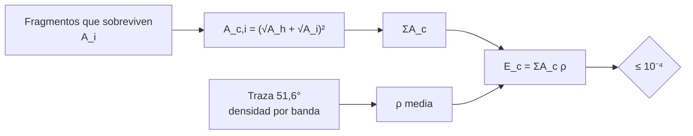

# B118-C14 — Reentrada y riesgos en superficie

<!-- nav:top -->
[🏠 Programa](../../../../README.md) · [📚 Bloque B118](../../../tronco-comun/B118-trafico-espacial-y-sostenibilidad-orbital.md) · [← Anterior: B118-C13 — Desorbitación controlada](../B118-C13-desorbitacion-controlada/CLASE.md) · [Siguiente: B118-C15 — Seguimiento de mega constelaciones →](../B118-C15-seguimiento-de-mega-constelaciones/CLASE.md)
<!-- /nav -->

## 1. Ubicación, nivel y alcance

Clase 14 del bloque B118. Nivel N4. Sexta clase del tramo «Desechos, fin de vida y reentrada». Lo que sobrevive a la reentrada puede llegar al suelo. Aquí calculas el **área de víctima**, el **número esperado de víctimas** `E_c` de 12 fragmentos **sintéticos** que sobreviven, con densidades de población **sintéticas** por banda de latitud, y lo comparas con el límite de **10⁻⁴** de la IADC Rev. 4. La clase **no** evalúa ningún evento real ni da consejo de seguridad personal. **Esta clase es educativa: no constituye asesoría legal, regulatoria, financiera ni operativa y no sustituye la lectura del texto normativo vigente ni a un profesional habilitado.**

## 2. Por qué esta clase existe

El riesgo en superficie se controla antes de lanzar: limitando los fragmentos que sobreviven o confinando la reentrada a zonas despobladas. La decisión central: **¿cuánta área de víctima se puede aceptar para respetar 10⁻⁴ y cómo influye dónde cae?**

## 3. Lo que podrás hacer al terminar

1. Calcular el área de víctima `A_c = (√A_h + √A_i)²` por fragmento.
2. Calcular la densidad media de población expuesta a lo largo de la traza de una órbita de 51,6° (muestreo uniforme del argumento de latitud).
3. Calcular `E_c = ΣA_c × ρ` y compararlo con 10⁻⁴ (aquí `5,42 × 10⁻⁴`, supera).
4. Obtener el área de víctima máxima admisible (1,60 m²).
5. Ver el efecto de confinar el riesgo al océano.
6. Rotular las densidades y las áreas como sintéticas e ilustrativas.

La evidencia es la **ficha de riesgo en superficie de una reentrada** del ejercicio 12 (sección 20).

## 4. Con qué llegas y cómo comprobarlo

1. ¿Qué es un área de víctima?
2. ¿Qué es una densidad de población?
3. ¿Qué es una traza terrestre?
4. ¿Qué es el valor esperado?
5. ¿Qué es el límite de 10⁻⁴?

<details>
<summary>Ver respuestas</summary>

1. El área alrededor de un fragmento dentro de la cual una persona sería alcanzada. 2. Personas por km². 3. La proyección del movimiento de un satélite sobre la superficie. 4. El promedio ponderado por la probabilidad. 5. El máximo número esperado de víctimas por reentrada recomendado por la IADC.
</details>

Con cuatro o cinco aciertos, sigue; si no, repasa los prerrequisitos.

## 5. Un caso de contexto y casos de referencia

Las directrices IADC Rev. 4 (enero de 2025, consultadas) recomiendan usar 10⁻⁴ como límite superior del número esperado de víctimas por reentrada, limitando los restos que sobreviven o confinándolos a regiones no habitadas como los océanos; la directriz 6 de la COPUOS (2010, consultada) pide que los restos que lleguen al suelo no supongan un riesgo indebido. El **ejemplo conductor** son 12 fragmentos sintéticos de entre 0,01 y 0,30 m².

## 6. Vocabulario

El **área de víctima** `A_c` es el área efectiva donde una persona sería alcanzada. El **número esperado de víctimas** `E_c` es la suma de áreas de víctima por la densidad de población. La **densidad expuesta** es la media a lo largo de la traza. La **supervivencia** es la fracción de la masa o de los fragmentos que llega al suelo. La **zona de dispersión** es el área de caída posible. Un **sitio oceánico** es una zona de caída sin población.

## 7. Modelo mental



*Descripción textual:* cada fragmento aporta un área de víctima; la suma se multiplica por la densidad de población media de las latitudes que recorre la traza y se compara con el límite.

Analogía: lluvia de granizo sobre una ciudad; el daño esperado crece con el área de cada piedra y con cuántas personas hay debajo. Límite: la caída real es puntual y depende de dónde y cuándo ocurra.

## 8. La explicación, paso a paso

### 8.1 Área de víctima

`A_c = (√A_h + √A_i)²` con `A_h = 0,36 m²` (área proyectada de una persona; forma habitual **no consultada** aquí). El término `√A_h` domina para fragmentos pequeños: un fragmento de 0,01 m² da `A_c/A = 49,0`; uno de 0,30 m², `4,39`. Los 12 fragmentos suman **8,680 m²**.

### 8.2 Densidad expuesta

Seis bandas de 10° de latitud con densidades sintéticas (45; 70; 110; 80; 50; 20 personas/km²). Muestreando uniformemente el argumento de latitud de una órbita de 51,6°, la densidad media es **62,47 personas/km²** (estable al duplicar los puntos).

### 8.3 Riesgo

`E_c = 8,680 × 10⁻⁶ km² × 62,47 = 5,422 × 10⁻⁴`, **por encima de 10⁻⁴**. Si el riesgo se confinara al océano (fracción terrestre ilustrativa de 0,29): 1,572 × 10⁻⁴. El área de víctima máxima que cumple 10⁻⁴ es **1,60 m²**. Con densidad uniforme de 45/km²: 3,906 × 10⁻⁴.

### 8.4 Qué no dice

El modelo no calcula qué fragmentos sobreviven (depende de materiales y calentamiento), ni la zona real de caída, ni la hora; y la lectura «supera o cumple» es una comprobación aritmética, no una evaluación regulatoria.

## 9. Magnitudes, símbolos y unidades

| Símbolo | Qué es | Unidad | Valor / nota |
|---|---|---|---|
| `A_h` | área de una persona | m² | 0,36 (ilustrativa) |
| `A_c` | área de víctima total | m² | 8,680 |
| `ρ` | densidad media expuesta | personas/km² | 62,47 |
| `E_c` | víctimas esperadas | adimensional | 5,42 × 10⁻⁴ |
| límite | IADC Rev. 4 | adimensional | 10⁻⁴ |

## 10. Convenciones y referencias

Áreas en m² (km² para la densidad: 1 m² = 10⁻⁶ km²). Latitud de la traza: `sin φ = sin i sin u` con `u` uniforme. Densidades sintéticas por banda, no de ningún país. Fragmentos sintéticos. Dos decimales de resultado; ninguna cifra describe un evento real.

## 11. De dónde sale lo que afirmamos

| ID | Fuente | Localizador | Respalda | Estado |
|---|---|---|---|---|
| S3 | IADC Space Debris Mitigation Guidelines, IADC-02-01 Rev. 4 (enero de 2025), presentadas como A/AC.105/C.1/2025/CRP.9 (3 de febrero de 2025) — https://www.unoosa.org/res/oosadoc/data/documents/2025/aac_105c_12025crp/aac_105c_12025crp_9_0_html/AC105_C1_2025_CRP09E.pdf (consultada 2026-11-11; PDF leído con PyMuPDF) | sección 5.3.2 | 10⁻⁴ como límite superior de víctimas esperadas por reentrada; confinar los restos a regiones no habitadas | Consultada |
| S1 | Space Debris Mitigation Guidelines of the Committee on the Peaceful Uses of Outer Space (UNOOSA, Viena, 2010; COPUOS 2007, resolución 62/217 de la Asamblea General) — https://www.unoosa.org/documents/pdf/psa/bsti/COPUOS_SPACE_DEBRIS_MITIGATION_GUIDELINES.pdf (consultada 2026-11-11; PDF leído con PyMuPDF) | directriz 6 | los restos que lleguen al suelo no deben suponer un riesgo indebido | Consultada |
| — | Fórmula `A_c = (√A_h + √A_i)²` y `A_h = 0,36 m²` (estándares de seguridad de reentrada) | — | área de víctima | No consultada |
| — | Fragmentos y densidades de población | — | riesgo | Sintético / ilustrativo |

Límites: el límite de 10⁻⁴ se leyó en el PDF de la IADC; la fórmula del área de víctima y los datos demográficos no se consultaron; esta clase no sustituye una evaluación de riesgo de reentrada.

## 12. Cómo ver los resultados

| Magnitud | Valor |
|---|---|
| `A_c` total | 8,680 m² |
| Densidad media | 62,47 personas/km² |
| `E_c` | 5,422 × 10⁻⁴ |
| `E_c` confinado al océano | 1,572 × 10⁻⁴ |
| `A_c` máxima para 10⁻⁴ | 1,60 m² |

Descripción larga: el riesgo esperado de esta reentrada sintética queda por encima del límite; bajarlo requiere reducir el área de víctima por unos factores de 5 o confinar la caída al océano.

## 13. Ejemplo trabajado

**Paso 1 · Un fragmento.** `A_i = 0,10 m²`: `(√0,36 + √0,10)² = (0,6 + 0,316)² = 0,839 m²`.

**Paso 2 · Suma.** Los 12 fragmentos dan 8,680 m².

**Paso 3 · Riesgo.** `8,680 × 10⁻⁶ × 62,47 = 5,422 × 10⁻⁴`.

**Paso 4 · Margen.** `10⁻⁴ / 5,422 × 10⁻⁴ = 0,18`: haría falta reducir el área de víctima a esa fracción.

## 14. Distintas formas de describir el problema

**Por fragmento:** `A_c,i`. **Por suma:** `ΣA_c`. **Por geografía:** densidad media. **Por límite:** 10⁻⁴. **Por mitigación:** confinar a océano.

## 15. Práctica guiada

**Ejercicio 1 · con los pasos indicados.** Calcula el área de víctima de un fragmento de 0,25 m². *Pasos:* `√0,36 = 0,6`, `√0,25 = 0,5`.

<details><summary>Solución comentada</summary>

`(0,6 + 0,5)² = 1,21 m²`.
</details>

**Ejercicio 2 · con una pista.** Calcula `A_c` de un fragmento de 0,01 m². *Pista:* `√0,01 = 0,1`.

<details><summary>Solución comentada</summary>

`(0,6 + 0,1)² = 0,49 m²`.
</details>

**Ejercicio 3 · casi autónomo.** Si `A_c` total es 3 m² y la densidad 50/km², calcula `E_c`.

<details><summary>Solución comentada</summary>

`3 × 10⁻⁶ × 50 = 1,50 × 10⁻⁴`.
</details>

## 16. Práctica autónoma, transferencia e integrador

**Ejercicio 4 · autónomo.** ¿Qué `A_c` total cumple 10⁻⁴ con 50/km²?

<details><summary>Solución comentada</summary>

`10⁻⁴/(50 × 10⁻⁶) = 2,00 m²`.
</details>

**Ejercicio 5 · autónomo.** Si la fracción terrestre cae a 0,10, ¿cuánto vale `E_c` para este caso?

<details><summary>Solución comentada</summary>

`5,42 × 10⁻⁵`.
</details>

**Ejercicio 6 · autónomo.** ¿Cuántas veces supera `E_c` (5,42 × 10⁻⁴) al límite?

<details><summary>Solución comentada</summary>

`5,42`.
</details>

**Ejercicio 7 · autónomo.** ¿Por qué muchos fragmentos pequeños pueden pesar más que uno grande?

<details><summary>Solución comentada</summary>

Porque `A_c` incluye el término fijo `√A_h`: 49 veces el área de uno de 0,01 m²; diez de esos suman 4,90 m².
</details>

**Ejercicio 8 · autónomo.** ¿Qué banda de latitud tiene la mayor densidad sintética y qué consecuencia tiene para una órbita de 51,6°?

<details><summary>Solución comentada</summary>

La de 20–30° (110/km²); la traza pasa por ella dos veces por órbita.
</details>

**Ejercicio 9 · transferencia.** **Transferencia.** Un operador dice «el riesgo es 10⁻⁵, está bien». ¿Qué datos pides?

<details><summary>Solución comentada</summary>

Número y área de los fragmentos que sobreviven, densidad usada, método de supervivencia y versión de la norma aplicada.
</details>

**Ejercicio 10 · transferencia.** **Transferencia.** ¿Qué hace más eficaz: reducir fragmentos que sobreviven o confinar a océano?

<details><summary>Solución comentada</summary>

Ambos; la reducción actúa sobre `A_c` y el confinamiento sobre la densidad; lo ideal es combinarlos.
</details>

**Ejercicio 11 · transferencia.** **Transferencia.** ¿Es esta clase una guía para evaluar un evento de reentrada actual?

<details><summary>Solución comentada</summary>

No: usa datos sintéticos; para un evento real hay que acudir a las autoridades y los modelos oficiales.
</details>

**Ejercicio 12 · integrador.** **Integrador.** Elabora tu *ficha de riesgo en superficie de una reentrada*: lista de fragmentos y áreas, `A_c` total, densidad media, `E_c` frente a 10⁻⁴, el efecto de confinar a océano y la lista de qué es consultado, no consultado y sintético, con el aviso de que es educativa.

<details><summary>Solución comentada</summary>

Secciones 8.1–8.4 y la salida del laboratorio.
</details>

## 17. Laboratorio

El script [reentrada.py](reentrada.py) calcula las áreas de víctima, la densidad media a lo largo de una traza de 51,6° y `E_c` (**comprueba** que la densidad es estable al duplicar el muestreo y que `A_c/A > 1`).

**Datos:** fragmentos y densidades **sintéticos**; `A_h` **no consultada**; límite de 10⁻⁴ **consultado** (IADC Rev. 4). **Predice antes de ejecutar:** ¿cumple 10⁻⁴ la reentrada sintética? (no, queda unas 5 veces por encima.) **Ejecución del 2026-11-11 (Python 3.12.9):**

```text
Python 3.12.9 (biblioteca estandar)
Fragmentos y densidades de poblacion SINTETICOS; A_h = 0.36 m^2 ILUSTRATIVO; limite 1e-4 consultado (IADC Rev.4).
12 fragmentos sobrevivientes sinteticos; area de victima total A_c = 8.680 m^2
Densidad media expuesta (inclinacion 51.6 deg): 62.47 personas/km^2 (con el doble de puntos: 62.47)
E_c = 5.422e-04; limite 1e-4 -> SUPERA
Si el riesgo se confinara al oceano (fraccion terrestre 0.29, ILUSTRATIVA): E_c = 1.572e-04
Area de victima maxima que cumple 1e-4: 1.60 m^2
Control con densidad uniforme de 45 /km^2: E_c = 3.906e-04
A_c/A: fragmento de 0.01 m^2 -> 49.0; de 0.30 m^2 -> 4.39
Pruebas superadas (promedio de densidad estable a 2 %; area de victima mayor que el area geometrica).
```

```bash
python programa/clases/B118/B118-C14-reentrada-y-riesgos-en-superficie/reentrada.py
```

**Límites:** no modela la supervivencia ni la zona de caída; las densidades son por banda y constantes; sin variación temporal.

## 18. Errores frecuentes y cómo corregirlos

**Usar el área geométrica en vez del área de víctima.** Se corrige con 8.1.

**Mezclar m² y km².** Se corrige con la sección 10.

**Tomar el cálculo aritmético como una evaluación regulatoria.** Se corrige con 8.4.

**Olvidar la dependencia con la inclinación de la traza.** Se corrige con 8.2.

## 19. Cómo sabrás que vas bien

Tras la sección 8: ¿qué `E_c` esperabas y cuál obtuviste? Si dudas, repasa el ejemplo 13. Tras el laboratorio: ¿qué comprueba? (ver la sección 17).

## 20. Qué entregas y cómo se evalúa

El producto es tu **ficha de riesgo en superficie de una reentrada** (ejercicio 12).

| Criterio | Inicial | En desarrollo | Logrado | Destacado |
|---|---|---|---|---|
| Conceptos | Los confunde | Parciales | Calcula `A_c`, `ρ` y `E_c` | Explica los límites del modelo |
| Cálculo | Sin unidades | Con errores | Tablas completas con unidades | Calcula casos nuevos |
| Numérico | Sin comprobar | Un caso | Contraste con una segunda vía | Interpreta las diferencias |
| Fuentes | Sin fuente | Sin fecha | Fuentes con fecha, versión y estado | Declara lo ilustrativo y lo no consultado |
| Límites | No los nombra | Uno | Tres | Discute qué falta del modelo |

**Condiciones críticas (no se compensan con promedio):** rotular los datos sintéticos e ilustrativos como tales; no presentar un modelo como observación; citar solo lo consultado, con su versión y fecha; no usar la ficha como asesoría legal, regulatoria o financiera.

## 21. Ética, seguridad y límites

Clase educativa: **no constituye asesoría legal, regulatoria ni financiera** ni orienta decisiones operativas reales, y no sustituye la lectura del texto normativo vigente (se cita siempre la versión y la fecha consultadas) ni la opinión de un especialista habilitado. Los modelos son simplificados y sus datos son sintéticos o ilustrativos. La clase no evalúa ningún evento real de reentrada ni da instrucciones de seguridad personal; ante un evento real, siga a las autoridades de protección civil. Accesibilidad: tablas equivalentes a las gráficas, fórmulas en texto, ejercicios sin conexión.

## 22. Para cerrar y seguir

Doce fragmentos sintéticos suman 8,7 m² de área de víctima y un `E_c` de 5,4 × 10⁻⁴, unas 5,4 veces el límite de 10⁻⁴. Queda una pregunta: ¿qué pasa cuando miles de satélites están sujetos a la misma exigencia?

**Glosario español–inglés.** área de víctima · *casualty area* · víctimas esperadas · *expected casualties* · reentrada · *re-entry* · traza terrestre · *ground track* · densidad de población · *population density*.

**Continuidad.** [B118-C15](../B118-C15-seguimiento-de-mega-constelaciones/CLASE.md) estudia el seguimiento de mega constelaciones.

**Referencias:** ver sección 11.

<!-- nav:bottom -->
---

[← Anterior: B118-C13 — Desorbitación controlada](../B118-C13-desorbitacion-controlada/CLASE.md) · [📚 Bloque B118](../../../tronco-comun/B118-trafico-espacial-y-sostenibilidad-orbital.md) · [Siguiente: B118-C15 — Seguimiento de mega constelaciones →](../B118-C15-seguimiento-de-mega-constelaciones/CLASE.md)
<!-- /nav -->
