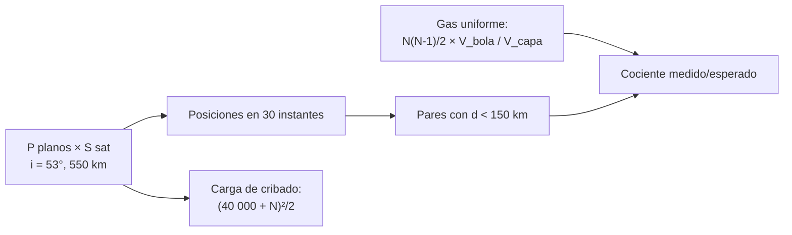

# B118-C15 — Seguimiento de mega constelaciones

<!-- nav:top -->
[🏠 Programa](../../../../README.md) · [📚 Bloque B118](../../../tronco-comun/B118-trafico-espacial-y-sostenibilidad-orbital.md) · [← Anterior: B118-C14 — Reentrada y riesgos en superficie](../B118-C14-reentrada-y-riesgos-en-superficie/CLASE.md) · [Siguiente: B118-C16 — Contaminación lumínica →](../B118-C16-contaminacion-luminica/CLASE.md)
<!-- /nav -->

## 1. Ubicación, nivel y alcance

Clase 15 del bloque B118. Nivel N3. Primera clase del tramo «Constelaciones, cielo y espectro». Una constelación numerosa multiplica los objetos que hay que seguir y las conjunciones posibles. Aquí construyes una **constelación sintética tipo Walker-delta** de 528 satélites a 550 km (no es el diseño de ninguna empresa), cuentas los **pares cercanos** en instantáneas y los comparas con la expectativa de un gas uniforme, y estimas la carga que añade al cribado del catálogo. **Esta clase es educativa: no constituye asesoría legal, regulatoria, financiera ni operativa y no sustituye la lectura del texto normativo vigente ni a un profesional habilitado.**

## 2. Por qué esta clase existe

La sección 5.5 de la IADC Rev. 4 pide planificar y operar las constelaciones para minimizar la probabilidad de colisión entre sus miembros, en los cruces de planos y con otras constelaciones, y minimizar el riesgo acumulado de reentradas. La decisión central: **¿cuántos acercamientos genera por sí sola una constelación y cuánto trabajo añade al seguimiento?**

## 3. Lo que podrás hacer al terminar

1. Generar una constelación Walker-delta `P/S/F` y propagarla con Kepler.
2. Contar los pares a menos de 150 km en 30 instantáneas (15,7 en promedio).
3. Comparar con la expectativa de un gas uniforme en la capa (10,9; cociente 1,44).
4. Explicar por qué el cociente supera 1 (los satélites se concentran en latitudes altas).
5. Estimar el aumento de pares a cribar frente a un catálogo de unos 40 000 objetos.
6. Rotular la constelación como sintética y las cifras de la ESA como consultadas.

La evidencia es la **ficha de carga de seguimiento de una constelación** del ejercicio 12 (sección 20).

## 4. Con qué llegas y cómo comprobarlo

1. ¿Qué es una constelación Walker-delta?
2. ¿Qué es un gas uniforme?
3. ¿Qué es una instantánea?
4. ¿Qué es el número de pares?
5. ¿Qué es un cribado?

<details>
<summary>Ver respuestas</summary>

1. Un patrón `i: T/P/F` de `T` satélites en `P` planos igualmente espaciados con fase relativa `F`. 2. Una distribución en la que la probabilidad de encontrar un objeto en un volumen es proporcional al volumen. 3. El estado de todos los objetos en un solo instante. 4. `N(N−1)/2`. 5. Un filtro rápido que descarta pares sin posibilidad de acercarse.
</details>

Con cuatro o cinco aciertos, sigue; si no, repasa los prerrequisitos.

## 5. Un caso de contexto y casos de referencia

La sección 5.5 de las directrices IADC Rev. 4 (enero de 2025, consultadas) recomienda separación suficiente entre todas las partes de la constelación, en los cruces de planos y respecto a otras constelaciones o a órbitas densamente pobladas, y que se minimice el riesgo acumulado de las reentradas más frecuentes; la revisión añadió una sección sobre grandes constelaciones. El informe de la ESA 2025 (consultado) cuenta unos 40 000 objetos seguidos. El **ejemplo conductor** es una constelación sintética de 24 planos × 22 satélites, 53°, 550 km.

## 6. Vocabulario

Una **constelación** es un conjunto de satélites que operan coordinados. Una **Walker-delta** reparte los satélites en planos igualmente espaciados en la ascensión recta. El **cruce de planos** es donde dos planos se intersecan. Un **par cercano** es un par a menos de una distancia umbral. La **expectativa de gas uniforme** estima los pares por razón de volúmenes. El **cribado** es el filtro rápido previo al cálculo fino.

## 7. Modelo mental



*Descripción textual:* se genera la constelación, se cuentan los pares cercanos en varias instantáneas y se comparan con la expectativa de un gas uniforme; por separado se estima el crecimiento de pares a cribar.

Analogía: cuántas personas quedan a menos de 2 m en una plaza; si hay más gente en el centro, el promedio uniforme subestima. Límite: aquí los satélites no maniobran y los errores de inyección son pequeños.

## 8. La explicación, paso a paso

### 8.1 Constelación

`N = 528` (24 planos × 22), `i = 53°`, `h = 550 km`, periodo 95,65 min. Se añaden errores de fase de ±3° (semilla 118) para que la geometría no sea perfecta.

### 8.2 Pares cercanos

En 30 instantáneas no conmensurables con el periodo, el promedio de pares a menos de 150 km es **15,70**. Esperado de un gas uniforme en una capa de 300 km de espesor: `N(N−1)/2 × V_bola/V_capa = 10,87`. El cociente **1,44** supera 1; la explicación probable es que con `i = 53°` los satélites se acumulan cerca de los extremos de latitud (donde la traza cambia más despacio de latitud), mientras que el gas uniforme supone densidad homogénea; la clase no lo verifica por separado.

### 8.3 Carga de seguimiento

Si cada objeto se actualiza cada 8 h (ilustrativo), la constelación añade 1584 actualizaciones por día. Pares a cribar con el catálogo de unos 40 000: antes 8,000 × 10⁸; después 8,212 × 10⁸ (×1,0266). El aumento de pares es de solo 2,7 %, pero **todos** los miembros están en la misma capa, de modo que las conjunciones se concentran allí.

### 8.4 Qué no cubre

No hay maniobras, ni fallos, ni fases de despliegue, ni otras constelaciones. La IADC pide además mantener la separación con las demás.

## 9. Magnitudes, símbolos y unidades

| Símbolo | Qué es | Unidad | Valor / nota |
|---|---|---|---|
| `N` | satélites | objetos | 528 |
| `i` | inclinación | grados | 53 |
| `h` | altitud | km | 550 |
| pares (<150 km) | promedio en 30 instantáneas | pares | 15,70 |
| cociente | medido / gas uniforme | adimensional | 1,44 |

## 10. Convenciones y referencias

Sistema inercial geocéntrico; Kepler de dos cuerpos; `GM = 398 600,4418 km³/s²` (convencional, no consultado). Distancia umbral 150 km (didáctica; las alertas reales usan umbrales mucho menores). Constelación sintética: no corresponde a ningún sistema real.

## 11. De dónde sale lo que afirmamos

| ID | Fuente | Localizador | Respalda | Estado |
|---|---|---|---|---|
| S3 | IADC Space Debris Mitigation Guidelines, IADC-02-01 Rev. 4 (enero de 2025), presentadas como A/AC.105/C.1/2025/CRP.9 (3 de febrero de 2025) — https://www.unoosa.org/res/oosadoc/data/documents/2025/aac_105c_12025crp/aac_105c_12025crp_9_0_html/AC105_C1_2025_CRP09E.pdf (consultada 2026-11-11; PDF leído con PyMuPDF) | sección 5.5 | separación entre miembros, en los cruces de planos y con otras constelaciones; minimizar el riesgo acumulado de reentradas | Consultada |
| S4 | ESA Space Environment Report 2025 (página, publicada el 1 de abril de 2025 con datos hasta fines de 2024) — https://www.esa.int/Space_Safety/Space_Debris/ESA_Space_Environment_Report_2025 (consultada 2026-11-11; página leída con WebFetch; el informe completo no se abrió) | página del informe | unos 40 000 objetos seguidos | Consultada |
| — | Diseños reales de constelaciones y su operación | — | comparación | No consultados |
| — | Constelación Walker sintética y errores de fase | — | pares y carga | Sintético |

Límites: no se consultó ningún sistema real ni documentos de operadores; la actualización cada 8 h es ilustrativa.

## 12. Cómo ver los resultados

| Magnitud | Valor |
|---|---|
| Pares < 150 km (promedio) | 15,70 |
| Esperado (gas uniforme) | 10,87 |
| Cociente | 1,44 |
| Actualizaciones/día | 1584 |
| Aumento de pares a cribar | ×1,0266 |

Descripción larga: los pares cercanos son más que los del gas uniforme por la concentración en latitudes altas; la carga de cribado crece poco en total pero se concentra en una sola capa.

## 13. Ejemplo trabajado

**Paso 1 · Pares totales.** `528 × 527/2 = 139128`.

**Paso 2 · Volúmenes.** `V_bola = 4π/3 × 150³ = 1,414 × 10⁷ km³`; `V_capa = 4π a² × 300 = 1,810 × 10¹¹ km³`.

**Paso 3 · Esperado.** `139128 × 7,813 × 10⁻⁵ = 10,87`.

**Paso 4 · Cociente.** `15,70/10,87 = 1,44`.

## 14. Distintas formas de describir el problema

**Por patrón:** `P/S/F`. **Por conteo:** pares cercanos. **Por teoría:** gas uniforme. **Por carga:** actualizaciones y pares a cribar. **Por separación:** cruces de planos.

## 15. Práctica guiada

**Ejercicio 1 · con los pasos indicados.** Calcula los pares de una constelación de 100 satélites. *Pasos:* `N(N−1)/2`.

<details><summary>Solución comentada</summary>

`4950`.
</details>

**Ejercicio 2 · con una pista.** Si el umbral de distancia se duplica, ¿cuánto crece el esperado de pares? *Pista:* volumen ∝ `d³`.

<details><summary>Solución comentada</summary>

Ocho veces.
</details>

**Ejercicio 3 · casi autónomo.** Si el espesor de la capa se duplica, ¿cuánto cae el esperado?

<details><summary>Solución comentada</summary>

A la mitad.
</details>

## 16. Práctica autónoma, transferencia e integrador

**Ejercicio 4 · autónomo.** Calcula el aumento relativo de pares al sumar 528 satélites a 40 000 objetos.

<details><summary>Solución comentada</summary>

`2,66 %`.
</details>

**Ejercicio 5 · autónomo.** Si se actualiza cada objeto cada 4 h, ¿cuántas actualizaciones/día añade la constelación?

<details><summary>Solución comentada</summary>

`528 × 24/4 = 3168`.
</details>

**Ejercicio 6 · autónomo.** ¿Es razonable un cociente de 1,44?

<details><summary>Solución comentada</summary>

Sí: entra en el rango de la prueba del laboratorio (0,3 a 3); el exceso tiene una explicación geométrica probable (8.2), no verificada aparte.
</details>

**Ejercicio 7 · autónomo.** ¿Por qué las constelaciones de 53° tienen más densidad cerca de ±53°?

<details><summary>Solución comentada</summary>

Porque `sin φ = sin i sin u`: la latitud cambia más despacio cerca de `±i`, así que el satélite pasa más tiempo allí.
</details>

**Ejercicio 8 · autónomo.** ¿Qué recomienda la IADC sobre los cruces de planos?

<details><summary>Solución comentada</summary>

Asegurar separación suficiente para evitar conjunciones entre los planos de la constelación.
</details>

**Ejercicio 9 · transferencia.** **Transferencia.** Un operador declara «cero conjunciones propias». ¿Qué pides?

<details><summary>Solución comentada</summary>

El método (umbral, covarianza, horizonte), la cobertura de las fases de despliegue y el tratamiento de fallos y otras constelaciones.
</details>

**Ejercicio 10 · transferencia.** **Transferencia.** ¿Por qué importa el tiempo de vida orbital residual en una constelación?

<details><summary>Solución comentada</summary>

Porque un satélite fallido seguirá en la capa y entrará en conjunción con los demás hasta que decaiga (B118-C12).
</details>

**Ejercicio 11 · transferencia.** **Transferencia.** ¿Qué parte del problema no resuelve un cociente de pares?

<details><summary>Solución comentada</summary>

La dinámica de maniobras, que cambian las posiciones, y el riesgo de los objetos ajenos que cruzan la capa.
</details>

**Ejercicio 12 · integrador.** **Integrador.** Elabora tu *ficha de carga de seguimiento de una constelación*: parámetros del patrón, pares medidos y esperados, cociente, carga de actualizaciones y de cribado, y la lista de qué es sintético, consultado y no consultado.

<details><summary>Solución comentada</summary>

Secciones 8.1–8.4 y la salida del laboratorio.
</details>

## 17. Laboratorio

El script [megaconstelacion.py](megaconstelacion.py) genera la constelación sintética, cuenta pares cercanos en 30 instantáneas y los compara con la expectativa de gas uniforme (**comprueba** que el cociente está entre 0,3 y 3).

**Datos:** constelación **sintética**; cifras de conteo de la ESA y la sección 5.5 de la IADC **consultadas**. **Predice antes de ejecutar:** ¿mayor o menor que 1 será el cociente medido/esperado? (mayor que 1.) **Ejecución del 2026-11-11 (Python 3.12.9):**

```text
Python 3.12.9 (biblioteca estandar)
Constelacion SINTETICA Walker-delta 24 x 22 (528 satelites), inclinacion 53 deg, 550 km; fases con error de +-3 deg (semilla 118).
N = 528; periodo 95.65 min
Pares a menos de 150 km (media de 30 instantaneas): 15.70
Esperado de gas uniforme en capa de 300 km de espesor: 10.87; cociente 1.44
Actualizaciones por dia si cada objeto se actualiza cada 8 h (ilustrativo): 1584
Pares a cribar con el catalogo de ~40000 objetos (ESA, consultado): antes 8.000e+08; despues 8.212e+08 (x1.0266)
Pruebas superadas (cociente medido/esperado entre 0.3 y 3).
```

```bash
python programa/clases/B118/B118-C15-seguimiento-de-mega-constelaciones/megaconstelacion.py
```

**Límites:** sin maniobras ni fallos, distancia umbral didáctica, gas uniforme en capa gruesa.

## 18. Errores frecuentes y cómo corregirlos

**Esperar que los satélites se distribuyan uniformemente en latitud.** Se corrige con 8.2.

**Confundir aumento de pares totales con aumento local.** Se corrige con 8.3.

**Usar umbrales de 150 km como si fueran los de las alertas reales.** Se corrige con la sección 10.

**Citar una constelación real a partir de un modelo sintético.** Se corrige con la sección 11.

## 19. Cómo sabrás que vas bien

Tras la sección 8: ¿qué cociente esperabas y cuál obtuviste? Si dudas, repasa el ejemplo 13. Tras el laboratorio: ¿qué comprueba? (ver la sección 17).

## 20. Qué entregas y cómo se evalúa

El producto es tu **ficha de carga de seguimiento de una constelación** (ejercicio 12).

| Criterio | Inicial | En desarrollo | Logrado | Destacado |
|---|---|---|---|---|
| Conceptos | Los confunde | Parciales | Cuenta pares y explica el cociente | Explica los límites del modelo |
| Cálculo | Sin unidades | Con errores | Tablas completas con unidades | Calcula casos nuevos |
| Numérico | Sin comprobar | Un caso | Contraste con una segunda vía | Interpreta las diferencias |
| Fuentes | Sin fuente | Sin fecha | Fuentes con fecha, versión y estado | Declara lo ilustrativo y lo no consultado |
| Límites | No los nombra | Uno | Tres | Discute qué falta del modelo |

**Condiciones críticas (no se compensan con promedio):** rotular los datos sintéticos e ilustrativos como tales; no presentar un modelo como observación; citar solo lo consultado, con su versión y fecha; no usar la ficha como asesoría legal, regulatoria o financiera.

## 21. Ética, seguridad y límites

Clase educativa: **no constituye asesoría legal, regulatoria ni financiera** ni orienta decisiones operativas reales, y no sustituye la lectura del texto normativo vigente (se cita siempre la versión y la fecha consultadas) ni la opinión de un especialista habilitado. Los modelos son simplificados y sus datos son sintéticos o ilustrativos. Accesibilidad: tablas equivalentes a las gráficas, fórmulas en texto, ejercicios sin conexión.

## 22. Para cerrar y seguir

La constelación sintética de 528 satélites tiene en promedio 15,7 pares a menos de 150 km, 1,4 veces la expectativa uniforme, y añade solo 2,7 % de pares al catálogo, concentrados en una capa. Queda una pregunta: ¿cómo afectan estos satélites al cielo que ven los astrónomos?

**Glosario español–inglés.** constelación · *constellation* · par cercano · *close pair* · cruce de planos · *plane crossing* · cribado · *screening* · grandes constelaciones · *large constellations*.

**Continuidad.** [B118-C16](../B118-C16-contaminacion-luminica/CLASE.md) estudia la contaminación lumínica.

**Referencias:** ver sección 11.

<!-- nav:bottom -->
---

[← Anterior: B118-C14 — Reentrada y riesgos en superficie](../B118-C14-reentrada-y-riesgos-en-superficie/CLASE.md) · [📚 Bloque B118](../../../tronco-comun/B118-trafico-espacial-y-sostenibilidad-orbital.md) · [Siguiente: B118-C16 — Contaminación lumínica →](../B118-C16-contaminacion-luminica/CLASE.md)
<!-- /nav -->
