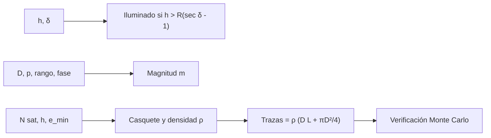

# B118-C16 — Contaminación lumínica

<!-- nav:top -->
[🏠 Programa](../../../../README.md) · [📚 Bloque B118](../../../tronco-comun/B118-trafico-espacial-y-sostenibilidad-orbital.md) · [← Anterior: B118-C15 — Seguimiento de mega constelaciones](../B118-C15-seguimiento-de-mega-constelaciones/CLASE.md) · [Siguiente: B118-C17 — Interferencia radioastronómica →](../B118-C17-interferencia-radioastronomica/CLASE.md)
<!-- /nav -->

## 1. Ubicación, nivel y alcance

Clase 16 del bloque B118. Nivel N3. Segunda clase del tramo «Constelaciones, cielo y espectro». Los satélites reflejan la luz del Sol y dejan trazas en las imágenes astronómicas. Aquí calculas la **geometría de iluminación** (cuándo un satélite está al sol de noche), su **magnitud** como esfera difusa y el **número esperado de trazas** en una exposición, para una constelación **ilustrativa** de 5000 satélites a 550 km. La fotometría es la misma de B118-C03. **Esta clase es educativa: no constituye asesoría legal, regulatoria, financiera ni operativa y no sustituye la lectura del texto normativo vigente ni a un profesional habilitado.**

## 2. Por qué esta clase existe

El brillo y el número de satélites visibles dependen de la altitud y de la profundidad del Sol bajo el horizonte; para un telescopio, una traza arruina la zona que cruza. La decisión central: **¿cuánto dura la ventana de iluminación, qué tan brillante es el satélite y cuántas trazas esperar en una exposición?**

## 3. Lo que podrás hacer al terminar

1. Calcular la profundidad solar máxima `δ = arccos(R/(R+h))` para un satélite en el cenit.
2. Calcular la altura de la sombra `R(sec δ − 1)` para 6°, 12° y 18° (35, 142 y 328 km).
3. Calcular la magnitud de una esfera de 2 m y albedo 0,25 en el cenit (5,15) y a 30° de elevación (6,43).
4. Obtener el número esperado de satélites iluminados visibles y la densidad en el cielo.
5. Calcular las trazas esperadas con la fórmula `ρ (D L + πD²/4)` y verificarla con Monte Carlo.
6. Separar lo convencional (magnitud solar), lo ilustrativo (constelación) y lo consultado.

La evidencia es la **ficha de impacto luminoso de una constelación** del ejercicio 12 (sección 20).

## 4. Con qué llegas y cómo comprobarlo

1. ¿Qué es la profundidad solar?
2. ¿Qué es la elevación?
3. ¿Qué es un ángulo sólido?
4. ¿Qué es una traza?
5. ¿Qué es un Monte Carlo?

<details>
<summary>Ver respuestas</summary>

1. El ángulo del Sol bajo el horizonte del observador. 2. El ángulo sobre el horizonte. 3. La extensión de cielo, en estereorradianes o grados cuadrados. 4. La línea que deja un objeto en movimiento durante la exposición. 5. Un cálculo basado en muestras aleatorias.
</details>

Con cuatro o cinco aciertos, sigue; si no, repasa los prerrequisitos.

## 5. Un caso de contexto y casos de referencia

El informe de la ESA 2025 (consultado) cuenta unos 40 000 objetos seguidos, buena parte en órbita baja. El **ejemplo conductor** es una constelación ilustrativa de 5000 satélites con un diámetro equivalente de 2 m y albedo 0,25; ninguna empresa la respalda.

## 6. Vocabulario

La **profundidad solar** `δ` es el ángulo del Sol bajo el horizonte. La **sombra de la Tierra** es la región sin luz solar. La **ventana de iluminación** es el tiempo en que el satélite está al sol de noche. La **magnitud** mide el brillo. Una **traza** es una línea en una imagen. El **ángulo sólido** mide la extensión de cielo. La **elevación mínima** es el límite de observación.

## 7. Modelo mental



*Descripción textual:* tres cálculos independientes (iluminación, brillo y trazas) comparten la misma constelación ilustrativa; el último se verifica con Monte Carlo.

Analogía: velas encendidas sobre una repisa que ves de noche; solo las que reciben luz brillan, y las que se mueven dejan una raya en una foto larga. Límite: la reflexión real depende de la forma, la orientación y los tratamientos de superficie.

## 8. La explicación, paso a paso

### 8.1 Iluminación

Un satélite en el cenit está al sol si `h > R(sec δ − 1)`, con `R = 6371 km`. La altura de la sombra es 35 km para 6°, 142 km para 12° y 328 km para 18°. La profundidad solar máxima a la que un satélite de 550 km sigue iluminado es **23,00°** (a 1200 km, 32,70°); a 15°/h en el ecuador son unos 92 min (aproximación).

### 8.2 Brillo

Rango: 550 km en el cenit; 993 km a 30°. Con `D = 2 m`, `p = 0,25` y fase 90°: **5,15** en el cenit y **6,43** a 30°. La convención de ojo desnudo (~6) **no se consultó**: se menciona solo como referencia. Con albedo a la mitad el satélite es 0,753 mag más débil (`2,5 log₁₀ 2`).

### 8.3 Cuántos se ven

Casquete visible por encima de 20° de elevación: ángulo central 10,12°, fracción de la capa 0,0078. Con 5000 satélites y la mitad iluminada: **19,4 satélites iluminados visibles** y densidad 0,00143 /deg².

### 8.4 Trazas

Para un campo de 3° y una exposición de 30 s, con velocidad angular media de 0,5°/s (ilustrativa), `L = 15°` y `trazas = ρ (D L + πD²/4) = 0,075`. La verificación Monte Carlo (densidad ×100, reescalada) da 0,0743 frente a 0,0745.

## 9. Magnitudes, símbolos y unidades

| Símbolo | Qué es | Unidad | Valor / nota |
|---|---|---|---|
| `R` | radio medio terrestre | km | 6371 |
| `δ_max` | profundidad solar máxima | grados | 23,00 |
| `m` | magnitud (cenit) | mag | 5,15 |
| `n_vis` | satélites iluminados visibles | objetos | 19,4 |
| trazas | esperadas en 30 s, campo 3° | adimensional | 0,075 |

## 10. Convenciones y referencias

Sistema topocéntrico para el observador; elevación mínima de 20°; magnitud solar −26,74 (convención, no consultada); la mitad de la capa se supone iluminada; velocidad angular media 0,5°/s. Todo es ilustrativo: ninguna cifra describe una constelación real ni un observatorio.

## 11. De dónde sale lo que afirmamos

| ID | Fuente | Localizador | Respalda | Estado |
|---|---|---|---|---|
| S4 | ESA Space Environment Report 2025 (página, publicada el 1 de abril de 2025 con datos hasta fines de 2024) — https://www.esa.int/Space_Safety/Space_Debris/ESA_Space_Environment_Report_2025 (consultada 2026-11-11; página leída con WebFetch; el informe completo no se abrió) | página del informe | unos 40 000 objetos seguidos (contexto de la población) | Consultada |
| — | Magnitud solar −26,74 y límite de ojo desnudo ≈ 6 | — | fotometría y referencia | No consultados (convención) |
| — | Estudios de impacto de constelaciones en la astronomía óptica | — | comparación | No consultados |
| — | Constelación de 5000 satélites, 2 m, albedo 0,25 | — | todo el cálculo | Ilustrativo |

Límites: no se consultó ningún informe sobre el impacto en la astronomía; la geometría es estándar; la constelación es ilustrativa.

## 12. Cómo ver los resultados

| Magnitud | Valor |
|---|---|
| `δ_max` (550 km) | 23,00° |
| Magnitud en el cenit | 5,15 |
| Magnitud a 30° | 6,43 |
| Visibles iluminados | 19,4 |
| Trazas (30 s) | 0,075 |

Descripción larga: la ventana de iluminación llega hasta unos 23° de profundidad solar; el satélite del ejemplo es de magnitud ≈ 5, al borde de lo visible a simple vista; en una exposición de 30 s la probabilidad de una traza en un campo de 3° es del orden de 7 %.

## 13. Ejemplo trabajado

**Paso 1 · Profundidad.** `δ = arccos(6371/6921) = 23,00°`.

**Paso 2 · Rango en el cenit.** `550 km`.

**Paso 3 · Cociente de flujo.** `p r² Φ/R² = 0,25 × 1 × 0,2122 / (5,5×10⁵)² = 1,754 × 10⁻¹³`.

**Paso 4 · Magnitud.** `m = −26,74 − 2,5 log₁₀(…) = 5,15`.

## 14. Distintas formas de describir el problema

**Por geometría:** `δ`, sombra. **Por brillo:** magnitud. **Por conteo:** casquete y densidad. **Por exposición:** trazas esperadas. **Por verificación:** Monte Carlo.

## 15. Práctica guiada

**Ejercicio 1 · con los pasos indicados.** Calcula la altura de la sombra para `δ` = 12°. *Pasos:* `sec 12° = 1/cos 12°`.

<details><summary>Solución comentada</summary>

`6371 × (1,0223 − 1) = 142 km`.
</details>

**Ejercicio 2 · con una pista.** Calcula `δ_max` para 800 km. *Pista:* `arccos(R/(R+h))`.

<details><summary>Solución comentada</summary>

`27,32°`.
</details>

**Ejercicio 3 · casi autónomo.** ¿Cuántas magnitudes más débil es un satélite a 30° que en el cenit?

<details><summary>Solución comentada</summary>

`1,28`.
</details>

## 16. Práctica autónoma, transferencia e integrador

**Ejercicio 4 · autónomo.** Si el diámetro se reduce a la mitad, ¿cuánto cambia la magnitud?

<details><summary>Solución comentada</summary>

`+1,51` magnitudes (más débil).
</details>

**Ejercicio 5 · autónomo.** Calcula el área barrida por un campo de 3° y una traza de 15°.

<details><summary>Solución comentada</summary>

`3 × 15 + π × 9/4 = 52,1 deg²`.
</details>

**Ejercicio 6 · autónomo.** Con la densidad 0,00143 /deg², ¿cuántas trazas esperas en esa área?

<details><summary>Solución comentada</summary>

`0,075`.
</details>

**Ejercicio 7 · autónomo.** ¿Qué le pasa a las trazas si la exposición pasa de 30 a 60 s?

<details><summary>Solución comentada</summary>

Casi se duplican: `L` se duplica y domina el término `D L`.
</details>

**Ejercicio 8 · autónomo.** ¿Por qué los satélites más bajos se ven solo poco después del ocaso o antes del alba?

<details><summary>Solución comentada</summary>

Porque `δ_max = arccos(R/(R+h))` crece con la altitud: a menor altura, menor `δ_max`; los más bajos solo se ven poco después del ocaso.
</details>

**Ejercicio 9 · transferencia.** **Transferencia.** Un observatorio dice «perdemos 10 % de las imágenes». ¿Qué datos pides?

<details><summary>Solución comentada</summary>

Campo, exposición, horario, elevación mínima, número de satélites y método de conteo; sin ellos no se puede contrastar.
</details>

**Ejercicio 10 · transferencia.** **Transferencia.** ¿Por qué un albedo bajo (satélites oscuros) reduce la traza pero no la elimina?

<details><summary>Solución comentada</summary>

Hace el satélite más débil (por ejemplo 0,75 mag con la mitad de albedo), pero las trazas de exposiciones largas siguen saturando píxeles.
</details>

**Ejercicio 11 · transferencia.** **Transferencia.** ¿Es esta clase una evaluación de impacto de alguna constelación real?

<details><summary>Solución comentada</summary>

No: la constelación es ilustrativa; una evaluación real exige datos del operador y del observatorio.
</details>

**Ejercicio 12 · integrador.** **Integrador.** Elabora tu *ficha de impacto luminoso de una constelación*: profundidad solar máxima, magnitudes, satélites visibles, trazas esperadas con verificación, y la lista de qué es convencional, ilustrativo y consultado.

<details><summary>Solución comentada</summary>

Secciones 8.1–8.4 y la salida del laboratorio.
</details>

## 17. Laboratorio

El script [cielo.py](cielo.py) calcula la profundidad solar, la magnitud, el casquete visible y las trazas esperadas, y verifica las trazas con Monte Carlo (**comprueba** `2,5 log₁₀ 2` exacto y el Monte Carlo a 4 %).

**Datos:** constelación **ilustrativa**; magnitud solar **convencional, no consultada**; conteos de la ESA **consultados**. **Predice antes de ejecutar:** ¿cuántos satélites iluminados espera ver a más de 20° de elevación? (alrededor de 20.) **Ejecución del 2026-11-11 (Python 3.12.9):**

```text
Python 3.12.9 (biblioteca estandar)
Constelacion ILUSTRATIVA: 5000 satelites a 550 km, D equivalente 2 m, albedo 0.25; magnitud solar convencional (no consultada).
Profundidad solar maxima para un satelite en el cenit: 550 km -> 23.00 deg; 1200 km -> 32.70 deg
Altura de la sombra sobre el cenit: d = 6 deg -> 35 km; d = 12 deg -> 142 km; d = 18 deg -> 328 km
Duracion de la ventana de iluminacion en el ecuador (15 deg/h): 92 min a 550 km
Rango: cenit 550 km; elevacion 30 deg 993 km
Magnitud (fase 90 deg): cenit 5.15; 30 deg 6.43; con albedo a la mitad 5.90 (diferencia 0.753 = 2.5 log10 2)
Casquete visible (elevacion > 20 deg): angulo central 10.12 deg, fraccion de la capa 0.0078; satelites iluminados visibles 19.4
Densidad 0.00143 /deg^2; trazas esperadas en 30 s, campo de 3 deg: 0.075
Verificacion Monte Carlo (densidad x100, reescalada): formula 0.0745; MC 0.0743
Pruebas superadas (2.5 log10 2 exacto; trazas MC vs formula a 4 %).
```

```bash
python programa/clases/B118/B118-C16-contaminacion-luminica/cielo.py
```

**Límites:** esfera difusa, mitad de la capa iluminada, velocidad angular media constante, campo plano.

## 18. Errores frecuentes y cómo corregirlos

**Creer que todos los satélites sobre el horizonte se ven.** Se corrige con 8.1: deben estar iluminados.

**Olvidar que el rango oblicuo es mayor que la altitud.** Se corrige con 8.2.

**Contar trazas sin tener en cuenta la longitud.** Se corrige con 8.4.

**Citar la clase como evaluación de un operador.** Se corrige con el ejercicio 11.

## 19. Cómo sabrás que vas bien

Tras la sección 8: ¿qué magnitud esperabas y cuál obtuviste? Si dudas, repasa el ejemplo 13. Tras el laboratorio: ¿qué comprueba? (ver la sección 17).

## 20. Qué entregas y cómo se evalúa

El producto es tu **ficha de impacto luminoso de una constelación** (ejercicio 12).

| Criterio | Inicial | En desarrollo | Logrado | Destacado |
|---|---|---|---|---|
| Conceptos | Los confunde | Parciales | Calcula iluminación, brillo y trazas | Explica los límites del modelo |
| Cálculo | Sin unidades | Con errores | Tablas completas con unidades | Calcula casos nuevos |
| Numérico | Sin comprobar | Un caso | Contraste con una segunda vía | Interpreta las diferencias |
| Fuentes | Sin fuente | Sin fecha | Fuentes con fecha, versión y estado | Declara lo ilustrativo y lo no consultado |
| Límites | No los nombra | Uno | Tres | Discute qué falta del modelo |

**Condiciones críticas (no se compensan con promedio):** rotular los datos sintéticos e ilustrativos como tales; no presentar un modelo como observación; citar solo lo consultado, con su versión y fecha; no usar la ficha como asesoría legal, regulatoria o financiera.

## 21. Ética, seguridad y límites

Clase educativa: **no constituye asesoría legal, regulatoria ni financiera** ni orienta decisiones operativas reales, y no sustituye la lectura del texto normativo vigente (se cita siempre la versión y la fecha consultadas) ni la opinión de un especialista habilitado. Los modelos son simplificados y sus datos son sintéticos o ilustrativos. Accesibilidad: tablas equivalentes a las gráficas, fórmulas en texto, ejercicios sin conexión.

## 22. Para cerrar y seguir

Un satélite ilustrativo de 2 m a 550 km tiene magnitud 5,2 en el cenit, hay unos 19 iluminados sobre 20° y una exposición de 30 s tiene 7 % de probabilidad de una traza en 3°. Queda una pregunta: ¿qué ocurre con las ondas de radio?

**Glosario español–inglés.** contaminación lumínica · *light pollution* · profundidad solar · *solar depression* · traza · *streak* · magnitud · *magnitude* · sombra de la Tierra · *Earth's shadow*.

**Continuidad.** [B118-C17](../B118-C17-interferencia-radioastronomica/CLASE.md) estudia la interferencia radioastronómica.

**Referencias:** ver sección 11.

<!-- nav:bottom -->
---

[← Anterior: B118-C15 — Seguimiento de mega constelaciones](../B118-C15-seguimiento-de-mega-constelaciones/CLASE.md) · [📚 Bloque B118](../../../tronco-comun/B118-trafico-espacial-y-sostenibilidad-orbital.md) · [Siguiente: B118-C17 — Interferencia radioastronómica →](../B118-C17-interferencia-radioastronomica/CLASE.md)
<!-- /nav -->
