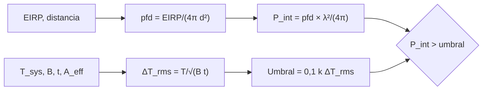

# B118-C17 — Interferencia radioastronómica

<!-- nav:top -->
[🏠 Programa](../../../../README.md) · [📚 Bloque B118](../../../tronco-comun/B118-trafico-espacial-y-sostenibilidad-orbital.md) · [← Anterior: B118-C16 — Contaminación lumínica](../B118-C16-contaminacion-luminica/CLASE.md) · [Siguiente: B118-C18 — Gestión del tráfico espacial →](../B118-C18-gestion-del-trafico-espacial/CLASE.md)
<!-- /nav -->

## 1. Ubicación, nivel y alcance

Clase 17 del bloque B118. Nivel N3. Tercera clase del tramo «Constelaciones, cielo y espectro». Un radiotelescopio mide señales extremadamente débiles; un satélite que emite cerca de su banda puede taparlas. Aquí calculas la **sensibilidad** de un radiotelescopio **hipotético**, el **flujo recibido** de un satélite **sintético** con emisiones no deseadas ilustrativas y el **exceso sobre un umbral del 10 %** del ruido rms. El criterio proviene de la idea de la Recomendación ITU-R RA.769, de la que solo se leyó un resumen de búsqueda. **Esta clase es educativa: no constituye asesoría legal, regulatoria, financiera ni operativa y no sustituye la lectura del texto normativo vigente ni a un profesional habilitado.**

## 2. Por qué esta clase existe

La radioastronomía opera en bandas donde la ITU asigna protección, pero las constelaciones numerosas y sus emisiones no deseadas pueden degradar la sensibilidad. La decisión central: **¿cuánto debe bajar una emisión para quedar por debajo del umbral de daño y de qué depende ese umbral?**

## 3. Lo que podrás hacer al terminar

1. Calcular `ΔT_rms = T_sys/√(B t)` y `ΔS_rms = 2kT_sys/(A_eff √(n_pol B t))`.
2. Comprobar que cuadruplicar el tiempo reduce el ruido a la mitad (cociente `2,0000`).
3. Calcular la densidad de flujo de un satélite a 1000 km con EIRP espectral −70 dBW/Hz.
4. Calcular la potencia recibida por un lóbulo lateral de 0 dBi y compararla con el 10 % del ruido.
5. Obtener el exceso (46,9 dB) y la distancia a la que el nivel cae al umbral.
6. Separar lo consultado (el criterio, por resumen), lo hipotético (telescopio) y lo estándar no consultado.

La evidencia es la **ficha de margen de interferencia** del ejercicio 12 (sección 20).

## 4. Con qué llegas y cómo comprobarlo

1. ¿Qué es la temperatura de sistema?
2. ¿Qué es un jansky?
3. ¿Qué es el área efectiva?
4. ¿Qué es el EIRP?
5. ¿Qué es una ganancia de lóbulo lateral?

<details>
<summary>Ver respuestas</summary>

1. La temperatura equivalente de ruido del receptor y del cielo. 2. `1 Jy = 10⁻²⁶ W m⁻² Hz⁻¹`. 3. `A_eff = η π (D/2)²`. 4. La potencia isótropa radiada equivalente de un transmisor. 5. La ganancia de la antena fuera del haz principal, aquí 0 dBi.
</details>

Con cuatro o cinco aciertos, sigue; si no, repasa los prerrequisitos.

## 5. Un caso de contexto y casos de referencia

La Recomendación ITU-R RA.769-2 (05/2003) define, según el resumen de una búsqueda del 2026-11-11, criterios de protección para las mediciones radioastronómicas, con un nivel de interferencia dañino que corresponde a una pérdida de sensibilidad de largo plazo de hasta un 10 %; la Recomendación **no se abrió** y no se reproducen sus umbrales. El **ejemplo conductor** es un radiotelescopio hipotético de 25 m a 1,42 GHz (21 cm) con `T_sys = 25 K`, `B = 1 MHz` y 1 h de integración, frente a un satélite sintético a 1000 km.

## 6. Vocabulario

El **ruido rms** `ΔT_rms` es la fluctuación de la medida tras integrar. La **densidad de flujo** `S` se mide en Jy. La **densidad de flujo de potencia** (pfd) es la potencia por m² y por Hz. El **EIRP espectral** es la potencia isótropa equivalente por Hz. Un **lóbulo lateral** es una respuesta fuera del haz principal. El **criterio de daño** compara la interferencia con el ruido.

## 7. Modelo mental



*Descripción textual:* la sensibilidad del telescopio fija el umbral; la emisión del satélite se convierte en flujo y, por un lóbulo lateral de 0 dBi, en potencia recibida; la comparación da el exceso en dB.

Analogía: oír un susurro en una sala mientras alguien habla en la sala de al lado; importa cuánto susurro hay (sensibilidad), cuánta voz llega (flujo) y cuánto bloquea la pared (lóbulo lateral). Límite: el telescopio real tiene un patrón de lóbulos complejo y el satélite emite a distintas frecuencias.

## 8. La explicación, paso a paso

### 8.1 Sensibilidad

`A_eff = 0,6 π (12,5)² = 294,5 m²`; `λ = 21,11 cm`. `ΔT_rms = T_sys/√(B t) = 25/√(10⁶ × 3600) = 0,417 mK`. `ΔS_rms = 2kT_sys/(A_eff √(2 B t)) = 2,762 mJy`. Con 4 h: 1,381 mJy (cociente 2,0000).

### 8.2 Flujo del satélite

EIRP espectral `10^(−7) W/Hz`; `pfd = EIRP/(4π d²) = 7,958 × 10⁻²¹ W m⁻² Hz⁻¹ = 7,958 × 10⁵ Jy` a 1000 km: unos 10⁸ veces el ruido.

### 8.3 Por el lóbulo lateral

Con una ganancia de 0 dBi el área efectiva es `λ²/(4π) = 35,47 cm²`. Potencia recibida: **2,823 × 10⁻²³ W/Hz**. El umbral (10 % de `k ΔT_rms`) es **5,753 × 10⁻²⁸ W/Hz**. Exceso: **46,9 dB**.

### 8.4 Distancia y reducción

Por la ley `1/d²`, el nivel cae al umbral a unos **221506 km**, es decir, del orden de cientos de miles de kilómetros. Para quedar en el umbral a 1000 km habría que reducir el EIRP espectral en 46,9 dB. El radiómetro de Monte Carlo confirma `σ/μ = 1/√N`: 0,1007 con N = 100 (0,1000) y 0,01021 con N = 10 000 (0,01000).

## 9. Magnitudes, símbolos y unidades

| Símbolo | Qué es | Unidad | Valor / nota |
|---|---|---|---|
| `D` | diámetro | m | 25 (hipotético) |
| `T_sys` | temperatura de sistema | K | 25 |
| `ΔT_rms` | ruido tras 1 h | mK | 0,417 |
| `ΔS_rms` | sensibilidad | mJy | 2,762 |
| exceso | interferencia sobre el 10 % del ruido | dB | 46,9 |

## 10. Convenciones y referencias

`k = 1,380649 × 10⁻²³ J/K` (CODATA, no consultado aquí); `1 Jy = 10⁻²⁶ W m⁻² Hz⁻¹`; `c = 299 792 458 m/s`. Polarización doble. EIRP espectral −70 dBW/Hz y lóbulo lateral de 0 dBi: ilustrativos. Datos hipotéticos y sintéticos; no corresponden a ningún observatorio ni sistema real.

## 11. De dónde sale lo que afirmamos

| ID | Fuente | Localizador | Respalda | Estado |
|---|---|---|---|---|
| S7 | Recomendación ITU-R RA.769-2 (05/2003), criterios de protección para mediciones radioastronómicas — https://www.itu.int/rec/R-REC-RA.769/en (consultada 2026-11-11; solo resumen de una búsqueda web; la Recomendación no se abrió) | resumen de búsqueda sobre RA.769-2 | criterio de protección: pérdida de sensibilidad de largo plazo de hasta un 10 % (no verificado en el texto) | Consultada parcialmente |
| — | Valores umbral de la Rec. ITU-R RA.769 por banda | — | umbrales reglamentarios | No consultados |
| — | Reglamento de Radiocomunicaciones de la UIT | — | asignación de bandas | No consultado |
| — | Ecuación del radiómetro, pfd y área efectiva | — | todo el cálculo | No consultada (relaciones estándar; verificadas con Monte Carlo) |

Límites: RA.769 solo se conoce por el resumen de una búsqueda; ni sus umbrales ni el Reglamento se consultaron; el criterio del 10 % se usa como regla didáctica.

## 12. Cómo ver los resultados

| Magnitud | Valor |
|---|---|
| `ΔT_rms` | 0,417 mK |
| `ΔS_rms` | 2,762 mJy |
| pfd a 1000 km | 7,96 × 10⁵ Jy |
| Exceso | 46,9 dB |
| Distancia al umbral | 221506 km |

Descripción larga: la señal del satélite es mucho mayor que la sensibilidad, pero el lóbulo lateral la reduce; aun así queda unos 47 dB por encima del umbral del 10 %.

## 13. Ejemplo trabajado

**Paso 1 · Ruido.** `25/√(10⁶ × 3600) = 0,417 mK`.

**Paso 2 · Umbral.** `0,1 × 1,38×10⁻²³ × 4,167 × 10⁻⁴ = 5,753 × 10⁻²⁸ W/Hz`.

**Paso 3 · pfd.** `10⁻⁷/(4π (10⁶)²) = 7,958 × 10⁻²¹`.

**Paso 4 · Lóbulo lateral.** `7,958 × 10⁻²¹ × 3,547 × 10⁻³ = 2,823 × 10⁻²³ W/Hz`; exceso `10 log₁₀(…/5,753 × 10⁻²⁸) = 46,9 dB`.

## 14. Distintas formas de describir el problema

**Por ruido:** `ΔT_rms`. **Por flujo:** Jy. **Por potencia:** W/Hz. **Por margen:** dB. **Por distancia:** ley `1/d²`.

## 15. Práctica guiada

**Ejercicio 1 · con los pasos indicados.** Calcula `A_eff` de una antena de 10 m con `η` = 0,5. *Pasos:* `η π (D/2)²`.

<details><summary>Solución comentada</summary>

`0,5 × π × 25 = 39,3 m²`.
</details>

**Ejercicio 2 · con una pista.** Calcula `ΔT_rms` para `T_sys` = 50 K, `B` = 10 kHz y 100 s. *Pista:* `T/√(B t)`.

<details><summary>Solución comentada</summary>

`50/√(10⁶) = 0,050 K`.
</details>

**Ejercicio 3 · casi autónomo.** Si el tiempo se cuadruplica, ¿cuánto baja el ruido?

<details><summary>Solución comentada</summary>

A la mitad.
</details>

## 16. Práctica autónoma, transferencia e integrador

**Ejercicio 4 · autónomo.** Convierte `10⁻²⁰ W m⁻² Hz⁻¹` a Jy.

<details><summary>Solución comentada</summary>

`10⁻²⁰/10⁻²⁶ = 10⁶ Jy`.
</details>

**Ejercicio 5 · autónomo.** Calcula la pfd de un EIRP de `10⁻⁶ W/Hz` a 500 km.

<details><summary>Solución comentada</summary>

`10⁻⁶/(4π (5×10⁵)²) = 3,18 × 10⁻¹⁹`.
</details>

**Ejercicio 6 · autónomo.** ¿En cuántos dB hay que reducir el EIRP para bajar de un exceso de 47 dB a 0?

<details><summary>Solución comentada</summary>

En 47 dB (un factor de unos 50 000).
</details>

**Ejercicio 7 · autónomo.** Si el telescopio se alejara a 10 000 km, ¿cuánto cae el nivel (ley `1/d²`)?

<details><summary>Solución comentada</summary>

100 veces (20 dB).
</details>

**Ejercicio 8 · autónomo.** ¿Es coherente el Monte Carlo (0,1007) con `1/√N` = 0,1000?

<details><summary>Solución comentada</summary>

Sí; la tolerancia usada es 3 %.
</details>

**Ejercicio 9 · transferencia.** **Transferencia.** Un operador dice «nuestras emisiones cumplen». ¿Qué falta?

<details><summary>Solución comentada</summary>

La banda, el nivel por Hz, la referencia (EIRP o pfd), el criterio aplicado y su versión; sin eso no se puede contrastar.
</details>

**Ejercicio 10 · transferencia.** **Transferencia.** ¿Por qué un lóbulo lateral de 0 dBi es una hipótesis simplificadora?

<details><summary>Solución comentada</summary>

Porque el patrón real varía con el ángulo y la frecuencia, y puede ser mayor en ciertas direcciones.
</details>

**Ejercicio 11 · transferencia.** **Transferencia.** Tu equipo cita «RA.769 exige X dBW». ¿Qué respondes?

<details><summary>Solución comentada</summary>

Que RA.769 no se consultó en su texto; antes de citar un número hay que abrir la Recomendación vigente y su versión.
</details>

**Ejercicio 12 · integrador.** **Integrador.** Elabora tu *ficha de margen de interferencia*: sensibilidad del telescopio, flujo del satélite, potencia por el lóbulo lateral, exceso sobre el umbral, distancia crítica y la lista de qué es hipotético, no consultado y consultado parcialmente.

<details><summary>Solución comentada</summary>

Secciones 8.1–8.4 y la salida del laboratorio.
</details>

## 17. Laboratorio

El script [interferencia.py](interferencia.py) calcula la sensibilidad, el flujo y el exceso de un satélite sintético sobre el umbral del 10 % y verifica el promediado con un radiómetro Monte Carlo (**comprueba** el cociente 2 exacto y `1/√N` a 3 %).

**Datos:** telescopio **hipotético**; satélite **sintético**; criterio de RA.769 **solo por resumen**. **Predice antes de ejecutar:** ¿cuántos dB por encima del umbral queda el satélite por el lóbulo lateral? (unos 47 dB.) **Ejecución del 2026-11-11 (Python 3.12.9):**

```text
Python 3.12.9 (biblioteca estandar)
Radiotelescopio HIPOTETICO (25 m, eta 0.6, Tsys 25 K, B 1 MHz, 1 h, 1.42 GHz) y satelite SINTETICO; RA.769 no abierta (solo resumen de busqueda).
A_eff = 294.5 m^2; lambda = 21.11 cm; DT_rms = 0.417 mK
Sensibilidad DS_rms (1 h) = 2.762 mJy; a 4 h = 1.381 mJy; cociente 2.0000
Satelite a 1000 km, EIRP espectral -70 dBW/Hz: pfd = 7.958e-21 W m^-2 Hz^-1 = 7.958e+05 Jy
Por el lobulo lateral de 0 dBi: P = 2.823e-23 W/Hz; umbral 10 % del rms = 5.753e-28 W/Hz; exceso 46.9 dB
Distancia a la que cae al umbral (ley 1/d^2): 221506 km; reduccion de EIRP necesaria a 1000 km: 46.9 dB
Radiometro Monte Carlo: sd/media con N = 100: 0.1007 (1/sqrt(N) = 0.1000); N = 10000: 0.01021 (0.01000)
Pruebas superadas (promediado 1/sqrt(Bt) exacto y por Monte Carlo a 3 %).
```

```bash
python programa/clases/B118/B118-C17-interferencia-radioastronomica/interferencia.py
```

**Límites:** una sola frecuencia, polarización doble, lóbulo lateral fijo, sin ganancia de integración espacial ni mitigación.

## 18. Errores frecuentes y cómo corregirlos

**Comparar un flujo con una potencia sin convertir.** Se corrige con 8.3.

**Confundir EIRP y pfd.** Se corrige con 8.2.

**Citar un umbral de RA.769 sin haberlo leído.** Se corrige con el ejercicio 11.

**Esperar que más integración elimine una interferencia constante.** Se corrige con 8.1: reduce el ruido, no la señal de interferencia.

## 19. Cómo sabrás que vas bien

Tras la sección 8: ¿qué exceso esperabas y cuál obtuviste? Si dudas, repasa el ejemplo 13. Tras el laboratorio: ¿qué comprueba? (ver la sección 17).

## 20. Qué entregas y cómo se evalúa

El producto es tu **ficha de margen de interferencia** (ejercicio 12).

| Criterio | Inicial | En desarrollo | Logrado | Destacado |
|---|---|---|---|---|
| Conceptos | Los confunde | Parciales | Calcula sensibilidad, flujo y margen | Explica los límites del modelo |
| Cálculo | Sin unidades | Con errores | Tablas completas con unidades | Calcula casos nuevos |
| Numérico | Sin comprobar | Un caso | Contraste con una segunda vía | Interpreta las diferencias |
| Fuentes | Sin fuente | Sin fecha | Fuentes con fecha, versión y estado | Declara lo ilustrativo y lo no consultado |
| Límites | No los nombra | Uno | Tres | Discute qué falta del modelo |

**Condiciones críticas (no se compensan con promedio):** rotular los datos sintéticos e ilustrativos como tales; no presentar un modelo como observación; citar solo lo consultado, con su versión y fecha; no usar la ficha como asesoría legal, regulatoria o financiera.

## 21. Ética, seguridad y límites

Clase educativa: **no constituye asesoría legal, regulatoria ni financiera** ni orienta decisiones operativas reales, y no sustituye la lectura del texto normativo vigente (se cita siempre la versión y la fecha consultadas) ni la opinión de un especialista habilitado. Los modelos son simplificados y sus datos son sintéticos o ilustrativos. Los umbrales reglamentarios deben leerse en la Recomendación y el Reglamento vigentes; no se reproducen. Accesibilidad: tablas equivalentes a las gráficas, fórmulas en texto, ejercicios sin conexión.

## 22. Para cerrar y seguir

El radiotelescopio hipotético alcanza 2,8 mJy en 1 h y el satélite sintético queda 47 dB por encima del umbral del 10 % incluso por un lóbulo lateral. Queda una pregunta: ¿quién decide cómo se reparte el tráfico en órbita?

**Glosario español–inglés.** interferencia radioastronómica · *radio-astronomy interference* · densidad de flujo · *flux density* · lóbulo lateral · *sidelobe* · radiómetro · *radiometer* · área efectiva · *effective area*.

**Continuidad.** [B118-C18](../B118-C18-gestion-del-trafico-espacial/CLASE.md) estudia la gestión del tráfico espacial.

**Referencias:** ver sección 11.

<!-- nav:bottom -->
---

[← Anterior: B118-C16 — Contaminación lumínica](../B118-C16-contaminacion-luminica/CLASE.md) · [📚 Bloque B118](../../../tronco-comun/B118-trafico-espacial-y-sostenibilidad-orbital.md) · [Siguiente: B118-C18 — Gestión del tráfico espacial →](../B118-C18-gestion-del-trafico-espacial/CLASE.md)
<!-- /nav -->
