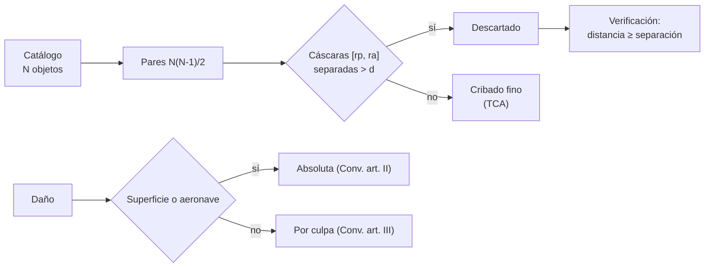

# B118-C18 — Gestión del tráfico espacial

<!-- nav:top -->
[🏠 Programa](../../../../README.md) · [📚 Bloque B118](../../../tronco-comun/B118-trafico-espacial-y-sostenibilidad-orbital.md) · [← Anterior: B118-C17 — Interferencia radioastronómica](../B118-C17-interferencia-radioastronomica/CLASE.md) · [Siguiente: B118-C19 — Sostenibilidad y gobernanza orbital →](../B118-C19-sostenibilidad-y-gobernanza-orbital/CLASE.md)
<!-- /nav -->

## 1. Ubicación, nivel y alcance

Clase 18 del bloque B118. Nivel N4. Primera clase del tramo «Gestión, gobernanza y evidencia». Gestionar el tráfico espacial combina técnica (cribar millones de pares de objetos) y derecho (quién responde de qué). Aquí construyes un **cribado en cascada con filtro de apsis** sobre un catálogo **sintético** de 400 objetos, compruebas que **no pierde ningún par** y lees con la compilación ST/SPACE/11 **quién es responsable, quién responde por daños y quién registra** un objeto. No es asesoría legal. **Esta clase es educativa: no constituye asesoría legal, regulatoria, financiera ni operativa y no sustituye la lectura del texto normativo vigente ni a un profesional habilitado.**

## 2. Por qué esta clase existe

Con decenas de miles de objetos, comparar todos los pares es costoso; un buen cribado descarta de entrada los pares imposibles sin perder ninguno posible. Y cuando algo sale mal, los tratados determinan responsabilidad y jurisdicción. La decisión central: **¿cómo se reduce el trabajo sin perder riesgo, y qué dice el derecho vigente sobre quién responde?**

## 3. Lo que podrás hacer al terminar

1. Aplicar el filtro de apsis: dos cáscaras radiales separadas más que un margen `d` no pueden acercarse a menos de `d`.
2. Medir la fracción de pares que pasan el filtro (0,345) y la que se descarta (0,655).
3. Verificar por propagación que el filtro es conservador (peor exceso ≥ 0).
4. Leer los artículos VI–IX del Tratado del Espacio Ultraterrestre y II–III del Convenio sobre Responsabilidad.
5. Distinguir responsabilidad absoluta (en la superficie o aeronaves) de la basada en la culpa (en el espacio).
6. Reconocer que ninguna cifra de la clase es asesoría legal.

La evidencia es la **ficha de cribado de un catálogo sintético** del ejercicio 12 (sección 20).

## 4. Con qué llegas y cómo comprobarlo

1. ¿Qué es el perigeo y el apogeo?
2. ¿Qué es un filtro conservador?
3. ¿Qué es el cribado?
4. ¿Qué es un Estado de lanzamiento?
5. ¿Qué es una responsabilidad absoluta?

<details>
<summary>Ver respuestas</summary>

1. La mínima y la máxima distancia de la órbita al centro de la Tierra. 2. Uno que nunca descarta un caso peligroso. 3. Una etapa rápida que reduce el número de pares a evaluar con detalle. 4. El que lanza o hace lanzar un objeto, o desde cuyo territorio o instalación se lanza. 5. Una que no exige probar culpa.
</details>

Con cuatro o cinco aciertos, sigue; si no, repasa los prerrequisitos.

## 5. Un caso de contexto y casos de referencia

La compilación ST/SPACE/11 (Naciones Unidas, 2002; consultada el 2026-11-11) establece: Tratado del Espacio Ultraterrestre, art. VI (responsabilidad internacional por las actividades nacionales, incluidas las de entidades no gubernamentales, que requieren autorización y supervisión continua del Estado), art. VII (responsabilidad por los daños causados por objetos lanzados), art. VIII (jurisdicción y control del Estado de registro) y art. IX (cooperación, consultas ante interferencia potencialmente perjudicial); Convenio sobre Responsabilidad, art. II (responsabilidad absoluta en la superficie o a aeronaves en vuelo) y art. III (responsabilidad por culpa en otras partes); Convenio sobre Registro, art. II (el Estado de lanzamiento registra el objeto). La IADC Rev. 4 (consultada) recomienda evitar colisiones accidentales.

## 6. Vocabulario

El **cribado** descarta pares. El **filtro de apsis** compara las cáscaras `[r_p, r_a]`. El **Estado de lanzamiento** es el que lanza, hace lanzar o cede territorio o instalación. El **Estado de registro** lleva el registro y conserva jurisdicción y control. La **responsabilidad absoluta** no exige culpa. La **responsabilidad por culpa** exige que el daño se deba a la culpa del causante.

## 7. Modelo mental



*Descripción textual:* el cribado descarta los pares cuyas cáscaras de altitud están separadas; una verificación por propagación prueba que no se pierde ninguno; aparte, el régimen jurídico distingue la responsabilidad según dónde ocurra el daño.

Analogía: antes de cruzar los horarios de miles de trenes, descartas los que nunca pasan por la misma estación. Límite: el filtro de apsis es el más simple; otros filtros usan planos orbitales y tiempos, y el derecho tiene excepciones que la clase no recorre.

## 8. La explicación, paso a paso

### 8.1 Filtro de apsis

Cada objeto ocupa la cáscara `[r_p, r_a]`. Si `r_p(1) − r_a(2) > d` o `r_p(2) − r_a(1) > d`, los objetos nunca pueden acercarse a menos de `d`. Con `d = 20 km` y 400 objetos (79800 pares): **27532 pasan (0,345) y 52268 se descartan**.

### 8.2 Verificación

Se toman 150 pares descartados y se propagan en 300 instantes aleatorios (3 días): el peor valor de `distancia − separación radial` es **11,690 km**, no negativo, así que el filtro no pierde ningún par muestreado. Con la misma fracción en 40 000 objetos pasarían 2,76 × 10⁸ de 8,00 × 10⁸ pares (ilustrativo).

### 8.3 El régimen jurídico (texto consultado)

Art. VI del Tratado: los Estados responden de las actividades nacionales, y las de entidades no gubernamentales requieren autorización y supervisión continua. Art. VII: el Estado que lanza o hace lanzar un objeto, y aquel desde cuyo territorio o instalación se lanza, es internacionalmente responsable de los daños. Art. VIII: el Estado de registro conserva jurisdicción y control. Convenio sobre Responsabilidad: art. II, responsabilidad **absoluta** por daños en la superficie de la Tierra o a aeronaves en vuelo; art. III, en otras partes (por ejemplo, entre satélites) responde **solo por culpa**.

### 8.4 Límites

La clase no analiza reclamaciones, excepciones, ni leyes nacionales; el cribado no decide maniobras. Ver la sección 21: no es asesoría legal.

## 9. Magnitudes, símbolos y unidades

| Símbolo | Qué es | Unidad | Valor / nota |
|---|---|---|---|
| `d` | margen del filtro | km | 20 (ilustrativo) |
| pares | totales en el catálogo | pares | 79800 |
| pasan | pares que superan el filtro | pares | 27532 (0,345) |
| exceso | peor (distancia − separación) | km | 11,690 |
| art. | responsabilidad absoluta | — | Convenio, art. II |

## 10. Convenciones y referencias

Elementos clásicos en el sistema inercial geocéntrico; `GM = 398 600,4418 km³/s²` (convencional, no consultado); radio ecuatorial 6378,137 km. Catálogo sintético (semilla 118). Los artículos citados proceden del texto de ST/SPACE/11 (2002); la versión vigente de cada instrumento debe comprobarse.

## 11. De dónde sale lo que afirmamos

| ID | Fuente | Localizador | Respalda | Estado |
|---|---|---|---|---|
| S2 | Treaties and principles on outer space, ST/SPACE/11 (Naciones Unidas, Nueva York, 2002) — https://www.unoosa.org/pdf/publications/STSPACE11E.pdf (consultada 2026-11-11; PDF leído con PyMuPDF) | Tratado arts. VI–IX; Convenio sobre Responsabilidad arts. II–III; Convenio sobre Registro art. II | responsabilidad internacional y autorización de entidades no gubernamentales; responsabilidad por daños del Estado de lanzamiento; jurisdicción y control del Estado de registro; responsabilidad absoluta en la superficie y por culpa en otras partes; obligación de registrar | Consultada |
| S3 | IADC Space Debris Mitigation Guidelines, IADC-02-01 Rev. 4 (enero de 2025), presentadas como A/AC.105/C.1/2025/CRP.9 (3 de febrero de 2025) — https://www.unoosa.org/res/oosadoc/data/documents/2025/aac_105c_12025crp/aac_105c_12025crp_9_0_html/AC105_C1_2025_CRP09E.pdf (consultada 2026-11-11; PDF leído con PyMuPDF) | sección 5.4 | evitar colisiones accidentales con objetos conocidos | Consultada |
| — | Legislación nacional y acuerdos bilaterales sobre tráfico espacial | — | obligaciones concretas | No consultada |
| — | Directrices de Sostenibilidad a Largo Plazo (2019) | — | medidas de seguridad de las operaciones | No consultadas (solo resumen de búsqueda) |
| — | Catálogo sintético de 400 objetos | — | cribado | Sintético |

Límites: los artículos se leyeron en la compilación de 2002; no se verificó el estado de ratificación ni la jurisprudencia; el texto vigente puede diferir; la parte jurídica es una lectura didáctica, no asesoría.

## 12. Cómo ver los resultados

| Magnitud | Valor |
|---|---|
| Pares totales | 79800 |
| Pasan el filtro | 27532 (0,345) |
| Descartados | 52268 |
| Peor exceso en la verificación | 11,690 km |

Descripción larga: el filtro de apsis descarta más de la mitad de los pares y la verificación muestra que no pierde ninguno; con muchas órbitas casi circulares a la misma altitud quedan más pares por evaluar.

## 13. Ejemplo trabajado

**Paso 1 · Cáscaras.** Objeto 1: `[6978, 6998]` km; objeto 2: `[7100, 7120]`.

**Paso 2 · Separación.** `7100 − 6998 = 102 km > 20`: descartado.

**Paso 3 · Pares.** 400 × 399/2 = 79800.

**Paso 4 · Fracción.** 27532/79800 = 0,345 pasan.

## 14. Distintas formas de describir el problema

**Por filtro:** apsis. **Por conteo:** pares que pasan. **Por verificación:** distancia mínima muestreada. **Por derecho:** Tratado y Convenios. **Por responsabilidad:** absoluta o por culpa.

## 15. Práctica guiada

**Ejercicio 1 · con los pasos indicados.** Calcula los pares de un catálogo de 1000 objetos. *Pasos:* `N(N−1)/2`.

<details><summary>Solución comentada</summary>

`499 500`.
</details>

**Ejercicio 2 · con una pista.** Los objetos A `[6900, 6920]` y B `[7000, 7010]` km: ¿pasan con `d` = 50 km? *Pista:* separación `7000 − 6920`.

<details><summary>Solución comentada</summary>

Separación 80 > 50: se descarta.
</details>

**Ejercicio 3 · casi autónomo.** ¿Y con `d` = 100 km?

<details><summary>Solución comentada</summary>

80 ≤ 100: pasa.
</details>

## 16. Práctica autónoma, transferencia e integrador

**Ejercicio 4 · autónomo.** Un satélite A y un satélite B colisionan en órbita. ¿Qué régimen de responsabilidad aplica el Convenio?

<details><summary>Solución comentada</summary>

El art. III: responde solo si el daño se debe a su culpa o a la de personas de las que es responsable.
</details>

**Ejercicio 5 · autónomo.** Un fragmento cae en una ciudad. ¿Qué régimen aplica?

<details><summary>Solución comentada</summary>

El art. II: responsabilidad absoluta del Estado de lanzamiento por el daño en la superficie.
</details>

**Ejercicio 6 · autónomo.** ¿Qué Estado conserva jurisdicción y control sobre un objeto?

<details><summary>Solución comentada</summary>

El Estado en cuyo registro figura (Tratado, art. VIII).
</details>

**Ejercicio 7 · autónomo.** ¿Qué exige el art. VI del Tratado para las actividades de entidades no gubernamentales?

<details><summary>Solución comentada</summary>

Autorización y supervisión continua del Estado Parte pertinente.
</details>

**Ejercicio 8 · autónomo.** ¿Es posible que el filtro descarte un par que se acerca a menos de `d`? ¿Qué resultado lo sugiere?

<details><summary>Solución comentada</summary>

No, si es conservador; el peor exceso muestreado fue 11,690 km ≥ 0.
</details>

**Ejercicio 9 · transferencia.** **Transferencia.** Un operador privado extranjero pierde un satélite sobre un tercero. ¿Qué pregunta jurídica surge y qué debes hacer?

<details><summary>Solución comentada</summary>

Quién es Estado de lanzamiento y de registro, y qué régimen aplica; no resolverlo en la clase: consultar a un especialista y el texto vigente.
</details>

**Ejercicio 10 · transferencia.** **Transferencia.** ¿Por qué el cribado no sustituye al cálculo fino?

<details><summary>Solución comentada</summary>

Porque solo descarta imposibles; los pares que pasan siguen requiriendo TCA y probabilidad.
</details>

**Ejercicio 11 · transferencia.** **Transferencia.** ¿Qué agregarías a un filtro de apsis para reducir aún más pares?

<details><summary>Solución comentada</summary>

Un filtro de planos orbitales y uno de tiempo: descartar pares cuyos planos se cruzan lejos o cuyos pasos no coinciden.
</details>

**Ejercicio 12 · integrador.** **Integrador.** Elabora tu *ficha de cribado de un catálogo sintético*: conteos, verificación, mapa de responsabilidades (artículos y régimen), la lista de qué es consultado, no consultado y sintético, con el aviso de que no es asesoría legal.

<details><summary>Solución comentada</summary>

Secciones 8.1–8.4 y la salida del laboratorio.
</details>

## 17. Laboratorio

El script [cribado.py](cribado.py) aplica el filtro de apsis a un catálogo sintético y verifica por propagación que ningún par descartado se acerca a menos de su separación radial (**comprueba** el peor exceso ≥ 0).

**Datos:** catálogo **sintético**; artículos de ST/SPACE/11 **consultados**; legislación nacional **no consultada**. **Predice antes de ejecutar:** ¿qué fracción de pares pasará el filtro? (alrededor de un tercio.) **Ejecución del 2026-11-11 (Python 3.12.9):**

```text
Python 3.12.9 (biblioteca estandar)
Catalogo SINTETICO de 400 objetos (semilla 118); margen del filtro de apsis d = 20 km (ILUSTRATIVO).
Pares totales: 79800; pasan el filtro: 27532 (0.345); rechazados: 52268
Verificacion: 150 pares rechazados x 300 instantes aleatorios; peor (distancia - separacion radial) = 11.690 km (>= 0 si es conservador)
Con la misma fraccion en 40000 objetos: 8.000e+08 pares -> 2.760e+08 retenidos para el cribado fino
Pruebas superadas (el filtro de apsis no pierde ningun par muestreado).
```

```bash
python programa/clases/B118/B118-C18-gestion-del-trafico-espacial/cribado.py
```

**Límites:** órbitas keplerianas, margen único, muestra de 150 pares descartados × 300 instantes; no verifica el rango completo.

## 18. Errores frecuentes y cómo corregirlos

**Creer que el cribado decide maniobras.** Se corrige con el ejercicio 10.

**Aplicar el art. II a una colisión en órbita.** Se corrige con 8.3.

**Confundir Estado de lanzamiento y de registro.** Se corrige con el vocabulario y el ejercicio 6.

**Leer los tratados como asesoría.** Se corrige con la sección 21.

## 19. Cómo sabrás que vas bien

Tras la sección 8: ¿qué fracción de pares esperabas que pasara y cuál obtuviste? Si dudas, repasa el ejemplo 13. Tras el laboratorio: ¿qué comprueba? (ver la sección 17).

## 20. Qué entregas y cómo se evalúa

El producto es tu **ficha de cribado de un catálogo sintético** (ejercicio 12).

| Criterio | Inicial | En desarrollo | Logrado | Destacado |
|---|---|---|---|---|
| Conceptos | Los confunde | Parciales | Criba y distingue regímenes de responsabilidad | Explica los límites del modelo |
| Cálculo | Sin unidades | Con errores | Tablas completas con unidades | Calcula casos nuevos |
| Numérico | Sin comprobar | Un caso | Contraste con una segunda vía | Interpreta las diferencias |
| Fuentes | Sin fuente | Sin fecha | Fuentes con fecha, versión y estado | Declara lo ilustrativo y lo no consultado |
| Límites | No los nombra | Uno | Tres | Discute qué falta del modelo |

**Condiciones críticas (no se compensan con promedio):** rotular los datos sintéticos e ilustrativos como tales; no presentar un modelo como observación; citar solo lo consultado, con su versión y fecha; no usar la ficha como asesoría legal, regulatoria o financiera.

## 21. Ética, seguridad y límites

Clase educativa: **no constituye asesoría legal, regulatoria ni financiera** ni orienta decisiones operativas reales, y no sustituye la lectura del texto normativo vigente (se cita siempre la versión y la fecha consultadas) ni la opinión de un especialista habilitado. Los modelos son simplificados y sus datos son sintéticos o ilustrativos. La lectura de los tratados es didáctica; para un caso concreto se requiere un especialista y el texto vigente. Accesibilidad: tablas equivalentes a las gráficas, fórmulas en texto, ejercicios sin conexión.

## 22. Para cerrar y seguir

El filtro de apsis dejó 27532 de 79800 pares sin perder ninguno en la verificación, y la compilación ST/SPACE/11 distingue la responsabilidad absoluta en la superficie de la basada en la culpa en el espacio. Queda una pregunta: ¿qué tan bien cumplen los operadores las directrices?

**Glosario español–inglés.** gestión del tráfico espacial · *space traffic management* · filtro de apsis · *apsis filter* · Estado de lanzamiento · *launching State* · responsabilidad absoluta · *absolute liability* · registro · *registration*.

**Continuidad.** [B118-C19](../B118-C19-sostenibilidad-y-gobernanza-orbital/CLASE.md) estudia la sostenibilidad y la gobernanza orbital.

**Referencias:** ver sección 11.

<!-- nav:bottom -->
---

[← Anterior: B118-C17 — Interferencia radioastronómica](../B118-C17-interferencia-radioastronomica/CLASE.md) · [📚 Bloque B118](../../../tronco-comun/B118-trafico-espacial-y-sostenibilidad-orbital.md) · [Siguiente: B118-C19 — Sostenibilidad y gobernanza orbital →](../B118-C19-sostenibilidad-y-gobernanza-orbital/CLASE.md)
<!-- /nav -->
