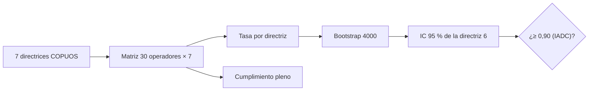

# B118-C19 — Sostenibilidad y gobernanza orbital

<!-- nav:top -->
[🏠 Programa](../../../../README.md) · [📚 Bloque B118](../../../tronco-comun/B118-trafico-espacial-y-sostenibilidad-orbital.md) · [← Anterior: B118-C18 — Gestión del tráfico espacial](../B118-C18-gestion-del-trafico-espacial/CLASE.md) · [Siguiente: B118-C20 — Evaluación de riesgo de conjunción documentada →](../B118-C20-evaluacion-de-riesgo-de-conjuncion-documentada/CLASE.md)
<!-- /nav -->

## 1. Ubicación, nivel y alcance

Clase 19 del bloque B118. Nivel N3. Segunda clase del tramo «Gestión, gobernanza y evidencia». La sostenibilidad orbital se apoya en normas voluntarias (directrices de la COPUOS y de la IADC) y en tratados obligatorios. Aquí lees las **siete directrices de mitigación de la COPUOS** (2010) y construyes un **cuadro de cumplimiento de 30 operadores sintéticos**, con un intervalo bootstrap para la tasa de disposición en LEO, comparándola con el 90 % de la IADC Rev. 4. El cuadro es una herramienta pedagógica, **no una evaluación legal**. **Esta clase es educativa: no constituye asesoría legal, regulatoria, financiera ni operativa y no sustituye la lectura del texto normativo vigente ni a un profesional habilitado.**

## 2. Por qué esta clase existe

Una norma voluntaria vale lo que se cumple; medir el cumplimiento exige muestras y declarar la incertidumbre. La decisión central: **¿qué se puede afirmar del cumplimiento de un grupo de operadores con una muestra pequeña y qué no?**

## 3. Lo que podrás hacer al terminar

1. Enumerar las siete directrices de la COPUOS y reconocer su carácter voluntario.
2. Calcular las tasas de cumplimiento por directriz de 30 operadores sintéticos (la disposición en LEO: 0,567).
3. Calcular el intervalo bootstrap del 95 % ([0,400; 0,733]) y compararlo con 0,90.
4. Ver cómo se estrecha con 300 operadores ([0,623; 0,730]).
5. Distinguir el cumplimiento pleno observado (0,267) del esperado si fueran independientes (0,172).
6. Rotular que las tasas son ilustrativas y no describen a nadie.

La evidencia es la **cuadro de gobernanza con su incertidumbre** del ejercicio 12 (sección 20).

## 4. Con qué llegas y cómo comprobarlo

1. ¿Qué es una norma voluntaria?
2. ¿Qué es un bootstrap?
3. ¿Qué es un intervalo del 95 %?
4. ¿Qué es la independencia?
5. ¿Qué es una tasa de cumplimiento?

<details>
<summary>Ver respuestas</summary>

1. Una recomendación sin fuerza jurídica obligatoria por sí misma. 2. Un remuestreo con reemplazo para estimar la variabilidad de un estadístico. 3. Un rango que contiene el valor verdadero en el 95 % de las repeticiones. 4. Que el cumplimiento de una directriz no informa sobre el de otra. 5. La fracción de operadores que cumple.
</details>

Con cuatro o cinco aciertos, sigue; si no, repasa los prerrequisitos.

## 5. Un caso de contexto y casos de referencia

Las **Directrices de mitigación de desechos de la COPUOS** (UNOOSA, 2010; endosadas por la Asamblea General en la resolución 62/217; consultadas) son siete: (1) limitar desechos en operación normal; (2) minimizar rupturas en fases operativas; (3) limitar la probabilidad de colisión accidental; (4) evitar la destrucción intencional y otras actividades dañinas; (5) minimizar rupturas posmisión por energía almacenada; (6) limitar la presencia prolongada en LEO tras la misión; (7) limitar la interferencia prolongada con la región GEO. Son **voluntarias**. Las Directrices de Sostenibilidad a Largo Plazo (2019) solo se conocen por un resumen de búsqueda. El **ejemplo conductor** es un grupo de 30 operadores sintéticos.

## 6. Vocabulario

Una **directriz** es una recomendación. La **mitigación** reduce la generación de desechos. La **sostenibilidad a largo plazo** busca mantener el uso del espacio. Una **tasa de cumplimiento** es una proporción. El **bootstrap** estima la incertidumbre por remuestreo. La **gobernanza** es el conjunto de normas e instituciones que regulan una actividad.

## 7. Modelo mental



*Descripción textual:* una matriz de operadores contra directrices produce tasas; el bootstrap de la tasa de disposición da un intervalo que se compara con la meta de la IADC.

Analogía: un examen aplicado a 30 alumnos; el promedio informa, pero con tan pocos alumnos la incertidumbre es grande. Límite: aquí las directrices se tratan como binarias e independientes, y los operadores no existen.

## 8. La explicación, paso a paso

### 8.1 Las siete directrices

Texto consultado (UNOOSA, 2010): las siete directrices aplican a la planificación, el diseño, la fabricación y la operación (lanzamiento, misión y disposición) de naves y etapas. El documento recuerda que se basan en las de la IADC y que las revisará a la luz de nuevos hallazgos.

### 8.2 Cuadro sintético

Tasas de cumplimiento de 30 operadores sintéticos (semilla 118): 1 → 0,933; 2 → 0,900; 3 → 0,800; 4 → 0,967; 5 → 0,667; 6 → 0,567; 7 → 0,800. Cumplen las siete **0,267** de los operadores (si fueran independientes se esperaría 0,172).

### 8.3 Intervalo bootstrap

Disposición en LEO (directriz 6): 0,567; bootstrap de 4000 réplicas: media 0,566, **IC95 [0,400; 0,733]**. Comparado con el 0,90 de la IADC Rev. 4 (consultada): no cumple. Con 300 operadores el IC95 es [0,623; 0,730]: el intervalo se estrecha con `1/√n`.

### 8.4 Qué no significa

Un cuadro de cumplimiento no es una auditoría: no se verifica cada afirmación, no hay jurisdicción ni sanción, y las directrices no son obligatorias por sí mismas. La obligación proviene, si procede, de la licencia nacional.

## 9. Magnitudes, símbolos y unidades

| Símbolo | Qué es | Unidad | Valor / nota |
|---|---|---|---|
| directrices | COPUOS 2010 | — | 7 |
| operadores | muestra sintética | — | 30 |
| `p₆` | tasa de disposición en LEO | adimensional | 0,567 |
| IC95 | intervalo bootstrap | adimensional | [0,400; 0,733] |
| meta | IADC Rev. 4 | adimensional | ≥ 0,90 |

## 10. Convenciones y referencias

Cumplimiento binario por directriz y operador; bootstrap con 4000 réplicas y semilla 118; intervalo percentil del 95 %. Las tasas verdaderas usadas para generar el cuadro son ilustrativas. Los operadores no existen.

## 11. De dónde sale lo que afirmamos

| ID | Fuente | Localizador | Respalda | Estado |
|---|---|---|---|---|
| S1 | Space Debris Mitigation Guidelines of the Committee on the Peaceful Uses of Outer Space (UNOOSA, Viena, 2010; COPUOS 2007, resolución 62/217 de la Asamblea General) — https://www.unoosa.org/documents/pdf/psa/bsti/COPUOS_SPACE_DEBRIS_MITIGATION_GUIDELINES.pdf (consultada 2026-11-11; PDF leído con PyMuPDF) | directrices 1 a 7 | siete directrices de mitigación, voluntarias, endosadas por la resolución 62/217 de la Asamblea General | Consultada |
| S3 | IADC Space Debris Mitigation Guidelines, IADC-02-01 Rev. 4 (enero de 2025), presentadas como A/AC.105/C.1/2025/CRP.9 (3 de febrero de 2025) — https://www.unoosa.org/res/oosadoc/data/documents/2025/aac_105c_12025crp/aac_105c_12025crp_9_0_html/AC105_C1_2025_CRP09E.pdf (consultada 2026-11-11; PDF leído con PyMuPDF) | sección 5.3.2 | probabilidad de disposición exitosa de al menos 90 % | Consultada |
| S8 | Directrices para la sostenibilidad a largo plazo de las actividades en el espacio ultraterrestre (COPUOS, junio de 2019; A/74/20, anexo II) — https://spacesustainability.unoosa.org/node/650 (consultada 2026-11-11; solo resumen de una búsqueda web; el texto no se abrió) | resumen de búsqueda | 21 directrices de sostenibilidad a largo plazo adoptadas por la COPUOS en junio de 2019 (no verificado en el texto) | Consultada parcialmente |
| — | Estado real del cumplimiento por operadores o países | — | tasas | No consultado |
| — | Tasas verdaderas de cumplimiento por directriz | — | generación del cuadro | Ilustrativo |

Límites: las directrices de 2010 se leyeron completas; las de 2019 solo por un resumen; ninguna base de cumplimiento real se consultó.

## 12. Cómo ver los resultados

| Magnitud | Valor |
|---|---|
| Disposición en LEO | 0,567 |
| IC95 (n = 30) | [0,400; 0,733] |
| IC95 (n = 300) | [0,623; 0,730] |
| Cumplimiento pleno | 0,267 |
| Esperado si independientes | 0,172 |

Descripción larga: la tasa de disposición en LEO es la más baja de las siete en la muestra; el intervalo con 30 operadores es ancho y con 300 se estrecha a la mitad.

## 13. Ejemplo trabajado

**Paso 1 · Tasa.** 17 de 30 cumplen la directriz 6: `17/30 = 0,567`.

**Paso 2 · Error estándar.** `√(0,567 × 0,433/30) = 0,090`.

**Paso 3 · Intervalo normal aproximado.** `0,567 ± 1,96 × 0,090 = [0,389; 0,744]` (el bootstrap: [0,400; 0,733]).

**Paso 4 · Comparación.** El 0,90 de la IADC queda fuera del intervalo, por encima.

## 14. Distintas formas de describir el problema

**Por directriz:** tasa. **Por operador:** número de cumplidas. **Por incertidumbre:** bootstrap. **Por meta:** IADC. **Por conjunto:** cumplimiento pleno.

## 15. Práctica guiada

**Ejercicio 1 · con los pasos indicados.** Nombra tres de las siete directrices de la COPUOS. *Pasos:* consulta la sección 5.

<details><summary>Solución comentada</summary>

Por ejemplo: limitar desechos en operación normal, evitar la destrucción intencional y limitar la presencia en LEO tras la misión.
</details>

**Ejercicio 2 · con una pista.** Calcula la tasa si 24 de 30 operadores cumplen. *Pista:* proporción.

<details><summary>Solución comentada</summary>

`0,8`.
</details>

**Ejercicio 3 · casi autónomo.** Calcula el error estándar de una tasa de 0,8 con n = 30.

<details><summary>Solución comentada</summary>

`√(0,8 × 0,2/30) = 0,073`.
</details>

## 16. Práctica autónoma, transferencia e integrador

**Ejercicio 4 · autónomo.** ¿Cómo cambia el error si n pasa de 30 a 300?

<details><summary>Solución comentada</summary>

Cae `√10 = 3,16` veces.
</details>

**Ejercicio 5 · autónomo.** Si cuatro directrices independientes se cumplen con 0,9, ¿qué fracción cumple las cuatro?

<details><summary>Solución comentada</summary>

`0,9⁴ = 0,6561`.
</details>

**Ejercicio 6 · autónomo.** El cumplimiento pleno observado es 0,267 y el esperado 0,172. ¿Qué sugiere la diferencia?

<details><summary>Solución comentada</summary>

Con 30 operadores, mucha variabilidad; no permite concluir correlación sin un intervalo.
</details>

**Ejercicio 7 · autónomo.** ¿Qué nivel de obligación jurídica tienen las directrices de la COPUOS por sí mismas?

<details><summary>Solución comentada</summary>

Ninguno: son voluntarias; la obligación puede provenir de leyes nacionales o licencias.
</details>

**Ejercicio 8 · autónomo.** ¿Contiene el IC95 de la directriz 6 el valor 0,90?

<details><summary>Solución comentada</summary>

No; el 0,90 queda por encima del límite superior.
</details>

**Ejercicio 9 · transferencia.** **Transferencia.** Un periodista escribe «el 85 % de los operadores cumple». ¿Qué preguntas haces?

<details><summary>Solución comentada</summary>

Qué muestra, qué directriz, qué definición de «cumplir» y qué incertidumbre.
</details>

**Ejercicio 10 · transferencia.** **Transferencia.** ¿Por qué no basta que un Estado adopte las directrices?

<details><summary>Solución comentada</summary>

Porque su efecto depende de que las licencias las exijan y de que se verifiquen; la adopción por sí sola no mide cumplimiento.
</details>

**Ejercicio 11 · transferencia.** **Transferencia.** Tu equipo propone usar este cuadro para calificar a un proveedor real. ¿Qué respondes?

<details><summary>Solución comentada</summary>

Que no: los datos son sintéticos; una evaluación real requiere evidencia del operador y criterio profesional.
</details>

**Ejercicio 12 · integrador.** **Integrador.** Elabora tu *cuadro de gobernanza con su incertidumbre*: las siete directrices, tasas de cumplimiento sintéticas, cumplimiento pleno, IC95 de la disposición en LEO con n = 30 y n = 300, comparación con el 0,90 de la IADC y la lista de qué es consultado, parcial e ilustrativo.

<details><summary>Solución comentada</summary>

Secciones 8.1–8.4 y la salida del laboratorio.
</details>

## 17. Laboratorio

El script [gobernanza.py](gobernanza.py) genera el cuadro sintético, calcula las tasas y el bootstrap de la disposición en LEO y lo compara con 0,90 (**comprueba** que la media bootstrap coincide con la muestral y que el intervalo se estrecha con `n`).

**Datos:** operadores y tasas **sintéticos**; directrices de 2010 e IADC Rev. 4 **consultadas**; directrices de 2019 solo por **resumen**. **Predice antes de ejecutar:** ¿qué directriz tendrá la tasa más baja? (la 6, disposición en LEO (≈ 0,57).) **Ejecución del 2026-11-11 (Python 3.12.9):**

```text
Python 3.12.9 (biblioteca estandar)
30 operadores SINTETICOS; cumplimiento por directriz ILUSTRATIVO (semilla 118). Directrices COPUOS 2010 (consultadas): voluntarias.
  1 Limitar desechos en operacion normal               0.933
  2 Minimizar rupturas en fase operativa               0.900
  3 Limitar la probabilidad de colision                0.800
  4 Evitar destruccion intencional                     0.967
  5 Minimizar rupturas por energia almacenada          0.667
  6 Limitar presencia en LEO tras el fin de mision     0.567
  7 Limitar interferencia con la region GEO            0.800
Operadores que cumplen las 7: 0.267 (esperado si fueran independientes: 0.172)
Disposicion en LEO (directriz 6): 0.567; bootstrap media 0.566, IC95 [0.400, 0.733]
Comparado con el 0.90 de IADC Rev.4 (consultado): NO cumple
Con 300 operadores sinteticos: IC95 [0.623, 0.730]
Pruebas superadas (bootstrap coherente con la media; el intervalo se estrecha con n).
```

```bash
python programa/clases/B118/B118-C19-sostenibilidad-y-gobernanza-orbital/gobernanza.py
```

**Límites:** cumplimiento binario, independencia entre directrices y muestras pequeñas; no hay verificación de afirmaciones.

## 18. Errores frecuentes y cómo corregirlos

**Tomar las directrices como obligatorias.** Se corrige con el ejercicio 7.

**Comparar tasas sin intervalo.** Se corrige con 8.3.

**Citar las directrices de 2019 como leídas.** Se corrige con la sección 11.

**Usar el cuadro para evaluar a un proveedor real.** Se corrige con el ejercicio 11.

## 19. Cómo sabrás que vas bien

Tras la sección 8: ¿qué tasa esperabas para la directriz 6 y cuál obtuviste? Si dudas, repasa el ejemplo 13. Tras el laboratorio: ¿qué comprueba? (ver la sección 17).

## 20. Qué entregas y cómo se evalúa

El producto es tu **cuadro de gobernanza con su incertidumbre** (ejercicio 12).

| Criterio | Inicial | En desarrollo | Logrado | Destacado |
|---|---|---|---|---|
| Conceptos | Los confunde | Parciales | Lee las directrices y calcula intervalos | Explica los límites del modelo |
| Cálculo | Sin unidades | Con errores | Tablas completas con unidades | Calcula casos nuevos |
| Numérico | Sin comprobar | Un caso | Contraste con una segunda vía | Interpreta las diferencias |
| Fuentes | Sin fuente | Sin fecha | Fuentes con fecha, versión y estado | Declara lo ilustrativo y lo no consultado |
| Límites | No los nombra | Uno | Tres | Discute qué falta del modelo |

**Condiciones críticas (no se compensan con promedio):** rotular los datos sintéticos e ilustrativos como tales; no presentar un modelo como observación; citar solo lo consultado, con su versión y fecha; no usar la ficha como asesoría legal, regulatoria o financiera.

## 21. Ética, seguridad y límites

Clase educativa: **no constituye asesoría legal, regulatoria ni financiera** ni orienta decisiones operativas reales, y no sustituye la lectura del texto normativo vigente (se cita siempre la versión y la fecha consultadas) ni la opinión de un especialista habilitado. Los modelos son simplificados y sus datos son sintéticos o ilustrativos. El cuadro no evalúa a ningún operador real ni a ningún Estado. Accesibilidad: tablas equivalentes a las gráficas, fórmulas en texto, ejercicios sin conexión.

## 22. Para cerrar y seguir

Con 30 operadores sintéticos, la disposición en LEO cumple en 57 % con un IC95 de [0,40; 0,73], por debajo del 0,90 de la IADC; con 300 el intervalo se estrecha. Queda una pregunta: ¿cómo se documenta una decisión de riesgo para que otro pueda reproducirla?

**Glosario español–inglés.** sostenibilidad a largo plazo · *long-term sustainability* · directrices de mitigación · *mitigation guidelines* · tasa de cumplimiento · *compliance rate* · gobernanza · *governance* · remuestreo · *bootstrap*.

**Continuidad.** [B118-C20](../B118-C20-evaluacion-de-riesgo-de-conjuncion-documentada/CLASE.md) estudia la evaluación de riesgo de conjunción documentada.

**Referencias:** ver sección 11.

<!-- nav:bottom -->
---

[← Anterior: B118-C18 — Gestión del tráfico espacial](../B118-C18-gestion-del-trafico-espacial/CLASE.md) · [📚 Bloque B118](../../../tronco-comun/B118-trafico-espacial-y-sostenibilidad-orbital.md) · [Siguiente: B118-C20 — Evaluación de riesgo de conjunción documentada →](../B118-C20-evaluacion-de-riesgo-de-conjuncion-documentada/CLASE.md)
<!-- /nav -->
