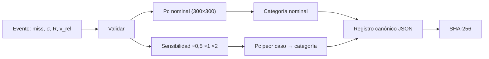

# B118-C20 — Evaluación de riesgo de conjunción documentada

<!-- nav:top -->
[🏠 Programa](../../../../README.md) · [📚 Bloque B118](../../../tronco-comun/B118-trafico-espacial-y-sostenibilidad-orbital.md) · [← Anterior: B118-C19 — Sostenibilidad y gobernanza orbital](../B118-C19-sostenibilidad-y-gobernanza-orbital/CLASE.md) · [Siguiente: B118-C21 — Calidad, latencia y trazabilidad de datos de vigilancia espacial →](../B118-C21-calidad-latencia-y-trazabilidad-de-datos-de-vigilancia-espacial/CLASE.md)
<!-- /nav -->

## 1. Ubicación, nivel y alcance

Clase 20 del bloque B118. Nivel N4. Tercera clase del tramo «Gestión, gobernanza y evidencia». Una evaluación de conjunción solo sirve si otra persona puede **reproducirla y auditarla**. Aquí generas el **registro documentado** de un evento **sintético**: entradas con unidades, versión del método, probabilidad de colisión por cuadratura, sensibilidad a la covarianza, categoría y **huella SHA-256**. Los umbrales de categoría son **ilustrativos**. **Esta clase es educativa: no constituye asesoría legal, regulatoria, financiera ni operativa y no sustituye la lectura del texto normativo vigente ni a un profesional habilitado.**

## 2. Por qué esta clase existe

Una decisión de maniobra se justifica meses después: ¿con qué datos, qué método y qué sensibilidad? La decisión central: **¿qué debe contener un registro para que el resultado sea reproducible, y cómo se evita decidir con un único número?**

## 3. Lo que podrás hacer al terminar

1. Definir los campos mínimos de un registro: entradas, unidades, referencia, versión, tolerancia.
2. Calcular la `Pc` nominal (2,883 × 10⁻⁴) y su sensibilidad al escalar la covarianza (×0,5; ×1; ×2).
3. Clasificar por categoría con umbrales ilustrativos y tomar el peor caso (`2,883 × 10⁻⁴`, ROJO).
4. Calcular una huella SHA-256 del registro canónico y comprobar que es reproducible.
5. Comprobar que un cambio de 1 m en el desfase cambia la huella.
6. Validar entradas y rechazar las incorrectas.

La evidencia es la **registro documentado de una evaluación de conjunción** del ejercicio 12 (sección 20).

## 4. Con qué llegas y cómo comprobarlo

1. ¿Qué es una huella criptográfica (hash)?
2. ¿Qué es una representación canónica?
3. ¿Qué es la `Pc`?
4. ¿Qué es una sensibilidad?
5. ¿Qué es una validación de entradas?

<details>
<summary>Ver respuestas</summary>

1. Un resumen de longitud fija de unos datos; cualquier cambio da otro resumen. 2. Una forma única de escribir los datos (orden de campos, separadores) para que el hash sea estable. 3. La probabilidad de colisión de B118-C06. 4. El cambio del resultado ante un cambio de una entrada. 5. La comprobación previa de que los datos son admisibles.
</details>

Con cuatro o cinco aciertos, sigue; si no, repasa los prerrequisitos.

## 5. Un caso de contexto y casos de referencia

Las directrices de la COPUOS (directriz 3) y de la IADC (sección 5.4), consultadas el 2026-11-11, piden estimar y limitar la probabilidad de colisión y considerar maniobras con datos orbitales fiables, pero no definen el contenido de un registro ni umbrales. El **ejemplo conductor** es el evento sintético `SINT-0001`: desfase 350 m, `σ` 200 × 120 m, radio combinado 8 m, velocidad relativa 14 km/s; las categorías (amarillo 10⁻⁷, rojo 10⁻⁴) son **ilustrativas** y no se tomaron de ninguna política.

## 6. Vocabulario

Un **registro** documenta una evaluación. La **huella** (SHA-256) es el resumen criptográfico del registro canónico. La **versión del método** identifica el cálculo. La **sensibilidad** muestra la dependencia con la covarianza. La **categoría de peor caso** usa el máximo de `Pc` en el barrido. La **trazabilidad** es la capacidad de reconstruir el resultado.

## 7. Modelo mental



*Descripción textual:* el evento se valida, se calcula la `Pc` nominal y el barrido de covarianza, se asignan categorías y todo se escribe en un registro canónico cuya huella permite verificar la reproducibilidad.

Analogía: la bitácora de un laboratorio; si anotas qué hiciste, con qué instrumento y en qué versión, otro puede repetirlo. Límite: la huella prueba que no cambió el registro, no que el método sea correcto.

## 8. La explicación, paso a paso

### 8.1 Contenido mínimo

Entradas con unidades (`miss_m`, `sx_m`, `sy_m`, `radio_m`, `v_rel_ms`), sistema de referencia (plano de encuentro), versión del método (`lab-b118-c20-1.0`), tipo de datos (SINTÉTICO), tolerancia numérica, umbrales y resultados.

### 8.2 Resultado

`Pc = 2,8831 × 10⁻⁴` (aproximación de disco pequeño 2,8835 × 10⁻⁴; diferencia menor que 0,2 %). Categoría nominal: **ROJO**.

### 8.3 Sensibilidad

Escalando la covarianza: ×0,5 → 1,175 × 10⁻⁵; ×1 → 2,883 × 10⁻⁴; ×2 → 2,273 × 10⁻⁴. El peor caso es 2,883 × 10⁻⁴ (ROJO). Notar que ×0,5 da **menos** `Pc`: la dilución de B118-C06 no es monótona.

### 8.4 Huella

SHA-256 del registro canónico (claves ordenadas, sin espacios): `15d59b33fc5300c454b37c7b46a76fec33a2a20f01518f04c3b053fdc0ff922e`. Repetido: idéntico. Con desfase de 351 m: `70a2c6be133b4334…` distinto. Tres entradas inválidas (sigma negativa, desfase negativo, falta el radio) se rechazan con mensajes claros.

## 9. Magnitudes, símbolos y unidades

| Símbolo | Qué es | Unidad | Valor / nota |
|---|---|---|---|
| `miss` | desfase | m | 350 |
| `σₓ`, `σᵧ` | desviaciones | m | 200, 120 |
| `R` | radio combinado | m | 8 |
| `Pc` | probabilidad de colisión | adimensional | 2,883 × 10⁻⁴ |
| huella | SHA-256 | hex | 15d59b33fc53… |

## 10. Convenciones y referencias

Plano de encuentro; longitudes en m, velocidad en m/s; `Pc` adimensional. JSON canónico con claves ordenadas y separadores `,` y `:` sin espacios. Cuadratura de 300 × 300 puntos (120 × 120 en el barrido). Los umbrales 10⁻⁷ y 10⁻⁴ son ilustrativos. Evento y covarianza sintéticos.

## 11. De dónde sale lo que afirmamos

| ID | Fuente | Localizador | Respalda | Estado |
|---|---|---|---|---|
| S1 | Space Debris Mitigation Guidelines of the Committee on the Peaceful Uses of Outer Space (UNOOSA, Viena, 2010; COPUOS 2007, resolución 62/217 de la Asamblea General) — https://www.unoosa.org/documents/pdf/psa/bsti/COPUOS_SPACE_DEBRIS_MITIGATION_GUIDELINES.pdf (consultada 2026-11-11; PDF leído con PyMuPDF) | directriz 3 | estimar y limitar la probabilidad de colisión; considerar una maniobra si los datos indican colisión potencial | Consultada |
| S3 | IADC Space Debris Mitigation Guidelines, IADC-02-01 Rev. 4 (enero de 2025), presentadas como A/AC.105/C.1/2025/CRP.9 (3 de febrero de 2025) — https://www.unoosa.org/res/oosadoc/data/documents/2025/aac_105c_12025crp/aac_105c_12025crp_9_0_html/AC105_C1_2025_CRP09E.pdf (consultada 2026-11-11; PDF leído con PyMuPDF) | sección 5.4 | estimar y limitar la probabilidad de colisión accidental; considerar maniobras con datos y evaluaciones fiables | Consultada |
| S6 | CCSDS 508.0-B-1, Conjunction Data Message (Issue 1, junio de 2013, con correcciones técnicas hasta octubre de 2021): ficha del Libro Azul — https://ccsds.org/publications/bluebooks/entry/3064/ (consultada 2026-11-11; solo la ficha leída con WebFetch; el texto del estándar no se abrió) | ficha del Libro Azul | el CDM (CCSDS 508.0-B-1, junio de 2013) es un formato estándar para intercambiar información de conjunción; el texto no se abrió | Consultada parcialmente |
| — | Umbrales de categoría de políticas operativas | — | decisión | No consultados |
| — | SHA-256 (FIPS 180-4) | — | huella | No consultada (función estándar de la biblioteca de Python) |
| — | Evento sintético | — | números | Sintético |

Límites: ninguna de las fuentes consultadas define el contenido de un registro ni umbrales; el registro es una propuesta didáctica.

## 12. Cómo ver los resultados

| Magnitud | Valor |
|---|---|
| `Pc` nominal | 2,883 × 10⁻⁴ |
| `Pc` ×0,5 / ×2 | 1,17 × 10⁻⁵ / 2,27 × 10⁻⁴ |
| Categoría nominal / peor caso | ROJO / ROJO |
| Huella repetida | idéntica |
| Huella con miss 351 m | distinta |

Descripción larga: el desfase pequeño frente a la covarianza da una `Pc` en categoría roja ilustrativa; la sensibilidad muestra que no depende monótonamente de la covarianza y que el peor caso importa.

## 13. Ejemplo trabajado

**Paso 1 · Entradas.** `miss` 350 m, `σ` 200 × 120 m, `R` 8 m.

**Paso 2 · Aproximación.** `R²/(2σₓσᵧ) × exp(−½(350/200)²) = 0,00133 × 0,2163 = 2,8835 × 10⁻⁴`.

**Paso 3 · Categoría.** `≥ 10⁻⁴` → ROJO (ilustrativo).

**Paso 4 · Huella.** SHA-256 del JSON canónico: `15d59b33fc5300c4…`.

## 14. Distintas formas de describir el problema

**Por campos:** entradas, método, resultados. **Por riesgo:** `Pc` nominal y de peor caso. **Por categoría:** verde, amarillo, rojo. **Por integridad:** huella. **Por reproducibilidad:** misma huella al repetir.

## 15. Práctica guiada

**Ejercicio 1 · con los pasos indicados.** Escribe los campos mínimos de un registro. *Pasos:* entradas, unidades, método, resultado.

<details><summary>Solución comentada</summary>

Identificador, entradas con unidades, referencia, versión del método, tolerancia, resultados y categoría.
</details>

**Ejercicio 2 · con una pista.** Calcula `R²/(2σₓσᵧ)` con `R` = 8, `σₓ` = 200, `σᵧ` = 120.

<details><summary>Solución comentada</summary>

`64/48 000 = 0,00133`.
</details>

**Ejercicio 3 · casi autónomo.** Calcula `exp(−½(350/200)²)`. *Pista:* `(1,75)²/2`.

<details><summary>Solución comentada</summary>

`0,2163`.
</details>

## 16. Práctica autónoma, transferencia e integrador

**Ejercicio 4 · autónomo.** Con ambos factores, ¿cuánto vale la `Pc` aproximada?

<details><summary>Solución comentada</summary>

`2,884 × 10⁻⁴`.
</details>

**Ejercicio 5 · autónomo.** ¿Qué categoría resulta con umbrales 10⁻⁷ y 10⁻⁴?

<details><summary>Solución comentada</summary>

Rojo (mayor que 10⁻⁴).
</details>

**Ejercicio 6 · autónomo.** ¿Por qué el peor caso no es el de covarianza menor?

<details><summary>Solución comentada</summary>

Por la dilución: con `σ` demasiado pequeño el objeto pasa en la cola y la `Pc` baja.
</details>

**Ejercicio 7 · autónomo.** Si cambias una cifra del registro, ¿qué pasa con la huella?

<details><summary>Solución comentada</summary>

Cambia por completo; permite detectar alteraciones.
</details>

**Ejercicio 8 · autónomo.** ¿Qué errores de entrada detecta la validación?

<details><summary>Solución comentada</summary>

Sigmas o radio no positivos, desfase negativo y campos ausentes.
</details>

**Ejercicio 9 · transferencia.** **Transferencia.** Un colega copia un registro y cambia la unidad de m a km sin recalcular. ¿Qué detecta la huella?

<details><summary>Solución comentada</summary>

Que el contenido cambió, pero no que el cálculo sea incorrecto; hay que recalcular y comparar.
</details>

**Ejercicio 10 · transferencia.** **Transferencia.** ¿Por qué se guardan los umbrales dentro del registro?

<details><summary>Solución comentada</summary>

Porque la categoría depende de ellos; sin guardarlos no se puede reproducir ni auditar.
</details>

**Ejercicio 11 · transferencia.** **Transferencia.** ¿Se puede usar este registro para decidir una maniobra real?

<details><summary>Solución comentada</summary>

No: los datos son sintéticos y los umbrales ilustrativos; una decisión real exige datos del operador, política aprobada y criterio profesional.
</details>

**Ejercicio 12 · integrador.** **Integrador.** Elabora tu *registro documentado de una evaluación de conjunción*: JSON con entradas, unidades, método, `Pc` nominal y de peor caso, categorías, umbrales ilustrativos, huella y la lista de qué es consultado, no consultado y sintético.

<details><summary>Solución comentada</summary>

Secciones 8.1–8.4 y la salida del laboratorio.
</details>

## 17. Laboratorio

El script [registro.py](registro.py) evalúa un evento sintético, construye el registro canónico y su huella, comprueba la reproducibilidad y valida entradas incorrectas (**comprueba** huella idéntica al repetir, distinta con otra entrada y `Pc` frente a la aproximación a 0,2 %).

**Datos:** evento y covarianza **sintéticos**; umbrales **ilustrativos**; directrices **consultadas** para el contexto. **Predice antes de ejecutar:** ¿qué categoría saldrá? (rojo (Pc cerca de 3×10⁻⁴).) **Ejecución del 2026-11-11 (Python 3.12.9):**

```text
Python 3.12.9 (biblioteca estandar)
Evento SINTETICO; umbrales de categoria ILUSTRATIVOS (no tomados de ninguna politica); version del metodo lab-b118-c20-1.0
Pc nominal = 2.8831e-04 (aproximacion de disco pequeno 2.8835e-04); categoria ROJO
  covarianza x0.5: Pc = 1.1746e-05
  covarianza x1.0: Pc = 2.8831e-04
  covarianza x2.0: Pc = 2.2728e-04
Pc de peor caso = 2.8831e-04; categoria de peor caso ROJO
Huella SHA-256: 15d59b33fc5300c454b37c7b46a76fec33a2a20f01518f04c3b053fdc0ff922e
Repetida:       15d59b33fc5300c454b37c7b46a76fec33a2a20f01518f04c3b053fdc0ff922e (iguales: True)
Miss 351 m:     70a2c6be133b4334... (distinta: True)
  validacion: sigmas y radio deben ser positivos
  validacion: miss no puede ser negativo
  validacion: falta radio_m
Pruebas superadas (reproducibilidad por huella, sensibilidad a la entrada, validacion de entradas).
```

```bash
python programa/clases/B118/B118-C20-evaluacion-de-riesgo-de-conjuncion-documentada/registro.py
```

**Límites:** una sola gaussiana en el plano de encuentro, categorías ilustrativas, huella sobre una representación JSON propia.

## 18. Errores frecuentes y cómo corregirlos

**Decidir con un único número.** Se corrige con 8.3.

**Guardar resultados sin unidades ni versión.** Se corrige con 8.1.

**Creer que la huella prueba que el cálculo es correcto.** Se corrige con el ejercicio 9.

**Usar umbrales ajenos sin citarlos.** Se corrige con la sección 11.

## 19. Cómo sabrás que vas bien

Tras la sección 8: ¿qué categoría esperabas y cuál obtuviste? Si dudas, repasa el ejemplo 13. Tras el laboratorio: ¿qué comprueba? (ver la sección 17).

## 20. Qué entregas y cómo se evalúa

El producto es tu **registro documentado de una evaluación de conjunción** (ejercicio 12).

| Criterio | Inicial | En desarrollo | Logrado | Destacado |
|---|---|---|---|---|
| Conceptos | Los confunde | Parciales | Construye y verifica un registro | Explica los límites del modelo |
| Cálculo | Sin unidades | Con errores | Tablas completas con unidades | Calcula casos nuevos |
| Numérico | Sin comprobar | Un caso | Contraste con una segunda vía | Interpreta las diferencias |
| Fuentes | Sin fuente | Sin fecha | Fuentes con fecha, versión y estado | Declara lo ilustrativo y lo no consultado |
| Límites | No los nombra | Uno | Tres | Discute qué falta del modelo |

**Condiciones críticas (no se compensan con promedio):** rotular los datos sintéticos e ilustrativos como tales; no presentar un modelo como observación; citar solo lo consultado, con su versión y fecha; no usar la ficha como asesoría legal, regulatoria o financiera.

## 21. Ética, seguridad y límites

Clase educativa: **no constituye asesoría legal, regulatoria ni financiera** ni orienta decisiones operativas reales, y no sustituye la lectura del texto normativo vigente (se cita siempre la versión y la fecha consultadas) ni la opinión de un especialista habilitado. Los modelos son simplificados y sus datos son sintéticos o ilustrativos. El registro es un ejemplo pedagógico y no debe usarse para decidir operaciones reales. Accesibilidad: tablas equivalentes a las gráficas, fórmulas en texto, ejercicios sin conexión.

## 22. Para cerrar y seguir

El registro del evento sintético da `Pc = 2,88 × 10⁻⁴` (ROJO con umbrales ilustrativos), peor caso 2,88 × 10⁻⁴ y una huella reproducible. Queda una pregunta: ¿qué calidad tienen los datos de vigilancia con que se construyen estos registros?

**Glosario español–inglés.** evaluación de riesgo · *risk assessment* · huella criptográfica · *cryptographic hash* · sensibilidad · *sensitivity* · trazabilidad · *traceability* · registro canónico · *canonical record*.

**Continuidad.** [B118-C21](../B118-C21-calidad-latencia-y-trazabilidad-de-datos-de-vigilancia-espacial/CLASE.md) estudia la calidad, latencia y trazabilidad de los datos de vigilancia espacial.

**Referencias:** ver sección 11.

<!-- nav:bottom -->
---

[← Anterior: B118-C19 — Sostenibilidad y gobernanza orbital](../B118-C19-sostenibilidad-y-gobernanza-orbital/CLASE.md) · [📚 Bloque B118](../../../tronco-comun/B118-trafico-espacial-y-sostenibilidad-orbital.md) · [Siguiente: B118-C21 — Calidad, latencia y trazabilidad de datos de vigilancia espacial →](../B118-C21-calidad-latencia-y-trazabilidad-de-datos-de-vigilancia-espacial/CLASE.md)
<!-- /nav -->
