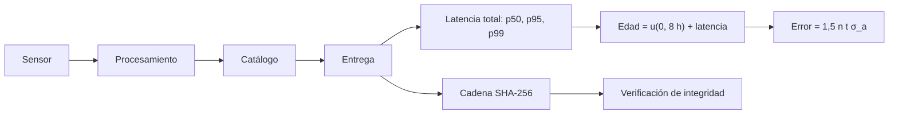

# B118-C21 — Calidad, latencia y trazabilidad de datos de vigilancia espacial

<!-- nav:top -->
[🏠 Programa](../../../../README.md) · [📚 Bloque B118](../../../tronco-comun/B118-trafico-espacial-y-sostenibilidad-orbital.md) · [← Anterior: B118-C20 — Evaluación de riesgo de conjunción documentada](../B118-C20-evaluacion-de-riesgo-de-conjuncion-documentada/CLASE.md) · [Siguiente: B118-C22 — Intercambio de datos de vigilancia entre operadores y Estados →](../B118-C22-intercambio-de-datos-de-vigilancia-entre-operadores-y-estados/CLASE.md)
<!-- /nav -->

## 1. Ubicación, nivel y alcance

Clase 21 del bloque B118. Nivel N4. Primera clase del tramo «Datos, cobertura y normas de vigilancia» (clase programada de la ampliación `0.2.0`). Un dato de vigilancia llega tarde, con edad y con un historial. Aquí mides, con un flujo **sintético** de 5000 observaciones, la **latencia por etapas**, la **edad de los elementos al usarlos**, el **error de posición** que esa edad produce y una **cadena de huellas** que detecta alteraciones. Todos los retardos son **ilustrativos**. **Esta clase es educativa: no constituye asesoría legal, regulatoria, financiera ni operativa y no sustituye la lectura del texto normativo vigente ni a un profesional habilitado.**

## 2. Por qué esta clase existe

B48-C11 trata la calidad de datos astronómicos; ninguna clase evalúa datos de vigilancia (latencia, cobertura, trazabilidad). Una conjunción se evalúa con datos que ya envejecieron; un dato sin historial no se puede auditar. La decisión central: **¿cuánto tarda un dato en llegar, qué error acumula por su edad y cómo se demuestra de dónde viene?**

## 3. Lo que podrás hacer al terminar

1. Modelar la latencia total como suma de cuatro etapas con retardos lognormales.
2. Calcular percentiles de la latencia (p50 7967 s; p95 15144 s; p99 19332 s) y ver que la suma de medianas subestima la media.
3. Calcular la edad de los elementos al usarlos (p50 6,38 h; p95 10,32 h).
4. Convertir la edad en error a lo largo de la traza (p50 0,75 km; p95 1,22 km).
5. Construir una cadena de huellas SHA-256 y comprobar que detecta una alteración.
6. Rotular que ningún retardo es medido y que Space-Track se consultó solo por los tipos de datos.

La evidencia es la **ficha de calidad y trazabilidad de datos** del ejercicio 12 (sección 20).

## 4. Con qué llegas y cómo comprobarlo

1. ¿Qué es un percentil?
2. ¿Qué es una distribución lognormal?
3. ¿Qué es la edad de un dato?
4. ¿Qué es una cadena de huellas?
5. ¿Qué es la trazabilidad?

<details>
<summary>Ver respuestas</summary>

1. El valor bajo el cual queda esa fracción de las muestras. 2. Una en la que el logaritmo de la variable es normal; tiene cola larga. 3. El tiempo transcurrido desde su época hasta su uso. 4. Una lista donde cada huella incluye la anterior, de modo que alterar un registro invalida los siguientes. 5. La capacidad de reconstruir el origen y el tratamiento de un dato.
</details>

Con cuatro o cinco aciertos, sigue; si no, repasa los prerrequisitos.

## 5. Un caso de contexto y casos de referencia

La documentación de **Space-Track** (consultada el 2026-11-11) indica que publica elementos GP en formatos TLE y OMM, el catálogo SATCAT, mensajes de conjunción (CDM), datos de decaimiento y reentrada, y advierte de que los TLE públicos son elementos medios que no deben usarse para la predicción de conjunciones. No informa de latencias. El **ejemplo conductor** usa medianas por etapa (sensor 397 s; procesamiento 1831 s; catálogo 4932 s; entrega 246 s), todas **ilustrativas**.

## 6. Vocabulario

La **latencia** es el retardo entre la observación y la disponibilidad del dato. La **edad** es el tiempo entre la época de los elementos y su uso. La **completitud** es la fracción de datos entregados en un plazo. El **percentil 95** deja el 5 % de los casos por encima. La **huella encadenada** liga cada registro con el anterior. El **linaje** (*provenance*) es el historial de un dato.

## 7. Modelo mental



*Descripción textual:* cuatro etapas suman una latencia con cola larga; la edad de los elementos al usarlos añade el ciclo de actualización y de ahí se estima el error de posición; en paralelo, una cadena de huellas protege la integridad.

Analogía: un periódico que llega con retraso y con la hora de la noticia impresa; la «edad» de lo que lees es la de la imprenta más la del reparto. Límite: aquí el retardo de cada etapa es independiente y las actualizaciones son uniformes.

## 8. La explicación, paso a paso

### 8.1 Latencia por etapas

Medianas: sensor 397 s; procesamiento 1831 s; catálogo 4932 s; entrega 246 s; **suma de medianas 7406 s**. La latencia total tiene p50 = 7967 s, p95 = 15144 s y p99 = 19332 s; la media es 8639 s. La suma de medianas (no la mediana de la suma) subestima, y las colas pesan.

### 8.2 Edad y error

Con actualización cada 8 h (uniforme) más la latencia, la edad al usarlos es p50 = 6,38 h y p95 = 10,32 h. El error a lo largo de la traza (`1,5 n t σ_a`, `σ_a = 0,02 km`, 550 km) es **0,755 km** (p50) y **1,220 km** (p95). Solo el 1,34 % se entrega en menos de 1 h.

### 8.3 Cadena de huellas

Cada registro `(id, número sintético, época, edad)` se resume con `SHA-256(huella_anterior + JSON canónico)`. Huellas (12 primeros hex): 2faa2adbae24 368351c7af98 b30c27bd01a0 e9572f1a79c9 a04cc6daf111. Verificación de la cadena intacta: **True**; con un registro alterado: **False**.

### 8.4 Límites

La latencia real depende del sensor, de la red y de las políticas del operador; el modelo no representa ninguna. La huella protege la integridad, no la exactitud del dato.

## 9. Magnitudes, símbolos y unidades

| Símbolo | Qué es | Unidad | Valor / nota |
|---|---|---|---|
| `p50`, `p95` | latencia total | s | 7967, 15144 |
| edad `p95` | edad al usar los elementos | h | 10,32 |
| error `p95` | error a lo largo de la traza | km | 1,220 |
| completitud 1 h | fracción entregada en menos de 1 h | adimensional | 0,0134 |
| huella | SHA-256 encadenada | hex | 64 caracteres |

## 10. Convenciones y referencias

Tiempos en s (h en los resultados); lognormal `ln(s) ~ N(μ, σ)` por etapa con semilla 118; percentiles por interpolación lineal. Actualización cada 8 h (ilustrativa). `GM = 398 600,4418 km³/s²` (convencional, no consultado). Registros con números sintéticos (90 000+). Ningún dato es medido.

## 11. De dónde sale lo que afirmamos

| ID | Fuente | Localizador | Respalda | Estado |
|---|---|---|---|---|
| S5 | Space-Track.org, documentación (operado por Space Forces-Space; 18.º y 19.º Escuadrón de Defensa Espacial) — https://www.space-track.org/documentation (consultada 2026-11-11; página leída con WebFetch) | página de documentación | Space-Track publica GP (TLE, OMM), SATCAT, CDM y datos de reentrada; advierte que los TLE públicos son elementos medios que no deben usarse para la predicción de conjunciones | Consultada |
| — | Latencias reales de redes de vigilancia | — | retardos | No consultadas |
| — | Retardos lognormales por etapa y ciclo de 8 h | — | distribución | Ilustrativo |
| — | SHA-256 | — | huella | No consultada (función estándar de la biblioteca) |

Límites: de Space-Track solo se leyó la lista de datos y la advertencia; no hay cifras de latencia ni de calidad en las fuentes consultadas.

## 12. Cómo ver los resultados

| Magnitud | Valor |
|---|---|
| Latencia `p50` / `p95` / `p99` | 7967 / 15144 / 19332 s |
| Suma de medianas | 7406 s |
| Edad `p50` / `p95` | 6,38 / 10,32 h |
| Error `p50` / `p95` | 0,75 / 1,22 km |
| Cadena intacta / alterada | True / False |

Descripción larga: la latencia tiene cola larga: el percentil 99 es más del doble de la mediana; la edad de 6 a 10 horas convierte los 0,02 km de incertidumbre del semieje en un error de casi un kilómetro; la cadena detecta cualquier cambio.

## 13. Ejemplo trabajado

**Paso 1 · Suma de medianas.** `397 + 1831 + 4932 + 246 = 7406 s`.

**Paso 2 · Edad del percentil 50.** 22982 s = 6,38 h.

**Paso 3 · Error.** `1,5 × 1,0948×10⁻³ × 22982 × 0,02 = 0,755 km`.

**Paso 4 · Integridad.** Cambiar `edad_s` en el registro 2 invalida su huella y las siguientes.

## 14. Distintas formas de describir el problema

**Por etapa:** mediana. **Por cola:** p95, p99. **Por edad:** horas. **Por error:** km. **Por integridad:** huella encadenada.

## 15. Práctica guiada

**Ejercicio 1 · con los pasos indicados.** Calcula la suma de las medianas de tres etapas de 100, 200 y 300 s. *Pasos:* suma simple.

<details><summary>Solución comentada</summary>

`600 s`.
</details>

**Ejercicio 2 · con una pista.** Convierte 7967 s a horas. *Pista:* divide entre 3600.

<details><summary>Solución comentada</summary>

`2,21 h`.
</details>

**Ejercicio 3 · casi autónomo.** Calcula `1,5 n t σ_a` para `t` = 6 h con `n` = 1,0948×10⁻³ rad/s y `σ_a` = 0,02 km.

<details><summary>Solución comentada</summary>

`1,5 × 1,0948×10⁻³ × 21 600 × 0,02 = 0,709 km`.
</details>

## 16. Práctica autónoma, transferencia e integrador

**Ejercicio 4 · autónomo.** ¿Por qué el percentil 99 (19332 s) es más del doble de la mediana (7967 s)?

<details><summary>Solución comentada</summary>

Por la cola larga de las distribuciones lognormales.
</details>

**Ejercicio 5 · autónomo.** ¿Qué pasa con el error si la actualización pasa de cada 8 h a cada 4 h (edad media ≈ la mitad)?

<details><summary>Solución comentada</summary>

El error baja aproximadamente a la mitad (es lineal en la edad).
</details>

**Ejercicio 6 · autónomo.** ¿Qué porcentaje de datos llega en menos de 1 h según el laboratorio?

<details><summary>Solución comentada</summary>

`1,34 %`.
</details>

**Ejercicio 7 · autónomo.** ¿Por qué una cadena de huellas detecta la alteración de un registro intermedio?

<details><summary>Solución comentada</summary>

Porque cada huella depende de la anterior: al cambiar un registro cambian su huella y todas las siguientes, y la verificación falla.
</details>

**Ejercicio 8 · autónomo.** ¿Qué no garantiza una huella?

<details><summary>Solución comentada</summary>

Que el dato sea correcto: solo que no cambió desde que se registró.
</details>

**Ejercicio 9 · transferencia.** **Transferencia.** Un proveedor promete «latencia media de 10 minutos». ¿Qué pides?

<details><summary>Solución comentada</summary>

La definición (de qué a qué), los percentiles p95 y p99, la completitud por plazo y el método de medida.
</details>

**Ejercicio 10 · transferencia.** **Transferencia.** ¿Por qué la edad importa más que la latencia para un TLE?

<details><summary>Solución comentada</summary>

Porque el error crece con el tiempo desde la época (hasta días), mientras la latencia es de horas o menos.
</details>

**Ejercicio 11 · transferencia.** **Transferencia.** ¿Cómo documentarías el origen de un dato en un registro de conjunción?

<details><summary>Solución comentada</summary>

Fuente, versión del producto, época, hora de descarga y huella; así otra persona reconstruye qué dato se usó.
</details>

**Ejercicio 12 · integrador.** **Integrador.** Elabora tu *ficha de calidad y trazabilidad de datos*: latencia por etapas y percentiles, edad y error, completitud, cadena de huellas verificada y la lista de qué es consultado, no consultado e ilustrativo.

<details><summary>Solución comentada</summary>

Secciones 8.1–8.4 y la salida del laboratorio.
</details>

## 17. Laboratorio

El script [latencia.py](latencia.py) simula 5000 observaciones con cuatro etapas, calcula los percentiles de latencia, la edad, el error y verifica una cadena de huellas SHA-256 (**comprueba** que la cadena detecta una alteración y que los percentiles están ordenados).

**Datos:** flujo **sintético**; retardos **ilustrativos**; Space-Track **consultado** solo por los tipos de datos. **Predice antes de ejecutar:** ¿qué fracción llega en menos de 1 h? (muy poca, cerca de 1 %.) **Ejecución del 2026-11-11 (Python 3.12.9):**

```text
Python 3.12.9 (biblioteca estandar)
Flujo SINTETICO de 5000 observaciones; retardos lognormales ILUSTRATIVOS (semilla 118); Space-Track consultado solo para los tipos de datos.
Mediana por etapa [s]: sensor 397, procesamiento 1831, catalogo 4932, entrega 246; suma de medianas 7406 s
Latencia total: p50 = 7967 s; p95 = 15144 s; p99 = 19332 s; media 8639 s (la suma de medianas subestima)
Edad de los elementos al usarlos: p50 = 6.38 h; p95 = 10.32 h
Error de posicion a lo largo de la traza (sigma_a = 0.02 km): p50 = 0.755 km; p95 = 1.220 km
Fraccion entregada en menos de 1 h: 0.0134
Cadena de huellas (12 primeros hex): 2faa2adbae24 368351c7af98 b30c27bd01a0 e9572f1a79c9 a04cc6daf111
Verificacion de la cadena intacta: True; con un registro alterado: False
Pruebas superadas (cadena detecta la alteracion; percentiles ordenados; la cola pesa mas que la mediana).
```

```bash
python programa/clases/B118/B118-C21-calidad-latencia-y-trazabilidad-de-datos-de-vigilancia-espacial/latencia.py
```

**Límites:** etapas independientes, lognormal sin autocorrelación, un solo ciclo de actualización, error por semieje solo.

## 18. Errores frecuentes y cómo corregirlos

**Reportar solo la media de la latencia.** Se corrige con 8.1.

**Sumar medianas como si fuera la mediana de la suma.** Se corrige con 8.1.

**Creer que la huella verifica la exactitud.** Se corrige con el ejercicio 8.

**Ignorar la edad de los elementos.** Se corrige con 8.2.

## 19. Cómo sabrás que vas bien

Tras la sección 8: ¿qué latencia p95 esperabas y cuál obtuviste? Si dudas, repasa el ejemplo 13. Tras el laboratorio: ¿qué comprueba? (ver la sección 17).

## 20. Qué entregas y cómo se evalúa

El producto es tu **ficha de calidad y trazabilidad de datos** (ejercicio 12).

| Criterio | Inicial | En desarrollo | Logrado | Destacado |
|---|---|---|---|---|
| Conceptos | Los confunde | Parciales | Calcula percentiles, edad y trazabilidad | Explica los límites del modelo |
| Cálculo | Sin unidades | Con errores | Tablas completas con unidades | Calcula casos nuevos |
| Numérico | Sin comprobar | Un caso | Contraste con una segunda vía | Interpreta las diferencias |
| Fuentes | Sin fuente | Sin fecha | Fuentes con fecha, versión y estado | Declara lo ilustrativo y lo no consultado |
| Límites | No los nombra | Uno | Tres | Discute qué falta del modelo |

**Condiciones críticas (no se compensan con promedio):** rotular los datos sintéticos e ilustrativos como tales; no presentar un modelo como observación; citar solo lo consultado, con su versión y fecha; no usar la ficha como asesoría legal, regulatoria o financiera.

## 21. Ética, seguridad y límites

Clase educativa: **no constituye asesoría legal, regulatoria ni financiera** ni orienta decisiones operativas reales, y no sustituye la lectura del texto normativo vigente (se cita siempre la versión y la fecha consultadas) ni la opinión de un especialista habilitado. Los modelos son simplificados y sus datos son sintéticos o ilustrativos. Accesibilidad: tablas equivalentes a las gráficas, fórmulas en texto, ejercicios sin conexión.

## 22. Para cerrar y seguir

La latencia sintética tiene p95 de 4,2 h; los elementos se usan con una edad p95 de 10,3 h y 1,2 km de error, y la cadena de huellas detecta cualquier alteración. Queda una pregunta: ¿cómo se intercambian estos datos entre operadores sin que se pierdan unidades ni significado?

**Glosario español–inglés.** latencia · *latency* · trazabilidad · *traceability* · edad de los datos · *data age* · completitud · *completeness* · linaje de datos · *data provenance*.

**Continuidad.** [B118-C22](../B118-C22-intercambio-de-datos-de-vigilancia-entre-operadores-y-estados/CLASE.md) estudia el intercambio de datos de vigilancia entre operadores y Estados.

**Referencias:** ver sección 11.

<!-- nav:bottom -->
---

[← Anterior: B118-C20 — Evaluación de riesgo de conjunción documentada](../B118-C20-evaluacion-de-riesgo-de-conjuncion-documentada/CLASE.md) · [📚 Bloque B118](../../../tronco-comun/B118-trafico-espacial-y-sostenibilidad-orbital.md) · [Siguiente: B118-C22 — Intercambio de datos de vigilancia entre operadores y Estados →](../B118-C22-intercambio-de-datos-de-vigilancia-entre-operadores-y-estados/CLASE.md)
<!-- /nav -->
