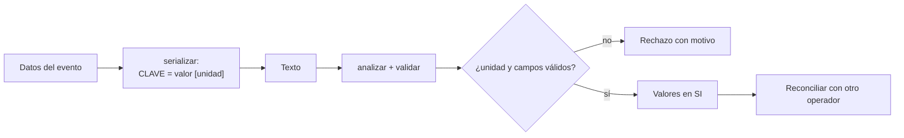

# B118-C22 — Intercambio de datos de vigilancia entre operadores y Estados

<!-- nav:top -->
[🏠 Programa](../../../../README.md) · [📚 Bloque B118](../../../tronco-comun/B118-trafico-espacial-y-sostenibilidad-orbital.md) · [← Anterior: B118-C21 — Calidad, latencia y trazabilidad de datos de vigilancia espacial](../B118-C21-calidad-latencia-y-trazabilidad-de-datos-de-vigilancia-espacial/CLASE.md) · [Siguiente: B118-C23 — Cobertura, sesgos y límites de las redes de vigilancia →](../B118-C23-cobertura-sesgos-y-limites-de-las-redes-de-vigilancia/CLASE.md)
<!-- /nav -->

## 1. Ubicación, nivel y alcance

Clase 22 del bloque B118. Nivel N4. Segunda clase del tramo «Datos, cobertura y normas de vigilancia» (clase programada de la ampliación `0.2.0`). Dos operadores solo pueden coordinar una maniobra si sus mensajes significan lo mismo. Aquí implementas un **mensaje de conjunción sintético** en texto `clave = valor [unidad]`, **inspirado** en el estilo de los mensajes CCSDS pero **no conforme** a ellos, con **serialización, análisis, validación de unidades y reconciliación** entre dos operadores. **Esta clase es educativa: no constituye asesoría legal, regulatoria, financiera ni operativa y no sustituye la lectura del texto normativo vigente ni a un profesional habilitado.**

## 2. Por qué esta clase existe

B118-C18 trata la gestión del tráfico en general, pero no cubre formatos ni acuerdos de intercambio. Un error de unidades (metros contra kilómetros) puede cambiar una decisión por un factor 1000. La decisión central: **¿cómo se diseña un intercambio para que los errores de unidades, campos y tiempos se detecten antes de que alguien decida?**

## 3. Lo que podrás hacer al terminar

1. Definir un esquema con campos obligatorios, tipos y unidades.
2. Serializar y analizar un mensaje con ida y vuelta exacta.
3. Convertir unidades de entrada a SI y reconciliar dos mensajes del mismo evento.
4. Detectar una unidad errónea (350 [km] en lugar de 350 [m]): discrepancia de un factor 1000.
5. Rechazar mensajes con campos faltantes, repetidos, desconocidos o unidades no reconocidas.
6. Distinguir un formato didáctico de un estándar (CCSDS 508.0-B-1).

La evidencia es la **ficha de intercambio de un mensaje de conjunción** del ejercicio 12 (sección 20).

## 4. Con qué llegas y cómo comprobarlo

1. ¿Qué es un esquema?
2. ¿Qué es un análisis sintáctico (*parsing*)?
3. ¿Qué es una ida y vuelta?
4. ¿Qué es la reconciliación?
5. ¿Qué es una tolerancia relativa?

<details>
<summary>Ver respuestas</summary>

1. La definición de los campos, tipos y restricciones de un mensaje. 2. Convertir un texto en datos estructurados. 3. Serializar y analizar de vuelta para recuperar el original. 4. Comparar dos versiones de un dato y señalar las diferencias. 5. La diferencia máxima aceptada dividida entre el valor mayor.
</details>

Con cuatro o cinco aciertos, sigue; si no, repasa los prerrequisitos.

## 5. Un caso de contexto y casos de referencia

La ficha del **Libro Azul CCSDS 508.0-B-1, Conjunction Data Message** (Issue 1, junio de 2013, con correcciones técnicas hasta octubre de 2021; consultada el 2026-11-11) indica que especifica un formato estándar para intercambiar información de conjunción entre originadores de datos, operadores y otras partes autorizadas, y que tiene equivalente ISO 19389. **El texto del estándar no se abrió**: la sintaxis y los campos de esta clase son propios. Space-Track (consultado) publica CDM. El **ejemplo conductor** es un mensaje sintético con desfase 350 m y velocidad relativa 14 km/s.

## 6. Vocabulario

Un **mensaje de conjunción** transmite los datos de un evento. Un **campo** tiene nombre, tipo y unidad. Una **unidad** fija la escala. La **serialización** convierte datos en texto. El **análisis** hace lo inverso. La **reconciliación** compara dos mensajes. Un **originador** es quien crea el mensaje.

## 7. Modelo mental



*Descripción textual:* los datos se escriben con su unidad, se leen y validan; si son válidos se convierten a SI y se comparan con el mensaje de otro operador.

Analogía: una factura entre dos empresas; si una escribe «350» sin decir si son metros o kilómetros, el pago sale mal. Límite: el formato real tiene muchos más campos, reglas de versionado y registros de valores.

## 8. La explicación, paso a paso

### 8.1 El esquema

Campos: `MESSAGE_ID`, `ORIGINATOR`, `CREATION_DATE`, `TCA`, `OBJECT1`, `OBJECT2` (texto); `MISS_DISTANCE [m]`, `RELATIVE_SPEED [m/s]` (con unidad obligatoria); `COLLISION_PROBABILITY` (adimensional).

### 8.2 El mensaje

```text
MESSAGE_ID = SINT-A-0001
ORIGINATOR = OPERADOR_SINTETICO_A
CREATION_DATE = 2026-11-11T00:00:00
TCA = 2026-11-12T03:04:05.000
OBJECT1 = SINT-90001
OBJECT2 = SINT-90002
MISS_DISTANCE = 350.0 [m]
RELATIVE_SPEED = 14000.0 [m/s]
COLLISION_PROBABILITY = 0.000288
```

Ida y vuelta exacta: **True**.

### 8.3 Unidades y reconciliación

El mismo evento escrito en km y km/s (`0,35 [km]`, `14,0 [km/s]`) se convierte a SI y no tiene discrepancias con el original: **[]**. Un operador que escribe `350,0 [km]` genera 1 discrepancia: `MISS_DISTANCE` 3,500 × 10² frente a 3,500 × 10⁵ (error relativo 0,9990).

### 8.4 Rechazos

Se rechazan con motivo: MISS_DISTANCE sin unidad; unidad no reconocida mph; campo repetido TCA; campo desconocido ORIGEN; linea sin '=': 'MESSAGE_ID SINT'. En un intercambio real también se validarían tipos de fecha, rangos físicos y versiones.

## 9. Magnitudes, símbolos y unidades

| Símbolo | Qué es | Unidad | Valor / nota |
|---|---|---|---|
| `MISS_DISTANCE` | distancia de paso | m | 350,0 |
| `RELATIVE_SPEED` | velocidad relativa | m/s | 14 000,0 |
| `COLLISION_PROBABILITY` | probabilidad | adimensional | 2,88×10⁻⁴ |
| tolerancia | reconciliación | relativa | 1 % |
| unidades | aceptadas | — | m, km, m/s, km/s |

## 10. Convenciones y referencias

Texto UTF-8 con una línea por campo; las unidades entre corchetes; conversión a SI. Fechas en texto ISO sin validar en esta clase. El formato es didáctico y no es CCSDS: no sirve para intercambiar datos reales. Datos sintéticos.

## 11. De dónde sale lo que afirmamos

| ID | Fuente | Localizador | Respalda | Estado |
|---|---|---|---|---|
| S6 | CCSDS 508.0-B-1, Conjunction Data Message (Issue 1, junio de 2013, con correcciones técnicas hasta octubre de 2021): ficha del Libro Azul — https://ccsds.org/publications/bluebooks/entry/3064/ (consultada 2026-11-11; solo la ficha leída con WebFetch; el texto del estándar no se abrió) | ficha del Libro Azul | CDM: formato estándar de intercambio de información de conjunción (Issue 1, junio de 2013; correcciones técnicas hasta octubre de 2021; ISO 19389); el texto no se abrió | Consultada parcialmente |
| S5 | Space-Track.org, documentación (operado por Space Forces-Space; 18.º y 19.º Escuadrón de Defensa Espacial) — https://www.space-track.org/documentation (consultada 2026-11-11; página leída con WebFetch) | página de documentación | Space-Track publica CDM | Consultada |
| — | Sintaxis y campos reales del CDM (KVN, XML) y del OMM | — | formato | No consultados |
| — | Acuerdos de intercambio entre operadores y Estados | — | marco contractual | No consultados |
| — | Mensaje y campos de la clase | — | ejercicio | Sintético / propio |

Límites: solo se leyó la ficha del CDM, no el estándar; los campos de la clase son propios; los acuerdos reales de intercambio no se consultaron.

## 12. Cómo ver los resultados

| Magnitud | Valor |
|---|---|
| Ida y vuelta | True |
| Discrepancias km vs m | ninguna |
| Discrepancia con unidad errónea | MISS_DISTANCE: 3,50 × 10² frente a 3,50 × 10⁵ |
| Rechazos | 5 de 5 detectados |

Descripción larga: el mismo evento en otras unidades se reconcilia sin diferencias; una unidad errónea produce un factor 1000 y se detecta; los cinco mensajes defectuosos se rechazan.

## 13. Ejemplo trabajado

**Paso 1 · Mensaje A.** `MISS_DISTANCE = 350.0 [m]` → 350 m.

**Paso 2 · Mensaje B.** `MISS_DISTANCE = 0.35 [km]` → 0,35 × 1000 = 350 m: coincide.

**Paso 3 · Mensaje C.** `MISS_DISTANCE = 350.0 [km]` → 350 000 m: discrepancia relativa `(350 000 − 350)/350 000 = 0,9990`.

**Paso 4 · Decisión.** Se marca la discrepancia y se pide aclaración antes de usar el dato.

## 14. Distintas formas de describir el problema

**Por esquema:** campos y unidades. **Por texto:** serialización. **Por valor:** SI. **Por comparación:** reconciliación. **Por error:** rechazo con motivo.

## 15. Práctica guiada

**Ejercicio 1 · con los pasos indicados.** Convierte `0,35 [km]` a m. *Pasos:* multiplica por 1000.

<details><summary>Solución comentada</summary>

`350 m`.
</details>

**Ejercicio 2 · con una pista.** Convierte `14,0 [km/s]` a m/s.

<details><summary>Solución comentada</summary>

`14 000 m/s`.
</details>

**Ejercicio 3 · casi autónomo.** Calcula la discrepancia relativa entre 350 m y 3500 m.

<details><summary>Solución comentada</summary>

`(3500 − 350)/3500 = 0,90`.
</details>

## 16. Práctica autónoma, transferencia e integrador

**Ejercicio 4 · autónomo.** ¿Qué pasa si falta la unidad en `MISS_DISTANCE`?

<details><summary>Solución comentada</summary>

El análisis la rechaza: «sin unidad».
</details>

**Ejercicio 5 · autónomo.** ¿Qué pasa si aparece `TCA` dos veces?

<details><summary>Solución comentada</summary>

Se rechaza por campo repetido.
</details>

**Ejercicio 6 · autónomo.** ¿Qué tolerancia se usó para reconciliar y por qué una unidad errónea la supera?

<details><summary>Solución comentada</summary>

1 %; el error de un factor 1000 es cercano al 100 %.
</details>

**Ejercicio 7 · autónomo.** ¿Por qué conviene guardar las unidades en el propio mensaje?

<details><summary>Solución comentada</summary>

Porque el receptor no tiene que adivinarlas y los errores se detectan al analizar.
</details>

**Ejercicio 8 · autónomo.** ¿Qué campos añadirías a un mensaje real?

<details><summary>Solución comentada</summary>

Versión del formato, covarianzas, radios, estados de los objetos y marcas de calidad.
</details>

**Ejercicio 9 · transferencia.** **Transferencia.** Dos operadores reportan `Pc` de 10⁻⁴ y 10⁻⁶ para el mismo evento con el mismo desfase. ¿Qué verificas?

<details><summary>Solución comentada</summary>

Las covarianzas y el radio usados, el método y la versión; no basta reconciliar el desfase.
</details>

**Ejercicio 10 · transferencia.** **Transferencia.** Un acuerdo de intercambio dice «enviar datos en formato estándar». ¿Qué falta?

<details><summary>Solución comentada</summary>

La versión exacta del estándar, la sintaxis (KVN o XML), los campos obligatorios y la política de correcciones.
</details>

**Ejercicio 11 · transferencia.** **Transferencia.** ¿Es este formato apto para producción?

<details><summary>Solución comentada</summary>

No: es didáctico y no conforme a CCSDS; la producción exige el estándar vigente y pruebas de interoperabilidad.
</details>

**Ejercicio 12 · integrador.** **Integrador.** Elabora tu *ficha de intercambio de un mensaje de conjunción*: esquema, mensaje de ejemplo, conversión de unidades, reconciliación con un segundo operador, casos de rechazo y la lista de qué es consultado (la ficha del CDM), propio y no consultado.

<details><summary>Solución comentada</summary>

Secciones 8.1–8.4 y la salida del laboratorio.
</details>

## 17. Laboratorio

El script [intercambio.py](intercambio.py) serializa y analiza un mensaje sintético, convierte unidades, reconcilia dos operadores y rechaza cinco mensajes defectuosos (**comprueba** la ida y vuelta exacta, la conversión y la detección de la unidad errónea).

**Datos:** mensaje **sintético**; formato **propio**; ficha del CDM **consultada**, texto del estándar **no consultado**. **Predice antes de ejecutar:** ¿qué ocurre si un operador escribe 350 [km] en vez de 350 [m]? (una discrepancia de un factor 1000 que se detecta.) **Ejecución del 2026-11-11 (Python 3.12.9):**

```text
Python 3.12.9 (biblioteca estandar)
Mensaje SINTETICO tipo clave = valor [unidad], inspirado en KVN pero NO conforme a CCSDS 508.0-B-1 (solo se consulto su ficha).
MESSAGE_ID = SINT-A-0001
ORIGINATOR = OPERADOR_SINTETICO_A
CREATION_DATE = 2026-11-11T00:00:00
TCA = 2026-11-12T03:04:05.000
OBJECT1 = SINT-90001
OBJECT2 = SINT-90002
MISS_DISTANCE = 350.0 [m]
RELATIVE_SPEED = 14000.0 [m/s]
COLLISION_PROBABILITY = 0.000288
Ida y vuelta exacta: True
Mismo evento en km (0.35 km, 14 km/s): discrepancias tras convertir a SI: []
Operador que escribe 350 [km] por error: 1 discrepancia(s): MISS_DISTANCE 350 vs 3.5e+05
  rechazo: MISS_DISTANCE sin unidad
  rechazo: unidad no reconocida mph
  rechazo: campo repetido TCA
  rechazo: campo desconocido ORIGEN
  rechazo: linea sin '=': 'MESSAGE_ID SINT'
Pruebas superadas (ida y vuelta, conversion de unidades, deteccion de unidad erronea, 5 rechazos).
```

```bash
python programa/clases/B118/B118-C22-intercambio-de-datos-de-vigilancia-entre-operadores-y-estados/intercambio.py
```

**Límites:** sin versiones, sin XML, sin covarianzas, sin firma; el formato no es el estándar.

## 18. Errores frecuentes y cómo corregirlos

**Suponer unidades por convención.** Se corrige con 8.1.

**Creer que el formato didáctico es el CDM.** Se corrige con la sección 11.

**Reconciliar solo un campo.** Se corrige con el ejercicio 9.

**Aceptar mensajes con campos desconocidos sin avisar.** Se corrige con 8.4.

## 19. Cómo sabrás que vas bien

Tras la sección 8: ¿qué discrepancia esperabas con la unidad errónea y cuál obtuviste? Si dudas, repasa el ejemplo 13. Tras el laboratorio: ¿qué comprueba? (ver la sección 17).

## 20. Qué entregas y cómo se evalúa

El producto es tu **ficha de intercambio de un mensaje de conjunción** (ejercicio 12).

| Criterio | Inicial | En desarrollo | Logrado | Destacado |
|---|---|---|---|---|
| Conceptos | Los confunde | Parciales | Define el esquema y reconcilia mensajes | Explica los límites del modelo |
| Cálculo | Sin unidades | Con errores | Tablas completas con unidades | Calcula casos nuevos |
| Numérico | Sin comprobar | Un caso | Contraste con una segunda vía | Interpreta las diferencias |
| Fuentes | Sin fuente | Sin fecha | Fuentes con fecha, versión y estado | Declara lo ilustrativo y lo no consultado |
| Límites | No los nombra | Uno | Tres | Discute qué falta del modelo |

**Condiciones críticas (no se compensan con promedio):** rotular los datos sintéticos e ilustrativos como tales; no presentar un modelo como observación; citar solo lo consultado, con su versión y fecha; no usar la ficha como asesoría legal, regulatoria o financiera.

## 21. Ética, seguridad y límites

Clase educativa: **no constituye asesoría legal, regulatoria ni financiera** ni orienta decisiones operativas reales, y no sustituye la lectura del texto normativo vigente (se cita siempre la versión y la fecha consultadas) ni la opinión de un especialista habilitado. Los modelos son simplificados y sus datos son sintéticos o ilustrativos. Accesibilidad: tablas equivalentes a las gráficas, fórmulas en texto, ejercicios sin conexión.

## 22. Para cerrar y seguir

Un mensaje con unidades explícitas se reconcilia sin diferencias entre m y km, y un 350 [km] equivocado se detecta con un factor 1000; el formato de la clase es propio y el estándar CCSDS 508.0-B-1 solo se conoce por su ficha. Queda una pregunta: ¿qué objetos nunca llegan a estos mensajes porque la red no los ve?

**Glosario español–inglés.** mensaje de datos de conjunción · *conjunction data message* · serialización · *serialization* · reconciliación · *reconciliation* · originador · *originator* · interoperabilidad · *interoperability*.

**Continuidad.** [B118-C23](../B118-C23-cobertura-sesgos-y-limites-de-las-redes-de-vigilancia/CLASE.md) estudia la cobertura, los sesgos y los límites de las redes de vigilancia.

**Referencias:** ver sección 11.

<!-- nav:bottom -->
---

[← Anterior: B118-C21 — Calidad, latencia y trazabilidad de datos de vigilancia espacial](../B118-C21-calidad-latencia-y-trazabilidad-de-datos-de-vigilancia-espacial/CLASE.md) · [📚 Bloque B118](../../../tronco-comun/B118-trafico-espacial-y-sostenibilidad-orbital.md) · [Siguiente: B118-C23 — Cobertura, sesgos y límites de las redes de vigilancia →](../B118-C23-cobertura-sesgos-y-limites-de-las-redes-de-vigilancia/CLASE.md)
<!-- /nav -->
