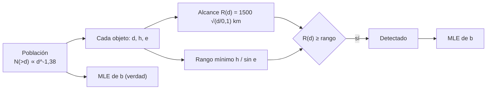

# B118-C23 — Cobertura, sesgos y límites de las redes de vigilancia

<!-- nav:top -->
[🏠 Programa](../../../../README.md) · [📚 Bloque B118](../../../tronco-comun/B118-trafico-espacial-y-sostenibilidad-orbital.md) · [← Anterior: B118-C22 — Intercambio de datos de vigilancia entre operadores y Estados](../B118-C22-intercambio-de-datos-de-vigilancia-entre-operadores-y-estados/CLASE.md) · [Siguiente: B118-C24 — Directrices técnicas de mitigación de desechos (IADC, ISO 24113) →](../B118-C24-directrices-tecnicas-de-mitigacion-de-desechos-iadc-iso-24113/CLASE.md)
<!-- /nav -->

## 1. Ubicación, nivel y alcance

Clase 23 del bloque B118. Nivel N4. Tercera clase del tramo «Datos, cobertura y normas de vigilancia» (clase programada de la ampliación). Una red de vigilancia solo ve lo que alcanza. Aquí generas una población **sintética** de 20 000 objetos con la pendiente de B118-C01 y la observas con una red **hipotética** cuyo alcance crece con el tamaño; mides la **completitud por tamaño**, el **sesgo de selección** y cómo una pendiente estimada solo con lo detectado **no recupera** la verdadera. **Esta clase es educativa: no constituye asesoría legal, regulatoria, financiera ni operativa y no sustituye la lectura del texto normativo vigente ni a un profesional habilitado.**

## 2. Por qué esta clase existe

B118-C15 trata solo mega constelaciones; aquí se aporta la comprensión de qué no ve una red. Un catálogo construido con lo detectado subestima los objetos pequeños y lejanos, y las estadísticas que se calculan con él están sesgadas. La decisión central: **¿a partir de qué tamaño es completa una red y qué se puede inferir de una muestra incompleta?**

## 3. Lo que podrás hacer al terminar

1. Generar una población con ley de potencias truncada por inversión de la CDF.
2. Definir un criterio de detección por alcance y distancia mínima de paso.
3. Medir la completitud por intervalo de diámetro (0,45 para 5–10 cm hasta 1,00 para ≥ 1 m).
4. Estimar la pendiente por máxima verosimilitud: con toda la población 1,372 ± 0,010; con lo detectado 1,041 (sesgada).
5. Mostrar que, por encima del diámetro de completitud (0,85 m), la estimación recupera la verdadera (1,390).
6. Rotular red, población y alcances como hipotéticos y sintéticos.

La evidencia es la **ficha de cobertura y sesgo de una red** del ejercicio 12 (sección 20).

## 4. Con qué llegas y cómo comprobarlo

1. ¿Qué es la completitud?
2. ¿Qué es el sesgo de selección?
3. ¿Qué es el estimador de máxima verosimilitud de una ley de Pareto?
4. ¿Qué es la inversión de la CDF?
5. ¿Qué es el error estándar?

<details>
<summary>Ver respuestas</summary>

1. La fracción de objetos de un grupo que son detectados. 2. El error que surge al estimar con una muestra que no es aleatoria. 3. `b̂ = n / Σ ln(dᵢ/d_min)`. 4. Generar muestras aplicando la inversa de la distribución acumulada a números uniformes. 5. La desviación típica de un estimador.
</details>

Con cuatro o cinco aciertos, sigue; si no, repasa los prerrequisitos.

## 5. Un caso de contexto y casos de referencia

Las directrices IADC Rev. 4 (enero de 2025, consultadas) incluyen recomendaciones sobre la capacidad de seguimiento de objetos espaciales pequeños; el informe de la ESA 2025 (consultado) muestra que hay más de 50 000 desechos mayores de 10 cm y más de 1,2 millones mayores de 1 cm, mientras que los objetos seguidos son unos 40 000 (incluidas unas 11 000 cargas útiles activas): la comparación sugiere que muchos objetos pequeños no están en el catálogo. El **ejemplo conductor** usa `b = 1,38` (derivada en B118-C01) y un alcance hipotético de 1500 km para 10 cm.

## 6. Vocabulario

La **cobertura** es la región o el conjunto de objetos que una red puede observar. La **completitud** es la fracción detectada. El **sesgo de selección** distorsiona las estadísticas. El **alcance** limita la distancia de detección. La **distancia mínima de paso** es la mínima distancia entre el sensor y la trayectoria. La **máxima verosimilitud** estima parámetros maximizando la probabilidad de los datos.

## 7. Modelo mental



*Descripción textual:* cada objeto se detecta si el alcance de la red a su tamaño supera la distancia mínima de su paso; la pendiente estimada con los detectados se compara con la de la población completa.

Analogía: pescar con una red de malla grande y estimar cuántos peces pequeños hay en el lago a partir de lo que cae; solo los grandes quedan. Límite: el alcance depende del tamaño de un modo simple y no hay variación por geometría ni por tiempo.

## 8. La explicación, paso a paso

### 8.1 Población y red

20000 objetos con `N(>d) ∝ d^−1,38` entre 0,05 y 50 m; altitud uniforme de 500 a 1500 km; elevación máxima del paso uniforme entre 20° y 90°. Alcance `R(d) = 1500 √(d/0,1 m) km` (régimen óptico). Detectados: **11991 de 20000 (0,600)**.

### 8.2 Completitud

| Diámetro (m) | Total | Detectados | Completitud |
|---|---|---|---|
| 0,05–0,10 | 12248 | 5519 | 0,451 |
| 0,10–0,20 | 4775 | 3641 | 0,763 |
| 0,20–0,50 | 2141 | 1997 | 0,933 |
| 0,50–1,0 | 525 | 523 | 0,996 |
| ≥ 1,0 | 311 | 311 | 1,000 |

La red es completa a partir de **0,855 m** (peor paso a 20° de elevación y 1500 km de altitud).

### 8.3 Sesgo en la pendiente

MLE con toda la población: **1,372 ± 0,010** (verdad 1,38). Con lo detectado y `d ≥ 0,05`: **1,041** (sesgada a la baja: faltan los pequeños). Con `d ≥ 1 m` (zona completa) la muestra detectada coincide con la verdadera: **1,390** (verdad en esa zona 1,390 ± 0,079).

### 8.4 Consecuencia

Un catálogo construido con lo detectado subestima la población de pequeños y aplana la pendiente; solo la parte completa puede usarse sin corrección. Corregir exige modelar la detección, no ignorarla.

## 9. Magnitudes, símbolos y unidades

| Símbolo | Qué es | Unidad | Valor / nota |
|---|---|---|---|
| `b` | pendiente verdadera | adimensional | 1,38 (sintética) |
| `R_ref` | alcance a 0,10 m | km | 1500 (hipotético) |
| `d_c` | diámetro de completitud | m | 0,855 |
| `b̂_det` | pendiente con lo detectado | adimensional | 1,041 |
| `b̂_pob` | pendiente con toda la población | adimensional | 1,372 |

## 10. Convenciones y referencias

Diámetros en m, altitudes y alcances en km; elevación máxima del paso entre 20° y 90°; distancia mínima del paso `h/sin e`. Semilla 118. Estimador MLE de Pareto con `d_min` fijo. Población y red hipotéticas: no describen ningún catálogo ni red reales.

## 11. De dónde sale lo que afirmamos

| ID | Fuente | Localizador | Respalda | Estado |
|---|---|---|---|---|
| S4 | ESA Space Environment Report 2025 (página, publicada el 1 de abril de 2025 con datos hasta fines de 2024) — https://www.esa.int/Space_Safety/Space_Debris/ESA_Space_Environment_Report_2025 (consultada 2026-11-11; página leída con WebFetch; el informe completo no se abrió) | página del informe | más de 50 000 desechos > 10 cm, más de 1,2 millones > 1 cm y unos 40 000 objetos seguidos | Consultada |
| S3 | IADC Space Debris Mitigation Guidelines, IADC-02-01 Rev. 4 (enero de 2025), presentadas como A/AC.105/C.1/2025/CRP.9 (3 de febrero de 2025) — https://www.unoosa.org/res/oosadoc/data/documents/2025/aac_105c_12025crp/aac_105c_12025crp_9_0_html/AC105_C1_2025_CRP09E.pdf (consultada 2026-11-11; PDF leído con PyMuPDF) | revisión 4 (historia de revisiones) | recomendaciones sobre la capacidad de seguimiento de objetos espaciales pequeños | Consultada |
| — | Cobertura real de redes de vigilancia | — | alcances y completitud | No consultada |
| — | Estimadores con corrección por detección | — | inferencia | No consultados |
| — | Población, red y alcances | — | números | Sintético / hipotético |

Límites: no se consultó ninguna red real ni estadística de cobertura; el modelo de alcance es simple; la IADC solo se cita por la revisión.

## 12. Cómo ver los resultados

| Magnitud | Valor |
|---|---|
| Detectados | 11991 de 20000 (0,600) |
| Completitud 5–10 cm / ≥ 1 m | 0,451 / 1,000 |
| `d_c` | 0,855 m |
| MLE población / detectados | 1,372 / 1,041 |
| MLE zona completa (≥ 1 m) | 1,390 |

Descripción larga: la completitud sube de 0,45 en los más pequeños a 1 por encima de 1 m; la pendiente estimada con lo detectado es 1,04 frente a 1,38: faltan los objetos pequeños.

## 13. Ejemplo trabajado

**Paso 1 · Alcance a 0,4 m.** `1500 √(0,4/0,1) = 1500 × 2 = 3000 km`.

**Paso 2 · Rango del peor paso.** `h/sin e` con `h` = 1500 km y `e` = 20°: `4386 km`.

**Paso 3 · Diámetro de completitud.** `0,1 × (4386/1500)² = 0,855 m`.

**Paso 4 · MLE.** `b̂ = n/Σ ln(dᵢ/d_min)`; con toda la población da 1,372.

## 14. Distintas formas de describir el problema

**Por tamaño:** completitud. **Por geometría:** rango mínimo. **Por estadística:** MLE. **Por sesgo:** pendiente subestimada. **Por zona:** parte completa.

## 15. Práctica guiada

**Ejercicio 1 · con los pasos indicados.** Calcula el alcance de la red para 0,4 m. *Pasos:* `1500 √(d/0,1)`.

<details><summary>Solución comentada</summary>

`3000 km`.
</details>

**Ejercicio 2 · con una pista.** Calcula el rango del peor paso para `h` = 1000 km y `e` = 30°. *Pista:* `h/sin e`.

<details><summary>Solución comentada</summary>

`2000 km`.
</details>

**Ejercicio 3 · casi autónomo.** ¿Detecta la red un objeto de 0,2 m en ese paso? *Pista:* alcance de 0,2 m.

<details><summary>Solución comentada</summary>

Alcance `1500 √2 = 2121 km` ≥ 2000: sí.
</details>

## 16. Práctica autónoma, transferencia e integrador

**Ejercicio 4 · autónomo.** Calcula el diámetro de completitud si el alcance de referencia fuera 3000 km a 0,1 m y el peor rango 4386 km.

<details><summary>Solución comentada</summary>

`0,1 × (4386/3000)² = 0,214 m`.
</details>

**Ejercicio 5 · autónomo.** La completitud en 5–10 cm es 0,45. ¿Cuántos de 12248 se pierden?

<details><summary>Solución comentada</summary>

`12248 − 5519 = 6729`.
</details>

**Ejercicio 6 · autónomo.** ¿Cuántos sigmas separan la pendiente de la población (1,372) de la verdadera (1,38)?

<details><summary>Solución comentada</summary>

`|1,372 − 1,38|/0,010 = 0,8` (cerca de 1).
</details>

**Ejercicio 7 · autónomo.** ¿Por qué la pendiente de lo detectado (1,041) es menor que la verdadera?

<details><summary>Solución comentada</summary>

Porque se pierden más objetos pequeños que grandes y la distribución resulta más plana.
</details>

**Ejercicio 8 · autónomo.** ¿Qué zona de tamaños se puede usar sin corregir?

<details><summary>Solución comentada</summary>

La completa: diámetros ≥ 0,86 m en este caso.
</details>

**Ejercicio 9 · transferencia.** **Transferencia.** Un analista estima la población de 1 cm extrapolando desde el catálogo. ¿Qué advierte esta clase?

<details><summary>Solución comentada</summary>

Que el catálogo es incompleto bajo cierto tamaño; extrapolar sin modelo de detección subestima los pequeños.
</details>

**Ejercicio 10 · transferencia.** **Transferencia.** ¿Cómo mejorarías la cobertura de una red?

<details><summary>Solución comentada</summary>

Más sensores o más sensibles, mejor geometría (latitudes y longitudes distintas) y combinación radar-óptica.
</details>

**Ejercicio 11 · transferencia.** **Transferencia.** ¿Por qué los operadores deben saber qué no ve la red que les avisa?

<details><summary>Solución comentada</summary>

Porque un objeto no catalogado puede colisionar sin alerta; el riesgo no es cero cuando no hay aviso.
</details>

**Ejercicio 12 · integrador.** **Integrador.** Elabora tu *ficha de cobertura y sesgo de una red*: tabla de completitud, diámetro de completitud, MLE con toda la población y con lo detectado, zona utilizable y la lista de qué es consultado, sintético e hipotético.

<details><summary>Solución comentada</summary>

Secciones 8.1–8.4 y la salida del laboratorio.
</details>

## 17. Laboratorio

El script [cobertura.py](cobertura.py) genera la población sintética, aplica el criterio de detección, mide la completitud por tamaño y compara los estimadores de máxima verosimilitud (**comprueba** que el MLE recupera `b` con la población completa a 3 sigmas y que la muestra detectada lo subestima en más de 0,3).

**Datos:** población y red **sintéticas e hipotéticas**; cifras de conteo de la ESA **consultadas**; recomendación de la IADC sobre objetos pequeños **consultada**. **Predice antes de ejecutar:** ¿a partir de qué tamaño será completa la red? (cerca de 0,86 m.) **Ejecución del 2026-11-11 (Python 3.12.9):**

```text
Python 3.12.9 (biblioteca estandar)
Poblacion SINTETICA de 20000 objetos (b = 1.38, 0.05-50 m) y red HIPOTETICA con alcance 1500 km a 0.10 m; semilla 118.
Detectados 11991 de 20000 (0.600)
 intervalo d [m]       total   detectados   completitud
  0.05 - 0.10       12248        5519       0.451
  0.10 - 0.20        4775        3641       0.763
  0.20 - 0.50        2141        1997       0.933
  0.50 - 1.00         525         523       0.996
  1.00 - 50.00         311         311       1.000
Diametro a partir del cual la red es completa (peor paso a 20 deg): 0.855 m
Pendiente verdadera: 1.38; MLE con toda la poblacion (d >= 0.05): 1.372 +- 0.010
MLE con lo detectado (d >= 0.05): 1.041 (SESGADO, n = 11991); con d >= 1 m: 1.390 (n = 311); verdad con d >= 1 m: 1.390 +- 0.079
Pruebas superadas (el MLE recupera b con la poblacion completa; la muestra detectada lo subestima).
```

```bash
python programa/clases/B118/B118-C23-cobertura-sesgos-y-limites-de-las-redes-de-vigilancia/cobertura.py
```

**Límites:** una sola red, alcance único dependiente del tamaño, sin variación temporal y sin incertidumbre de medida del diámetro.

## 18. Errores frecuentes y cómo corregirlos

**Estimar con lo detectado sin considerar la detección.** Se corrige con 8.3.

**Suponer que no ver equivale a no haber.** Se corrige con el ejercicio 11.

**Usar la zona incompleta para inferir.** Se corrige con 8.4.

**Confundir diámetro de completitud con alcance.** Se corrige con el ejemplo 13.

## 19. Cómo sabrás que vas bien

Tras la sección 8: ¿qué pendiente esperabas con lo detectado y cuál obtuviste? Si dudas, repasa el ejemplo 13. Tras el laboratorio: ¿qué comprueba? (ver la sección 17).

## 20. Qué entregas y cómo se evalúa

El producto es tu **ficha de cobertura y sesgo de una red** (ejercicio 12).

| Criterio | Inicial | En desarrollo | Logrado | Destacado |
|---|---|---|---|---|
| Conceptos | Los confunde | Parciales | Mide completitud y explica el sesgo | Explica los límites del modelo |
| Cálculo | Sin unidades | Con errores | Tablas completas con unidades | Calcula casos nuevos |
| Numérico | Sin comprobar | Un caso | Contraste con una segunda vía | Interpreta las diferencias |
| Fuentes | Sin fuente | Sin fecha | Fuentes con fecha, versión y estado | Declara lo ilustrativo y lo no consultado |
| Límites | No los nombra | Uno | Tres | Discute qué falta del modelo |

**Condiciones críticas (no se compensan con promedio):** rotular los datos sintéticos e ilustrativos como tales; no presentar un modelo como observación; citar solo lo consultado, con su versión y fecha; no usar la ficha como asesoría legal, regulatoria o financiera.

## 21. Ética, seguridad y límites

Clase educativa: **no constituye asesoría legal, regulatoria ni financiera** ni orienta decisiones operativas reales, y no sustituye la lectura del texto normativo vigente (se cita siempre la versión y la fecha consultadas) ni la opinión de un especialista habilitado. Los modelos son simplificados y sus datos son sintéticos o ilustrativos. Accesibilidad: tablas equivalentes a las gráficas, fórmulas en texto, ejercicios sin conexión.

## 22. Para cerrar y seguir

La red hipotética detecta el 60 % de la población, es completa desde 0,85 m, y la pendiente estimada con lo detectado (1,04) subestima la verdadera (1,38). Queda una pregunta: ¿qué dicen las directrices técnicas que deberían cumplir los satélites para no sumar a lo que no vemos?

**Glosario español–inglés.** cobertura · *coverage* · completitud · *completeness* · sesgo de selección · *selection bias* · máxima verosimilitud · *maximum likelihood* · alcance · *range*.

**Continuidad.** [B118-C24](../B118-C24-directrices-tecnicas-de-mitigacion-de-desechos-iadc-iso-24113/CLASE.md) estudia las directrices técnicas de mitigación de desechos (IADC e ISO 24113).

**Referencias:** ver sección 11.

<!-- nav:bottom -->
---

[← Anterior: B118-C22 — Intercambio de datos de vigilancia entre operadores y Estados](../B118-C22-intercambio-de-datos-de-vigilancia-entre-operadores-y-estados/CLASE.md) · [📚 Bloque B118](../../../tronco-comun/B118-trafico-espacial-y-sostenibilidad-orbital.md) · [Siguiente: B118-C24 — Directrices técnicas de mitigación de desechos (IADC, ISO 24113) →](../B118-C24-directrices-tecnicas-de-mitigacion-de-desechos-iadc-iso-24113/CLASE.md)
<!-- /nav -->
