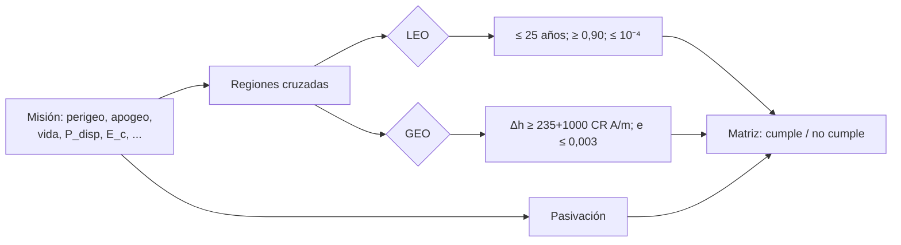

# B118-C24 — Directrices técnicas de mitigación de desechos (IADC, ISO 24113)

<!-- nav:top -->
[🏠 Programa](../../../../README.md) · [📚 Bloque B118](../../../tronco-comun/B118-trafico-espacial-y-sostenibilidad-orbital.md) · [← Anterior: B118-C23 — Cobertura, sesgos y límites de las redes de vigilancia](../B118-C23-cobertura-sesgos-y-limites-de-las-redes-de-vigilancia/CLASE.md) · [Siguiente: B119-C01 — Tratado del Espacio Ultraterrestre →](../../../tronco-comun/B119-derecho-seguridad-y-geopolitica-espacial.md#b119-c01)
<!-- /nav -->

## 1. Ubicación, nivel y alcance

Clase 24 del bloque B118. Nivel N4. Cuarta clase del tramo «Datos, cobertura y normas de vigilancia» (clase programada de la ampliación `0.2.0`). Las directrices técnicas se vuelven útiles cuando se pueden **verificar**. Aquí escribes un **verificador didáctico** con los valores de la **IADC-02-01 Rev. 4** (enero de 2025) y lo pruebas con nueve misiones **sintéticas**, incluidos los **casos límite** (25,0 contra 25,01 años; 0,90 contra 0,89; 248,0 contra 247,9 km). **ISO 24113 no se consultó**: la página de ISO devolvió 403. No es una verificación de conformidad ni asesoría legal o regulatoria. **Esta clase es educativa: no constituye asesoría legal, regulatoria, financiera ni operativa y no sustituye la lectura del texto normativo vigente ni a un profesional habilitado.**

## 2. Por qué esta clase existe

B118-C11 enseña diseño para mitigación; ninguna clase trata las directrices de la IADC y de ISO ni su verificación. Un requisito sin criterio de aceptación y sin pruebas de borde se interpreta de distintas maneras. La decisión central: **¿cómo se traduce una directriz en una comprobación objetiva y qué casos límite hay que probar?**

## 3. Lo que podrás hacer al terminar

1. Resumir los valores de la IADC Rev. 4 para LEO y GEO con su sección.
2. Clasificar una órbita según las regiones protegidas (LEO hasta 2000 km; GEO ± 200 km y ± 15°).
3. Codificar comprobaciones con criterio de aceptación (≤ 25 años, ≥ 0,90, ≤ 10⁻⁴, `Δh` ≥ 235 + 1000 CR A/m, `e` ≤ 0,003, pasivación).
4. Probar nueve misiones y obtener 4 que cumplen (M1, M2, M6, M9) y 5 que no (M3, M4, M5, M7, M8).
5. Probar los valores de borde y distinguir `≤` de `<`.
6. Rotular lo que no se consultó (ISO 24113) y lo que es didáctico.

La evidencia es la **matriz de verificación de directrices** del ejercicio 12 (sección 20).

## 4. Con qué llegas y cómo comprobarlo

1. ¿Qué es un criterio de aceptación?
2. ¿Qué es una prueba de borde?
3. ¿Qué es una región protegida?
4. ¿Qué es la pasivación?
5. ¿Qué es una directriz voluntaria?

<details>
<summary>Ver respuestas</summary>

1. Una condición objetiva que debe cumplirse para aprobar un requisito. 2. Una prueba con el valor exacto del límite y su vecino inmediato. 3. Una región del espacio donde la IADC pide limitar los desechos. 4. Eliminar la energía almacenada al fin de la misión. 5. Una recomendación sin obligación jurídica por sí misma.
</details>

Con cuatro o cinco aciertos, sigue; si no, repasa los prerrequisitos.

## 5. Un caso de contexto y casos de referencia

Las **IADC Space Debris Mitigation Guidelines, IADC-02-01 Rev. 4** (16 de enero de 2025; presentadas a la UNOOSA como A/AC.105/C.1/2025/CRP.9, consultadas el 2026-11-11) definen la región LEO hasta 2000 km y la región GEO como un segmento de ± 200 km de 35 786 km y ± 15° de latitud; piden una vida residual de la desorbitación en LEO no mayor de 25 años; una probabilidad de disposición exitosa de al menos 90 % con objetivo de 99 %; 10⁻⁴ como límite de víctimas esperadas; y, en GEO, una elevación del perigeo de 235 km + 1000 CR A/m con `e ≤ 0,003`. La norma **ISO 24113** (requisitos de mitigación de desechos) **no se consultó**. Las directrices son voluntarias.

## 6. Vocabulario

Un **verificador** comprueba un requisito contra criterios. Un **caso límite** es un valor justo en el borde. La **región protegida** es LEO o GEO según la IADC. La **pasivación** elimina energía almacenada. Una **matriz de verificación** relaciona requisito, método y resultado. Un **método de verificación** puede ser análisis, prueba, inspección o demostración.

## 7. Modelo mental



*Descripción textual:* cada misión se clasifica por regiones y se le aplican las comprobaciones que corresponden; el resultado va a una matriz con los motivos de incumplimiento.

Analogía: la lista de comprobación de un inspector de edificios; cada punto tiene un criterio claro y las puertas de emergencia se prueban en el borde de la norma. Límite: la lista no sustituye al juicio del inspector ni al texto completo de la norma.

## 8. La explicación, paso a paso

### 8.1 Valores de la IADC Rev. 4 usados

LEO hasta 2000 km (sección 3.3.2); GEO 35 786 ± 200 km y ± 15° (sección 3.3.2); vida residual de la desorbitación en LEO no mayor de 25 años y probabilidad de disposición ≥ 90 % con objetivo de 99 % (sección 5.3.2); 10⁻⁴ de víctimas esperadas (sección 5.3.2); GEO: `235 km + 1000 CR A/m` y `e ≤ 0,003` (sección 5.3.1.1); pasivación (sección 3.4.1 y recomendaciones de 5.2).

### 8.2 Las nueve misiones

| Misión | Resultado | Motivo |
|---|---|---|
| M1 (LEO, 4 años, 0,95) | cumple | cumple 0.90 pero no el objetivo 0.99 |
| M2 (LEO, 25,0 años, 0,90, 10⁻⁴) | cumple | borde exacto: `≤` |
| M3 (LEO, 25,01 años) | no cumple | vida residual > 25 anios |
| M4 (LEO, 0,89) | no cumple | probabilidad de disposicion < 0.90 |
| M5 (LEO, 2×10⁻⁴) | no cumple | victimas esperadas > 1e-4 |
| M6 (GEO, 248,0 km, e 0,0003) | cumple | borde exacto |
| M7 (GEO, 247,9 km) | no cumple | elevacion 247.9 < 248.0 km |
| M8 (GEO, e 0,0031, sin pasivar) | no cumple | excentricidad > 0.003; sin pasivacion |
| M9 (órbita de 30 000 km) | cumple | fuera de las regiones protegidas |

### 8.3 Notas del verificador

Las misiones LEO con probabilidad de disposición entre 0,90 y 0,99 reciben la nota «cumple 0,90 pero no el objetivo 0,99» (M1, M2, M3). Las GEO se tratan por el campo `operaba_en` porque, tras la disposición, ya no están en la región.

### 8.4 Lo que el verificador no hace

No verifica la veracidad de los datos, no aplica ISO 24113 ni normas nacionales, no calcula vidas orbitales ni riesgos (los toma como entrada) y no sustituye una verificación de conformidad. Su valor es docente: mostrar que cada requisito debe tener un criterio, un método y pruebas de borde.

## 9. Magnitudes, símbolos y unidades

| Símbolo | Qué es | Unidad | Valor / nota |
|---|---|---|---|
| vida residual LEO | máximo | años | 25 |
| `P_disp` | mínima (objetivo) | adimensional | 0,90 (0,99) |
| `E_c` | máximo | adimensional | 10⁻⁴ |
| `Δh_GEO` | mínima | km | 235 + 1000 CR A/m |
| `e_GEO` | máxima | adimensional | 0,003 |

## 10. Convenciones y referencias

Altitudes sobre el radio ecuatorial de 6378 km (el de la IADC). Regiones: LEO ≤ 2000 km; GEO 35 786 ± 200 km, ± 15° (la latitud se ignora al clasificar GEO: aproximación). Comparaciones con `≤` o `≥` según el texto. Misiones sintéticas. ISO 24113 no consultada.

## 11. De dónde sale lo que afirmamos

| ID | Fuente | Localizador | Respalda | Estado |
|---|---|---|---|---|
| S3 | IADC Space Debris Mitigation Guidelines, IADC-02-01 Rev. 4 (enero de 2025), presentadas como A/AC.105/C.1/2025/CRP.9 (3 de febrero de 2025) — https://www.unoosa.org/res/oosadoc/data/documents/2025/aac_105c_12025crp/aac_105c_12025crp_9_0_html/AC105_C1_2025_CRP09E.pdf (consultada 2026-11-11; PDF leído con PyMuPDF) | secciones 3.3.2, 3.4.1, 5.3.1 y 5.3.2 | regiones protegidas; vida residual de 25 años; probabilidad de disposición de 90 % con objetivo de 99 %; 10⁻⁴ de víctimas esperadas; elevación del perigeo en GEO y e ≤ 0,003; definición de pasivación | Consultada |
| S1 | Space Debris Mitigation Guidelines of the Committee on the Peaceful Uses of Outer Space (UNOOSA, Viena, 2010; COPUOS 2007, resolución 62/217 de la Asamblea General) — https://www.unoosa.org/documents/pdf/psa/bsti/COPUOS_SPACE_DEBRIS_MITIGATION_GUIDELINES.pdf (consultada 2026-11-11; PDF leído con PyMuPDF) | directrices 1 a 7 | las directrices de la COPUOS se basan en las de la IADC y son voluntarias | Consultada |
| — | ISO 24113, Space systems — Space debris mitigation requirements | — | requisitos de mitigación | No consultada (la página de ISO devolvió 403) |
| — | Estándares ECSS (p. ej. ECSS-U-AS-10C) | — | requisitos europeos | No consultados |
| — | Misiones M1 a M9 | — | casos de prueba | Sintético |

Límites: los valores de la IADC se leyeron en el PDF de la Rev. 4; las normas ISO y ECSS y las leyes nacionales no se consultaron, y cualquier texto vigente podría diferir de lo leído.

## 12. Cómo ver los resultados

| Magnitud | Valor |
|---|---|
| Misiones que cumplen | 4 (M1, M2, M6, M9) |
| Misiones que no cumplen | 5 (M3, M4, M5, M7, M8) |
| Borde LEO 25,0 / 25,01 años | cumple / no cumple |
| Borde GEO 248,0 / 247,9 km | cumple / no cumple |
| Altura mínima GEO (CR 1,3; A/m 0,01) | 248,0 km |

Descripción larga: los bordes exactos cumplen (porque el texto usa «no mayor» y «al menos») y su vecino inmediato falla; M8 acumula dos incumplimientos y M9 queda fuera de las regiones protegidas.

## 13. Ejemplo trabajado

**Paso 1 · Región.** Perigeo 700 km, apogeo 720 km: cruza LEO.

**Paso 2 · Vida.** 25,0 años `≤ 25`: cumple; 25,01 años: no cumple.

**Paso 3 · Probabilidad.** 0,90 `≥ 0,90`: cumple; 0,89: no cumple; nota si es menor que 0,99.

**Paso 4 · GEO.** `235 + 1000 × 1,3 × 0,01 = 248,0 km`: 248,0 cumple; 247,9 no.

## 14. Distintas formas de describir el problema

**Por región:** LEO o GEO. **Por criterio:** `≤` o `≥`. **Por caso:** borde y vecino. **Por resultado:** cumple, no cumple, nota. **Por matriz:** requisito, método y resultado.

## 15. Práctica guiada

**Ejercicio 1 · con los pasos indicados.** Calcula la elevación mínima en GEO con `CR` = 1,5 y `A/m` = 0,02. *Pasos:* `235 + 1000 CR A/m`.

<details><summary>Solución comentada</summary>

`235 + 30 = 265 km`.
</details>

**Ejercicio 2 · con una pista.** ¿Cumple una misión LEO con vida de 25,0 años, `P` = 0,95 y `E_c` = 5×10⁻⁵? *Pista:* los tres criterios.

<details><summary>Solución comentada</summary>

Sí.
</details>

**Ejercicio 3 · casi autónomo.** ¿Y con `P` = 0,89?

<details><summary>Solución comentada</summary>

No: `P < 0,90`.
</details>

## 16. Práctica autónoma, transferencia e integrador

**Ejercicio 4 · autónomo.** ¿Qué nota recibe una misión con `P` = 0,95?

<details><summary>Solución comentada</summary>

«Cumple 0,90 pero no el objetivo 0,99».
</details>

**Ejercicio 5 · autónomo.** Con `e` = 0,003 exacto en GEO, ¿cumple la excentricidad?

<details><summary>Solución comentada</summary>

Sí: el criterio es `e ≤ 0,003`.
</details>

**Ejercicio 6 · autónomo.** ¿Qué región cruza una órbita con perigeo 35 700 km y apogeo 35 800 km?

<details><summary>Solución comentada</summary>

La región GEO (35 586–35 986 km).
</details>

**Ejercicio 7 · autónomo.** ¿Por qué se prueban los valores 25,0 y 25,01 años?

<details><summary>Solución comentada</summary>

Para comprobar el borde exacto y detectar errores de `<` en lugar de `≤`.
</details>

**Ejercicio 8 · autónomo.** ¿Qué comprobación falta si una misión no se pasiva?

<details><summary>Solución comentada</summary>

Falla el criterio de pasivación (sección 3.4.1 y recomendaciones de la IADC).
</details>

**Ejercicio 9 · transferencia.** **Transferencia.** Un proveedor declara «cumplimos ISO 24113». ¿Qué pides?

<details><summary>Solución comentada</summary>

La edición de la norma, los requisitos aplicados, el método de verificación y la evidencia; la clase no consultó la norma.
</details>

**Ejercicio 10 · transferencia.** **Transferencia.** ¿Por qué un verificador pasa 25,0 años pero el operador debe tener margen?

<details><summary>Solución comentada</summary>

Porque la vida calculada tiene incertidumbre (atmósfera, actividad solar); cumplir justo en el borde es frágil.
</details>

**Ejercicio 11 · transferencia.** **Transferencia.** Tu equipo quiere usar este verificador para certificar una misión. ¿Qué respondes?

<details><summary>Solución comentada</summary>

Que no: es didáctico, no consulta ISO ni la ley aplicable y depende de datos de entrada no verificados.
</details>

**Ejercicio 12 · integrador.** **Integrador.** Elabora tu *matriz de verificación de directrices*: requisito, valor, sección de la IADC Rev. 4, método, resultado de las nueve misiones sintéticas, casos de borde y la lista de qué es consultado, no consultado (ISO 24113) y sintético, con el aviso de que no es asesoría.

<details><summary>Solución comentada</summary>

Secciones 8.1–8.4 y la salida del laboratorio.
</details>

## 17. Laboratorio

El script [directrices.py](directrices.py) verifica nueve misiones sintéticas contra los valores de la IADC Rev. 4, incluidos los casos de borde (**comprueba** que cada misión produce exactamente el número esperado de incumplimientos).

**Datos:** misiones **sintéticas**; valores de la IADC Rev. 4 **consultados**; ISO 24113 **no consultada**. **Predice antes de ejecutar:** ¿cuántas de las nueve misiones cumplen? (cuatro: M1, M2, M6 y M9.) **Ejecución del 2026-11-11 (Python 3.12.9):**

```text
Python 3.12.9 (biblioteca estandar)
Misiones SINTETICAS; valores de IADC-02-01 Rev.4 (consultada); ISO 24113 NO consultada; didactico, no es verificacion de conformidad.
 M1: regiones ['LEO']; CUMPLE  [cumple 0.90 pero no el objetivo 0.99]
 M2: regiones ['LEO']; CUMPLE  [cumple 0.90 pero no el objetivo 0.99]
 M3: regiones ['LEO']; NO CUMPLE: vida residual > 25 anios  [cumple 0.90 pero no el objetivo 0.99]
 M4: regiones ['LEO']; NO CUMPLE: probabilidad de disposicion < 0.90
 M5: regiones ['LEO']; NO CUMPLE: victimas esperadas > 1e-4
 M6: regiones ['ninguna']; CUMPLE  [fuera de las regiones protegidas]
 M7: regiones ['ninguna']; NO CUMPLE: elevacion 247.9 < 248.0 km  [fuera de las regiones protegidas]
 M8: regiones ['ninguna']; NO CUMPLE: excentricidad > 0.003; sin pasivacion  [fuera de las regiones protegidas]
 M9: regiones ['ninguna']; CUMPLE  [fuera de las regiones protegidas]
Altura minima GEO para CR 1.3 y A/m 0.01: 248.0 km
Pruebas superadas (9 misiones, incluidos los bordes 25.0/25.01 anios, 0.90/0.89, 1e-4/2e-4, 248.0/247.9 km).
```

```bash
python programa/clases/B118/B118-C24-directrices-tecnicas-de-mitigacion-de-desechos-iadc-iso-24113/directrices.py
```

**Límites:** la región GEO se clasifica solo por altitud; las magnitudes de entrada (vida, riesgo) no se verifican; no incluye normas nacionales ni ISO.

## 18. Errores frecuentes y cómo corregirlos

**Usar `<` en lugar de `≤`.** Se corrige con las misiones M2 y M3.

**Confundir el 0,90 mínimo con el objetivo 0,99.** Se corrige con 8.3.

**Presentar el verificador como una certificación.** Se corrige con el ejercicio 11.

**Citar ISO 24113 sin haberla leído.** Se corrige con la sección 11.

## 19. Cómo sabrás que vas bien

Tras la sección 8: ¿cuántas misiones esperabas que cumplieran y cuántas cumplieron? Si dudas, repasa el ejemplo 13. Tras el laboratorio: ¿qué comprueba? (ver la sección 17).

## 20. Qué entregas y cómo se evalúa

El producto es tu **matriz de verificación de directrices** (ejercicio 12).

| Criterio | Inicial | En desarrollo | Logrado | Destacado |
|---|---|---|---|---|
| Conceptos | Los confunde | Parciales | Codifica criterios y casos límite | Explica los límites del modelo |
| Cálculo | Sin unidades | Con errores | Tablas completas con unidades | Calcula casos nuevos |
| Numérico | Sin comprobar | Un caso | Contraste con una segunda vía | Interpreta las diferencias |
| Fuentes | Sin fuente | Sin fecha | Fuentes con fecha, versión y estado | Declara lo ilustrativo y lo no consultado |
| Límites | No los nombra | Uno | Tres | Discute qué falta del modelo |

**Condiciones críticas (no se compensan con promedio):** rotular los datos sintéticos e ilustrativos como tales; no presentar un modelo como observación; citar solo lo consultado, con su versión y fecha; no usar la ficha como asesoría legal, regulatoria o financiera.

## 21. Ética, seguridad y límites

Clase educativa: **no constituye asesoría legal, regulatoria ni financiera** ni orienta decisiones operativas reales, y no sustituye la lectura del texto normativo vigente (se cita siempre la versión y la fecha consultadas) ni la opinión de un especialista habilitado. Los modelos son simplificados y sus datos son sintéticos o ilustrativos. Las normas ISO, ECSS y nacionales deben consultarse en su texto vigente; el verificador no certifica nada. Accesibilidad: tablas equivalentes a las gráficas, fórmulas en texto, ejercicios sin conexión.

## 22. Para cerrar y seguir

El verificador clasifica 4 de las nueve misiones sintéticas como cumplidoras con los valores de la IADC Rev. 4 y detecta los bordes (25,0 contra 25,01 años; 248,0 contra 247,9 km); ISO 24113 queda como pendiente de consulta. Con esto se cierra el bloque: población, catálogos, conjunciones, desechos, fin de vida, constelaciones, gobernanza, datos y directrices.

**Glosario español–inglés.** directrices de mitigación · *mitigation guidelines* · caso límite · *boundary case* · matriz de verificación · *verification matrix* · región protegida · *protected region* · pasivación · *passivation*.

**Continuidad.** el bloque B118 termina aquí; el siguiente bloque, B119, trata el derecho, la seguridad y la geopolítica espacial.

**Referencias:** ver sección 11.

<!-- nav:bottom -->
---

[← Anterior: B118-C23 — Cobertura, sesgos y límites de las redes de vigilancia](../B118-C23-cobertura-sesgos-y-limites-de-las-redes-de-vigilancia/CLASE.md) · [📚 Bloque B118](../../../tronco-comun/B118-trafico-espacial-y-sostenibilidad-orbital.md) · [Siguiente: B119-C01 — Tratado del Espacio Ultraterrestre →](../../../tronco-comun/B119-derecho-seguridad-y-geopolitica-espacial.md#b119-c01)
<!-- /nav -->
