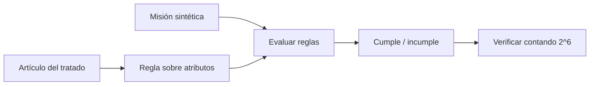

# B119-C01 — Tratado del Espacio Ultraterrestre

<!-- nav:top -->
[🏠 Programa](../../../../README.md) · [📚 Bloque B119](../../../tronco-comun/B119-derecho-seguridad-y-geopolitica-espacial.md) · [← Anterior: B118-C24 — Directrices técnicas de mitigación de desechos (IADC, ISO 24113)](../../../tronco-comun/B118-trafico-espacial-y-sostenibilidad-orbital.md#b118-c24) · [Siguiente: B119-C02 — Acuerdo de Salvamento →](../B119-C02-acuerdo-de-salvamento/CLASE.md)
<!-- /nav -->

## 1. Ubicación, nivel y alcance

Clase 1 del bloque B119. Nivel N3. Un tratado se lee como un conjunto de obligaciones: quién debe hacer o abstenerse de qué. Aquí conviertes seis artículos del Tratado del Espacio Ultraterrestre (1967) en reglas comprobables y las aplicas a tres misiones **sintéticas**, y compruebas con una enumeración exhaustiva cuántas combinaciones de atributos cumplen todo a la vez. Es la primera clase del bloque y fija el método: texto citado con fecha, modelo pequeño y verificación independiente. **Esta clase es educativa: no es asesoría legal, regulatoria ni financiera y no sustituye a un jurista, a una autoridad competente ni a un asesor.**

## 2. Por qué esta clase existe

Casi todo el derecho espacial posterior (salvamento, responsabilidad, registro, Luna) desarrolla principios de este tratado, y ninguna otra clase del programa lo estudia como instrumento jurídico. La decisión central: **¿qué obligación del tratado se infringe en una misión dada y qué cambio mínimo la devuelve a la conformidad?**

## 3. Lo que podrás hacer al terminar

1. Enunciar con tus palabras los artículos I, II, III, IV, VI, VIII, IX y XI.
2. Traducir cada artículo en una regla sobre atributos de una misión.
3. Evaluar tres misiones sintéticas y contar sus incumplimientos.
4. Contrastar el recuento analítico con una enumeración de `2^6 = 64` combinaciones.
5. Separar lo consultado (texto normativo con versión y fecha) de lo sintético o ilustrativo.

La evidencia es la **matriz de conformidad de tres misiones sintéticas** del ejercicio 12 (sección 20).

## 4. Con qué llegas y cómo comprobarlo

1. ¿Qué es un tratado internacional?
2. ¿Qué es un Estado parte?
3. ¿Qué es una variable booleana?
4. ¿Cuántas combinaciones tienen `n` booleanos?
5. ¿Qué es una verificación por segunda vía?

<details>
<summary>Ver respuestas</summary>

1. Un acuerdo entre sujetos de derecho internacional, regido por el derecho internacional, que obliga a sus partes. 2. Un Estado que ha consentido en obligarse por el tratado. 3. Una que toma solo dos valores, verdadero o falso. 4. `2^n`; con seis, 64. 5. Calcular lo mismo con otro método (aquí, enumerar y contar) y comparar.
</details>

Con cuatro o cinco aciertos, sigue; si no, repasa los prerrequisitos.

## 5. Un caso de contexto y casos de referencia

La nota de la Biblioteca Audiovisual de la ONU (consultada el 2026-11-11) resume el tratado: la exploración y el uso del espacio están abiertos a todos los Estados en igualdad (art. I); ningún Estado puede apropiarse del espacio ni de los cuerpos celestes (art. II); las actividades se rigen por el derecho internacional, incluida la Carta (art. III); no se colocan armas de destrucción masiva en órbita (art. IV); los Estados responden internacionalmente por sus actividades, también las privadas, que requieren autorización y supervisión continua (art. VI); el Estado de registro mantiene jurisdicción y control (art. VIII); se coopera con consideración a los demás (art. IX) y se informa a la ONU y al público (art. XI). Se aprobó el 19-12-1966 (res. 2222 (XXI)) y entró en vigor el 10-10-1967. El **ejemplo conductor** son tres misiones sintéticas: una de agencia que cumple, una privada sin autorización y una que reclama soberanía y no se registra.

## 6. Vocabulario

Un **Estado parte** ha ratificado el tratado. La **autorización y supervisión continua** es el control que el Estado debe ejercer sobre sus actores privados (art. VI). **Jurisdicción y control** es la potestad del Estado de registro sobre el objeto y su personal (art. VIII). **Apropiación nacional** es reclamar soberanía u ocupar de manera exclusiva (art. II). Una **regla comprobable** es un artículo traducido a una condición verdadera o falsa sobre atributos.

## 7. Modelo mental



*Descripción textual:* cada artículo se convierte en una regla; la misión aporta sus atributos; la evaluación da cumple o incumple y se verifica contando todas las combinaciones.

Analogía: una lista de comprobación de seguridad aérea: cada punto es una condición que se marca o no. Límite: un tratado se interpreta con método jurídico (ver C32); la regla booleana es una simplificación didáctica.

## 8. La explicación, paso a paso

### 8.1 Seis atributos, cinco reglas

Atributos booleanos de la misión: `wmd` (lleva armas de destrucción masiva en órbita), `soberanía` (reclama soberanía), `privado`, `autorizado`, `registrado`, `informado`. Reglas: **IV** `¬wmd`; **II** `¬soberanía`; **VI** `¬privado ∨ autorizado`; **VIII** `registrado`; **XI** `informado`.

### 8.2 Tres misiones sintéticas

| Misión | IV | II | VI | VIII | XI | Cumple |
|---|---|---|---|---|---|---|
| A (agencia) | sí | sí | sí | sí | sí | 5/5 |
| B (privada sin licencia) | sí | sí | NO | sí | sí | 4/5 |
| C (reclamo y sin registro) | sí | NO | sí | NO | sí | 3/5 |

### 8.3 Cuántas combinaciones cumplen todo

Del total de `64` combinaciones, cumplen todo `3` (fracción `0.0469`): `wmd`, `soberanía`, `registrado` e `informado` quedan fijados y el par (`privado`, `autorizado`) admite 3 de sus 4 combinaciones. La enumeración confirma el recuento analítico.

### 8.4 Qué no capturan las reglas

Los artículos I, III, V, VII y IX no son simples booleanos (acceso en igualdad, conformidad con el derecho internacional, asistencia a astronautas, responsabilidad por daños, consulta previa). Los dos primeros se tratan como marco; V y VII se desarrollan en C02 y C03.

## 9. Magnitudes, símbolos y unidades

| Símbolo | Qué es | Unidad | Valor / nota |
|---|---|---|---|
| `n` | número de atributos booleanos | — | 6 |
| `2^n` | combinaciones posibles | — | 64 |
| `k` | combinaciones conformes | — | 3 |
| `k/2^n` | fracción conforme | — | 0.0469 |

## 10. Convenciones y referencias

Los artículos se citan por su número romano. La paráfrasis es de la fuente consultada; no es el texto vinculante. Misiones y atributos: sintéticos. Fecha de consulta: 2026-11-11.

## 11. De dónde sale lo que afirmamos

| ID | Fuente | Localizador | Respalda | Estado |
|---|---|---|---|---|
| S3 | ONU, Biblioteca Audiovisual de Derecho Internacional, nota introductoria sobre el Tratado del Espacio Ultraterrestre, https://legal.un.org/avl/ha/tos/tos.html (WebFetch, consultada 2026-11-11; no discute los artículos V ni VII) | arts. I–IV, VI, VIII, IX, XI; fechas de aprobación y vigor | contenido y fechas del tratado | Consultada |
| S5 | UNOOSA, página del Tratado del Espacio Ultraterrestre, https://www.unoosa.org/unoosa/en/ourwork/spacelaw/treaties/outerspacetreaty.html (la lectura directa devolvió 403; solo resumen de búsqueda web, 2026-11-11) | art. II y art. VI | no apropiación y responsabilidad internacional (resumen de búsqueda) | Resumen de búsqueda |
| — | Texto completo y oficial del tratado; arts. V y VII | — | no consultados en esta clase | No consultado / ilustrativo |
| — | Atributos y misiones | — | sintéticos, inventados | No consultado / ilustrativo |

Límites: la nota consultada no discute los artículos V ni VII y la página de UNOOSA no se pudo leer directamente (403); no se consultó el texto vinculante del tratado. Texto normativo parafraseado de las páginas oficiales en la fecha indicada; el texto vinculante es el de la fuente oficial vigente.

## 12. Cómo ver la situación

| Magnitud | Valor |
|---|---|
| Misión A | 5/5 reglas |
| Misión B | 4/5 reglas |
| Misión C | 3/5 reglas |
| Combinaciones conformes | 3 de 64 |

Descripción larga: la misión de agencia cumple todas las reglas; la privada falla en el art. VI; la tercera falla en los arts. II y VIII. Solo tres de cada sesenta y cuatro combinaciones lo cumplen todo.

## 13. Ejemplo trabajado: la misión privada

**Paso 1 · Atributos.** `privado = 1`, `autorizado = 0`. **Paso 2 · Regla VI.** `¬1 ∨ 0 = falso`: incumple. **Paso 3 · Resto.** IV, II, VIII y XI se cumplen: `4/5`. **Paso 4 · Cambio mínimo.** Poner `autorizado = 1` (obtener autorización y supervisión) devuelve la misión a la conformidad.

## 14. Distintas formas de describirlo

**Por artículo:** I–XI. **Por actor:** Estado, operador privado, organización internacional. **Por atributo:** los seis booleanos. **Por resultado:** cumple, incumple, no aplica.

## 15. Práctica guiada

**Ejercicio 1 · con los pasos indicados.** Evalúa la misión A con las cinco reglas.

<details><summary>Solución comentada</summary>

Todas verdaderas: `5/5`.
</details>

**Ejercicio 2 · con una pista.** Evalúa la regla VI para una misión no privada y no autorizada. *Pista:* `¬privado ∨ autorizado`.

<details><summary>Solución comentada</summary>

`¬0 ∨ 0 = verdadero`: cumple; la autorización solo se exige a actores privados.
</details>

**Ejercicio 3 · casi autónomo.** Cuenta cuántas combinaciones de (`privado`, `autorizado`) cumplen la regla VI.

<details><summary>Solución comentada</summary>

Tres de cuatro: (0,0), (0,1), (1,1); falla (1,0).
</details>

## 16. Práctica autónoma, transferencia e integrador

**Ejercicio 4 · autónomo.** Calcula la fracción conforme `k/2^n`.

<details><summary>Solución comentada</summary>

`3/64 = 0.0469`.
</details>

**Ejercicio 5 · autónomo.** ¿Qué cambio mínimo devuelve la misión C a la conformidad?

<details><summary>Solución comentada</summary>

Quitar el reclamo de soberanía (II) y registrar el objeto (VIII): dos cambios.
</details>

**Ejercicio 6 · autónomo.** Añade una regla `X` ficticia: «informar a la ONU antes del lanzamiento». ¿Cuántas combinaciones conformes quedan si el atributo se añade como séptimo booleano?

<details><summary>Solución comentada</summary>

El nuevo atributo queda fijado en 1: `k = 3` de `2^7 = 128`.
</details>

**Ejercicio 7 · autónomo.** Un Estado ratifica y su empresa privada lanza sin licencia. ¿Qué artículo apunta a la responsabilidad del Estado?

<details><summary>Solución comentada</summary>

El art. VI: el Estado responde por las actividades nacionales, públicas o privadas.
</details>

**Ejercicio 8 · autónomo.** ¿Qué dato de la sección 11 limita lo que puedes afirmar sobre los arts. V y VII?

<details><summary>Solución comentada</summary>

Que la fuente consultada no los discute: lo afirmado sobre ellos es «no consultado».
</details>

**Ejercicio 9 · transferencia.** **Transferencia.** ¿Por qué una matriz booleana no basta para un caso real?

<details><summary>Solución comentada</summary>

Porque los artículos admiten interpretaciones y hechos graduados; ver C32.
</details>

**Ejercicio 10 · transferencia.** **Transferencia.** Una organización internacional lanza un satélite. ¿Quién responde según el art. VI?

<details><summary>Solución comentada</summary>

La propia organización y los Estados partes que participan.
</details>

**Ejercicio 11 · transferencia.** **Transferencia.** ¿Qué diferencia hay entre el art. II (no apropiación) y el art. VIII (jurisdicción sobre el objeto)?

<details><summary>Solución comentada</summary>

El II prohíbe reclamar el espacio; el VIII asigna jurisdicción sobre un objeto concreto sin apropiarse del lugar.
</details>

**Ejercicio 12 · integrador.** **Integrador.** Elabora tu *matriz de conformidad de tres misiones sintéticas*: reglas, atributos, resultados, combinaciones conformes y qué es consultado y sintético, con el aviso de que es educativa.

<details><summary>Solución comentada</summary>

Secciones 8.1–8.3 y la salida del laboratorio.
</details>

## 17. Laboratorio: reglas del tratado sobre misiones sintéticas

El script [laboratorio.py](laboratorio.py) evalúa las cinco reglas sobre tres misiones y enumera las 64 combinaciones de atributos (**comprueba** que el recuento exhaustivo coincide con el analítico).

**Datos:** texto parafraseado de la nota de legal.un.org (consultada 2026-11-11); misiones **sintéticas**. **Predice antes de ejecutar:** ¿cuántas de las 64 combinaciones cumplirán todas las reglas? (muy pocas.) **Ejecución del 2026-11-11 (Python 3.12.9):**

```text
Python 3.12.9 (biblioteca estandar)
Misiones SINTETICAS; texto del tratado parafraseado de la nota de legal.un.org (consultada 2026-11-11).
 mision                       IV   II   VI  VIII   XI  cumple/5
A_agencia                    si   si   si   si   si   5
B_privada_sin_licencia       si   si   NO   si   si   4
C_reclamo_y_sin_registro     si   NO   si   NO   si   3
Combinaciones conformes: 3 de 64 (analitico 3); fraccion 0.0469
CLAVES {"n_conf": 3, "n_total": 64, "frac": "0.0469", "a": 5, "b": 4, "c": 3}
Pruebas superadas.
```

```bash
python programa/clases/B119/B119-C01-tratado-del-espacio-ultraterrestre/laboratorio.py
```

**Límites:** las reglas son una simplificación didáctica; los artículos I, III, V, VII y IX no se modelan; el resultado no es una opinión jurídica.

## 18. Errores frecuentes y cómo corregirlos

**Tratar el texto parafraseado como el tratado.** Se corrige con la sección 11.

**Olvidar que el art. VI cubre a los privados.** Se corrige con el ejercicio 7.

**Confundir apropiación (II) con jurisdicción (VIII).** Se corrige con el ejercicio 11.

**Creer que la matriz sustituye la interpretación.** Se corrige con el ejercicio 9.

## 19. Cómo sabrás que vas bien

Tras la sección 8: ¿qué resultado esperabas en el ejemplo trabajado y cuál obtuviste? Si dudas, repasa la sección 13. Tras el laboratorio: ¿qué comprueba cada prueba? (ver la sección 17).

## 20. Qué entregas y cómo se evalúa

El producto es tu **matriz de conformidad de tres misiones sintéticas** (ejercicio 12).

| Criterio | Inicial | En desarrollo | Logrado | Destacado |
|---|---|---|---|---|
| Conceptos | Los confunde | Parciales | Usa el vocabulario con precisión | Explica los límites del modelo |
| Cálculo | Sin unidades | Con errores | Resultados con unidades y tolerancia | Calcula casos nuevos |
| Verificación | Sin comprobar | Un caso | Contraste con una segunda vía | Interpreta las diferencias |
| Fuentes | Sin fuente | Sin fecha | Fuentes con versión, fecha y estado | Declara lo sintético y lo no consultado |
| Límites | No los nombra | Uno | Tres | Discute qué falta del modelo |

**Condiciones críticas (no se compensan con promedio):** citar la versión y la fecha del texto normativo consultado; rotular lo sintético y lo ilustrativo; no presentar un resultado como asesoría legal, regulatoria o financiera.

## 21. Ética, seguridad y límites

Clase educativa: **no es asesoría legal, regulatoria ni financiera**; no sustituye a un abogado, a la autoridad competente ni a un asesor, y ningún resultado debe usarse para decidir sobre una licencia, una reclamación, un contrato o una operación real. Los tratados citados son los de Naciones Unidas; la clase no evalúa conductas de Estados ni de empresas reales. Los modelos son simplificados y sus datos son sintéticos o ilustrativos; lo simulado nunca se presenta como observado. Accesibilidad: tablas equivalentes a las gráficas, fórmulas en texto, ejercicios sin conexión.

## 22. Para cerrar y seguir

De sesenta y cuatro combinaciones solo tres cumplen todas las reglas, y la clase deja una pregunta: ¿qué obligaciones nacen cuando un astronauta aterriza en un país que no lo esperaba?

**Glosario español–inglés.** Tratado del Espacio Ultraterrestre · *Outer Space Treaty*; Estado parte · *State party*; jurisdicción y control · *jurisdiction and control*; apropiación nacional · *national appropriation*.

**Continuidad.** [B119-C02](../B119-C02-acuerdo-de-salvamento/CLASE.md): salvamento y devolución de astronautas y objetos.

**Referencias:** ver sección 11.

<!-- nav:bottom -->
---

[← Anterior: B118-C24 — Directrices técnicas de mitigación de desechos (IADC, ISO 24113)](../../../tronco-comun/B118-trafico-espacial-y-sostenibilidad-orbital.md#b118-c24) · [📚 Bloque B119](../../../tronco-comun/B119-derecho-seguridad-y-geopolitica-espacial.md) · [Siguiente: B119-C02 — Acuerdo de Salvamento →](../B119-C02-acuerdo-de-salvamento/CLASE.md)
<!-- /nav -->
