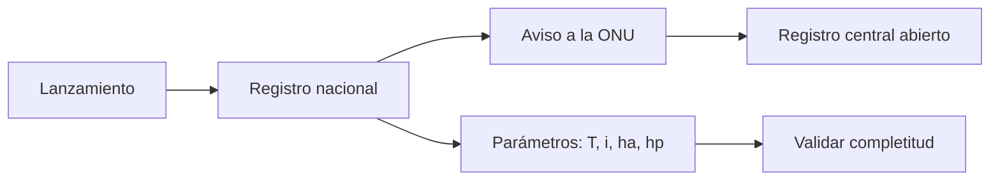

# B119-C04 — Convenio de Registro

<!-- nav:top -->
[🏠 Programa](../../../../README.md) · [📚 Bloque B119](../../../tronco-comun/B119-derecho-seguridad-y-geopolitica-espacial.md) · [← Anterior: B119-C03 — Convenio de Responsabilidad](../B119-C03-convenio-de-responsabilidad/CLASE.md) · [Siguiente: B119-C05 — Acuerdo sobre la Luna y alcance →](../B119-C05-acuerdo-sobre-la-luna-y-alcance/CLASE.md)
<!-- /nav -->

## 1. Ubicación, nivel y alcance

Clase 4 del bloque B119. Nivel N3. Un objeto espacial existe jurídicamente para el resto del mundo cuando está registrado. Esta clase lee qué debe informarse según el art. IV del Convenio de Registro (consultado) y calcula, desde apogeo y perigeo, el período orbital que acompaña al registro, con cinco registros **sintéticos** de los cuales dos están incompletos. **Esta clase es educativa: no es asesoría legal, regulatoria ni financiera y no sustituye a un jurista, a una autoridad competente ni a un asesor.**

## 2. Por qué esta clase existe

El art. VIII del tratado de 1967 vincula la jurisdicción al registro, y el convenio de 1974 define qué se registra; ninguna clase anterior lo calcula ni lo valida. La decisión central: **¿qué información hace identificable un objeto y cómo se comprueba que un registro está completo y es coherente?**

## 3. Lo que podrás hacer al terminar

1. Enumerar los datos del art. IV del Convenio de Registro.
2. Calcular el período kepleriano desde apogeo y perigeo con `T = 2π √(a³/GM)`.
3. Validar la completitud y la unicidad de un registro sintético.
4. Distinguir el período kepleriano del nodal y nombrar el efecto que se ignora (J2).
5. Separar lo consultado (texto normativo con versión y fecha) de lo sintético o ilustrativo.

La evidencia es la **registro sintético validado con período calculado** del ejercicio 12 (sección 20).

## 4. Con qué llegas y cómo comprobarlo

1. ¿Qué es el semieje mayor?
2. ¿Qué es el apogeo?
3. ¿Qué es `GM`?
4. ¿Cómo pasas segundos a minutos?
5. ¿Qué es un designador internacional?

<details>
<summary>Ver respuestas</summary>

1. La mitad del eje mayor de la elipse orbital. 2. El punto de mayor altura de la órbita. 3. El parámetro gravitacional del cuerpo central, en km³/s² para la Tierra. 4. Dividiendo por 60. 5. Un identificador (año, número de lanzamiento, letra de objeto) que distingue cada objeto.
</details>

Con cuatro o cinco aciertos, sigue; si no, repasa los prerrequisitos.

## 5. Un caso de contexto y casos de referencia

La página de UNOOSA del Convenio de Registro (consultada el 2026-11-11) dice que el Estado de lanzamiento registra el objeto y avisa al Secretario General (art. II), que la ONU lleva un registro central de acceso abierto (art. III) y que se informa: Estado(s) de lanzamiento, designador o número de registro, fecha y lugar del lanzamiento, parámetros orbitales básicos (período nodal, inclinación, apogeo y perigeo) y función general (art. IV). El art. VI prevé ayuda para identificar objetos. Fue adoptado el 12-11-1974 (res. 3235 (XXIX)). El **ejemplo conductor** son cinco registros sintéticos: dos completos de un país A, uno completo y otro sin designador de un país B, y uno sin función de un país C.

## 6. Vocabulario

El **Estado de lanzamiento** es el que lanza o hace lanzar. El **período nodal** es el tiempo entre dos pasos consecutivos por el nodo ascendente; el **kepleriano** ignora las perturbaciones. El **apogeo** y el **perigeo** son las alturas máxima y mínima. El **designador** es el identificador del objeto. La **completitud** es la fracción de registros con todos los campos.

## 7. Modelo mental



*Descripción textual:* el lanzamiento da lugar al registro nacional, que se comunica a la ONU; el registro incluye parámetros orbitales que se calculan y se validan.

Analogía: un registro civil de objetos: sin nombre y partida de nacimiento no hay identidad. Límite: el registro no crea propiedad ni autoriza el uso del espacio.

## 8. La explicación, paso a paso

### 8.1 Campos del art. IV

Estado(s) de lanzamiento, designador, fecha, lugar, período nodal, inclinación, apogeo, perigeo y función. Son nueve campos en el modelo del laboratorio.

### 8.2 Período

`a = R + (h_a + h_p)/2`; `T = 2π √(a³/GM)`. Para `h_a = 540` y `h_p = 520` km: `T = 95.24 min`. Control: la órbita circular a 400 km da `92.56 min`.

### 8.3 Cinco registros

Completos: 3 de 5 (`0.60`). Fallan uno por designador vacío y otro por función vacía. No hay designadores repetidos.

### 8.4 Una órbita de transferencia

Con perigeo 250 km y apogeo 35 790 km, `T = 10.54 h`; ejemplifica que los parámetros dependen mucho de la órbita. El período nodal real incluye el efecto de J2, que no se modela.

## 9. Magnitudes, símbolos y unidades

| Símbolo | Qué es | Unidad | Valor / nota |
|---|---|---|---|
| `R` | radio ecuatorial | km | 6378,137 |
| `GM` | parámetro gravitacional | km³/s² | 398 600,4418 |
| `a` | semieje mayor | km | `R + (ha+hp)/2` |
| `T` | período kepleriano | min | 95.24 |

## 10. Convenciones y referencias

Alturas sobre el elipsoide en km; tiempo en min; constantes estándar (no consultadas en esta sesión). Texto del convenio parafraseado de UNOOSA (2026-11-11).

## 11. De dónde sale lo que afirmamos

| ID | Fuente | Localizador | Respalda | Estado |
|---|---|---|---|---|
| S1 | UNOOSA, «Convention on Registration of Objects Launched into Outer Space» (página oficial), https://www.unoosa.org/oosa/en/ourwork/spacelaw/treaties/registration-convention.html (WebFetch, consultada 2026-11-11) | arts. II, III, IV, VI; fechas | qué se registra, registro central abierto y adopción en 1974 | Consultada |
| — | Constantes `R` y `GM`; fórmula de Kepler | — | valores estándar no consultados; verificados con dos órbitas de control | No consultado / ilustrativo |
| — | Registros y países | — | sintéticos | No consultado / ilustrativo |

Límites: no se consultó ningún registro real; el período calculado es kepleriano, no nodal. Texto normativo parafraseado de las páginas oficiales en la fecha indicada; el texto vinculante es el de la fuente oficial vigente.

## 12. Cómo ver la situación

| Magnitud | Valor |
|---|---|
| Completitud | 0.60 |
| `T` (540/520 km) | 95.24 min |
| `T` circular 400 km | 92.56 min |
| `T` GTO | 10.54 h |

Descripción larga: tres de cinco registros están completos; el control del período a 400 km coincide con el valor esperado.

## 13. Ejemplo trabajado: período de un registro

**Paso 1.** `a = 6378,137 + 530 = 6908,137 km`. **Paso 2.** `a³/GM = 8,271×10⁵ s²`, `√ = 909,4 s`. **Paso 3.** `T = 2π × 909,4 = 5714 s = 95.24 min`.

## 14. Distintas formas de describirlo

**Por campo:** los nueve del registro. **Por completitud:** completo o faltante. **Por órbita:** circular, elíptica, de transferencia. **Por acceso:** nacional o central.

## 15. Práctica guiada

**Ejercicio 1 · con los pasos indicados.** Calcula `a` para `h_a = 540` y `h_p = 520` km.

<details><summary>Solución comentada</summary>

`6378,137 + 530 = 6908,137 km`.
</details>

**Ejercicio 2 · con una pista.** Escribe `T` con la fórmula. *Pista:* `2π √(a³/GM)`.

<details><summary>Solución comentada</summary>

`T = 2π √(6908,137³/398600,4418) s`, 5714 s, es decir `95.24 min`.
</details>

**Ejercicio 3 · casi autónomo.** Cuenta los campos faltantes del registro sin designador.

<details><summary>Solución comentada</summary>

Uno: el designador.
</details>

## 16. Práctica autónoma, transferencia e integrador

**Ejercicio 4 · autónomo.** Calcula la completitud de los cinco registros.

<details><summary>Solución comentada</summary>

`3/5 = 0.60`.
</details>

**Ejercicio 5 · autónomo.** ¿Qué efecto hace que el período nodal difiera del kepleriano?

<details><summary>Solución comentada</summary>

El achatamiento terrestre `J2`.
</details>

**Ejercicio 6 · autónomo.** Calcula `T` para una órbita circular a 400 km y compáralo con 92,57 min.

<details><summary>Solución comentada</summary>

`92.56 min`: coincide a 0,05 min.
</details>

**Ejercicio 7 · autónomo.** ¿Cuántas horas dura la órbita de transferencia 250 × 35 790 km?

<details><summary>Solución comentada</summary>

`10.54 h`.
</details>

**Ejercicio 8 · autónomo.** ¿Qué le falta al registro del país C?

<details><summary>Solución comentada</summary>

La función general.
</details>

**Ejercicio 9 · transferencia.** **Transferencia.** ¿Por qué el registro no equivale a un permiso de operar?

<details><summary>Solución comentada</summary>

Registrar informa y asigna jurisdicción; la autorización es un acto aparte (C08).
</details>

**Ejercicio 10 · transferencia.** **Transferencia.** Un objeto sin designador causa un daño. ¿Qué artículo del convenio prevé la ayuda para identificarlo?

<details><summary>Solución comentada</summary>

El art. VI.
</details>

**Ejercicio 11 · transferencia.** **Transferencia.** ¿Qué dato crítico para la seguridad orbital incluye el registro?

<details><summary>Solución comentada</summary>

Los parámetros orbitales: período, inclinación, apogeo y perigeo.
</details>

**Ejercicio 12 · integrador.** **Integrador.** Elabora tu *registro sintético validado con período calculado*: campos, cálculo, completitud, controles y aviso de que es educativo.

<details><summary>Solución comentada</summary>

Secciones 8.1–8.4 y la salida del laboratorio.
</details>

## 17. Laboratorio: validar y calcular un registro sintético

El script [laboratorio.py](laboratorio.py) calcula el período de cinco registros sintéticos y valida su completitud y unicidad (**comprueba** el período a 400 km y el de la órbita de transferencia).

**Datos:** campos del art. IV consultados en UNOOSA (2026-11-11); registros **sintéticos**; constantes estándar no consultadas. **Predice antes de ejecutar:** ¿cuántos de los cinco registros estarán completos? (más de la mitad.) **Ejecución del 2026-11-11 (Python 3.12.9):**

```text
Python 3.12.9 (biblioteca estandar)
Registros SINTETICOS; campos del art. IV segun la pagina de UNOOSA consultada el 2026-11-11.
2026-001A  T =    95.24 min  completo
2026-001B  T =    95.34 min  completo
2026-014A  T =    95.81 min  completo
(vacio)    T =    95.81 min  FALTA designador
2026-030A  T =   632.11 min  FALTA funcion
Completitud: 3 de 5 = 0.60; designadores repetidos: False
Control: orbita circular a 400 km -> T = 92.56 min (esperado 92.57)
Control: GTO -> T = 632.1 min = 10.54 h
CLAVES {"t540": "95.24", "t400": "92.56", "frac": "0.60", "gto": "10.54", "tleo2": "95.81"}
Pruebas superadas.
```

```bash
python programa/clases/B119/B119-C04-convenio-de-registro/laboratorio.py
```

**Límites:** período kepleriano sin J2; registros inventados; no modela el registro central real.

## 18. Errores frecuentes y cómo corregirlos

**Usar la altura como radio.** Se corrige sumando `R`.

**Confundir período kepleriano y nodal.** Se corrige con 8.4.

**Creer que registrar da propiedad.** Se corrige con el ejercicio 9.

**Dejar campos vacíos sin señalarlos.** Se corrige con la validación del laboratorio.

## 19. Cómo sabrás que vas bien

Tras la sección 8: ¿qué resultado esperabas en el ejemplo trabajado y cuál obtuviste? Si dudas, repasa la sección 13. Tras el laboratorio: ¿qué comprueba cada prueba? (ver la sección 17).

## 20. Qué entregas y cómo se evalúa

El producto es tu **registro sintético validado con período calculado** (ejercicio 12).

| Criterio | Inicial | En desarrollo | Logrado | Destacado |
|---|---|---|---|---|
| Conceptos | Los confunde | Parciales | Usa el vocabulario con precisión | Explica los límites del modelo |
| Cálculo | Sin unidades | Con errores | Resultados con unidades y tolerancia | Calcula casos nuevos |
| Verificación | Sin comprobar | Un caso | Contraste con una segunda vía | Interpreta las diferencias |
| Fuentes | Sin fuente | Sin fecha | Fuentes con versión, fecha y estado | Declara lo sintético y lo no consultado |
| Límites | No los nombra | Uno | Tres | Discute qué falta del modelo |

**Condiciones críticas (no se compensan con promedio):** citar la versión y la fecha del texto normativo consultado; rotular lo sintético y lo ilustrativo; no presentar un resultado como asesoría legal, regulatoria o financiera.

## 21. Ética, seguridad y límites

Clase educativa: **no es asesoría legal, regulatoria ni financiera**; no sustituye a un abogado, a la autoridad competente ni a un asesor, y ningún resultado debe usarse para decidir sobre una licencia, una reclamación, un contrato o una operación real. El registro central es público; aquí todos los datos son inventados y no se identifica ningún objeto real. Los modelos son simplificados y sus datos son sintéticos o ilustrativos; lo simulado nunca se presenta como observado. Accesibilidad: tablas equivalentes a las gráficas, fórmulas en texto, ejercicios sin conexión.

## 22. Para cerrar y seguir

Tres de cinco registros sintéticos están completos y el período de cada uno sale de apogeo y perigeo. Queda una pregunta: ¿qué dice el último tratado de la serie sobre la Luna?

**Glosario español–inglés.** convenio de registro · *Registration Convention*; período nodal · *nodal period*; designador · *designator*; apogeo · *apogee*.

**Continuidad.** [B119-C05](../B119-C05-acuerdo-sobre-la-luna-y-alcance/CLASE.md): el Acuerdo sobre la Luna.

**Referencias:** ver sección 11.

<!-- nav:bottom -->
---

[← Anterior: B119-C03 — Convenio de Responsabilidad](../B119-C03-convenio-de-responsabilidad/CLASE.md) · [📚 Bloque B119](../../../tronco-comun/B119-derecho-seguridad-y-geopolitica-espacial.md) · [Siguiente: B119-C05 — Acuerdo sobre la Luna y alcance →](../B119-C05-acuerdo-sobre-la-luna-y-alcance/CLASE.md)
<!-- /nav -->
