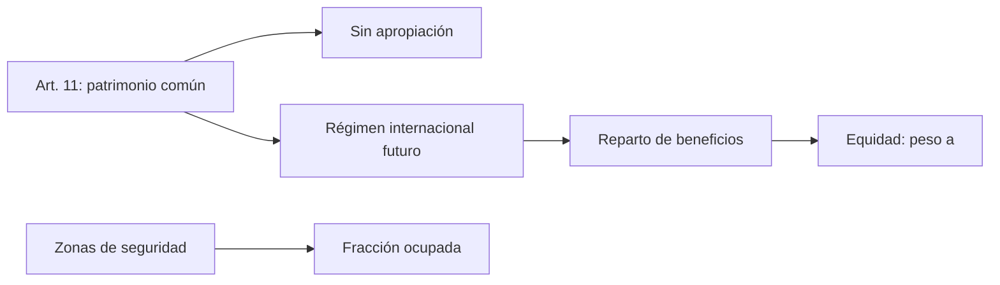

# B119-C05 — Acuerdo sobre la Luna y alcance

<!-- nav:top -->
[🏠 Programa](../../../../README.md) · [📚 Bloque B119](../../../tronco-comun/B119-derecho-seguridad-y-geopolitica-espacial.md) · [← Anterior: B119-C04 — Convenio de Registro](../B119-C04-convenio-de-registro/CLASE.md) · [Siguiente: B119-C06 — Organismos UNOOSA y COPUOS →](../B119-C06-organismos-unoosa-y-copuos/CLASE.md)
<!-- /nav -->

## 1. Ubicación, nivel y alcance

Clase 5 del bloque B119. Nivel N3. El Acuerdo sobre la Luna de 1979 es el más ambicioso y el menos ratificado de los cinco tratados: declara a la Luna y a sus recursos **patrimonio común de la humanidad** y prevé un régimen internacional. Aquí lees sus artículos 3, 11 y 12 tal como los presenta UNOOSA, calculas qué fracción de la superficie lunar ocuparía un conjunto de instalaciones sintéticas y exploras cómo cambia un reparto equitativo según el peso que se dé a la igualdad frente a la contribución. **Esta clase es educativa: no es asesoría legal, regulatoria ni financiera y no sustituye a un jurista, a una autoridad competente ni a un asesor.**

## 2. Por qué esta clase existe

La clase C01 establece la no apropiación; este acuerdo la aplica a los recursos y es la base de los debates de C25 y C36. La decisión central: **¿cómo se compara lo que ocupan las instalaciones con la superficie total y qué regla de reparto da un resultado más equitativo?**

## 3. Lo que podrás hacer al terminar

1. Enunciar los arts. 3, 11 y 12 del Acuerdo sobre la Luna.
2. Calcular la superficie lunar y la fracción ocupada por zonas de seguridad.
3. Comprobar la aproximación plana contra el área exacta de un casquete.
4. Comparar reglas de reparto con peso de igualdad `a` y razón mayor/menor.
5. Separar lo consultado (texto normativo con versión y fecha) de lo sintético o ilustrativo.

La evidencia es la **ficha comparativa Tratado–Acuerdo sobre la Luna** del ejercicio 12 (sección 20).

## 4. Con qué llegas y cómo comprobarlo

1. ¿Qué es el área de una esfera?
2. ¿Qué es un casquete esférico?
3. ¿Qué es una fracción?
4. ¿Qué es un promedio ponderado?
5. ¿Qué significa «patrimonio común»?

<details>
<summary>Ver respuestas</summary>

1. `4πR²`. 2. Una porción de esfera cortada por un plano; su área es `2πR²(1−cos θ)`. 3. Un cociente parte/total. 4. Una suma de valores multiplicados por pesos que suman 1. 5. Que nadie puede apropiarse del bien; se administra para toda la humanidad.
</details>

Con cuatro o cinco aciertos, sigue; si no, repasa los prerrequisitos.

## 5. Un caso de contexto y casos de referencia

La página de UNOOSA del Acuerdo (consultada el 2026-11-11) dice que la Luna se usa solo con fines pacíficos y no admite bases militares ni armas de destrucción masiva (art. 3); que la Luna y sus recursos son patrimonio común de la humanidad, que colocar equipo no crea propiedad y que se creará un régimen internacional con reparto equitativo y atención especial a los países en desarrollo y a quienes contribuyeron (art. 11); y que los Estados conservan jurisdicción y control sobre su personal y equipo (art. 12). La Asamblea General lo adoptó el 5-12-1979 (res. 34/68). **No se consultaron** el número de partes ni la fecha de entrada en vigor: la página no los mostraba. El **ejemplo conductor**: 12 instalaciones sintéticas con zona de seguridad de 5 km y cinco Estados genéricos con contribuciones 0,40; 0,25; 0,15; 0,12 y 0,08.

## 6. Vocabulario

El **patrimonio común de la humanidad** excluye la apropiación y exige reparto. El **régimen internacional** es el conjunto de reglas aún por crear para explotar recursos. La **zona de seguridad** es el área alrededor de una instalación. El **peso de igualdad** `a` pondera el reparto igualitario frente al proporcional a la contribución.

## 7. Modelo mental



*Descripción textual:* el patrimonio común excluye la apropiación y prevé un régimen de reparto; las zonas de seguridad miden cuánto se ocupa y el peso `a` modela la equidad.

Analogía: un jardín comunitario: nadie lo posee, cada parcela en uso tiene un cerco temporal y la cosecha se reparte con una regla. Límite: la regla de reparto del acuerdo no está definida; el modelo es una ilustración.

## 8. La explicación, paso a paso

### 8.1 Superficie

`4πR² = 3.7932e+07 km²`.

### 8.2 Zonas de seguridad

Una zona de 5 km de radio ocupa `78.54 km²` (plana); el casquete exacto difiere en menos de `10⁻⁴` en términos relativos. Doce instalaciones sin solape ocupan `942.5 km²`, una fracción `2.48e-05` de la superficie.

### 8.3 Reparto

`w_i = a/n + (1 − a) c_i`. Con `a = 0` (proporcional): el último Estado recibe `8.0` de 100; con `a = 0,5`, `14.0`; con `a = 1`, 20. La razón mayor/menor baja de `5.00` a `2.14` y a 1.

### 8.4 Lo que no define el modelo

El acuerdo no fija una fórmula; solo principios. La elección de `a` es un asunto de negociación (C27, C36).

## 9. Magnitudes, símbolos y unidades

| Símbolo | Qué es | Unidad | Valor / nota |
|---|---|---|---|
| `R` | radio lunar medio | km | 1737,4 (estándar) |
| `A` | superficie lunar | km² | 3.7932e+07 |
| `r` | radio de la zona de seguridad | km | 5 |
| `a` | peso de igualdad | — | 0; 0,5; 1 |

## 10. Convenciones y referencias

Áreas en km²; fracciones adimensionales; reparto sobre 100 unidades sintéticas. Texto del acuerdo parafraseado (UNOOSA, 2026-11-11).

## 11. De dónde sale lo que afirmamos

| ID | Fuente | Localizador | Respalda | Estado |
|---|---|---|---|---|
| S2 | UNOOSA, «Agreement Governing the Activities of States on the Moon and Other Celestial Bodies» (página oficial), https://www.unoosa.org/oosa/en/ourwork/spacelaw/treaties/moon-agreement.html (WebFetch, consultada 2026-11-11) | arts. 3, 11, 12; adopción | usos pacíficos, patrimonio común, régimen internacional y jurisdicción | Consultada |
| — | Número de partes y entrada en vigor | — | no consultados | No consultado / ilustrativo |
| — | Radio lunar `R` | — | valor estándar no consultado; verificado con la exactitud del casquete | No consultado / ilustrativo |
| — | Instalaciones, Estados y contribuciones | — | sintéticos | No consultado / ilustrativo |

Límites: no se sabe cuántos Estados son parte; el régimen internacional del art. 11 no está definido en lo consultado. Texto normativo parafraseado de las páginas oficiales en la fecha indicada; el texto vinculante es el de la fuente oficial vigente.

## 12. Cómo ver la situación

| Magnitud | Valor |
|---|---|
| Superficie lunar | 3.7932e+07 km² |
| Fracción ocupada | 2.48e-05 |
| Menor cuota (`a = 0`) | 8.0 |
| Menor cuota (`a = 0,5`) | 14.0 |

Descripción larga: las instalaciones ocupan una fracción minúscula de la superficie, y aumentar el peso de la igualdad sube la cuota del Estado que menos contribuyó.

## 13. Ejemplo trabajado: un reparto intermedio

**Paso 1.** `a = 0,5`, `n = 5`. **Paso 2.** Cuota del último: `0,5/5 + 0,5 × 0,08 = 0,14`. **Paso 3.** Cuota del primero: `0,1 + 0,2 = 0,30`. **Paso 4.** Razón `0,30/0,14 = 2.14`.

## 14. Distintas formas de describirlo

**Por artículo:** 3, 11, 12. **Por área:** zona y fracción. **Por regla:** proporcional, igualitaria, mixta. **Por estado jurídico:** patrimonio común frente a res nullius.

## 15. Práctica guiada

**Ejercicio 1 · con los pasos indicados.** Calcula `4πR²` con `R = 1737,4`.

<details><summary>Solución comentada</summary>

`3.7932e+07 km²`.
</details>

**Ejercicio 2 · con una pista.** Calcula el área plana de una zona de 5 km. *Pista:* `π r²`.

<details><summary>Solución comentada</summary>

`78.54 km²`.
</details>

**Ejercicio 3 · casi autónomo.** Calcula la fracción ocupada por 12 zonas.

<details><summary>Solución comentada</summary>

`2.48e-05`.
</details>

## 16. Práctica autónoma, transferencia e integrador

**Ejercicio 4 · autónomo.** Calcula la cuota del último Estado con `a = 0,5`.

<details><summary>Solución comentada</summary>

`14 de 100`.
</details>

**Ejercicio 5 · autónomo.** ¿Qué razón mayor/menor da `a = 0`?

<details><summary>Solución comentada</summary>

`0,40/0,08 = 5,00`.
</details>

**Ejercicio 6 · autónomo.** ¿Qué valor de `a` hace que las cuotas sean iguales?

<details><summary>Solución comentada</summary>

`a = 1`.
</details>

**Ejercicio 7 · autónomo.** Con seis Estados y `a = 1`, ¿cuánto recibe cada uno de 100?

<details><summary>Solución comentada</summary>

`100/6 = 16,7`.
</details>

**Ejercicio 8 · autónomo.** ¿Qué no consultaste sobre el acuerdo?

<details><summary>Solución comentada</summary>

El número de partes y la fecha de entrada en vigor.
</details>

**Ejercicio 9 · transferencia.** **Transferencia.** ¿Por qué el art. 11 no es incompatible con tener una instalación?

<details><summary>Solución comentada</summary>

Colocar equipo no crea propiedad (art. 11), y el art. 12 mantiene la jurisdicción sobre el equipo.
</details>

**Ejercicio 10 · transferencia.** **Transferencia.** ¿Qué diferencia de fondo hay entre «patrimonio común» y «libre de apropiación»?

<details><summary>Solución comentada</summary>

El primero añade reparto de beneficios y régimen; el segundo solo excluye la soberanía.
</details>

**Ejercicio 11 · transferencia.** **Transferencia.** ¿Por qué la poca ocupación (`2.48e-05`) no zanja el debate jurídico?

<details><summary>Solución comentada</summary>

Porque el problema no es la fracción de área sino el acceso a sitios valiosos y a recursos concentrados.
</details>

**Ejercicio 12 · integrador.** **Integrador.** Elabora tu *ficha comparativa Tratado–Acuerdo sobre la Luna*: artículos, ocupación, reglas de reparto con `a` y límites.

<details><summary>Solución comentada</summary>

Secciones 8.1–8.4 y la salida del laboratorio.
</details>

## 17. Laboratorio: ocupación lunar y reparto equitativo

El script [laboratorio.py](laboratorio.py) calcula la superficie lunar, la fracción ocupada por zonas de seguridad y tres reglas de reparto (**comprueba** la aproximación plana contra el casquete y que los pesos suman 1).

**Datos:** artículos parafraseados de UNOOSA (2026-11-11); instalaciones y Estados **sintéticos**; `R` estándar no consultado. **Predice antes de ejecutar:** ¿qué fracción de la Luna ocuparían 12 zonas de 5 km? (unas decenas de millonésimas.) **Ejecución del 2026-11-11 (Python 3.12.9):**

```text
Python 3.12.9 (biblioteca estandar)
Datos SINTETICOS; articulos del Acuerdo parafraseados de la pagina de UNOOSA (consultada 2026-11-11); R lunar = 1737.4 km (valor estandar, no consultado).
Superficie lunar = 3.7932e+07 km2
Zona de seguridad de 5 km: plana 78.5398 km2 ; casquete exacto 78.5398 km2 ; diferencia relativa 6.90e-07
12 instalaciones (sin solape): 942.48 km2 = fraccion 2.485e-05 de la superficie (0.00248 %)
Reparto de 100 unidades de beneficio sinteticas entre cinco Estados genericos, segun el peso a de la igualdad:
  a = 0.0:  40.0   25.0   15.0   12.0    8.0
  a = 0.5:  30.0   22.5   17.5   16.0   14.0
  a = 1.0:  20.0   20.0   20.0   20.0   20.0
Razon mayor/menor con a = 0: 5.00; con a = 0.5: 2.14; con a = 1: 1.00
CLAVES {"area": "3.7932e+07", "zona": "78.54", "ocup": "942.5", "frac": "2.48e-05", "w0": "8.0", "w05": "14.0", "razon0": "5.00", "razon05": "2.14"}
Pruebas superadas.
```

```bash
python programa/clases/B119/B119-C05-acuerdo-sobre-la-luna-y-alcance/laboratorio.py
```

**Límites:** sin solapes ni topografía; el reparto es ilustrativo y el acuerdo no fija fórmula.

## 18. Errores frecuentes y cómo corregirlos

**Dar por vigente el acuerdo para todos los Estados.** Se corrige con el ejercicio 8.

**Confundir patrimonio común con dominio público nacional.** Se corrige con el ejercicio 10.

**Calcular el área con el diámetro.** Se corrige con la sección 9.

**Tomar una regla de reparto como norma.** Se corrige con 8.4.

## 19. Cómo sabrás que vas bien

Tras la sección 8: ¿qué resultado esperabas en el ejemplo trabajado y cuál obtuviste? Si dudas, repasa la sección 13. Tras el laboratorio: ¿qué comprueba cada prueba? (ver la sección 17).

## 20. Qué entregas y cómo se evalúa

El producto es tu **ficha comparativa Tratado–Acuerdo sobre la Luna** (ejercicio 12).

| Criterio | Inicial | En desarrollo | Logrado | Destacado |
|---|---|---|---|---|
| Conceptos | Los confunde | Parciales | Usa el vocabulario con precisión | Explica los límites del modelo |
| Cálculo | Sin unidades | Con errores | Resultados con unidades y tolerancia | Calcula casos nuevos |
| Verificación | Sin comprobar | Un caso | Contraste con una segunda vía | Interpreta las diferencias |
| Fuentes | Sin fuente | Sin fecha | Fuentes con versión, fecha y estado | Declara lo sintético y lo no consultado |
| Límites | No los nombra | Uno | Tres | Discute qué falta del modelo |

**Condiciones críticas (no se compensan con promedio):** citar la versión y la fecha del texto normativo consultado; rotular lo sintético y lo ilustrativo; no presentar un resultado como asesoría legal, regulatoria o financiera.

## 21. Ética, seguridad y límites

Clase educativa: **no es asesoría legal, regulatoria ni financiera**; no sustituye a un abogado, a la autoridad competente ni a un asesor, y ningún resultado debe usarse para decidir sobre una licencia, una reclamación, un contrato o una operación real. Las cuotas de reparto son un ejercicio; no representan ninguna posición de un Estado real. Los modelos son simplificados y sus datos son sintéticos o ilustrativos; lo simulado nunca se presenta como observado. Accesibilidad: tablas equivalentes a las gráficas, fórmulas en texto, ejercicios sin conexión.

## 22. Para cerrar y seguir

Doce instalaciones sintéticas ocupan `2.48e-05` de la Luna y el peso de la igualdad cambia la cuota mínima de `8.0` a `14.0`. Queda una pregunta: ¿quién vigila y administra todo esto en Naciones Unidas?

**Glosario español–inglés.** patrimonio común de la humanidad · *common heritage of mankind*; acuerdo sobre la Luna · *Moon Agreement*; zona de seguridad · *safety zone*; reparto equitativo · *equitable sharing*.

**Continuidad.** [B119-C06](../B119-C06-organismos-unoosa-y-copuos/CLASE.md): los organismos UNOOSA y COPUOS.

**Referencias:** ver sección 11.

<!-- nav:bottom -->
---

[← Anterior: B119-C04 — Convenio de Registro](../B119-C04-convenio-de-registro/CLASE.md) · [📚 Bloque B119](../../../tronco-comun/B119-derecho-seguridad-y-geopolitica-espacial.md) · [Siguiente: B119-C06 — Organismos UNOOSA y COPUOS →](../B119-C06-organismos-unoosa-y-copuos/CLASE.md)
<!-- /nav -->
