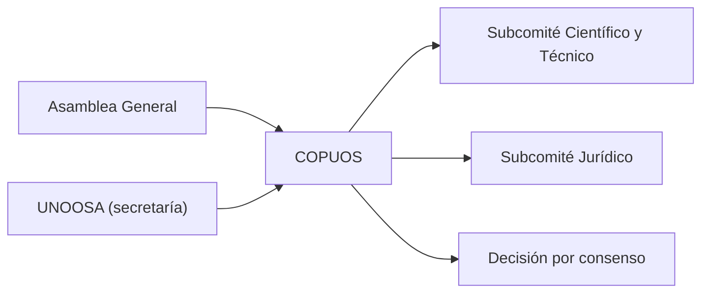

# B119-C06 — Organismos UNOOSA y COPUOS

<!-- nav:top -->
[🏠 Programa](../../../../README.md) · [📚 Bloque B119](../../../tronco-comun/B119-derecho-seguridad-y-geopolitica-espacial.md) · [← Anterior: B119-C05 — Acuerdo sobre la Luna y alcance](../B119-C05-acuerdo-sobre-la-luna-y-alcance/CLASE.md) · [Siguiente: B119-C07 — Registro nacional de objetos →](../B119-C07-registro-nacional-de-objetos/CLASE.md)
<!-- /nav -->

## 1. Ubicación, nivel y alcance

Clase 6 del bloque B119. Nivel N3. Los tratados no se administran solos: la Asamblea General creó una comisión permanente, COPUOS, y una oficina secretaria, UNOOSA. Aquí estudias qué se consultó sobre su origen, su estructura de dos subcomités y su decisión por consenso, y modelas con probabilidades sintéticas por qué un comité de cien miembros bloquea más fácilmente un asunto que uno de dieciocho. **Esta clase es educativa: no es asesoría legal, regulatoria ni financiera y no sustituye a un jurista, a una autoridad competente ni a un asesor.**

## 2. Por qué esta clase existe

Quien estudia el derecho espacial necesita saber dónde se negocia y cómo se decide; ninguna clase anterior trata los organismos. La decisión central: **¿cómo cambia la probabilidad de bloqueo cuando crece el número de miembros que deben consentir?**

## 3. Lo que podrás hacer al terminar

1. Describir el origen (1958–1959), los subcomités y la secretaría de COPUOS según lo consultado.
2. Calcular el crecimiento medio anual de los miembros.
3. Calcular `P(bloqueo) = 1 − (1 − p)^n` y verificarla con Monte Carlo.
4. Calcular la probabilidad máxima de bloqueo por miembro compatible con un consenso probable.
5. Separar lo consultado (texto normativo con versión y fecha) de lo sintético o ilustrativo.

La evidencia es la **modelo de consenso con sensibilidad** del ejercicio 12 (sección 20).

## 4. Con qué llegas y cómo comprobarlo

1. ¿Qué es el consenso?
2. ¿Qué es la independencia entre sucesos?
3. ¿Qué es una tasa de crecimiento compuesta?
4. ¿Qué es un subcomité?
5. ¿Qué es una semilla fija?

<details>
<summary>Ver respuestas</summary>

1. Una decisión sin objeción formal de ningún miembro. 2. Que la probabilidad de uno no cambia por el otro. 3. La tasa anual constante que lleva de un valor inicial a uno final. 4. Un órgano subordinado que prepara trabajo técnico o jurídico. 5. Un valor inicial del generador aleatorio que hace reproducible la simulación.
</details>

Con cuatro o cinco aciertos, sigue; si no, repasa los prerrequisitos.

## 5. Un caso de contexto y casos de referencia

Según el resumen de búsqueda de las páginas de UNOOSA (2026-11-11), la Asamblea General creó COPUOS como órgano ad hoc con 18 miembros por la res. 1348 (XIII) del 13-12-1958 y lo hizo permanente por la res. 1472 (XIV) del 12-12-1959; tiene un Subcomité Científico y Técnico y un Subcomité Jurídico, y UNOOSA es su secretaría. El número actual de miembros aparece como 100 (2021) y 102 en otra presentación; aquí se usa 100 como valor **ilustrativo no verificado**. El **ejemplo conductor**: un asunto concreto que cada miembro bloquea con una probabilidad sintética `p`, supuestos independientes.

## 6. Vocabulario

**COPUOS** es la Comisión sobre la Utilización del Espacio Ultraterrestre con Fines Pacíficos. **UNOOSA** es la Oficina de Asuntos del Espacio Ultraterrestre, su secretaría. El **consenso** exige que nadie bloquee. **Bloqueo** es la objeción que impide el consenso.

## 7. Modelo mental



*Descripción textual:* la Asamblea crea COPUOS; este tiene dos subcomités y una secretaría; decide por consenso, lo que da poder de bloqueo a cada miembro.

Analogía: una votación en que basta un «no» para detener la sala: cuantos más votantes, más probable que alguno diga que no. Límite: los miembros no son independientes; negocian y forman coaliciones.

## 8. La explicación, paso a paso

### 8.1 Origen y estructura (resumen de búsqueda)

18 miembros en 1958, permanente en 1959, dos subcomités y secretaría UNOOSA. El detalle del reglamento y las decisiones por consenso no se consultaron.

### 8.2 Crecimiento

De 18 a 100 en 63 años: factor `5.56`, crecimiento medio `2.76 %` anual.

### 8.3 Probabilidad de bloqueo

Con `p = 0,02`: `n = 18` da `0.3049` y `n = 100` da `0.8674`. Con `p = 0,005`: `0.0863` y `0.3942`. El Monte Carlo coincide a tres sigmas.

### 8.4 Cuánto bloqueo tolera un comité

Para consenso con probabilidad al menos 0,5: `p ≤ 0.03778` con 18 miembros y `p ≤ 0.00691` con 100. Con más miembros, cada uno debe bloquear menos.

## 9. Magnitudes, símbolos y unidades

| Símbolo | Qué es | Unidad | Valor / nota |
|---|---|---|---|
| `n` | número de miembros | — | 18 (1958); 100 (ilustrativo) |
| `p` | prob. de bloqueo por miembro | — | 0,005; 0,02 (sintético) |
| `P` | prob. de bloqueo del comité | — | `1−(1−p)^n` |
| `g` | crecimiento medio anual | % | 2.76 |

## 10. Convenciones y referencias

Probabilidades en [0,1]; años civiles; miembros según lo consultado o ilustrativo.

## 11. De dónde sale lo que afirmamos

| ID | Fuente | Localizador | Respalda | Estado |
|---|---|---|---|---|
| S7 | UNOOSA, páginas sobre COPUOS (resoluciones 1348 (XIII) de 1958 y 1472 (XIV) de 1959; subcomités), resumen de búsqueda web, 2026-11-11 | res. 1348 (XIII), 1472 (XIV); subcomités; secretaría | origen y estructura de COPUOS (resumen de búsqueda) | Resumen de búsqueda |
| — | Reglamento y práctica de consenso; lista de miembros actual | — | no consultados | No consultado / ilustrativo |
| — | Probabilidades de bloqueo | — | sintéticas | No consultado / ilustrativo |

Límites: el número de miembros es discrepante entre fuentes y no se verificó; la independencia entre miembros es un supuesto irreal. Texto normativo parafraseado de las páginas oficiales en la fecha indicada; el texto vinculante es el de la fuente oficial vigente.

## 12. Cómo ver la situación

| Magnitud | Valor |
|---|---|
| Crecimiento anual | 2.76 % |
| `P(bloqueo)`, `n = 18`, `p = 0,02` | 0.3049 |
| `P(bloqueo)`, `n = 100`, `p = 0,02` | 0.8674 |
| `p` máx. para `n = 100` | 0.00691 |

Descripción larga: con el mismo `p`, pasar de 18 a 100 miembros multiplica varias veces la probabilidad de bloqueo.

## 13. Ejemplo trabajado: dieciocho frente a cien

**Paso 1.** `p = 0,02`. **Paso 2.** `n = 18`: `1 − 0,98^18 = 0.3049`. **Paso 3.** `n = 100`: `1 − 0,98^100 = 0.8674`. **Paso 4.** Lectura: el comité grande casi siempre tendría algún bloqueo si los miembros fueran independientes.

## 14. Distintas formas de describirlo

**Por origen:** ad hoc (1958) y permanente (1959). **Por estructura:** comité, subcomités, secretaría. **Por regla:** consenso. **Por modelo:** `P` frente a `n`.

## 15. Práctica guiada

**Ejercicio 1 · con los pasos indicados.** Calcula el factor de crecimiento de 18 a 100 miembros.

<details><summary>Solución comentada</summary>

`100/18 = 5.56`.
</details>

**Ejercicio 2 · con una pista.** Calcula el crecimiento medio anual en 63 años. *Pista:* `(100/18)^(1/63) − 1`.

<details><summary>Solución comentada</summary>

`2.76 %`.
</details>

**Ejercicio 3 · casi autónomo.** Calcula `P(bloqueo)` con `n = 18`, `p = 0,02`.

<details><summary>Solución comentada</summary>

`0.3049`.
</details>

## 16. Práctica autónoma, transferencia e integrador

**Ejercicio 4 · autónomo.** Calcula `P(bloqueo)` con `n = 100`, `p = 0,005`.

<details><summary>Solución comentada</summary>

`0.3942`.
</details>

**Ejercicio 5 · autónomo.** ¿Qué `p` máximo permite consenso con prob. 0,5 y 100 miembros?

<details><summary>Solución comentada</summary>

`1 − 0,5^(1/100) = 0.00691`.
</details>

**Ejercicio 6 · autónomo.** Si `p = 0` para todos, ¿cuál es `P(bloqueo)`?

<details><summary>Solución comentada</summary>

0.
</details>

**Ejercicio 7 · autónomo.** Si los miembros formaran un solo bloque que decide en conjunto, ¿qué `P` obtienes?

<details><summary>Solución comentada</summary>

`p` (un solo decisor), sin acumulación.
</details>

**Ejercicio 8 · autónomo.** ¿Qué dato de COPUOS no es consistente entre fuentes?

<details><summary>Solución comentada</summary>

El número actual de miembros.
</details>

**Ejercicio 9 · transferencia.** **Transferencia.** ¿Por qué la independencia sobreestima el bloqueo?

<details><summary>Solución comentada</summary>

Porque los miembros negocian antes de objetar y forman coaliciones; el bloqueo real es menos frecuente que el modelo.
</details>

**Ejercicio 10 · transferencia.** **Transferencia.** ¿Qué ventaja da el consenso a un Estado pequeño?

<details><summary>Solución comentada</summary>

Un veto de hecho; a cambio, el comité avanza con textos prudentes.
</details>

**Ejercicio 11 · transferencia.** **Transferencia.** ¿Qué subcomité trataría la redacción de un texto sobre responsabilidad?

<details><summary>Solución comentada</summary>

El Subcomité Jurídico.
</details>

**Ejercicio 12 · integrador.** **Integrador.** Elabora tu *modelo de consenso con sensibilidad*: origen, crecimiento, `P(bloqueo)` para varios `n` y `p`, `p` máximo y aviso de que es educativo.

<details><summary>Solución comentada</summary>

Secciones 8.1–8.4 y la salida del laboratorio.
</details>

## 17. Laboratorio: consenso y poder de bloqueo

El script [laboratorio.py](laboratorio.py) calcula el crecimiento de miembros y la probabilidad de bloqueo en cuatro casos (**comprueba** el Monte Carlo a tres sigmas y el `p` máximo).

**Datos:** resumen de búsqueda de UNOOSA (2026-11-11); `n = 100` ilustrativo; `p` **sintético**. **Predice antes de ejecutar:** ¿cuántas veces mayor será `P(bloqueo)` con 100 miembros que con 18 para `p = 0,02`? (más de dos veces.) **Ejecución del 2026-11-11 (Python 3.12.9):**

```text
Python 3.12.9 (biblioteca estandar)
Miembros: 18 en 1958 (consultado, resumen de busqueda); 100 en 2021 (cifra discrepante, ILUSTRATIVA); p de bloqueo SINTETICA.
Crecimiento medio anual 1958-2021: 2.76 % ; factor 5.56
  n    p      P(bloqueo) analitica   Monte Carlo
  18  0.005       0.0863              0.0876
  18  0.020       0.3049              0.3057
 100  0.005       0.3942              0.3966
 100  0.020       0.8674              0.8675
n =  18: p maxima por miembro para consenso con prob. >= 0.5: 0.03778
n = 100: p maxima por miembro para consenso con prob. >= 0.5: 0.00691
CLAVES {"cagr": "2.76", "f": "5.56", "b18": "0.3049", "b100": "0.8674", "b18s": "0.0863", "b100s": "0.3942", "pmax18": "0.03778", "pmax100": "0.00691"}
Pruebas superadas.
```

```bash
python programa/clases/B119/B119-C06-organismos-unoosa-y-copuos/laboratorio.py
```

**Límites:** independencia irreal; sin coaliciones ni agenda; no es una predicción de ninguna negociación real.

## 18. Errores frecuentes y cómo corregirlos

**Usar un `n` desactualizado como si fuera exacto.** Se corrige con la sección 11.

**Sumar `p` en lugar de componer.** Se corrige con el ejercicio 3.

**Creer que consenso es unanimidad de votos.** Se corrige con el vocabulario.

**Atribuir la decisión a UNOOSA y no a COPUOS.** Se corrige con la sección 8.1.

## 19. Cómo sabrás que vas bien

Tras la sección 8: ¿qué resultado esperabas en el ejemplo trabajado y cuál obtuviste? Si dudas, repasa la sección 13. Tras el laboratorio: ¿qué comprueba cada prueba? (ver la sección 17).

## 20. Qué entregas y cómo se evalúa

El producto es tu **modelo de consenso con sensibilidad** (ejercicio 12).

| Criterio | Inicial | En desarrollo | Logrado | Destacado |
|---|---|---|---|---|
| Conceptos | Los confunde | Parciales | Usa el vocabulario con precisión | Explica los límites del modelo |
| Cálculo | Sin unidades | Con errores | Resultados con unidades y tolerancia | Calcula casos nuevos |
| Verificación | Sin comprobar | Un caso | Contraste con una segunda vía | Interpreta las diferencias |
| Fuentes | Sin fuente | Sin fecha | Fuentes con versión, fecha y estado | Declara lo sintético y lo no consultado |
| Límites | No los nombra | Uno | Tres | Discute qué falta del modelo |

**Condiciones críticas (no se compensan con promedio):** citar la versión y la fecha del texto normativo consultado; rotular lo sintético y lo ilustrativo; no presentar un resultado como asesoría legal, regulatoria o financiera.

## 21. Ética, seguridad y límites

Clase educativa: **no es asesoría legal, regulatoria ni financiera**; no sustituye a un abogado, a la autoridad competente ni a un asesor, y ningún resultado debe usarse para decidir sobre una licencia, una reclamación, un contrato o una operación real. No se atribuye conducta a ningún Estado miembro; las probabilidades son sintéticas. Los modelos son simplificados y sus datos son sintéticos o ilustrativos; lo simulado nunca se presenta como observado. Accesibilidad: tablas equivalentes a las gráficas, fórmulas en texto, ejercicios sin conexión.

## 22. Para cerrar y seguir

Con la misma `p`, pasar de 18 a 100 miembros lleva el bloqueo de `0.3049` a `0.8674` en el modelo. Queda una pregunta: ¿cómo se aplica todo esto dentro de un Estado, con su propio registro?

**Glosario español–inglés.** comisión · *committee*; subcomité jurídico · *Legal Subcommittee*; consenso · *consensus*; secretaría · *secretariat*.

**Continuidad.** [B119-C07](../B119-C07-registro-nacional-de-objetos/CLASE.md): el registro nacional de objetos.

**Referencias:** ver sección 11.

<!-- nav:bottom -->
---

[← Anterior: B119-C05 — Acuerdo sobre la Luna y alcance](../B119-C05-acuerdo-sobre-la-luna-y-alcance/CLASE.md) · [📚 Bloque B119](../../../tronco-comun/B119-derecho-seguridad-y-geopolitica-espacial.md) · [Siguiente: B119-C07 — Registro nacional de objetos →](../B119-C07-registro-nacional-de-objetos/CLASE.md)
<!-- /nav -->
