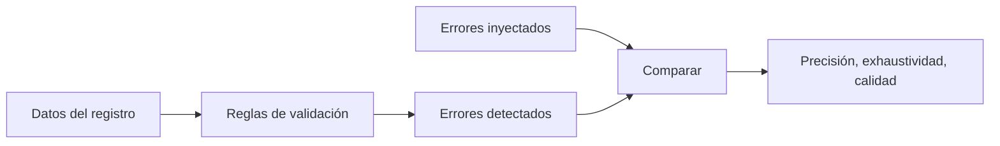

# B119-C07 — Registro nacional de objetos

<!-- nav:top -->
[🏠 Programa](../../../../README.md) · [📚 Bloque B119](../../../tronco-comun/B119-derecho-seguridad-y-geopolitica-espacial.md) · [← Anterior: B119-C06 — Organismos UNOOSA y COPUOS](../B119-C06-organismos-unoosa-y-copuos/CLASE.md) · [Siguiente: B119-C08 — Autorización y supervisión de operadores →](../B119-C08-autorizacion-y-supervision-de-operadores/CLASE.md)
<!-- /nav -->

## 1. Ubicación, nivel y alcance

Clase 7 del bloque B119. Nivel N3. Cada Estado lleva su propio registro de objetos lanzados; si el registro tiene errores, el registro central de la ONU y la identificación de objetos fallan. Aquí diseñas reglas de validación para un registro nacional **sintético** de 200 objetos con errores inyectados y compruebas que las reglas encuentran exactamente esos errores, sin falsas alarmas. **Esta clase es educativa: no es asesoría legal, regulatoria ni financiera y no sustituye a un jurista, a una autoridad competente ni a un asesor.**

## 2. Por qué esta clase existe

C04 estudia qué se registra y calcula el período; esta clase estudia la calidad del registro como sistema y la auditoría de coherencia, que ninguna otra clase trata. La decisión central: **¿qué reglas mínimas permiten confiar en un registro nacional y cómo se mide su calidad?**

## 3. Lo que podrás hacer al terminar

1. Explicar que el contenido del registro nacional lo fija cada Estado (art. II, consultado).
2. Escribir reglas de validación: campos vacíos, formato, duplicados, coherencia orbital y fecha.
3. Medir precisión y exhaustividad de las reglas contra errores inyectados.
4. Calcular la calidad del registro como fracción de objetos sin errores.
5. Separar lo consultado (texto normativo con versión y fecha) de lo sintético o ilustrativo.

La evidencia es la **informe de calidad de un registro sintético** del ejercicio 12 (sección 20).

## 4. Con qué llegas y cómo comprobarlo

1. ¿Qué es una expresión regular?
2. ¿Qué es la precisión?
3. ¿Qué es la exhaustividad?
4. ¿Qué es un duplicado?
5. ¿Qué es una semilla fija?

<details>
<summary>Ver respuestas</summary>

1. Un patrón para reconocer formatos de texto. 2. De lo detectado, la fracción que es error real. 3. De los errores reales, la fracción detectada. 4. Un valor que debería ser único y aparece más de una vez. 5. Lo que hace reproducible el sorteo de errores.
</details>

Con cuatro o cinco aciertos, sigue; si no, repasa los prerrequisitos.

## 5. Un caso de contexto y casos de referencia

La página de UNOOSA del Convenio de Registro (consultada el 2026-11-11) dice que cada Estado mantiene un registro cuyo contenido y reglas fija él mismo y que avisa al Secretario General (art. II), y que debe informar designador, fecha y lugar, parámetros orbitales y función (art. IV), y comunicar en lo posible cuando un objeto ya no está en órbita. El **ejemplo conductor**: 200 objetos sintéticos con 25 errores inyectados de cinco tipos (designador vacío o duplicado, perigeo mayor que apogeo, función vacía, fecha imposible).

## 6. Vocabulario

**Validación** es comprobar reglas sobre los datos. **Precisión** y **exhaustividad** miden la detección. **Calidad** es la fracción de objetos sin errores. **Inyección de errores** es introducir fallos conocidos para probar las reglas. Un **designador duplicado** impide identificar un objeto.

## 7. Modelo mental



*Descripción textual:* las reglas procesan los datos y producen errores; se comparan con los inyectados para medir precisión y exhaustividad y obtener la calidad.

Analogía: un corrector ortográfico probado con un texto al que se le pusieron faltas conocidas. Límite: los errores reales son más variados que los inyectados.

## 8. La explicación, paso a paso

### 8.1 Reglas

(1) designador vacío; (2) formato `AAAA-NNNL` (ilustrativo); (3) duplicado; (4) perigeo > apogeo; (5) función vacía; (6) fecha inválida.

### 8.2 Resultado

Se inyectaron 25 errores; los objetos con al menos un error son `30` de 200 (los duplicados afectan a dos objetos). Las reglas detectaron exactamente lo inyectado: precisión y exhaustividad `1,00`.

### 8.3 Calidad

`Q = 1 − 30/200 = 0.850`.

### 8.4 Qué no prueba

Detectar los errores propios del generador no prueba que las reglas detecten errores reales desconocidos; sirve para comprobar que no hay fallos de implementación.

## 9. Magnitudes, símbolos y unidades

| Símbolo | Qué es | Unidad | Valor / nota |
|---|---|---|---|
| `N` | objetos del registro | — | 200 |
| `E` | objetos con error | — | 30 |
| `Q` | calidad | — | 0.850 |
| `P`, `X` | precisión, exhaustividad | — | 1,00 |

## 10. Convenciones y referencias

Fechas ISO 8601; alturas en km; formato de designador ilustrativo. Semilla 119.

## 11. De dónde sale lo que afirmamos

| ID | Fuente | Localizador | Respalda | Estado |
|---|---|---|---|---|
| S1 | UNOOSA, «Convention on Registration of Objects Launched into Outer Space» (página oficial), https://www.unoosa.org/oosa/en/ourwork/spacelaw/treaties/registration-convention.html (WebFetch, consultada 2026-11-11) | arts. II y IV | registro nacional con contenido fijado por el Estado; datos a informar | Consultada |
| — | Formato oficial de designadores internacionales | — | no consultado; el usado es ilustrativo | No consultado / ilustrativo |
| — | Registro y errores | — | sintéticos | No consultado / ilustrativo |

Límites: no se consultó ningún registro real ni el formato oficial de designador. Texto normativo parafraseado de las páginas oficiales en la fecha indicada; el texto vinculante es el de la fuente oficial vigente.

## 12. Cómo ver la situación

| Magnitud | Valor |
|---|---|
| Objetos con error | 30 de 200 |
| Calidad | 0.850 |
| Duplicados | 10 objetos |
| Órbitas incoherentes | 5 |

Descripción larga: las reglas encuentran todos los errores inyectados; la calidad del registro sintético queda ligeramente por debajo de 0,9.

## 13. Ejemplo trabajado: una órbita incoherente

**Paso 1.** Objeto con `apogeo = 600` y `perigeo = 605`. **Paso 2.** Regla 4: `perigeo > apogeo` es verdadera. **Paso 3.** Se marca `orbita`. **Paso 4.** Corrección: revisar la fuente del dato.

## 14. Distintas formas de describirlo

**Por regla:** vacío, formato, duplicado, coherencia, fecha. **Por métrica:** precisión, exhaustividad, calidad. **Por gravedad:** impide identificar o solo incompleta.

## 15. Práctica guiada

**Ejercicio 1 · con los pasos indicados.** Indica la regla que detecta `perigeo > apogeo`.

<details><summary>Solución comentada</summary>

La regla 4 de coherencia orbital.
</details>

**Ejercicio 2 · con una pista.** Calcula la calidad si 20 de 200 objetos tienen error. *Pista:* `1 − 20/200`.

<details><summary>Solución comentada</summary>

`0,90`.
</details>

**Ejercicio 3 · casi autónomo.** Un duplicado afecta a dos objetos. Si hay 5 pares, ¿cuántos objetos?

<details><summary>Solución comentada</summary>

10.
</details>

## 16. Práctica autónoma, transferencia e integrador

**Ejercicio 4 · autónomo.** Calcula la precisión si se detectaron 30 y 24 son errores reales.

<details><summary>Solución comentada</summary>

`24/30 = 0,80`.
</details>

**Ejercicio 5 · autónomo.** Calcula la exhaustividad si hay 25 errores reales y se detectaron 24.

<details><summary>Solución comentada</summary>

`0,96`.
</details>

**Ejercicio 6 · autónomo.** ¿Qué regla marcaría `2024-13-40` como fecha?

<details><summary>Solución comentada</summary>

La de fecha inválida (`fromisoformat`).
</details>

**Ejercicio 7 · autónomo.** Escribe una expresión regular para `AAAA-NNNL`.

<details><summary>Solución comentada</summary>

`\d{4}-\d{3}[A-Z]`.
</details>

**Ejercicio 8 · autónomo.** ¿Qué dato del registro es crítico para identificar un objeto?

<details><summary>Solución comentada</summary>

El designador.
</details>

**Ejercicio 9 · transferencia.** **Transferencia.** ¿Por qué un registro con calidad alta no prueba que sea verdadero?

<details><summary>Solución comentada</summary>

Las reglas comprueban coherencia interna, no que el objeto exista o que el dato sea cierto.
</details>

**Ejercicio 10 · transferencia.** **Transferencia.** ¿Qué haría un Estado con los duplicados detectados?

<details><summary>Solución comentada</summary>

Corregirlos y avisar al Secretario General de las enmiendas, según el art. II.
</details>

**Ejercicio 11 · transferencia.** **Transferencia.** ¿Qué riesgo hay en inyectar solo los errores que ya sabes detectar?

<details><summary>Solución comentada</summary>

Sobreestimar la exhaustividad; hay que probar también con errores no previstos.
</details>

**Ejercicio 12 · integrador.** **Integrador.** Elabora tu *informe de calidad de un registro sintético*: reglas, errores, precisión, exhaustividad, calidad y aviso de que es educativo.

<details><summary>Solución comentada</summary>

Secciones 8.1–8.4 y la salida del laboratorio.
</details>

## 17. Laboratorio: validar un registro nacional sintético

El script [laboratorio.py](laboratorio.py) genera 200 objetos con 25 errores inyectados y aplica seis reglas (**comprueba** que lo detectado es exactamente lo inyectado).

**Datos:** art. II y IV del convenio (UNOOSA, consultado 2026-11-11); el registro y los errores son **sintéticos**. **Predice antes de ejecutar:** ¿qué calidad tendrá el registro? (entre 0,85 y 0,9.) **Ejecución del 2026-11-11 (Python 3.12.9):**

```text
Python 3.12.9 (biblioteca estandar)
Registro SINTETICO de 200 objetos con errores inyectados (semilla 119); campos segun UNOOSA (consultado 2026-11-11).
  id_vacio  inyectados  5  detectados  5  aciertos  5
  id_dup    inyectados 10  detectados 10  aciertos 10
  orbita    inyectados  5  detectados  5  aciertos  5
  funcion   inyectados  5  detectados  5  aciertos  5
  fecha     inyectados  5  detectados  5  aciertos  5
Objetos con al menos un error: 30 de 200 ; calidad (sin errores) = 0.850
Precision = exhaustividad = 1.00
CLAVES {"n_err": 30, "q": "0.850", "dup": 10, "vacio": 5, "orb": 5}
Pruebas superadas.
```

```bash
python programa/clases/B119/B119-C07-registro-nacional-de-objetos/laboratorio.py
```

**Límites:** el generador conoce los errores; el formato de designador es ilustrativo; no se valida contra ningún registro real.

## 18. Errores frecuentes y cómo corregirlos

**Confundir completitud con veracidad.** Se corrige con el ejercicio 9.

**Contar un duplicado como un error.** Se corrige con el ejercicio 3.

**Probar solo con errores conocidos.** Se corrige con el ejercicio 11.

**Olvidar los objetos fuera de órbita.** Se corrige con la sección 5.

## 19. Cómo sabrás que vas bien

Tras la sección 8: ¿qué resultado esperabas en el ejemplo trabajado y cuál obtuviste? Si dudas, repasa la sección 13. Tras el laboratorio: ¿qué comprueba cada prueba? (ver la sección 17).

## 20. Qué entregas y cómo se evalúa

El producto es tu **informe de calidad de un registro sintético** (ejercicio 12).

| Criterio | Inicial | En desarrollo | Logrado | Destacado |
|---|---|---|---|---|
| Conceptos | Los confunde | Parciales | Usa el vocabulario con precisión | Explica los límites del modelo |
| Cálculo | Sin unidades | Con errores | Resultados con unidades y tolerancia | Calcula casos nuevos |
| Verificación | Sin comprobar | Un caso | Contraste con una segunda vía | Interpreta las diferencias |
| Fuentes | Sin fuente | Sin fecha | Fuentes con versión, fecha y estado | Declara lo sintético y lo no consultado |
| Límites | No los nombra | Uno | Tres | Discute qué falta del modelo |

**Condiciones críticas (no se compensan con promedio):** citar la versión y la fecha del texto normativo consultado; rotular lo sintético y lo ilustrativo; no presentar un resultado como asesoría legal, regulatoria o financiera.

## 21. Ética, seguridad y límites

Clase educativa: **no es asesoría legal, regulatoria ni financiera**; no sustituye a un abogado, a la autoridad competente ni a un asesor, y ningún resultado debe usarse para decidir sobre una licencia, una reclamación, un contrato o una operación real. El registro nacional puede incluir datos sensibles; aquí todo es inventado. Los modelos son simplificados y sus datos son sintéticos o ilustrativos; lo simulado nunca se presenta como observado. Accesibilidad: tablas equivalentes a las gráficas, fórmulas en texto, ejercicios sin conexión.

## 22. Para cerrar y seguir

El registro sintético tiene calidad `0.850` y las reglas encuentran todos los errores inyectados. Queda una pregunta: ¿quién decide que una empresa puede lanzar y la vigila después?

**Glosario español–inglés.** registro nacional · *national registry*; validación · *validation*; exhaustividad · *recall*; precisión · *precision*.

**Continuidad.** [B119-C08](../B119-C08-autorizacion-y-supervision-de-operadores/CLASE.md): la autorización y supervisión de operadores.

**Referencias:** ver sección 11.

<!-- nav:bottom -->
---

[← Anterior: B119-C06 — Organismos UNOOSA y COPUOS](../B119-C06-organismos-unoosa-y-copuos/CLASE.md) · [📚 Bloque B119](../../../tronco-comun/B119-derecho-seguridad-y-geopolitica-espacial.md) · [Siguiente: B119-C08 — Autorización y supervisión de operadores →](../B119-C08-autorizacion-y-supervision-de-operadores/CLASE.md)
<!-- /nav -->
