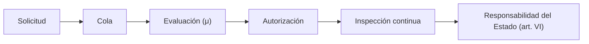

# B119-C08 — Autorización y supervisión de operadores

<!-- nav:top -->
[🏠 Programa](../../../../README.md) · [📚 Bloque B119](../../../tronco-comun/B119-derecho-seguridad-y-geopolitica-espacial.md) · [← Anterior: B119-C07 — Registro nacional de objetos](../B119-C07-registro-nacional-de-objetos/CLASE.md) · [Siguiente: B119-C09 — Derecho y normas de telecomunicaciones →](../B119-C09-derecho-y-normas-de-telecomunicaciones/CLASE.md)
<!-- /nav -->

## 1. Ubicación, nivel y alcance

Clase 8 del bloque B119. Nivel N3. El art. VI del tratado de 1967 hace al Estado responsable de las actividades de sus entidades privadas y exige autorización y supervisión continua. Aquí modelas el trámite de autorización como una cola con tasas sintéticas y la supervisión como una inspección por muestreo, y calculas cuánto tarda en promedio una solicitud y con qué probabilidad un operador pasa sin ser inspeccionado. **Esta clase es educativa: no es asesoría legal, regulatoria ni financiera y no sustituye a un jurista, a una autoridad competente ni a un asesor.**

## 2. Por qué esta clase existe

C01 enuncia el art. VI como regla; esta clase lo convierte en un proceso con tiempos y cobertura, lo que ninguna clase del bloque hace. La decisión central: **¿qué capacidad de tramitación y qué intensidad de inspección hacen creíble una autorización «y supervisión continua»?**

## 3. Lo que podrás hacer al terminar

1. Enunciar el requisito de autorización y supervisión continua del art. VI.
2. Calcular `ρ`, `W` y `W_q` de una cola M/M/1 y verificarlas por simulación.
3. Calcular el efecto de aumentar la capacidad de tramitación.
4. Calcular la probabilidad de no ser inspeccionado en `m` periodos.
5. Separar lo consultado (texto normativo con versión y fecha) de lo sintético o ilustrativo.

La evidencia es la **plan de autorización con tiempos esperados** del ejercicio 12 (sección 20).

## 4. Con qué llegas y cómo comprobarlo

1. ¿Qué es una cola M/M/1?
2. ¿Qué es la utilización `ρ`?
3. ¿Qué pasa con la cola si `ρ ≥ 1`?
4. ¿Qué es un muestreo aleatorio simple?
5. ¿Qué es la probabilidad complementaria?

<details>
<summary>Ver respuestas</summary>

1. Un sistema con llegadas de Poisson, servicio exponencial y un servidor. 2. El cociente entre la tasa de llegada y la de servicio. 3. Crece sin límite. 4. Elegir elementos al azar con igual probabilidad. 5. `1 − p`.
</details>

Con cuatro o cinco aciertos, sigue; si no, repasa los prerrequisitos.

## 5. Un caso de contexto y casos de referencia

La nota de la Biblioteca Audiovisual de la ONU (consultada el 2026-11-11) resume el art. VI: los Estados responden internacionalmente por sus actividades nacionales, públicas o privadas; las privadas requieren autorización y supervisión continua. **No se consultó ninguna ley nacional**: cómo se licencia cada actividad depende de cada Estado y se estudia en B121. El **ejemplo conductor**: una autoridad que recibe 3 solicitudes al mes y tramita 4 al mes, y que inspecciona 12 de 60 operadores por periodo. Todos los valores son sintéticos.

## 6. Vocabulario

La **autorización** es el permiso previo. La **supervisión continua** es el control durante toda la vida de la actividad. La **tasa de llegada** `λ` y la **de servicio** `μ` se miden en solicitudes por mes. El **tiempo en el sistema** `W` incluye espera y servicio.

## 7. Modelo mental



*Descripción textual:* la solicitud espera, se evalúa y se autoriza; después el operador queda bajo inspección continua, y el Estado responde de todo el proceso.

Analogía: la ventanilla de un registro con una sola cajera: si llegan casi tantos clientes como los que atiende, la fila se alarga. Límite: una autorización real tiene varias etapas y servidores.

## 8. La explicación, paso a paso

### 8.1 Cola

`ρ = λ/μ = 0.75`; `W = 1/(μ − λ) = 1.000 mes` (`30` días); `W_q = ρ/(μ − λ) = 0.750 mes`. La simulación con 200 000 solicitudes da `W = 0.988`, dentro del 3 %.

### 8.2 Reforzar el servicio

Subir `μ` de 4 a 5 reduce `W` a `0.500 mes`: no es proporcional; cerca de `ρ = 1` pequeñas mejoras reducen mucho la espera.

### 8.3 Supervisión

Con 12 inspecciones de 60 operadores por periodo, un operador no es inspeccionado con probabilidad `0.80` en un periodo y `0.3277` en cinco.

### 8.4 Límites

La cola no modela solicitudes incompletas ni prioridades; la inspección aleatoria no cubre operadores de riesgo alto que merecen más atención.

## 9. Magnitudes, símbolos y unidades

| Símbolo | Qué es | Unidad | Valor / nota |
|---|---|---|---|
| `λ` | tasa de llegada | 1/mes | 3 |
| `μ` | tasa de servicio | 1/mes | 4 |
| `W` | tiempo en el sistema | mes | 1.000 |
| `k/n` | fracción inspeccionada | — | 0,2 |

## 10. Convenciones y referencias

Tiempos en meses (1 mes = 30 días); probabilidades en [0,1]; estado estacionario. Valores sintéticos.

## 11. De dónde sale lo que afirmamos

| ID | Fuente | Localizador | Respalda | Estado |
|---|---|---|---|---|
| S3 | ONU, Biblioteca Audiovisual de Derecho Internacional, nota introductoria sobre el Tratado del Espacio Ultraterrestre, https://legal.un.org/avl/ha/tos/tos.html (WebFetch, consultada 2026-11-11; no discute los artículos V ni VII) | art. VI | autorización y supervisión continua; responsabilidad del Estado | Consultada |
| — | Leyes nacionales de licencias | — | no consultadas | No consultado / ilustrativo |
| — | Teoría de colas M/M/1 | — | no consultada en una fuente concreta; verificada por simulación | No consultado / ilustrativo |
| — | Tasas y número de operadores | — | sintéticos | No consultado / ilustrativo |

Límites: no se consultó ninguna autoridad ni ley nacional; las tasas son sintéticas. Texto normativo parafraseado de las páginas oficiales en la fecha indicada; el texto vinculante es el de la fuente oficial vigente.

## 12. Cómo ver la situación

| Magnitud | Valor |
|---|---|
| `ρ` | 0.75 |
| `W` | 1.000 mes |
| `W` con `μ = 5` | 0.500 mes |
| P(sin inspección en 5 periodos) | 0.3277 |

Descripción larga: con 75 % de utilización un trámite tarda un mes; aumentar un poco la capacidad lo reduce a la mitad.

## 13. Ejemplo trabajado: reforzar la ventanilla

**Paso 1.** `λ = 3`, `μ = 4`: `W = 1/(4 − 3) = 1` mes. **Paso 2.** Con `μ = 5`: `W = 1/2 = 0.500` mes. **Paso 3.** La capacidad subió 25 % y la espera bajó 50 %.

## 14. Distintas formas de describirlo

**Por tiempo:** `W`, `W_q`. **Por utilización:** `ρ`. **Por cobertura:** fracción inspeccionada. **Por responsabilidad:** Estado y operador.

## 15. Práctica guiada

**Ejercicio 1 · con los pasos indicados.** Calcula `ρ` con `λ = 3` y `μ = 4`.

<details><summary>Solución comentada</summary>

`0,75`.
</details>

**Ejercicio 2 · con una pista.** Calcula `W`. *Pista:* `1/(μ − λ)`.

<details><summary>Solución comentada</summary>

`1` mes = 30 días.
</details>

**Ejercicio 3 · casi autónomo.** Calcula `W_q`.

<details><summary>Solución comentada</summary>

`0,75/1 = 0,75` mes.
</details>

## 16. Práctica autónoma, transferencia e integrador

**Ejercicio 4 · autónomo.** Calcula `W` si `μ = 6`.

<details><summary>Solución comentada</summary>

`1/3 = 0,333` mes.
</details>

**Ejercicio 5 · autónomo.** ¿Qué pasa si `μ = λ`?

<details><summary>Solución comentada</summary>

`ρ = 1`; la cola no tiene estado estacionario.
</details>

**Ejercicio 6 · autónomo.** Calcula P(no inspeccionado en 3 periodos) con `k/n = 0,2`.

<details><summary>Solución comentada</summary>

`0,8³ = 0,512`.
</details>

**Ejercicio 7 · autónomo.** ¿Cuántos periodos hacen falta para que P(no inspeccionado) < 0,1?

<details><summary>Solución comentada</summary>

`ln 0,1/ln 0,8 = 10,3`: 11 periodos.
</details>

**Ejercicio 8 · autónomo.** ¿Qué artículo exige la supervisión continua?

<details><summary>Solución comentada</summary>

El art. VI del tratado de 1967.
</details>

**Ejercicio 9 · transferencia.** **Transferencia.** ¿Por qué no basta autorizar una vez?

<details><summary>Solución comentada</summary>

Porque las actividades cambian y el Estado responde de lo que ocurre durante toda la operación.
</details>

**Ejercicio 10 · transferencia.** **Transferencia.** ¿Cómo ajustarías la inspección para operadores de riesgo alto?

<details><summary>Solución comentada</summary>

Muestreo estratificado: mayor probabilidad de inspección para ese grupo.
</details>

**Ejercicio 11 · transferencia.** **Transferencia.** ¿Por qué el modelo M/M/1 puede subestimar la espera real?

<details><summary>Solución comentada</summary>

Porque las solicitudes llegan en lotes y los casos complejos tardan mucho más que el promedio.
</details>

**Ejercicio 12 · integrador.** **Integrador.** Elabora tu *plan de autorización con tiempos esperados*: cola, mejora de capacidad, cobertura de inspección y aviso de que es educativo.

<details><summary>Solución comentada</summary>

Secciones 8.1–8.4 y la salida del laboratorio.
</details>

## 17. Laboratorio: trámite como cola y supervisión por muestreo

El script [laboratorio.py](laboratorio.py) simula una cola M/M/1 de 200 000 solicitudes y calcula la cobertura de inspección (**comprueba** `W` y `W_q` contra la fórmula).

**Datos:** art. VI consultado (2026-11-11); tasas y operadores **sintéticos**. **Predice antes de ejecutar:** ¿cuánto tardará en promedio una solicitud con `ρ = 0,75`? (un mes.) **Ejecución del 2026-11-11 (Python 3.12.9):**

```text
Python 3.12.9 (biblioteca estandar)
Tramite SINTETICO M/M/1 (lambda = 3, mu = 4 solicitudes/mes); art. VI consultado 2026-11-11; ninguna ley nacional consultada.
rho = 0.75 ; W analitico = 1.000 mes ; simulado 0.988 ; Wq analitico = 0.750 ; simulado 0.739
Efecto de reforzar el servicio (mu): 
   mu = 3.5  W =  2.000 mes  (  60.0 dias)
   mu = 4.0  W =  1.000 mes  (  30.0 dias)
   mu = 5.0  W =  0.500 mes  (  15.0 dias)
   mu = 6.0  W =  0.333 mes  (  10.0 dias)
Supervision: 12 de 60 operadores por periodo; P(no inspeccionado en 1 periodos) = 0.8000
Supervision: 12 de 60 operadores por periodo; P(no inspeccionado en 3 periodos) = 0.5120
Supervision: 12 de 60 operadores por periodo; P(no inspeccionado en 5 periodos) = 0.3277
CLAVES {"rho": "0.75", "W": "1.000", "Wq": "0.750", "dias": "30", "W5": "0.500", "pm5": "0.3277", "pm1": "0.80", "Wsim": "0.988"}
Pruebas superadas.
```

```bash
python programa/clases/B119/B119-C08-autorizacion-y-supervision-de-operadores/laboratorio.py
```

**Límites:** un servidor, tasas constantes, sin prioridades ni etapas; no describe ninguna autoridad real.

## 18. Errores frecuentes y cómo corregirlos

**Ignorar `ρ ≥ 1`.** Se corrige con el ejercicio 5.

**Creer que la capacidad y la espera son proporcionales.** Se corrige con 8.2.

**Confundir `W` con `W_q`.** Se corrige con la sección 6.

**Inspeccionar solo una vez.** Se corrige con el ejercicio 9.

## 19. Cómo sabrás que vas bien

Tras la sección 8: ¿qué resultado esperabas en el ejemplo trabajado y cuál obtuviste? Si dudas, repasa la sección 13. Tras el laboratorio: ¿qué comprueba cada prueba? (ver la sección 17).

## 20. Qué entregas y cómo se evalúa

El producto es tu **plan de autorización con tiempos esperados** (ejercicio 12).

| Criterio | Inicial | En desarrollo | Logrado | Destacado |
|---|---|---|---|---|
| Conceptos | Los confunde | Parciales | Usa el vocabulario con precisión | Explica los límites del modelo |
| Cálculo | Sin unidades | Con errores | Resultados con unidades y tolerancia | Calcula casos nuevos |
| Verificación | Sin comprobar | Un caso | Contraste con una segunda vía | Interpreta las diferencias |
| Fuentes | Sin fuente | Sin fecha | Fuentes con versión, fecha y estado | Declara lo sintético y lo no consultado |
| Límites | No los nombra | Uno | Tres | Discute qué falta del modelo |

**Condiciones críticas (no se compensan con promedio):** citar la versión y la fecha del texto normativo consultado; rotular lo sintético y lo ilustrativo; no presentar un resultado como asesoría legal, regulatoria o financiera.

## 21. Ética, seguridad y límites

Clase educativa: **no es asesoría legal, regulatoria ni financiera**; no sustituye a un abogado, a la autoridad competente ni a un asesor, y ningún resultado debe usarse para decidir sobre una licencia, una reclamación, un contrato o una operación real. Estas cifras no evalúan a ninguna autoridad ni operador reales. Los modelos son simplificados y sus datos son sintéticos o ilustrativos; lo simulado nunca se presenta como observado. Accesibilidad: tablas equivalentes a las gráficas, fórmulas en texto, ejercicios sin conexión.

## 22. Para cerrar y seguir

Con `ρ = 0,75` una solicitud sintética tarda `1.000` mes y con `μ = 5` baja a `0.500`. Queda una pregunta: ¿qué reglas del espectro condicionan una licencia satelital?

**Glosario español–inglés.** autorización · *authorization*; supervisión continua · *continuing supervision*; utilización · *utilization*; cola · *queue*.

**Continuidad.** [B119-C09](../B119-C09-derecho-y-normas-de-telecomunicaciones/CLASE.md): el derecho y las normas de telecomunicaciones.

**Referencias:** ver sección 11.

<!-- nav:bottom -->
---

[← Anterior: B119-C07 — Registro nacional de objetos](../B119-C07-registro-nacional-de-objetos/CLASE.md) · [📚 Bloque B119](../../../tronco-comun/B119-derecho-seguridad-y-geopolitica-espacial.md) · [Siguiente: B119-C09 — Derecho y normas de telecomunicaciones →](../B119-C09-derecho-y-normas-de-telecomunicaciones/CLASE.md)
<!-- /nav -->
