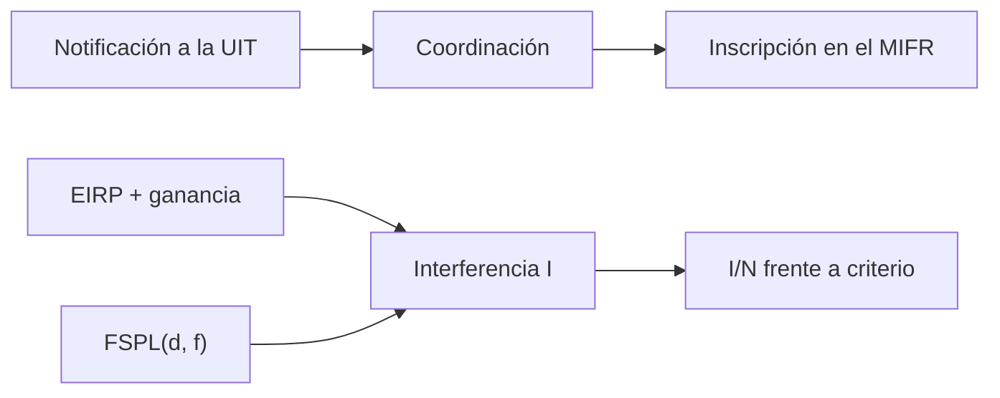

# B119-C09 — Derecho y normas de telecomunicaciones

<!-- nav:top -->
[🏠 Programa](../../../../README.md) · [📚 Bloque B119](../../../tronco-comun/B119-derecho-seguridad-y-geopolitica-espacial.md) · [← Anterior: B119-C08 — Autorización y supervisión de operadores](../B119-C08-autorizacion-y-supervision-de-operadores/CLASE.md) · [Siguiente: B119-C10 — Responsabilidad por daños espaciales →](../B119-C10-responsabilidad-por-danos-espaciales/CLASE.md)
<!-- /nav -->

## 1. Ubicación, nivel y alcance

Clase 9 del bloque B119. Nivel N3. Las ondas de radio no respetan fronteras: el espectro es un recurso compartido que la UIT coordina. Aquí lees qué hace la UIT-R con las notificaciones y el registro de frecuencias (consultado) y calculas, con enlaces sintéticos, cuánta señal de un interferente llega a un receptor satelital, usando la pérdida en espacio libre y el cociente interferencia/ruido, y a qué distancia mínima se cumple un criterio ilustrativo. **Esta clase es educativa: no es asesoría legal, regulatoria ni financiera y no sustituye a un jurista, a una autoridad competente ni a un asesor.**

## 2. Por qué esta clase existe

Ninguna clase anterior vincula el derecho de telecomunicaciones con el cálculo de interferencia; B120 trata licencias y espectro en detalle y esta clase fija el marco. La decisión central: **¿a qué separación o con qué potencia un segundo sistema deja de perturbar al primero?**

## 3. Lo que podrás hacer al terminar

1. Describir lo que hace la UIT-R: notificación, coordinación, MIFR e interferencia perjudicial.
2. Calcular la pérdida en espacio libre `FSPL` y el ruido `kTB`.
3. Calcular `I/N` en cinco separaciones y compararlo con un criterio ilustrativo.
4. Despejar la distancia mínima que cumple el criterio.
5. Separar lo consultado (texto normativo con versión y fecha) de lo sintético o ilustrativo.

La evidencia es la **ficha de interferencia entre dos enlaces sintéticos** del ejercicio 12 (sección 20).

## 4. Con qué llegas y cómo comprobarlo

1. ¿Qué es un decibelio?
2. ¿Qué es el ruido térmico?
3. ¿Qué es la EIRP?
4. ¿Cuánto cambia la pérdida al duplicar la distancia?
5. ¿Qué es una interferencia perjudicial?

<details>
<summary>Ver respuestas</summary>

1. Diez veces el logaritmo decimal de una razón de potencias. 2. El ruido `kTB` de un receptor a temperatura `T` y ancho de banda `B`. 3. La potencia isótropa radiada equivalente de un transmisor. 4. Aumenta unos 6 dB. 5. La que degrada o impide un servicio radioeléctrico.
</details>

Con cuatro o cinco aciertos, sigue; si no, repasa los prerrequisitos.

## 5. Un caso de contexto y casos de referencia

La página de la UIT-R (consultada el 2026-11-11) dice que el Departamento de Servicios Espaciales aplica el Reglamento de Radiocomunicaciones a sistemas espaciales, examina y publica las notificaciones de asignaciones de frecuencia, fija requisitos de coordinación, inscribe las asignaciones en el Registro Internacional de Frecuencias (MIFR) y ayuda a resolver interferencias perjudiciales; también registra planes de asignación. **No se consultó el Reglamento ni sus criterios numéricos.** El **ejemplo conductor**: un interferente sintético con EIRP de 20 dBW apunta a un receptor víctima de 40 dBi a 12 GHz, con `T = 150 K` y `B = 36 MHz`.

## 6. Vocabulario

La **notificación** informa una asignación a la UIT. La **coordinación** busca evitar interferencia entre sistemas. El **MIFR** es el registro de frecuencias. La **interferencia perjudicial** degrada un servicio. La **FSPL** es la pérdida en espacio libre. `I/N` es la interferencia respecto del ruido.

## 7. Modelo mental



*Descripción textual:* la UIT recibe notificaciones, coordina e inscribe; el cálculo de `I/N` combina potencia, ganancia y pérdida y se compara con un criterio.

Analogía: dos conversaciones en una sala: la voz del vecino se oye menos cuanto más lejos, y lo que importa es cuánto más fuerte suena que el ruido de fondo. Límite: la propagación real incluye atmósfera, lóbulos de antena y polarización.

## 8. La explicación, paso a paso

### 8.1 Lo consultado

La UIT-R examina, coordina, inscribe y ayuda con las interferencias; los criterios numéricos quedan como «no consultados».

### 8.2 Ruido y pérdida

`N = k T B = -131.28 dBW`. Control: la `FSPL` GEO a 12 GHz es `205.11 dB`. Duplicar la distancia añade `6.02 dB`.

### 8.3 Interferencia

`I = EIRP + G_rx − FSPL`; `I/N = I − N`. A 500 km, `I/N = 23.3 dB`; a 36 000 km, `-13.9 dB`.

### 8.4 Distancia mínima

Con el criterio ilustrativo `I/N ≤ −12,2 dB`, la separación mínima es `29654 km`.

## 9. Magnitudes, símbolos y unidades

| Símbolo | Qué es | Unidad | Valor / nota |
|---|---|---|---|
| `k` | constante de Boltzmann | J/K | 1,380649×10⁻²³ |
| `f` | frecuencia | MHz | 12 000 |
| `d` | distancia | km | 500–80 000 |
| `N` | ruido térmico | dBW | -131.28 |

## 10. Convenciones y referencias

Decibelios; distancias en km; frecuencia en MHz; el criterio `I/N ≤ −12,2 dB` es ilustrativo (no consultado).

## 11. De dónde sale lo que afirmamos

| ID | Fuente | Localizador | Respalda | Estado |
|---|---|---|---|---|
| S4 | UIT-R, Departamento de Servicios Espaciales, https://www.itu.int/en/ITU-R/space/Pages/default.aspx (WebFetch, consultada 2026-11-11) | departamento de servicios espaciales | notificación, coordinación, MIFR, planes e interferencia perjudicial | Consultada |
| — | Reglamento de Radiocomunicaciones y criterios de coordinación | — | no consultados | No consultado / ilustrativo |
| — | Fórmulas FSPL y `kTB` | — | no consultadas en una fuente concreta; verificadas con el caso GEO y la duplicación de distancia | No consultado / ilustrativo |
| — | Enlaces | — | sintéticos | No consultado / ilustrativo |

Límites: no se consultó el Reglamento; el criterio numérico es ilustrativo y no determina ninguna coordinación real. Texto normativo parafraseado de las páginas oficiales en la fecha indicada; el texto vinculante es el de la fuente oficial vigente.

## 12. Cómo ver la situación

| Magnitud | Valor |
|---|---|
| Ruido `N` | -131.28 dBW |
| `I/N` a 500 km | 23.3 dB |
| `I/N` a 36 000 km | -13.9 dB |
| Distancia mínima | 29654 km |

Descripción larga: la interferencia cae con el cuadrado de la distancia y el criterio solo se cumple a decenas de miles de kilómetros del interferente.

## 13. Ejemplo trabajado: separación mínima

**Paso 1.** Margen disponible: `EIRP + G − N + 12,2`. **Paso 2.** Se despeja `FSPL` igual a ese margen. **Paso 3.** `d = 10^((FSPL − 20 log f − 32,45)/20) = 29654 km`.

## 14. Distintas formas de describirlo

**Por procedimiento:** notificación, coordinación, inscripción. **Por magnitud:** `FSPL`, `N`, `I`, `I/N`. **Por criterio:** cumple o no. **Por escala:** lineal o en dB.

## 15. Práctica guiada

**Ejercicio 1 · con los pasos indicados.** Calcula `FSPL` a 1000 km y 12 000 MHz.

<details><summary>Solución comentada</summary>

`60 + 81,58 + 32,45 = 174,03 dB`.
</details>

**Ejercicio 2 · con una pista.** Calcula `FSPL` a 2000 km. *Pista:* suma 6,02 dB.

<details><summary>Solución comentada</summary>

`180,05 dB`.
</details>

**Ejercicio 3 · casi autónomo.** Calcula `N` con `T = 150 K` y `B = 36 MHz`.

<details><summary>Solución comentada</summary>

`-131.28 dBW`.
</details>

## 16. Práctica autónoma, transferencia e integrador

**Ejercicio 4 · autónomo.** Calcula `I/N` a 500 km.

<details><summary>Solución comentada</summary>

`23.3 dB`.
</details>

**Ejercicio 5 · autónomo.** ¿Cumple el criterio a 36 000 km?

<details><summary>Solución comentada</summary>

Sí según el laboratorio: `-13.9 dB`, por debajo de −12,2 dB.
</details>

**Ejercicio 6 · autónomo.** Calcula la distancia mínima.

<details><summary>Solución comentada</summary>

`29654 km`.
</details>

**Ejercicio 7 · autónomo.** Si se baja la EIRP 10 dB, ¿cómo cambia la distancia mínima?

<details><summary>Solución comentada</summary>

Se divide por `10^(10/20) = 3,16`.
</details>

**Ejercicio 8 · autónomo.** ¿Qué hace la UIT con una notificación?

<details><summary>Solución comentada</summary>

La examina, aplica la coordinación y la inscribe en el MIFR (S4).
</details>

**Ejercicio 9 · transferencia.** **Transferencia.** ¿Por qué el criterio `I/N` es solo ilustrativo aquí?

<details><summary>Solución comentada</summary>

Porque los criterios reales están en el Reglamento, que no se consultó.
</details>

**Ejercicio 10 · transferencia.** **Transferencia.** ¿Qué factores reales cambian el resultado?

<details><summary>Solución comentada</summary>

Lóbulos laterales, polarización, lluvia, geometría y múltiples interferentes.
</details>

**Ejercicio 11 · transferencia.** **Transferencia.** ¿Quién resuelve una interferencia perjudicial entre dos Estados?

<details><summary>Solución comentada</summary>

Las administraciones, con asistencia de la UIT (S4).
</details>

**Ejercicio 12 · integrador.** **Integrador.** Elabora tu *ficha de interferencia entre dos enlaces sintéticos*: cálculo, criterio, distancia mínima y aviso de que es educativa.

<details><summary>Solución comentada</summary>

Secciones 8.1–8.4 y la salida del laboratorio.
</details>

## 17. Laboratorio: interferencia entre enlaces sintéticos

El script [laboratorio.py](laboratorio.py) calcula `FSPL`, ruido e `I/N` en cinco separaciones y despeja la distancia mínima (**comprueba** la `FSPL` GEO a 0,1 dB y la duplicación de distancia).

**Datos:** UIT-R consultada (2026-11-11) sin cifras; enlaces y criterio **sintéticos o ilustrativos**. **Predice antes de ejecutar:** ¿a 36 000 km se cumplirá el criterio? (sí, por poco.) **Ejecución del 2026-11-11 (Python 3.12.9):**

```text
Python 3.12.9 (biblioteca estandar)
Enlaces SINTETICOS; UIT-R consultada el 2026-11-11 (procedimientos, no cifras); criterio I/N = -12.2 dB ILUSTRATIVO.
Control: FSPL GEO a 12 GHz = 205.11 dB (esperado 205.1)
Ruido N = k T B = -131.28 dBW
  separacion al interferente [km]   FSPL [dB]   I [dBW]   I/N [dB]   cumple (<= -12.2)
                      500       168.01   -108.01      23.26   NO
                     2000       180.05   -120.05      11.22   NO
                    10000       194.03   -134.03      -2.76   NO
                    36000       205.16   -145.16     -13.88   si
                    80000       212.10   -152.10     -20.82   si
Distancia minima para cumplir I/N <= -12.2 dB: 29654 km
Duplicar la distancia: +6.02 dB
CLAVES {"N": "-131.28", "geo": "205.11", "dmin": "29654", "i500": "23.3", "i36": "-13.9", "dif": "6.02"}
Pruebas superadas.
```

```bash
python programa/clases/B119/B119-C09-derecho-y-normas-de-telecomunicaciones/laboratorio.py
```

**Límites:** espacio libre, un interferente, sin antenas reales ni atmósfera; no es una coordinación.

## 18. Errores frecuentes y cómo corregirlos

**Mezclar km con m en la fórmula.** Se corrige con la sección 10.

**Sumar decibelios de potencias lineales.** Se corrige trabajando en dB.

**Tomar el criterio como norma.** Se corrige con la sección 11.

**Olvidar que la pérdida crece con `f`.** Se corrige con el ejercicio 1.

## 19. Cómo sabrás que vas bien

Tras la sección 8: ¿qué resultado esperabas en el ejemplo trabajado y cuál obtuviste? Si dudas, repasa la sección 13. Tras el laboratorio: ¿qué comprueba cada prueba? (ver la sección 17).

## 20. Qué entregas y cómo se evalúa

El producto es tu **ficha de interferencia entre dos enlaces sintéticos** (ejercicio 12).

| Criterio | Inicial | En desarrollo | Logrado | Destacado |
|---|---|---|---|---|
| Conceptos | Los confunde | Parciales | Usa el vocabulario con precisión | Explica los límites del modelo |
| Cálculo | Sin unidades | Con errores | Resultados con unidades y tolerancia | Calcula casos nuevos |
| Verificación | Sin comprobar | Un caso | Contraste con una segunda vía | Interpreta las diferencias |
| Fuentes | Sin fuente | Sin fecha | Fuentes con versión, fecha y estado | Declara lo sintético y lo no consultado |
| Límites | No los nombra | Uno | Tres | Discute qué falta del modelo |

**Condiciones críticas (no se compensan con promedio):** citar la versión y la fecha del texto normativo consultado; rotular lo sintético y lo ilustrativo; no presentar un resultado como asesoría legal, regulatoria o financiera.

## 21. Ética, seguridad y límites

Clase educativa: **no es asesoría legal, regulatoria ni financiera**; no sustituye a un abogado, a la autoridad competente ni a un asesor, y ningún resultado debe usarse para decidir sobre una licencia, una reclamación, un contrato o una operación real. Interferir deliberadamente un servicio es ilícito y peligroso; esta clase solo calcula márgenes sintéticos. Los modelos son simplificados y sus datos son sintéticos o ilustrativos; lo simulado nunca se presenta como observado. Accesibilidad: tablas equivalentes a las gráficas, fórmulas en texto, ejercicios sin conexión.

## 22. Para cerrar y seguir

La separación mínima sintética es `29654 km` con un criterio ilustrativo. Queda una pregunta: ¿qué pasa cuando el daño no es de radio sino de un objeto físico?

**Glosario español–inglés.** pérdida en espacio libre · *free-space path loss*; interferencia perjudicial · *harmful interference*; coordinación · *coordination*; registro de frecuencias · *frequency register*.

**Continuidad.** [B119-C10](../B119-C10-responsabilidad-por-danos-espaciales/CLASE.md): la responsabilidad por daños espaciales.

**Referencias:** ver sección 11.

<!-- nav:bottom -->
---

[← Anterior: B119-C08 — Autorización y supervisión de operadores](../B119-C08-autorizacion-y-supervision-de-operadores/CLASE.md) · [📚 Bloque B119](../../../tronco-comun/B119-derecho-seguridad-y-geopolitica-espacial.md) · [Siguiente: B119-C10 — Responsabilidad por daños espaciales →](../B119-C10-responsabilidad-por-danos-espaciales/CLASE.md)
<!-- /nav -->
