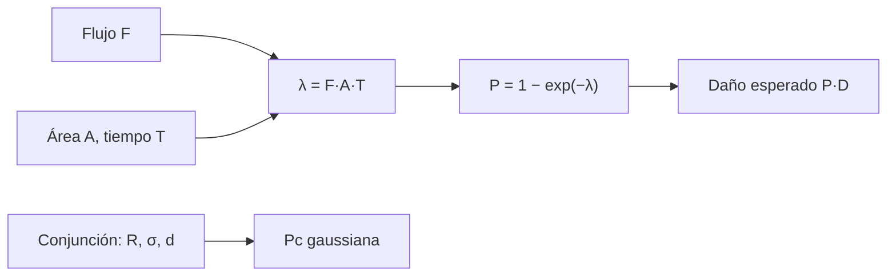

# B119-C10 — Responsabilidad por daños espaciales

<!-- nav:top -->
[🏠 Programa](../../../../README.md) · [📚 Bloque B119](../../../tronco-comun/B119-derecho-seguridad-y-geopolitica-espacial.md) · [← Anterior: B119-C09 — Derecho y normas de telecomunicaciones](../B119-C09-derecho-y-normas-de-telecomunicaciones/CLASE.md) · [Siguiente: B119-C11 — Uso pacífico y limitaciones militares →](../B119-C11-uso-pacifico-y-limitaciones-militares/CLASE.md)
<!-- /nav -->

## 1. Ubicación, nivel y alcance

Clase 10 del bloque B119. Nivel N3. Antes de repartir una indemnización hay que saber cuán probable es el daño. Aquí calculas, con datos **sintéticos**, la probabilidad de que un satélite sufra un impacto en su vida útil con un flujo de escombros dado, la probabilidad de colisión en una conjunción con error gaussiano, y el daño esperado, y verificas ambas con Monte Carlo. Se estudia la exposición, no se predice ningún evento. **Esta clase es educativa: no es asesoría legal, regulatoria ni financiera y no sustituye a un jurista, a una autoridad competente ni a un asesor.**

## 2. Por qué esta clase existe

C03 reparte una indemnización dada; esta clase cuantifica la exposición que la origina. La prueba del daño y su cuantificación real se tratan en B123. La decisión central: **¿qué parte del riesgo de daño depende del flujo de escombros, de la sección eficaz y del tiempo, y cuánto incierto es?**

## 3. Lo que podrás hacer al terminar

1. Relacionar la responsabilidad por daños (resumen consultado) con la exposición al riesgo.
2. Calcular `P = 1 − exp(−F A T)` y el daño esperado `P·D`.
3. Calcular la probabilidad de colisión de una conjunción gaussiana y verificarla.
4. Probar la sensibilidad al flujo de escombros.
5. Separar lo consultado (texto normativo con versión y fecha) de lo sintético o ilustrativo.

La evidencia es la **ficha de exposición a daño con incertidumbre** del ejercicio 12 (sección 20).

## 4. Con qué llegas y cómo comprobarlo

1. ¿Qué es un proceso de Poisson?
2. ¿Qué es un flujo?
3. ¿Qué es una distribución gaussiana?
4. ¿Qué es el valor esperado?
5. ¿Por qué verificar con Monte Carlo?

<details>
<summary>Ver respuestas</summary>

1. Eventos independientes a tasa constante; el número en un intervalo es Poisson. 2. Impactos por área y por tiempo. 3. Una distribución normal con media y desviación típica. 4. El promedio ponderado por probabilidad. 5. Para comprobar una fórmula con una segunda vía independiente.
</details>

Con cuatro o cinco aciertos, sigue; si no, repasa los prerrequisitos.

## 5. Un caso de contexto y casos de referencia

El resumen de búsqueda de UNOOSA (2026-11-11) indica que el Estado de lanzamiento responde por los daños de su objeto (art. II absoluta en la superficie; art. III por culpa en el espacio). **No se consultó** el texto del convenio ni práctica de reclamaciones. El **ejemplo conductor**: un satélite de 12 m² durante 5 años con un flujo sintético de 2×10⁻⁵ impactos/m²/año y un daño de 80 unidades monetarias sintéticas, y una conjunción con `R = 10 m`, `σ = 50 m`, `d = 60 m`.

## 6. Vocabulario

El **flujo** `F` es la tasa de impactos por área. La **sección eficaz** `A` es el área expuesta. La **conjunción** es un acercamiento entre dos objetos. La **probabilidad de colisión** `P_c` depende del error de posición `σ` y del radio combinado `R`. El **daño esperado** es `P·D`.

## 7. Modelo mental



*Descripción textual:* el flujo, el área y el tiempo dan la tasa `λ`, de ella la probabilidad y el daño esperado; la conjunción se trata aparte con un modelo gaussiano.

Analogía: lluvia sobre un tejado: cuanto mayor la superficie y el tiempo, más gotas. Límite: los escombros no caen uniformemente y la sección eficaz depende de la orientación.

## 8. La explicación, paso a paso

### 8.1 Exposición por flujo

`λ = F A T = 0.0012`; `P = 1 − exp(−λ) = 0.001199`; daño esperado `E = P D = 0.0959 u.m.`

### 8.2 Conjunción

`P_c = (R²/2σ²) exp(−d²/2σ²) = 0.00974`; daño esperado `0.779 u.m.`. El Monte Carlo da `0.00983`.

### 8.3 Sensibilidad

Si el flujo se triplica, `P` pasa a `0.003594`: casi proporcional mientras `λ` es pequeño.

### 8.4 Lo que no es

No es una probabilidad de ningún objeto real ni una estimación de reclamación.

## 9. Magnitudes, símbolos y unidades

| Símbolo | Qué es | Unidad | Valor / nota |
|---|---|---|---|
| `F` | flujo de impactos | 1/(m²·año) | 2×10⁻⁵ (sintético) |
| `A` | sección eficaz | m² | 12 |
| `T` | tiempo | año | 5 |
| `D` | daño | u.m. | 80 |

## 10. Convenciones y referencias

Flujo en 1/(m²·año); distancias en m; daño en u.m. sintéticas; semilla 119.

## 11. De dónde sale lo que afirmamos

| ID | Fuente | Localizador | Respalda | Estado |
|---|---|---|---|---|
| S6 | UNOOSA, página del Convenio sobre Responsabilidad Internacional por Daños Causados por Objetos Espaciales, https://www.unoosa.org/oosa/en/ourwork/spacelaw/treaties/liability-convention.html (la lectura directa devolvió 404; solo resumen de búsqueda web, 2026-11-11) | arts. II y III | marco de responsabilidad que motiva la exposición (resumen de búsqueda) | Resumen de búsqueda |
| — | Flujos reales de escombros; modelos de colisión de agencias | — | no consultados | No consultado / ilustrativo |
| — | Fórmulas de Poisson y de `P_c` | — | no consultadas en una fuente concreta; verificadas por Monte Carlo | No consultado / ilustrativo |
| — | Valores numéricos | — | sintéticos | No consultado / ilustrativo |

Límites: no se usó ningún flujo ni conjunción real; el modelo gaussiano supone `R ≪ σ`. Texto normativo parafraseado de las páginas oficiales en la fecha indicada; el texto vinculante es el de la fuente oficial vigente.

## 12. Cómo ver la situación

| Magnitud | Valor |
|---|---|
| `λ` | 0.0012 |
| `P` | 0.001199 |
| Daño esperado | 0.0959 u.m. |
| `P_c` conjunción | 0.00974 |

Descripción larga: la exposición por flujo es pequeña pero no nula; la conjunción concreta tiene una probabilidad casi un orden de magnitud mayor.

## 13. Ejemplo trabajado: un satélite durante cinco años

**Paso 1.** `λ = 2×10⁻⁵ × 12 × 5 = 0.0012`. **Paso 2.** `P = 1 − e^(−0.0012) = 0.001199`. **Paso 3.** `E = 80 × 0.001199 = 0.0959 u.m.`

## 14. Distintas formas de describirlo

**Por flujo:** `λ`. **Por conjunción:** `P_c`. **Por daño:** valor esperado. **Por sensibilidad:** factor del flujo.

## 15. Práctica guiada

**Ejercicio 1 · con los pasos indicados.** Calcula `λ` con `F = 2×10⁻⁵`, `A = 12`, `T = 5`.

<details><summary>Solución comentada</summary>

`0.0012`.
</details>

**Ejercicio 2 · con una pista.** Calcula `P = 1 − exp(−λ)`. *Pista:* para `λ` pequeño `P ≈ λ`.

<details><summary>Solución comentada</summary>

`0.001199`.
</details>

**Ejercicio 3 · casi autónomo.** Calcula el daño esperado con `D = 80`.

<details><summary>Solución comentada</summary>

`0.0959 u.m.`.
</details>

## 16. Práctica autónoma, transferencia e integrador

**Ejercicio 4 · autónomo.** Calcula `P_c` con `R = 10`, `σ = 50`, `d = 60`.

<details><summary>Solución comentada</summary>

`0.00974`.
</details>

**Ejercicio 5 · autónomo.** Calcula el daño esperado de la conjunción.

<details><summary>Solución comentada</summary>

`0.779 u.m.`.
</details>

**Ejercicio 6 · autónomo.** Si el flujo se triplica, ¿qué pasa con `P`?

<details><summary>Solución comentada</summary>

`0.003594`: casi se triplica.
</details>

**Ejercicio 7 · autónomo.** ¿Qué pasa con `P_c` si `d = 0` y las demás magnitudes son iguales?

<details><summary>Solución comentada</summary>

`0,02`: el máximo del modelo.
</details>

**Ejercicio 8 · autónomo.** ¿Qué dato del convenio de responsabilidad está en esta clase como no consultado?

<details><summary>Solución comentada</summary>

El texto completo y la práctica de reclamaciones.
</details>

**Ejercicio 9 · transferencia.** **Transferencia.** ¿Por qué un daño esperado pequeño no quita la responsabilidad si ocurre el daño?

<details><summary>Solución comentada</summary>

La responsabilidad nace del daño causado; la probabilidad solo informa la exposición.
</details>

**Ejercicio 10 · transferencia.** **Transferencia.** ¿Por qué `P_c` es muy sensible a `σ`?

<details><summary>Solución comentada</summary>

Porque el error de posición determina cuánto se reparte la probabilidad alrededor de la trayectoria.
</details>

**Ejercicio 11 · transferencia.** **Transferencia.** ¿Qué haría un operador con una `P_c` elevada?

<details><summary>Solución comentada</summary>

Evaluar una maniobra de evitación con la información disponible (ver B118).
</details>

**Ejercicio 12 · integrador.** **Integrador.** Elabora tu *ficha de exposición a daño con incertidumbre*: `λ`, `P`, daño esperado, conjunción, sensibilidad y aviso de que es educativa.

<details><summary>Solución comentada</summary>

Secciones 8.1–8.4 y la salida del laboratorio.
</details>

## 17. Laboratorio: exposición a daño con Monte Carlo

El script [laboratorio.py](laboratorio.py) calcula la probabilidad de impacto y de colisión y las verifica con 400 000 sorteos (**comprueba** ambas a tres o cuatro sigmas).

**Datos:** resumen de UNOOSA (2026-11-11); flujo, áreas y daño **sintéticos**. **Predice antes de ejecutar:** ¿cuál será la probabilidad de colisión de la conjunción? (en torno al uno por ciento.) **Ejecución del 2026-11-11 (Python 3.12.9):**

```text
Python 3.12.9 (biblioteca estandar)
Flujo, area y dano SINTETICOS; Convenio de Responsabilidad solo por resumen de busqueda (2026-11-11).
P(impacto en 5 anos) = 0.001199 ; dano esperado = 0.0959 u.m.
Monte Carlo: 0.001205 (sigma 0.000055)
Conjuncion: Pc analitica 0.00974 ; Monte Carlo 0.00983 (sigma 0.00016) ; dano esperado 0.7788 u.m.
   flujo x0.33: P = 0.000400 ; dano esperado = 0.0320 u.m.
   flujo x1.00: P = 0.001199 ; dano esperado = 0.0959 u.m.
   flujo x3.00: P = 0.003594 ; dano esperado = 0.2875 u.m.
CLAVES {"P": "0.001199", "E": "0.0959", "Pc": "0.00974", "Ec": "0.779", "lam": "0.0012", "mc": "0.00983", "p3": "0.003594"}
Pruebas superadas.
```

```bash
python programa/clases/B119/B119-C10-responsabilidad-por-danos-espaciales/laboratorio.py
```

**Límites:** flujo uniforme, `R ≪ σ`, sin orientación; no es una evaluación de riesgo real.

## 18. Errores frecuentes y cómo corregirlos

**Confundir flujo con probabilidad.** Se corrige con 8.1.

**Sumar probabilidades de eventos que se solapan.** Se corrige usando `1 − exp(−λ)`.

**Usar `σ` en las unidades equivocadas.** Se corrige con la sección 10.

**Tomar el daño esperado como indemnización.** Se corrige con el ejercicio 9.

## 19. Cómo sabrás que vas bien

Tras la sección 8: ¿qué resultado esperabas en el ejemplo trabajado y cuál obtuviste? Si dudas, repasa la sección 13. Tras el laboratorio: ¿qué comprueba cada prueba? (ver la sección 17).

## 20. Qué entregas y cómo se evalúa

El producto es tu **ficha de exposición a daño con incertidumbre** (ejercicio 12).

| Criterio | Inicial | En desarrollo | Logrado | Destacado |
|---|---|---|---|---|
| Conceptos | Los confunde | Parciales | Usa el vocabulario con precisión | Explica los límites del modelo |
| Cálculo | Sin unidades | Con errores | Resultados con unidades y tolerancia | Calcula casos nuevos |
| Verificación | Sin comprobar | Un caso | Contraste con una segunda vía | Interpreta las diferencias |
| Fuentes | Sin fuente | Sin fecha | Fuentes con versión, fecha y estado | Declara lo sintético y lo no consultado |
| Límites | No los nombra | Uno | Tres | Discute qué falta del modelo |

**Condiciones críticas (no se compensan con promedio):** citar la versión y la fecha del texto normativo consultado; rotular lo sintético y lo ilustrativo; no presentar un resultado como asesoría legal, regulatoria o financiera.

## 21. Ética, seguridad y límites

Clase educativa: **no es asesoría legal, regulatoria ni financiera**; no sustituye a un abogado, a la autoridad competente ni a un asesor, y ningún resultado debe usarse para decidir sobre una licencia, una reclamación, un contrato o una operación real. No se evalúa el riesgo de ningún satélite real. Los modelos son simplificados y sus datos son sintéticos o ilustrativos; lo simulado nunca se presenta como observado. Accesibilidad: tablas equivalentes a las gráficas, fórmulas en texto, ejercicios sin conexión.

## 22. Para cerrar y seguir

La exposición sintética es `0.001199` y el daño esperado `0.0959 u.m.`; la conjunción tiene `0.00974`. Queda una pregunta: ¿qué usos del espacio están limitados por razones militares?

**Glosario español–inglés.** flujo de impactos · *impact flux*; sección eficaz · *cross-section*; probabilidad de colisión · *collision probability*; daño esperado · *expected damage*.

**Continuidad.** [B119-C11](../B119-C11-uso-pacifico-y-limitaciones-militares/CLASE.md): el uso pacífico y las limitaciones militares.

**Referencias:** ver sección 11.

<!-- nav:bottom -->
---

[← Anterior: B119-C09 — Derecho y normas de telecomunicaciones](../B119-C09-derecho-y-normas-de-telecomunicaciones/CLASE.md) · [📚 Bloque B119](../../../tronco-comun/B119-derecho-seguridad-y-geopolitica-espacial.md) · [Siguiente: B119-C11 — Uso pacífico y limitaciones militares →](../B119-C11-uso-pacifico-y-limitaciones-militares/CLASE.md)
<!-- /nav -->
