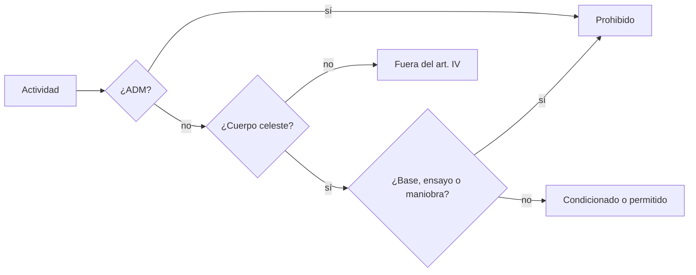

# B119-C11 — Uso pacífico y limitaciones militares

<!-- nav:top -->
[🏠 Programa](../../../../README.md) · [📚 Bloque B119](../../../tronco-comun/B119-derecho-seguridad-y-geopolitica-espacial.md) · [← Anterior: B119-C10 — Responsabilidad por daños espaciales](../B119-C10-responsabilidad-por-danos-espaciales/CLASE.md) · [Siguiente: B119-C12 — Historia de competencia estratégica espacial →](../B119-C12-historia-de-competencia-estrategica-espacial/CLASE.md)
<!-- /nav -->

## 1. Ubicación, nivel y alcance

Clase 11 del bloque B119. Nivel N3. El art. IV del tratado de 1967 impone dos límites distintos: ninguna arma de destrucción masiva en órbita, en cuerpos celestes ni en el espacio, y uso exclusivamente pacífico de la Luna y de los demás cuerpos celestes. Aquí conviertes el artículo en un árbol de decisión, lo comparas con una segunda implementación en forma de lista de reglas sobre 24 combinaciones y aprendes dónde termina lo que el artículo dice y empieza lo que **no** se consultó. **Esta clase es educativa: no es asesoría legal, regulatoria ni financiera y no sustituye a un jurista, a una autoridad competente ni a un asesor.**

## 2. Por qué esta clase existe

C01 reduce el art. IV a una regla booleana; esta clase lo desagrega por ubicación y propósito y conecta con el art. 3 del Acuerdo sobre la Luna, y deja explícito lo no consultado. La decisión central: **¿en qué ubicaciones y con qué atributos una actividad cae en lo prohibido, lo condicionado o lo permitido por el art. IV, y qué queda fuera?**

## 3. Lo que podrás hacer al terminar

1. Enunciar las dos obligaciones del art. IV y la excepción del personal militar científico.
2. Implementar el artículo como árbol de decisión y como lista de reglas.
3. Verificar que ambas coinciden en las 24 combinaciones de atributos.
4. Distinguir lo prohibido, lo condicionado, lo permitido y lo que el artículo no regula.
5. Separar lo consultado (texto normativo con versión y fecha) de lo sintético o ilustrativo.

La evidencia es la **árbol de clasificación verificado con tabla de verdad** del ejercicio 12 (sección 20).

## 4. Con qué llegas y cómo comprobarlo

1. ¿Qué es un árbol de decisión?
2. ¿Qué es una tabla de verdad?
3. ¿Qué es un arma de destrucción masiva?
4. ¿Qué significa «fines pacíficos»?
5. ¿Qué es una verificación por segunda vía?

<details>
<summary>Ver respuestas</summary>

1. Una secuencia de preguntas que lleva a una clasificación. 2. La lista de todas las combinaciones de valores y su resultado. 3. Un arma nuclear, química, biológica u otra de efectos masivos. 4. Su interpretación jurídica es debatida; el artículo no la define en lo consultado. 5. Resolver el mismo problema con otra implementación y comparar.
</details>

Con cuatro o cinco aciertos, sigue; si no, repasa los prerrequisitos.

## 5. Un caso de contexto y casos de referencia

La nota de la ONU (consultada el 2026-11-11) resume el art. IV: ni armas nucleares ni otras de destrucción masiva en órbita, en cuerpos celestes o en el espacio; la Luna y los cuerpos celestes, solo para fines pacíficos, con personal y equipo militar admitidos para investigación científica o exploración pacífica. La página de UNOOSA del Acuerdo sobre la Luna (art. 3) añade: sin bases militares, ensayos de armas ni maniobras militares en la Luna. **No se consultaron** las interpretaciones sobre armas convencionales en órbita ni la práctica de los Estados. El **ejemplo conductor** son cinco actividades sintéticas: de la prohibida a la perfectamente civil.

## 6. Vocabulario

**ADM** son armas de destrucción masiva. **Condicionado** significa permitido solo con el propósito científico o pacífico. **Fuera del art. IV** significa que el artículo no la regula expresamente (no que esté permitida). Un **cuerpo celeste** incluye la Luna. Una **lista de reglas** evalúa condiciones en orden.

## 7. Modelo mental



*Descripción textual:* primero se pregunta por armas de destrucción masiva; luego por el cuerpo celeste; por último por bases o ensayos; el resultado puede ser prohibido, condicionado, permitido o fuera del artículo.

Analogía: un cartel de una reserva natural con prohibiciones absolutas y otras según la zona. Límite: «fines pacíficos» y los usos militares en órbita son debatidos y esta clase no toma partido.

## 8. La explicación, paso a paso

### 8.1 El árbol

(1) ¿Lleva ADM? Prohibido. (2) ¿Está en un cuerpo celeste? Si no, queda fuera del art. IV. (3) ¿Hay base, ensayo o maniobra militar? Prohibido. (4) ¿Hay personal militar para ciencia? Condicionado. En otro caso, permitido.

### 8.2 Las 24 combinaciones

Resultado: `14` prohibidas, `1` condicionadas, `1` permitidas y `8` fuera del art. IV (de `24`). Ambas implementaciones coinciden en todas.

### 8.3 Cinco actividades

ADM en órbita: prohibido; base militar en la Luna: prohibido; científicos militares en la Luna: condicionado; telescopio civil en un asteroide: permitido; satélite de observación en órbita: fuera del art. IV.

### 8.4 Lo que no dice el modelo

«Fuera del art. IV» no significa «lícito»: otros instrumentos y la práctica pueden aplicar (C17, C26, C28).

## 9. Magnitudes, símbolos y unidades

| Símbolo | Qué es | Unidad | Valor / nota |
|---|---|---|---|
| `loc` | ubicación | — | 3 valores |
| `wmd` | ADM presentes | 0/1 | — |
| `inst` | base, ensayo o maniobra | 0/1 | — |
| `pers` | personal militar científico | 0/1 | — |

## 10. Convenciones y referencias

Categorías: prohibido, condicionado, permitido, fuera del art. IV. Actividades sintéticas.

## 11. De dónde sale lo que afirmamos

| ID | Fuente | Localizador | Respalda | Estado |
|---|---|---|---|---|
| S3 | ONU, Biblioteca Audiovisual de Derecho Internacional, nota introductoria sobre el Tratado del Espacio Ultraterrestre, https://legal.un.org/avl/ha/tos/tos.html (WebFetch, consultada 2026-11-11; no discute los artículos V ni VII) | art. IV | ADM y uso pacífico de cuerpos celestes; excepción científica | Consultada |
| S2 | UNOOSA, «Agreement Governing the Activities of States on the Moon and Other Celestial Bodies» (página oficial), https://www.unoosa.org/oosa/en/ourwork/spacelaw/treaties/moon-agreement.html (WebFetch, consultada 2026-11-11) | art. 3 del Acuerdo sobre la Luna | sin bases, ensayos ni maniobras militares en la Luna | Consultada |
| — | Doctrina y práctica sobre armas convencionales en órbita | — | no consultada | No consultado / ilustrativo |
| — | Actividades de ejemplo | — | sintéticas | No consultado / ilustrativo |

Límites: el modelo no toma posición sobre usos militares no mencionados en lo consultado; el Acuerdo sobre la Luna no vincula a todos los Estados. Texto normativo parafraseado de las páginas oficiales en la fecha indicada; el texto vinculante es el de la fuente oficial vigente.

## 12. Cómo ver la situación

| Magnitud | Valor |
|---|---|
| Prohibidas | 14 de 24 |
| Condicionadas | 1 |
| Permitidas | 1 |
| Fuera del art. IV | 8 |

Descripción larga: un tercio de las combinaciones (las que no ocurren en un cuerpo celeste y no llevan ADM) queda fuera del artículo; el tratado fija pocos límites concretos.

## 13. Ejemplo trabajado: científicos militares en la Luna

**Paso 1.** `loc = cuerpo celeste`, `wmd = 0`, `inst = 0`, `pers = 1`. **Paso 2.** Sin ADM; hay cuerpo celeste; sin base. **Paso 3.** Personal militar en ciencia: `condicionado`. **Paso 4.** La lista de reglas da el mismo resultado.

## 14. Distintas formas de describirlo

**Por ubicación:** órbita, cuerpo celeste, otro. **Por arma:** ADM o no. **Por propósito:** pacífico, científico, militar. **Por resultado:** cuatro categorías.

## 15. Práctica guiada

**Ejercicio 1 · con los pasos indicados.** Clasifica «ADM en la Luna».

<details><summary>Solución comentada</summary>

Prohibido (la regla de ADM aplica en cualquier ubicación).
</details>

**Ejercicio 2 · con una pista.** Clasifica «base militar en un asteroide». *Pista:* es un cuerpo celeste.

<details><summary>Solución comentada</summary>

Prohibido.
</details>

**Ejercicio 3 · casi autónomo.** Clasifica «investigador militar en la Luna».

<details><summary>Solución comentada</summary>

Condicionado.
</details>

## 16. Práctica autónoma, transferencia e integrador

**Ejercicio 4 · autónomo.** Cuenta las combinaciones con ADM.

<details><summary>Solución comentada</summary>

12 de 24 (la mitad).
</details>

**Ejercicio 5 · autónomo.** ¿Cuántas combinaciones fuera del art. IV hay?

<details><summary>Solución comentada</summary>

`8`.
</details>

**Ejercicio 6 · autónomo.** ¿Qué combinaciones de cuerpo celeste son permitidas?

<details><summary>Solución comentada</summary>

Sin ADM, sin base y sin personal militar: 1 de 8.
</details>

**Ejercicio 7 · autónomo.** Añade el atributo «maniobra militar» como un `inst` más. ¿Cambia el árbol?

<details><summary>Solución comentada</summary>

No: `inst` ya agrupa base, ensayo y maniobra.
</details>

**Ejercicio 8 · autónomo.** ¿Qué no se consultó sobre el art. IV?

<details><summary>Solución comentada</summary>

Las interpretaciones sobre armas convencionales en órbita y la práctica de los Estados.
</details>

**Ejercicio 9 · transferencia.** **Transferencia.** ¿Por qué «fuera del art. IV» no es sinónimo de permitido?

<details><summary>Solución comentada</summary>

Porque otros tratados, normas y la Carta pueden aplicar.
</details>

**Ejercicio 10 · transferencia.** **Transferencia.** ¿Por qué se verifican dos implementaciones?

<details><summary>Solución comentada</summary>

Para detectar errores de traducción del artículo a código.
</details>

**Ejercicio 11 · transferencia.** **Transferencia.** Un Estado no parte del Acuerdo sobre la Luna, ¿queda obligado por su art. 3?

<details><summary>Solución comentada</summary>

No por el solo hecho del acuerdo; el art. IV del tratado de 1967 sí aplica a sus partes.
</details>

**Ejercicio 12 · integrador.** **Integrador.** Elabora tu *árbol de clasificación verificado con tabla de verdad*: reglas, 24 combinaciones, cinco actividades y aviso de que es educativo.

<details><summary>Solución comentada</summary>

Secciones 8.1–8.4 y la salida del laboratorio.
</details>

## 17. Laboratorio: árbol del art. IV y tabla de verdad

El script [laboratorio.py](laboratorio.py) implementa el artículo como árbol y como lista de reglas y compara 24 combinaciones (**comprueba** que coinciden todas).

**Datos:** art. IV y art. 3 parafraseados (consultados 2026-11-11); actividades **sintéticas**. **Predice antes de ejecutar:** ¿cuántas de las 24 combinaciones quedarán fuera del art. IV? (un tercio del total.) **Ejecución del 2026-11-11 (Python 3.12.9):**

```text
Python 3.12.9 (biblioteca estandar)
Actividades SINTETICAS; art. IV parafraseado de legal.un.org (consultada 2026-11-11); armas convencionales en orbita: NO consultado.
Combinaciones: 24  coinciden: 24
  prohibido     14
  condicionado   1
  permitido      1
  fuera_art_IV   8
  ADM en orbita                      -> prohibido
  Base militar en la Luna            -> prohibido
  Cientificos militares en la Luna   -> condicionado
  Telescopio civil en un asteroide   -> permitido
  Satelite de observacion en orbita  -> fuera_art_IV
CLAVES {"proh": 14, "cond": 1, "perm": 1, "fuera": 8, "tot": 24}
Pruebas superadas.
```

```bash
python programa/clases/B119/B119-C11-uso-pacifico-y-limitaciones-militares/laboratorio.py
```

**Límites:** no modela interpretaciones doctrinales ni armas convencionales; no opina sobre ninguna conducta real.

## 18. Errores frecuentes y cómo corregirlos

**Leer «no regulado» como «permitido».** Se corrige con 8.4.

**Aplicar el uso pacífico a la órbita terrestre.** Se corrige con 8.1.

**Olvidar la excepción científica.** Se corrige con el ejercicio 3.

**Dar por vinculante el Acuerdo sobre la Luna para todos.** Se corrige con el ejercicio 11.

## 19. Cómo sabrás que vas bien

Tras la sección 8: ¿qué resultado esperabas en el ejemplo trabajado y cuál obtuviste? Si dudas, repasa la sección 13. Tras el laboratorio: ¿qué comprueba cada prueba? (ver la sección 17).

## 20. Qué entregas y cómo se evalúa

El producto es tu **árbol de clasificación verificado con tabla de verdad** (ejercicio 12).

| Criterio | Inicial | En desarrollo | Logrado | Destacado |
|---|---|---|---|---|
| Conceptos | Los confunde | Parciales | Usa el vocabulario con precisión | Explica los límites del modelo |
| Cálculo | Sin unidades | Con errores | Resultados con unidades y tolerancia | Calcula casos nuevos |
| Verificación | Sin comprobar | Un caso | Contraste con una segunda vía | Interpreta las diferencias |
| Fuentes | Sin fuente | Sin fecha | Fuentes con versión, fecha y estado | Declara lo sintético y lo no consultado |
| Límites | No los nombra | Uno | Tres | Discute qué falta del modelo |

**Condiciones críticas (no se compensan con promedio):** citar la versión y la fecha del texto normativo consultado; rotular lo sintético y lo ilustrativo; no presentar un resultado como asesoría legal, regulatoria o financiera.

## 21. Ética, seguridad y límites

Clase educativa: **no es asesoría legal, regulatoria ni financiera**; no sustituye a un abogado, a la autoridad competente ni a un asesor, y ningún resultado debe usarse para decidir sobre una licencia, una reclamación, un contrato o una operación real. Es un ejercicio de lectura de texto; no se evalúa la conducta de ningún Estado. Los modelos son simplificados y sus datos son sintéticos o ilustrativos; lo simulado nunca se presenta como observado. Accesibilidad: tablas equivalentes a las gráficas, fórmulas en texto, ejercicios sin conexión.

## 22. Para cerrar y seguir

De 24 combinaciones, `14` están prohibidas y `8` quedan fuera del artículo. Queda una pregunta: ¿cómo se llegó históricamente a estas reglas y por qué dejaron esos huecos?

**Glosario español–inglés.** armas de destrucción masiva · *weapons of mass destruction*; fines pacíficos · *peaceful purposes*; cuerpo celeste · *celestial body*; árbol de decisión · *decision tree*.

**Continuidad.** [B119-C12](../B119-C12-historia-de-competencia-estrategica-espacial/CLASE.md): la historia de la competencia estratégica espacial.

**Referencias:** ver sección 11.

<!-- nav:bottom -->
---

[← Anterior: B119-C10 — Responsabilidad por daños espaciales](../B119-C10-responsabilidad-por-danos-espaciales/CLASE.md) · [📚 Bloque B119](../../../tronco-comun/B119-derecho-seguridad-y-geopolitica-espacial.md) · [Siguiente: B119-C12 — Historia de competencia estratégica espacial →](../B119-C12-historia-de-competencia-estrategica-espacial/CLASE.md)
<!-- /nav -->
