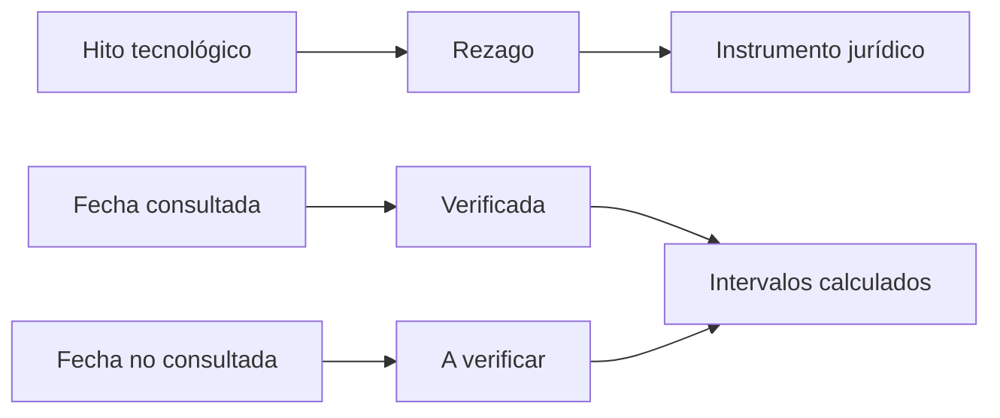

# B119-C12 — Historia de competencia estratégica espacial

<!-- nav:top -->
[🏠 Programa](../../../../README.md) · [📚 Bloque B119](../../../tronco-comun/B119-derecho-seguridad-y-geopolitica-espacial.md) · [← Anterior: B119-C11 — Uso pacífico y limitaciones militares](../B119-C11-uso-pacifico-y-limitaciones-militares/CLASE.md) · [Siguiente: B119-C13 — Vigilancia y conciencia situacional espacial →](../../../tronco-comun/B119-derecho-seguridad-y-geopolitica-espacial.md#b119-c13)
<!-- /nav -->

## 1. Ubicación, nivel y alcance

Clase 12 del bloque B119. Nivel N3. La competencia estratégica entre potencias moldeó el derecho del espacio: los tratados llegaron después de los primeros satélites y avanzaron más lentos a medida que los intereses divergían. Aquí construyes una cronología con fechas consultadas y fechas no consultadas rotuladas como tales, y calculas los intervalos entre hitos con dos métodos independientes de diferencia de fechas. **Esta clase es educativa: no es asesoría legal, regulatoria ni financiera y no sustituye a un jurista, a una autoridad competente ni a un asesor.**

## 2. Por qué esta clase existe

Para leer el derecho vigente conviene saber qué contexto lo produjo; ninguna clase anterior da la cronología comparada entre la tecnología y los instrumentos jurídicos. La decisión central: **¿cuánto tardó el derecho en seguir a la tecnología y por qué importa distinguir fechas verificadas de fechas recordadas?**

## 3. Lo que podrás hacer al terminar

1. Ubicar en el tiempo los hitos tecnológicos y los instrumentos jurídicos, separando lo consultado de lo no consultado.
2. Calcular intervalos con `datetime` y con el número de día juliano.
3. Calcular el intervalo entre aprobaciones de tratados sucesivos.
4. Formular una pregunta de investigación que la cronología sugiere pero no responde.
5. Separar lo consultado (texto normativo con versión y fecha) de lo sintético o ilustrativo.

La evidencia es la **línea de tiempo con intervalos calculados** del ejercicio 12 (sección 20).

## 4. Con qué llegas y cómo comprobarlo

1. ¿Qué es una cronología?
2. ¿Qué es el número de día juliano?
3. ¿Cuántos días tiene el año medio gregoriano?
4. ¿Qué es una fuente primaria?
5. ¿Qué es correlación frente a causalidad?

<details>
<summary>Ver respuestas</summary>

1. Una lista ordenada de hechos con fecha. 2. Un conteo continuo de días usado para restar fechas. 3. 365,2425. 4. Un documento original o un registro oficial del hecho. 5. Dos hechos cercanos en el tiempo no prueban que uno cause el otro.
</details>

Con cuatro o cinco aciertos, sigue; si no, repasa los prerrequisitos.

## 5. Un caso de contexto y casos de referencia

Fechas consultadas (2026-11-11): COPUOS ad hoc el 13-12-1958 y permanente el 12-12-1959 (resumen de búsqueda de UNOOSA); el Tratado del Espacio Ultraterrestre aprobado el 19-12-1966 y en vigor el 10-10-1967 (nota de legal.un.org); el Convenio de Registro aprobado el 12-11-1974 y el Acuerdo sobre la Luna el 5-12-1979 (UNOOSA). Las fechas del Sputnik 1, el Explorer 1, el vuelo de Gagarin y el Apollo 11 son **hechos históricos conocidos que no se consultaron en esta sesión** y deben verificarse. El **ejemplo conductor** es la línea de tiempo de diez hitos.

## 6. Vocabulario

Un **hito** es un hecho fechado. El **rezago normativo** es el tiempo entre una tecnología y su regulación. El **día juliano** es un conteo continuo de días. **Competencia estratégica** es la rivalidad entre Estados por ventaja de seguridad, poder o prestigio. Una **fuente primaria** es el documento original.

## 7. Modelo mental



*Descripción textual:* cada hito técnico precede a un instrumento jurídico tras un rezago; las fechas se separan en consultadas y no consultadas antes de calcular intervalos.

Analogía: un mapa del tráfico: las normas llegan después de que los coches ya circulan. Límite: la cronología muestra orden, no causas.

## 8. La explicación, paso a paso

### 8.1 Hitos y fuentes

De los diez hitos, seis tienen fecha consultada y cuatro no. Los intervalos que usan fechas no consultadas se rotulan.

### 8.2 Intervalos

Sputnik 1 → entrada en vigor del tratado de 1967: `10.02` años (`3658` días). Sputnik 1 → COPUOS ad hoc: `14.3` meses. Sputnik 1 → Acuerdo sobre la Luna: `22.17` años.

### 8.3 Entre tratados

Entre las aprobaciones de 1966, 1974 y 1979 pasan `7.90` y `5.06` años (media `6.48`). Con solo tres fechas consultadas no se puede inferir una tendencia: faltan los convenios de salvamento y de responsabilidad, no consultados.

### 8.4 Lo que no se puede concluir

La cronología no explica por qué los tratados se aprobaron entre 1966 y 1979; sugiere una pregunta (¿qué intereses y qué agenda los impulsaron?) que requiere fuentes históricas.

## 9. Magnitudes, símbolos y unidades

| Símbolo | Qué es | Unidad | Valor / nota |
|---|---|---|---|
| `Δt` | intervalo entre hitos | días / años | — |
| año medio | días por año gregoriano | d | 365,2425 |
| mes medio | días por mes | d | 30,436875 |
| `JDN` | número de día juliano | d | — |

## 10. Convenciones y referencias

Fechas ISO 8601 (calendario gregoriano); intervalos en días y años. «Consultada» = vista en la fuente indicada el 2026-11-11.

## 11. De dónde sale lo que afirmamos

| ID | Fuente | Localizador | Respalda | Estado |
|---|---|---|---|---|
| S3 | ONU, Biblioteca Audiovisual de Derecho Internacional, nota introductoria sobre el Tratado del Espacio Ultraterrestre, https://legal.un.org/avl/ha/tos/tos.html (WebFetch, consultada 2026-11-11; no discute los artículos V ni VII) | fechas del tratado de 1967 | aprobación 19-12-1966; en vigor 10-10-1967 | Consultada |
| S1 | UNOOSA, «Convention on Registration of Objects Launched into Outer Space» (página oficial), https://www.unoosa.org/oosa/en/ourwork/spacelaw/treaties/registration-convention.html (WebFetch, consultada 2026-11-11) | adopción del convenio de registro | 12-11-1974 | Consultada |
| S2 | UNOOSA, «Agreement Governing the Activities of States on the Moon and Other Celestial Bodies» (página oficial), https://www.unoosa.org/oosa/en/ourwork/spacelaw/treaties/moon-agreement.html (WebFetch, consultada 2026-11-11) | adopción del Acuerdo sobre la Luna | 5-12-1979 | Consultada |
| S7 | UNOOSA, páginas sobre COPUOS (resoluciones 1348 (XIII) de 1958 y 1472 (XIV) de 1959; subcomités), resumen de búsqueda web, 2026-11-11 | fechas de COPUOS | 13-12-1958 y 12-12-1959 (resumen de búsqueda) | Resumen de búsqueda |
| — | Fechas de Sputnik 1, Explorer 1, Gagarin y Apollo 11 | — | hechos conocidos, no consultados; a verificar en fuente primaria | No consultado / ilustrativo |
| — | Causas del ritmo de los tratados | — | no consultadas | No consultado / ilustrativo |

Límites: cuatro de diez fechas no se consultaron; no se consultó historiografía. Texto normativo parafraseado de las páginas oficiales en la fecha indicada; el texto vinculante es el de la fuente oficial vigente.

## 12. Cómo ver la situación

| Magnitud | Valor |
|---|---|
| Sputnik 1 → tratado en vigor | 10.02 años |
| Sputnik 1 → COPUOS ad hoc | 14.3 meses |
| Entre aprobaciones | 7.90 y 5.06 años |
| Hitos con fecha consultada | 6 de 10 |

Descripción larga: el derecho llega un año después del primer satélite en la ONU y una década después en forma de tratado vigente; los otros dos tratados consultados llegan con intervalos de ocho y cinco años.

## 13. Ejemplo trabajado: del satélite al tratado

**Paso 1.** `1957-10-04` → `1967-10-10`. **Paso 2.** Diferencia: `3658` días. **Paso 3.** `/365,2425 = 10.02` años. **Paso 4.** El método juliano da el mismo número de días.

## 14. Distintas formas de describirlo

**Por tipo:** tecnológico o jurídico. **Por fuente:** consultada o no. **Por intervalo:** días, meses, años. **Por ritmo:** media entre tratados.

## 15. Práctica guiada

**Ejercicio 1 · con los pasos indicados.** Cuenta los meses entre el Sputnik 1 y COPUOS ad hoc.

<details><summary>Solución comentada</summary>

`14.3` meses.
</details>

**Ejercicio 2 · con una pista.** Calcula el intervalo entre la aprobación y la entrada en vigor del tratado de 1967.

<details><summary>Solución comentada</summary>

`1966-12-19` → `1967-10-10`: 295 días.
</details>

**Ejercicio 3 · casi autónomo.** Convierte 295 días a años. *Pista:* `/365,2425`.

<details><summary>Solución comentada</summary>

`0,81` años.
</details>

## 16. Práctica autónoma, transferencia e integrador

**Ejercicio 4 · autónomo.** Calcula el intervalo entre el Convenio de Registro y el Acuerdo sobre la Luna.

<details><summary>Solución comentada</summary>

`5.06` años.
</details>

**Ejercicio 5 · autónomo.** Calcula la media de los dos intervalos entre tratados.

<details><summary>Solución comentada</summary>

`6.48` años.
</details>

**Ejercicio 6 · autónomo.** ¿Qué hitos usan fechas no consultadas?

<details><summary>Solución comentada</summary>

Sputnik 1, Explorer 1, Gagarin y Apollo 11.
</details>

**Ejercicio 7 · autónomo.** ¿Por qué se calcula la diferencia con dos métodos?

<details><summary>Solución comentada</summary>

Para detectar errores de cálculo de fechas.
</details>

**Ejercicio 8 · autónomo.** Si el Acuerdo sobre la Luna se hubiera aprobado diez años antes, ¿qué intervalo resultaría desde el Sputnik 1?

<details><summary>Solución comentada</summary>

`22.17 − 10` años, unos 12 años.
</details>

**Ejercicio 9 · transferencia.** **Transferencia.** ¿Qué pregunta de investigación sugiere el ritmo de aprobación de los tratados?

<details><summary>Solución comentada</summary>

¿Por qué se concentró entre 1966 y 1979 y qué ocurrió después? Con tres fechas no puede responderse.
</details>

**Ejercicio 10 · transferencia.** **Transferencia.** ¿Por qué rotular fechas no consultadas aunque sean conocidas?

<details><summary>Solución comentada</summary>

Porque el programa distingue lo verificado de lo recordado.
</details>

**Ejercicio 11 · transferencia.** **Transferencia.** ¿Qué otras fuentes necesitarías para explicar el rezago?

<details><summary>Solución comentada</summary>

Historia diplomática y actas de la negociación.
</details>

**Ejercicio 12 · integrador.** **Integrador.** Elabora tu *línea de tiempo con intervalos calculados*: diez hitos con estado de fuente, tres intervalos y la pregunta que dejan abierta, con aviso de que es educativa.

<details><summary>Solución comentada</summary>

Secciones 8.1–8.4 y la salida del laboratorio.
</details>

## 17. Laboratorio: cronología e intervalos con dos métodos

El script [laboratorio.py](laboratorio.py) calcula el tiempo desde el Sputnik 1 hasta cada hito y los intervalos entre tratados (**comprueba** `datetime` contra el día juliano).

**Datos:** fechas de tratados y de COPUOS consultadas (2026-11-11); cuatro fechas históricas **no consultadas**. **Predice antes de ejecutar:** ¿cuántos años pasan del Sputnik 1 a la entrada en vigor del tratado? (algo más de diez.) **Ejecución del 2026-11-11 (Python 3.12.9):**

```text
Python 3.12.9 (biblioteca estandar)
Cronologia: fechas marcadas 'consultada' vienen de UNOOSA/legal.un.org (2026-11-11); las otras NO se consultaron.
Sputnik 1 (no consultada)                      1957-10-04  +     0 d =   0.00 anos desde Sputnik 1
Explorer 1 (no consultada)                     1958-01-31  +   119 d =   0.33 anos desde Sputnik 1
COPUOS ad hoc (consultada)                     1958-12-13  +   435 d =   1.19 anos desde Sputnik 1
COPUOS permanente (consultada)                 1959-12-12  +   799 d =   2.19 anos desde Sputnik 1
Gagarin (no consultada)                        1961-04-12  +  1286 d =   3.52 anos desde Sputnik 1
OST aprobado (consultada)                      1966-12-19  +  3363 d =   9.21 anos desde Sputnik 1
OST en vigor (consultada)                      1967-10-10  +  3658 d =  10.02 anos desde Sputnik 1
Apollo 11 (no consultada)                      1969-07-20  +  4307 d =  11.79 anos desde Sputnik 1
Convenio de Registro aprobado (consultada)     1974-11-12  +  6248 d =  17.11 anos desde Sputnik 1
Acuerdo sobre la Luna aprobado (consultada)    1979-12-05  +  8097 d =  22.17 anos desde Sputnik 1
Sputnik 1 -> OST en vigor: 10.02 anos ; Sputnik 1 -> Acuerdo sobre la Luna aprobado: 22.17 anos ; Sputnik 1 -> COPUOS ad hoc: 14.3 meses
Entre OST, Registro y Luna (aprobaciones): 7.90 y 5.06 anos ; media 6.48
CLAVES {"a": "10.02", "b": "22.17", "c": "14.3", "i1": "7.90", "i2": "5.06", "m": "6.48", "dias_ost": 3658}
Pruebas superadas.
```

```bash
python programa/clases/B119/B119-C12-historia-de-competencia-estrategica-espacial/laboratorio.py
```

**Límites:** solo cronología; sin causalidad; cuatro fechas por verificar.

## 18. Errores frecuentes y cómo corregirlos

**Dar por verificada una fecha recordada.** Se corrige con 8.1.

**Contar mal años bisiestos.** Se corrige con el método juliano.

**Confundir aprobación con entrada en vigor.** Se corrige con el ejercicio 2.

**Inferir causas de la cronología.** Se corrige con 8.4.

## 19. Cómo sabrás que vas bien

Tras la sección 8: ¿qué resultado esperabas en el ejemplo trabajado y cuál obtuviste? Si dudas, repasa la sección 13. Tras el laboratorio: ¿qué comprueba cada prueba? (ver la sección 17).

## 20. Qué entregas y cómo se evalúa

El producto es tu **línea de tiempo con intervalos calculados** (ejercicio 12).

| Criterio | Inicial | En desarrollo | Logrado | Destacado |
|---|---|---|---|---|
| Conceptos | Los confunde | Parciales | Usa el vocabulario con precisión | Explica los límites del modelo |
| Cálculo | Sin unidades | Con errores | Resultados con unidades y tolerancia | Calcula casos nuevos |
| Verificación | Sin comprobar | Un caso | Contraste con una segunda vía | Interpreta las diferencias |
| Fuentes | Sin fuente | Sin fecha | Fuentes con versión, fecha y estado | Declara lo sintético y lo no consultado |
| Límites | No los nombra | Uno | Tres | Discute qué falta del modelo |

**Condiciones críticas (no se compensan con promedio):** citar la versión y la fecha del texto normativo consultado; rotular lo sintético y lo ilustrativo; no presentar un resultado como asesoría legal, regulatoria o financiera.

## 21. Ética, seguridad y límites

Clase educativa: **no es asesoría legal, regulatoria ni financiera**; no sustituye a un abogado, a la autoridad competente ni a un asesor, y ningún resultado debe usarse para decidir sobre una licencia, una reclamación, un contrato o una operación real. La cronología no atribuye intenciones a ningún Estado; los hechos históricos requieren fuentes primarias. Los modelos son simplificados y sus datos son sintéticos o ilustrativos; lo simulado nunca se presenta como observado. Accesibilidad: tablas equivalentes a las gráficas, fórmulas en texto, ejercicios sin conexión.

## 22. Para cerrar y seguir

El derecho tardó `10.02` años en llegar al tratado vigente y los otros dos tratados consultados llegaron con intervalos de `7.90` y `5.06` años. Queda una pregunta: ¿qué observamos hoy del dominio espacial para hacer cumplir o vigilar esas normas?

**Glosario español–inglés.** hito · *milestone*; rezago normativo · *regulatory lag*; día juliano · *Julian day number*; competencia estratégica · *strategic competition*.

**Continuidad.** [B119-C13](../B119-C13-vigilancia-y-conciencia-situacional-espacial/CLASE.md): la vigilancia y conciencia situacional espacial.

**Referencias:** ver sección 11.

<!-- nav:bottom -->
---

[← Anterior: B119-C11 — Uso pacífico y limitaciones militares](../B119-C11-uso-pacifico-y-limitaciones-militares/CLASE.md) · [📚 Bloque B119](../../../tronco-comun/B119-derecho-seguridad-y-geopolitica-espacial.md) · [Siguiente: B119-C13 — Vigilancia y conciencia situacional espacial →](../../../tronco-comun/B119-derecho-seguridad-y-geopolitica-espacial.md#b119-c13)
<!-- /nav -->
