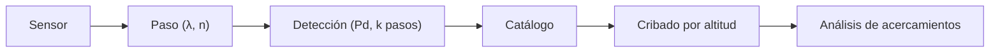

# B119-C13 — Vigilancia y conciencia situacional espacial

<!-- nav:top -->
[🏠 Programa](../../../../README.md) · [📚 Bloque B119](../../../tronco-comun/B119-derecho-seguridad-y-geopolitica-espacial.md) · [← Anterior: B119-C12 — Historia de competencia estratégica espacial](../B119-C12-historia-de-competencia-estrategica-espacial/CLASE.md) · [Siguiente: B119-C14 — Amenazas cibernéticas a satélites →](../B119-C14-amenazas-ciberneticas-a-satelites/CLASE.md)
<!-- /nav -->

## 1. Ubicación, nivel y alcance

Clase 13 del bloque B119. Nivel N3. No se puede aplicar ni vigilar una norma sobre objetos que no se ven. Esta clase estudia la conciencia situacional espacial como problema cuantitativo: cuánto dura el paso de un objeto sobre un sensor, con qué probabilidad se detecta tras varios pasos y cómo un cribado por altitud reduce la cantidad de pares que hay que comparar en un catálogo sintético de 2000 objetos. **Esta clase es educativa: no es asesoría legal, regulatoria ni financiera y no sustituye a un jurista, a una autoridad competente ni a un asesor.**

## 2. Por qué esta clase existe

El art. VI del Convenio de Registro prevé ayuda en la identificación mediante medios de rastreo; ninguna clase anterior muestra qué cubre un sensor ni cómo se criba un catálogo. La conciencia situacional de la tripulación es otra (B111-C04). La decisión central: **¿qué cobertura da un sensor y cómo se reduce el trabajo de buscar acercamientos peligrosos?**

## 3. Lo que podrás hacer al terminar

1. Describir el papel de los medios de rastreo en la identificación de objetos (art. VI, consultado).
2. Calcular el ángulo central de visibilidad y la duración máxima de un paso.
3. Calcular la probabilidad de detectar al menos una vez en `k` pasos.
4. Aplicar y verificar un cribado por altitud contra la fuerza bruta.
5. Separar lo consultado (texto normativo con versión y fecha) de lo sintético o ilustrativo.

La evidencia es la **ficha de cobertura de una red de sensores sintética** del ejercicio 12 (sección 20).

## 4. Con qué llegas y cómo comprobarlo

1. ¿Qué es la elevación mínima?
2. ¿Qué es el movimiento medio?
3. ¿Qué es un cribado?
4. ¿Cuántos pares hay entre `N` objetos?
5. ¿Qué es la probabilidad de detección?

<details>
<summary>Ver respuestas</summary>

1. El ángulo sobre el horizonte bajo el cual el sensor no observa. 2. La velocidad angular orbital `n = √(GM/a³)`. 3. Un filtro barato que descarta candidatos imposibles antes de un cálculo caro. 4. `N(N−1)/2`. 5. La de que el sensor registre el objeto en un paso.
</details>

Con cuatro o cinco aciertos, sigue; si no, repasa los prerrequisitos.

## 5. Un caso de contexto y casos de referencia

El art. VI del Convenio de Registro (UNOOSA, consultado el 2026-11-11) dice que si un Estado no puede identificar un objeto que lo dañó o es peligroso, otros Estados partes, en especial los con medios de rastreo, ayudan en la medida de lo razonable. **No se consultó ningún catálogo ni red de vigilancia real.** El **ejemplo conductor**: un sensor sintético que observa objetos a 550 km con elevación mínima de 10°, y 2000 objetos sintéticos con altitudes circulares entre 400 y 1200 km.

## 6. Vocabulario

La **conciencia situacional espacial** es el conocimiento actualizado de qué objetos hay y dónde. El **paso** es el intervalo en que un objeto es visible. El **ángulo central** `λ` es el ángulo en el centro de la Tierra entre el sensor y el límite de visibilidad. El **cribado** descarta pares lejanos. La **fuerza bruta** compara todos los pares.

## 7. Modelo mental



*Descripción textual:* el sensor ve pasos, los pasos dan detecciones que alimentan el catálogo, y el cribado reduce los pares que se analizan.

Analogía: un vigilante en una garita que ve un tramo de la calle: ve cada coche un rato, y para encontrar choques primero descarta los coches que van por calles distintas. Límite: un catálogo real tiene errores y objetos no cooperativos.

## 8. La explicación, paso a paso

### 8.1 Un paso

A 550 km: período `95.65 min`, ángulo central `14.96°`, paso máximo `477 s` (`7.95 min`). La fracción de la órbita en vista es `0.0831` para un paso cenital.

### 8.2 Detección acumulada

Con `Pd = 0,6` por paso, la probabilidad de al menos una detección en 3 pasos es `0.9360`.

### 8.3 Cribado

De `1999000` pares totales solo `49942` tienen altitudes a menos de 10 km: una reducción de `40.0` veces. El barrido ordenado da el mismo resultado que la fuerza bruta.

### 8.4 Límites

El cribado por altitud es válido para órbitas circulares; con elipses hay que comparar perigeo y apogeo (ver C10 y B118).

## 9. Magnitudes, símbolos y unidades

| Símbolo | Qué es | Unidad | Valor / nota |
|---|---|---|---|
| `h` | altitud del objeto | km | 550 |
| `ε` | elevación mínima | ° | 10 |
| `n` | movimiento medio | rad/s | — |
| `Pd` | prob. de detección por paso | — | 0,6 (sintético) |

## 10. Convenciones y referencias

Distancias en km; ángulos en grados o radianes según la fórmula; tiempos en s o min. Constantes estándar no consultadas.

## 11. De dónde sale lo que afirmamos

| ID | Fuente | Localizador | Respalda | Estado |
|---|---|---|---|---|
| S1 | UNOOSA, «Convention on Registration of Objects Launched into Outer Space» (página oficial), https://www.unoosa.org/oosa/en/ourwork/spacelaw/treaties/registration-convention.html (WebFetch, consultada 2026-11-11) | art. VI | ayuda en la identificación con medios de rastreo | Consultada |
| — | Catálogos y redes de vigilancia reales y su política de datos | — | no consultados | No consultado / ilustrativo |
| — | Geometría de visibilidad y movimiento medio | — | no consultados en una fuente concreta; verificados con el caso límite `ε = 90°` | No consultado / ilustrativo |
| — | Sensor y objetos | — | sintéticos | No consultado / ilustrativo |

Límites: no se consultó ninguna red real; el cribado es solo por altitud y con órbitas circulares sintéticas. Texto normativo parafraseado de las páginas oficiales en la fecha indicada; el texto vinculante es el de la fuente oficial vigente.

## 12. Cómo ver la situación

| Magnitud | Valor |
|---|---|
| Paso máximo | 477 s |
| Ángulo central | 14.96° |
| `P(≥1)` en 3 pasos | 0.9360 |
| Reducción del cribado | 40.0 veces |

Descripción larga: un paso dura unos minutos y un cribado simple descarta casi todos los pares sin perder ninguno.

## 13. Ejemplo trabajado: un paso a 550 km

**Paso 1.** `λ = arccos(R cos ε/(R+h)) − ε = 14.96°`. **Paso 2.** `n = √(GM/(R+h)³)`. **Paso 3.** `Δt = 2λ/n = 477 s`.

## 14. Distintas formas de describirlo

**Por geometría:** `λ`, paso. **Por probabilidad:** `Pd`, `k`. **Por escala:** pares totales y filtrados. **Por sensor:** cobertura y revisita.

## 15. Práctica guiada

**Ejercicio 1 · con los pasos indicados.** Calcula el número de pares de 2000 objetos.

<details><summary>Solución comentada</summary>

`1999000`.
</details>

**Ejercicio 2 · con una pista.** Explica por qué el cribado ordenado no pierde pares. *Pista:* dos altitudes ordenadas.

<details><summary>Solución comentada</summary>

Si `alt[j] − alt[i] > 10` para un `j`, los siguientes están aún más lejos.
</details>

**Ejercicio 3 · casi autónomo.** Calcula `P(≥1)` en 5 pasos con `Pd = 0,6`.

<details><summary>Solución comentada</summary>

`1 − 0,4^5 = 0,9898`.
</details>

## 16. Práctica autónoma, transferencia e integrador

**Ejercicio 4 · autónomo.** ¿Cuál es el ángulo central si `ε = 90°`?

<details><summary>Solución comentada</summary>

0: solo se ve el cenit.
</details>

**Ejercicio 5 · autónomo.** ¿Qué pasa con el paso si baja la elevación mínima a 5°?

<details><summary>Solución comentada</summary>

Aumenta `λ` y la duración.
</details>

**Ejercicio 6 · autónomo.** ¿Cuántos pasos hacen falta para `P(≥1) > 0,99` con `Pd = 0,6`?

<details><summary>Solución comentada</summary>

`ln 0,01/ln 0,4 = 5,03`: 6 pasos.
</details>

**Ejercicio 7 · autónomo.** ¿Qué reducción da el cribado?

<details><summary>Solución comentada</summary>

`40.0` veces.
</details>

**Ejercicio 8 · autónomo.** ¿Qué no consultaste de la vigilancia real?

<details><summary>Solución comentada</summary>

Ningún catálogo ni red.
</details>

**Ejercicio 9 · transferencia.** **Transferencia.** ¿Por qué el art. VI del Convenio de Registro depende de medios de rastreo?

<details><summary>Solución comentada</summary>

Para identificar un objeto causante hay que haberlo observado.
</details>

**Ejercicio 10 · transferencia.** **Transferencia.** ¿Qué riesgo hay en un cribado solo por altitud?

<details><summary>Solución comentada</summary>

Dejar fuera órbitas elípticas cuyas altitudes se cruzan.
</details>

**Ejercicio 11 · transferencia.** **Transferencia.** ¿Qué dilema plantea compartir datos de vigilancia?

<details><summary>Solución comentada</summary>

Transparencia para la seguridad frente a sensibilidad de las capacidades; ver C35.
</details>

**Ejercicio 12 · integrador.** **Integrador.** Elabora tu *ficha de cobertura de una red de sensores sintética*: paso, detección, cribado y aviso de que es educativa.

<details><summary>Solución comentada</summary>

Secciones 8.1–8.4 y la salida del laboratorio.
</details>

## 17. Laboratorio: paso de sensor y cribado por altitud

El script [laboratorio.py](laboratorio.py) calcula el paso, la detección acumulada y compara el cribado con la fuerza bruta en 2000 objetos (**comprueba** el caso límite y la igualdad de pares).

**Datos:** art. VI consultado (2026-11-11); sensor y objetos **sintéticos**; constantes estándar no consultadas. **Predice antes de ejecutar:** ¿cuántos minutos dura el paso máximo a 550 km con 10° de elevación mínima? (unos ocho.) **Ejecución del 2026-11-11 (Python 3.12.9):**

```text
Python 3.12.9 (biblioteca estandar)
Sensor y objetos SINTETICOS; art. VI del Convenio de Registro consultado (2026-11-11); ningun catalogo real consultado.
Orbita de 550 km: periodo 95.65 min ; angulo central 14.96 deg ; paso maximo 477 s = 7.95 min
Fraccion de la orbita en vista (si la traza pasa por el cenit): 0.0831
  Pd por paso 0.6: P(al menos una deteccion en 1 pasos) = 0.6000
  Pd por paso 0.6: P(al menos una deteccion en 3 pasos) = 0.9360
  Pd por paso 0.6: P(al menos una deteccion en 5 pasos) = 0.9898
Pares totales 1999000 ; con altitudes a menos de 10 km: 49942 (fuerza bruta) = 49942 (barrido ordenado) ; reduccion 40.0x
CLAVES {"T": "95.65", "lam": "14.96", "dur": "477", "durm": "7.95", "frac": "0.0831", "p3": "0.9360", "pares": 1999000, "fb": 49942, "red": "40.0"}
Pruebas superadas.
```

```bash
python programa/clases/B119/B119-C13-vigilancia-y-conciencia-situacional-espacial/laboratorio.py
```

**Límites:** órbitas circulares, un sensor, sin ruido de medida; no representa una red real.

## 18. Errores frecuentes y cómo corregirlos

**Mezclar grados y radianes.** Se corrige con la sección 10.

**Olvidar sumar `R` a la altitud.** Se corrige con la sección 8.1.

**Creer que más pasos aseguran detección.** Se corrige con el ejercicio 6.

**Cribar solo por altitud con elipses.** Se corrige con 8.4.

## 19. Cómo sabrás que vas bien

Tras la sección 8: ¿qué resultado esperabas en el ejemplo trabajado y cuál obtuviste? Si dudas, repasa la sección 13. Tras el laboratorio: ¿qué comprueba cada prueba? (ver la sección 17).

## 20. Qué entregas y cómo se evalúa

El producto es tu **ficha de cobertura de una red de sensores sintética** (ejercicio 12).

| Criterio | Inicial | En desarrollo | Logrado | Destacado |
|---|---|---|---|---|
| Conceptos | Los confunde | Parciales | Usa el vocabulario con precisión | Explica los límites del modelo |
| Cálculo | Sin unidades | Con errores | Resultados con unidades y tolerancia | Calcula casos nuevos |
| Verificación | Sin comprobar | Un caso | Contraste con una segunda vía | Interpreta las diferencias |
| Fuentes | Sin fuente | Sin fecha | Fuentes con versión, fecha y estado | Declara lo sintético y lo no consultado |
| Límites | No los nombra | Uno | Tres | Discute qué falta del modelo |

**Condiciones críticas (no se compensan con promedio):** citar la versión y la fecha del texto normativo consultado; rotular lo sintético y lo ilustrativo; no presentar un resultado como asesoría legal, regulatoria o financiera.

## 21. Ética, seguridad y límites

Clase educativa: **no es asesoría legal, regulatoria ni financiera**; no sustituye a un abogado, a la autoridad competente ni a un asesor, y ningún resultado debe usarse para decidir sobre una licencia, una reclamación, un contrato o una operación real. La clase no describe capacidades reales de vigilancia ni indica cómo evadirlas. Los modelos son simplificados y sus datos son sintéticos o ilustrativos; lo simulado nunca se presenta como observado. Accesibilidad: tablas equivalentes a las gráficas, fórmulas en texto, ejercicios sin conexión.

## 22. Para cerrar y seguir

Un paso sintético dura `7.95` min y el cribado reduce los pares `40.0` veces. Queda una pregunta: ¿qué amenazas no físicas afectan a esos mismos satélites?

**Glosario español–inglés.** conciencia situacional espacial · *space situational awareness*; paso · *pass*; cribado · *screening*; elevación mínima · *minimum elevation*.

**Continuidad.** [B119-C14](../B119-C14-amenazas-ciberneticas-a-satelites/CLASE.md): las amenazas cibernéticas a satélites.

**Referencias:** ver sección 11.

<!-- nav:bottom -->
---

[← Anterior: B119-C12 — Historia de competencia estratégica espacial](../B119-C12-historia-de-competencia-estrategica-espacial/CLASE.md) · [📚 Bloque B119](../../../tronco-comun/B119-derecho-seguridad-y-geopolitica-espacial.md) · [Siguiente: B119-C14 — Amenazas cibernéticas a satélites →](../B119-C14-amenazas-ciberneticas-a-satelites/CLASE.md)
<!-- /nav -->
