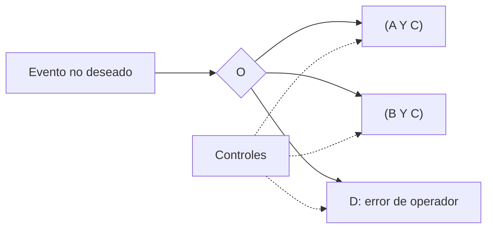

# B119-C14 — Amenazas cibernéticas a satélites

<!-- nav:top -->
[🏠 Programa](../../../../README.md) · [📚 Bloque B119](../../../tronco-comun/B119-derecho-seguridad-y-geopolitica-espacial.md) · [← Anterior: B119-C13 — Vigilancia y conciencia situacional espacial](../B119-C13-vigilancia-y-conciencia-situacional-espacial/CLASE.md) · [Siguiente: B119-C15 — Interferencias y resiliencia de comunicaciones →](../B119-C15-interferencias-y-resiliencia-de-comunicaciones/CLASE.md)
<!-- /nav -->

## 1. Ubicación, nivel y alcance

Clase 14 del bloque B119. Nivel N3. Un satélite depende de segmentos terrestres, enlaces y personas, y su compromiso es un asunto tanto técnico como jurídico: el Estado responde de las actividades de sus operadores (art. VI). Esta clase es **defensiva**: modela un árbol de ataque abstracto con probabilidades sintéticas, calcula el riesgo anual y el efecto de controles, y verifica el cálculo con Monte Carlo. No describe técnicas ni vulnerabilidades. **Esta clase es educativa: no es asesoría legal, regulatoria ni financiera y no sustituye a un jurista, a una autoridad competente ni a un asesor.**

## 2. Por qué esta clase existe

La amenaza cibernética conecta el derecho con la seguridad operativa; el modelo defensivo de infraestructura espacial (B122-C03) lo desarrolla, y esta clase fija el razonamiento de riesgo. La decisión central: **¿qué control reduce más el riesgo residual y cuánto se gana al combinarlos?**

## 3. Lo que podrás hacer al terminar

1. Explicar por qué el art. VI vincula la ciberseguridad del operador con la responsabilidad del Estado.
2. Calcular el riesgo de un árbol AND/OR con probabilidades de hoja.
3. Calcular el efecto de cada control y de todos juntos.
4. Verificar el resultado con Monte Carlo y reconocer el supuesto de independencia.
5. Separar lo consultado (texto normativo con versión y fecha) de lo sintético o ilustrativo.

La evidencia es la **árbol de ataque defensivo con controles** del ejercicio 12 (sección 20).

## 4. Con qué llegas y cómo comprobarlo

1. ¿Qué es un árbol de ataque?
2. ¿Cómo se combina una compuerta Y?
3. ¿Y una compuerta O?
4. ¿Qué es el riesgo residual?
5. ¿Qué es la independencia?

<details>
<summary>Ver respuestas</summary>

1. Un diagrama que descompone un evento no deseado en condiciones simples combinadas con Y/O. 2. Multiplicando probabilidades independientes. 3. `1 − Π(1 − p)`. 4. El que queda tras aplicar controles. 5. Que un suceso no cambia la probabilidad de otro.
</details>

Con cuatro o cinco aciertos, sigue; si no, repasa los prerrequisitos.

## 5. Un caso de contexto y casos de referencia

La nota de la ONU (consultada el 2026-11-11) resume el art. VI: los Estados responden de las actividades espaciales nacionales, también las privadas, que requieren autorización y supervisión continua. **No se consultó ninguna norma de ciberseguridad ni incidente real.** El **ejemplo conductor** es un árbol abstracto: el evento ocurre si hay acceso al segmento terreno (A) o al enlace (B) **y** se elude la autenticación (C), o si hay un error de operador (D). Probabilidades anuales sintéticas: A 0,10; B 0,05; C 0,20; D 0,08.

## 6. Vocabulario

Un **árbol de ataque** descompone un evento en hojas. Una **hoja** es una condición básica. Un **control** reduce la probabilidad de una hoja. El **riesgo residual** es el que queda. La **defensa en profundidad** combina varios controles.

## 7. Modelo mental



*Descripción textual:* el evento ocurre si se cumple alguna de tres rutas; los controles reducen las probabilidades de las hojas.

Analogía: una cerradura con varias puertas: forzar cualquiera de ellas basta, y el factor humano es una puerta más. Límite: las hojas reales no son independientes y sus probabilidades son muy inciertas.

## 8. La explicación, paso a paso

### 8.1 Riesgo base

`P = 1 − (1 − AC)(1 − BC)(1 − D)` con independencia: `0.10742` al año. Monte Carlo: `0.10702`.

### 8.2 Controles

Cada control reduce a la mitad una hoja. El más eficaz por separado es la formación y doble verificación (hoja D), con riesgo `0.06861`; la autenticación reforzada da `0.09375`.

### 8.3 Combinados

Con los cuatro controles el riesgo baja a `0.04719` (`56.1 %` menos).

### 8.4 Lo que no es

No indica cómo atacar nada: las hojas son abstractas, y el modelo no evalúa ningún satélite real.

## 9. Magnitudes, símbolos y unidades

| Símbolo | Qué es | Unidad | Valor / nota |
|---|---|---|---|
| `p_A`, `p_B` | acceso a terreno / enlace | 1/año | 0,10; 0,05 |
| `p_C` | elusión de autenticación | 1/año | 0,20 |
| `p_D` | error de operador | 1/año | 0,08 |
| `P` | riesgo anual base | 1/año | 0.10742 |

## 10. Convenciones y referencias

Probabilidades anuales sintéticas; independencia supuesta; controles con factor 0,5.

## 11. De dónde sale lo que afirmamos

| ID | Fuente | Localizador | Respalda | Estado |
|---|---|---|---|---|
| S3 | ONU, Biblioteca Audiovisual de Derecho Internacional, nota introductoria sobre el Tratado del Espacio Ultraterrestre, https://legal.un.org/avl/ha/tos/tos.html (WebFetch, consultada 2026-11-11; no discute los artículos V ni VII) | art. VI | responsabilidad del Estado y supervisión continua de actividades privadas | Consultada |
| — | Normas de ciberseguridad, incidentes y vulnerabilidades reales | — | no consultados | No consultado / ilustrativo |
| — | Probabilidades de hoja y efectividad de controles | — | sintéticas | No consultado / ilustrativo |

Límites: no se consultó ninguna fuente técnica de ciberseguridad; todo valor es sintético. Texto normativo parafraseado de las páginas oficiales en la fecha indicada; el texto vinculante es el de la fuente oficial vigente.

## 12. Cómo ver la situación

| Magnitud | Valor |
|---|---|
| Riesgo base | 0.10742 |
| Mejor control individual | 0.06861 |
| Cuatro controles | 0.04719 |
| Reducción total | 56.1 % |

Descripción larga: el error de operador domina el riesgo base; combinar controles reduce el riesgo de forma notable.

## 13. Ejemplo trabajado: reforzar la autenticación

**Paso 1.** `p_C: 0,20 → 0,10`. **Paso 2.** Rutas: `0,10×0,10 = 0,010` y `0,05×0,10 = 0,005`. **Paso 3.** `P = 1 − (1 − 0,010)(1 − 0,005)(1 − 0,08) = 0.09375`.

## 14. Distintas formas de describirlo

**Por estructura:** AND/OR. **Por control:** reducción por hoja. **Por riesgo:** base y residual. **Por verificación:** analítico y Monte Carlo.

## 15. Práctica guiada

**Ejercicio 1 · con los pasos indicados.** Calcula la ruta `A Y C`.

<details><summary>Solución comentada</summary>

`0,10 × 0,20 = 0,020`.
</details>

**Ejercicio 2 · con una pista.** Calcula la ruta `B Y C`.

<details><summary>Solución comentada</summary>

`0,05 × 0,20 = 0,010`.
</details>

**Ejercicio 3 · casi autónomo.** Combina las tres rutas con O. *Pista:* `1 − Π(1 − p)`.

<details><summary>Solución comentada</summary>

`1 − 0,98×0,99×0,92 = 0.10742`.
</details>

## 16. Práctica autónoma, transferencia e integrador

**Ejercicio 4 · autónomo.** Calcula el riesgo si D baja a 0,04.

<details><summary>Solución comentada</summary>

`1 − 0,98×0,99×0,96 = 0,0687`.
</details>

**Ejercicio 5 · autónomo.** ¿Qué hoja domina el riesgo?

<details><summary>Solución comentada</summary>

D (0,08).
</details>

**Ejercicio 6 · autónomo.** ¿Cuánto vale el riesgo si `C = 0`?

<details><summary>Solución comentada</summary>

Solo queda D: 0,08.
</details>

**Ejercicio 7 · autónomo.** ¿Qué supuesto hace que el cálculo sea aproximado?

<details><summary>Solución comentada</summary>

La independencia de las hojas.
</details>

**Ejercicio 8 · autónomo.** ¿Qué artículo consultado vincula al Estado con el riesgo del operador?

<details><summary>Solución comentada</summary>

El art. VI.
</details>

**Ejercicio 9 · transferencia.** **Transferencia.** ¿Por qué un control sobre una hoja AND tiene menos efecto que sobre una hoja OR?

<details><summary>Solución comentada</summary>

Porque la compuerta Y ya multiplica; la O suma exposición.
</details>

**Ejercicio 10 · transferencia.** **Transferencia.** ¿Por qué esta clase evita detallar técnicas?

<details><summary>Solución comentada</summary>

Es una clase defensiva: su objetivo es el razonamiento de riesgo, no el procedimiento de ataque.
</details>

**Ejercicio 11 · transferencia.** **Transferencia.** ¿Qué haría falta para convertir esto en una evaluación real?

<details><summary>Solución comentada</summary>

Datos de incidentes, evaluación técnica del sistema y asesoría especializada.
</details>

**Ejercicio 12 · integrador.** **Integrador.** Elabora tu *árbol de ataque defensivo con controles*: árbol, riesgo base, efecto de cada control, combinación y aviso de que es educativo.

<details><summary>Solución comentada</summary>

Secciones 8.1–8.4 y la salida del laboratorio.
</details>

## 17. Laboratorio: árbol defensivo y controles

El script [laboratorio.py](laboratorio.py) calcula el riesgo de un árbol abstracto, el efecto de cuatro controles y verifica el riesgo base con 400 000 sorteos (**comprueba** el Monte Carlo a tres sigmas).

**Datos:** art. VI consultado (2026-11-11); árbol y probabilidades **sintéticos**. **Predice antes de ejecutar:** ¿qué control individual reducirá más el riesgo? (el de la hoja con mayor probabilidad directa.) **Ejecución del 2026-11-11 (Python 3.12.9):**

```text
Python 3.12.9 (biblioteca estandar)
Arbol DEFENSIVO abstracto con probabilidades SINTETICAS; ninguna norma ni vulnerabilidad real consultada (art. VI consultado 2026-11-11).
Riesgo anual base (evento = (A y C) o (B y C) o D): 0.10742
  control autenticacion_reforzada         : riesgo 0.09375  reduccion  12.7 %
  control segmentacion_de_red             : riesgo 0.09831  reduccion   8.5 %
  control formacion_y_doble_verificacion  : riesgo 0.06861  reduccion  36.1 %
  control cifrado_del_enlace              : riesgo 0.10291  reduccion   4.2 %
Con los cuatro controles: riesgo 0.04719 (56.1 % menos)
Monte Carlo del riesgo base: 0.10702 (sigma 0.00049)
Control individual mas eficaz: formacion_y_doble_verificacion
CLAVES {"base": "0.10742", "todos": "0.04719", "mejor": "0.06861", "red": "56.1", "mc": "0.10702", "aut": "0.09375"}
Pruebas superadas.
```

```bash
python programa/clases/B119/B119-C14-amenazas-ciberneticas-a-satelites/laboratorio.py
```

**Límites:** hojas abstractas e independientes; sin dependencias ni adversario adaptativo; no es una evaluación de seguridad.

## 18. Errores frecuentes y cómo corregirlos

**Tomar las probabilidades como medidas.** Se corrige con la sección 11.

**Sumar probabilidades de rutas que se solapan.** Se corrige con `1 − Π(1 − p)`.

**Suponer independencia sin decirlo.** Se corrige con 8.4.

**Usar el modelo como manual de ataque.** Se corrige con el ejercicio 10.

## 19. Cómo sabrás que vas bien

Tras la sección 8: ¿qué resultado esperabas en el ejemplo trabajado y cuál obtuviste? Si dudas, repasa la sección 13. Tras el laboratorio: ¿qué comprueba cada prueba? (ver la sección 17).

## 20. Qué entregas y cómo se evalúa

El producto es tu **árbol de ataque defensivo con controles** (ejercicio 12).

| Criterio | Inicial | En desarrollo | Logrado | Destacado |
|---|---|---|---|---|
| Conceptos | Los confunde | Parciales | Usa el vocabulario con precisión | Explica los límites del modelo |
| Cálculo | Sin unidades | Con errores | Resultados con unidades y tolerancia | Calcula casos nuevos |
| Verificación | Sin comprobar | Un caso | Contraste con una segunda vía | Interpreta las diferencias |
| Fuentes | Sin fuente | Sin fecha | Fuentes con versión, fecha y estado | Declara lo sintético y lo no consultado |
| Límites | No los nombra | Uno | Tres | Discute qué falta del modelo |

**Condiciones críticas (no se compensan con promedio):** citar la versión y la fecha del texto normativo consultado; rotular lo sintético y lo ilustrativo; no presentar un resultado como asesoría legal, regulatoria o financiera.

## 21. Ética, seguridad y límites

Clase educativa: **no es asesoría legal, regulatoria ni financiera**; no sustituye a un abogado, a la autoridad competente ni a un asesor, y ningún resultado debe usarse para decidir sobre una licencia, una reclamación, un contrato o una operación real. Clase estrictamente defensiva: no describe métodos de intrusión, vulnerabilidades reales ni objetivos. Cualquier prueba real exige autorización expresa del propietario del sistema. Los modelos son simplificados y sus datos son sintéticos o ilustrativos; lo simulado nunca se presenta como observado. Accesibilidad: tablas equivalentes a las gráficas, fórmulas en texto, ejercicios sin conexión.

## 22. Para cerrar y seguir

El riesgo anual base sintético es `0.10742` y los cuatro controles lo bajan a `0.04719`. Queda una pregunta: ¿qué pasa cuando el ataque no es de software sino de radio?

**Glosario español–inglés.** árbol de ataque · *attack tree*; riesgo residual · *residual risk*; control · *control*; defensa en profundidad · *defence in depth*.

**Continuidad.** [B119-C15](../B119-C15-interferencias-y-resiliencia-de-comunicaciones/CLASE.md): las interferencias y la resiliencia de comunicaciones.

**Referencias:** ver sección 11.

<!-- nav:bottom -->
---

[← Anterior: B119-C13 — Vigilancia y conciencia situacional espacial](../B119-C13-vigilancia-y-conciencia-situacional-espacial/CLASE.md) · [📚 Bloque B119](../../../tronco-comun/B119-derecho-seguridad-y-geopolitica-espacial.md) · [Siguiente: B119-C15 — Interferencias y resiliencia de comunicaciones →](../B119-C15-interferencias-y-resiliencia-de-comunicaciones/CLASE.md)
<!-- /nav -->
