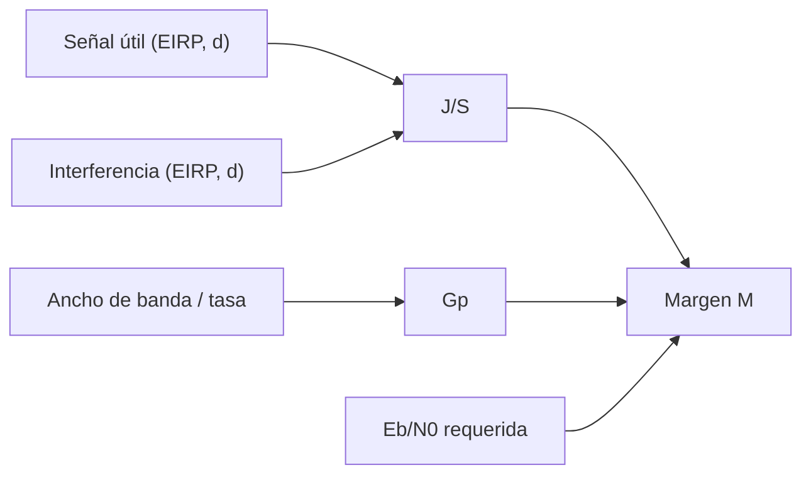

# B119-C15 — Interferencias y resiliencia de comunicaciones

<!-- nav:top -->
[🏠 Programa](../../../../README.md) · [📚 Bloque B119](../../../tronco-comun/B119-derecho-seguridad-y-geopolitica-espacial.md) · [← Anterior: B119-C14 — Amenazas cibernéticas a satélites](../B119-C14-amenazas-ciberneticas-a-satelites/CLASE.md) · [Siguiente: B119-C16 — Protección de infraestructura crítica →](../B119-C16-proteccion-de-infraestructura-critica/CLASE.md)
<!-- /nav -->

## 1. Ubicación, nivel y alcance

Clase 15 del bloque B119. Nivel N3. Una comunicación espacial puede degradarse por interferencia accidental o intencional. Esta clase es **defensiva**: calcula, para un enlace sintético, la relación interferencia/señal `J/S`, la ganancia de procesamiento que da un ensanchamiento del espectro y el margen de resistencia, sin dar instrucciones de interferencia. Conecta con el derecho porque la UIT atiende las interferencias perjudiciales. **Esta clase es educativa: no es asesoría legal, regulatoria ni financiera y no sustituye a un jurista, a una autoridad competente ni a un asesor.**

## 2. Por qué esta clase existe

C09 calcula interferencia entre sistemas lícitos; esta clase extiende el cálculo a un escenario de degradación deliberada para razonar sobre resiliencia. La respuesta jurídica se aborda en C17 y C27. La decisión central: **¿cuánta interferencia tolera el enlace y qué diseño aumenta el margen?**

## 3. Lo que podrás hacer al terminar

1. Describir qué hace la UIT ante interferencias perjudiciales (consultado).
2. Calcular `J/S` por dos caminos (lineal y en dB).
3. Calcular la ganancia de procesamiento y el margen de resistencia.
4. Calcular la interferencia máxima tolerable y el efecto de duplicar el ancho de banda.
5. Separar lo consultado (texto normativo con versión y fecha) de lo sintético o ilustrativo.

La evidencia es la **tabla de resiliencia de un enlace sintético** del ejercicio 12 (sección 20).

## 4. Con qué llegas y cómo comprobarlo

1. ¿Qué es la relación J/S?
2. ¿Qué es el ensanchamiento del espectro?
3. ¿Qué es `E_b/N_0`?
4. ¿Cuántos dB son un factor 2?
5. ¿Qué es una pérdida en espacio libre?

<details>
<summary>Ver respuestas</summary>

1. La potencia de interferencia dividida por la potencia de la señal en el receptor. 2. Transmitir con un ancho de banda mucho mayor que la tasa de datos para ganar robustez. 3. La energía por bit respecto de la densidad de ruido; fija la calidad. 4. 3,01 dB. 5. La atenuación por distancia y frecuencia (ver C09).
</details>

Con cuatro o cinco aciertos, sigue; si no, repasa los prerrequisitos.

## 5. Un caso de contexto y casos de referencia

La página de la UIT-R (consultada el 2026-11-11) dice que la UIT ayuda a las administraciones a resolver interferencias perjudiciales que afectan a servicios espaciales. **No se consultó** el Reglamento ni ninguna cifra real de resistencia. El **ejemplo conductor** es un enlace sintético a 14 GHz: señal útil de 55 dBW de EIRP desde 1000 km, una fuente de interferencia de 35 dBW desde 1500 km, ancho de banda de 20 MHz, tasa de 20 kbit/s y `E_b/N_0` requerida de 10 dB.

## 6. Vocabulario

La **relación J/S** compara interferencia y señal. La **ganancia de procesamiento** `G_p = 10 log(B/R)` es el beneficio del ensanchamiento. El **margen de resistencia** `M = G_p − J/S − (E_b/N_0)_req` es lo que sobra. La **resiliencia** es la capacidad de seguir operando degradado.

## 7. Modelo mental



*Descripción textual:* la relación J/S se compara con la ganancia de procesamiento y el requisito de `E_b/N_0` para dar el margen.

Analogía: hablar en una sala ruidosa: se entiende si la voz, repetida y lenta, supera al ruido. Límite: el modelo es de potencia media; no considera técnicas adaptativas de ninguna de las partes.

## 8. La explicación, paso a paso

### 8.1 J/S

`J/S = -23.52 dB` (la ganancia de recepción es común y se cancela). El camino lineal y el de dB coinciden a `10⁻⁹`.

### 8.2 Ganancia y margen

`G_p = 30.00 dB` y el margen `M = 43.52 dB`: el enlace resiste con holgura.

### 8.3 Cuánta interferencia tolera

El margen se anula con una EIRP de interferencia de `78.52 dBW` (`J/S` máxima tolerable `20.00 dB`).

### 8.4 Mejorar

Duplicar el ancho de banda suma `3.01 dB` de ganancia y lleva el margen a `46.53 dB`.

## 9. Magnitudes, símbolos y unidades

| Símbolo | Qué es | Unidad | Valor / nota |
|---|---|---|---|
| `G_p` | ganancia de procesamiento | dB | 30.00 |
| `J/S` | interferencia/señal | dB | -23.52 |
| `M` | margen de resistencia | dB | 43.52 |
| `E_b/N_0` | relación requerida | dB | 10 |

## 10. Convenciones y referencias

Potencias en dBW; distancias en km; frecuencia en MHz; `B` en Hz; `R` en bit/s. Valores sintéticos.

## 11. De dónde sale lo que afirmamos

| ID | Fuente | Localizador | Respalda | Estado |
|---|---|---|---|---|
| S4 | UIT-R, Departamento de Servicios Espaciales, https://www.itu.int/en/ITU-R/space/Pages/default.aspx (WebFetch, consultada 2026-11-11) | interferencia perjudicial | la UIT ayuda a resolver interferencias perjudiciales en servicios espaciales | Consultada |
| — | Reglamento de Radiocomunicaciones; cifras reales de resistencia | — | no consultados | No consultado / ilustrativo |
| — | Fórmulas de enlace | — | no consultadas en una fuente concreta; verificadas por dos caminos | No consultado / ilustrativo |
| — | Enlace y escenario | — | sintéticos | No consultado / ilustrativo |

Límites: no se consultó ninguna fuente técnica real; el análisis es de potencia media y no representa ningún sistema. Texto normativo parafraseado de las páginas oficiales en la fecha indicada; el texto vinculante es el de la fuente oficial vigente.

## 12. Cómo ver la situación

| Magnitud | Valor |
|---|---|
| `J/S` | -23.52 dB |
| `G_p` | 30.00 dB |
| Margen `M` | 43.52 dB |
| EIRP tolerable | 78.52 dBW |

Descripción larga: el enlace sintético tolera más de cuarenta decibelios de interferencia adicional antes de perder el servicio.

## 13. Ejemplo trabajado: duplicar el ancho de banda

**Paso 1.** `G_p = 10 log(20×10⁶/20×10³) = 30.00 dB`. **Paso 2.** Con `2B`: `+3,01 dB`. **Paso 3.** `M = 46.53 dB`.

## 14. Distintas formas de describirlo

**Por potencia:** lineal o en dB. **Por defensa:** más ancho de banda, más potencia, mejor antena, redundancia. **Por respuesta:** técnica, diplomática, regulatoria.

## 15. Práctica guiada

**Ejercicio 1 · con los pasos indicados.** Calcula `G_p` con `B = 20 MHz` y `R = 20 kbit/s`.

<details><summary>Solución comentada</summary>

`30.00 dB`.
</details>

**Ejercicio 2 · con una pista.** Calcula el margen si `J/S = 0`. *Pista:* `G_p − 0 − 10`.

<details><summary>Solución comentada</summary>

`30.00 − 0 − 10 = 20 dB`.
</details>

**Ejercicio 3 · casi autónomo.** Calcula `M` en el caso conductor.

<details><summary>Solución comentada</summary>

`43.52 dB`.
</details>

## 16. Práctica autónoma, transferencia e integrador

**Ejercicio 4 · autónomo.** ¿Qué `J/S` anula el margen?

<details><summary>Solución comentada</summary>

`20.00 dB`.
</details>

**Ejercicio 5 · autónomo.** ¿Cuántos dB suma duplicar `B`?

<details><summary>Solución comentada</summary>

`3,01 dB`.
</details>

**Ejercicio 6 · autónomo.** Si la distancia del interferente baja a la mitad, ¿cómo cambia `J/S`?

<details><summary>Solución comentada</summary>

Aumenta 6,02 dB.
</details>

**Ejercicio 7 · autónomo.** ¿Qué EIRP de interferencia anula el margen?

<details><summary>Solución comentada</summary>

`78.52 dBW`.
</details>

**Ejercicio 8 · autónomo.** ¿Qué consultaste en esta clase?

<details><summary>Solución comentada</summary>

Solo que la UIT ayuda con interferencias perjudiciales.
</details>

**Ejercicio 9 · transferencia.** **Transferencia.** ¿Por qué la resiliencia es también un asunto de derecho internacional?

<details><summary>Solución comentada</summary>

Porque la interferencia deliberada puede infringir normas de telecomunicaciones y de uso de la fuerza (ver C17).
</details>

**Ejercicio 10 · transferencia.** **Transferencia.** ¿Qué defensas no dependen del ancho de banda?

<details><summary>Solución comentada</summary>

Redundancia de enlaces, antenas directivas y detección y localización de la fuente.
</details>

**Ejercicio 11 · transferencia.** **Transferencia.** ¿Por qué esta clase evita explicar cómo interferir?

<details><summary>Solución comentada</summary>

Porque su objetivo es la resiliencia y la comprensión de riesgos, no el daño.
</details>

**Ejercicio 12 · integrador.** **Integrador.** Elabora tu *tabla de resiliencia de un enlace sintético*: `J/S`, `G_p`, margen, interferencia tolerable y aviso de que es educativa.

<details><summary>Solución comentada</summary>

Secciones 8.1–8.4 y la salida del laboratorio.
</details>

## 17. Laboratorio: margen de resistencia de un enlace sintético

El script [laboratorio.py](laboratorio.py) calcula `J/S` por dos caminos, la ganancia de procesamiento y el margen en cinco niveles de interferencia (**comprueba** la igualdad lineal/dB y la ganancia de 3,01 dB).

**Datos:** UIT-R consultada (2026-11-11) sin cifras; enlace **sintético**. **Predice antes de ejecutar:** ¿resistirá el enlace una interferencia de 55 dBW de EIRP? (sí, con margen de sobra.) **Ejecución del 2026-11-11 (Python 3.12.9):**

```text
Python 3.12.9 (biblioteca estandar)
Enlace SINTETICO, analisis DEFENSIVO; UIT-R consultada el 2026-11-11 (procedimiento, sin cifras).
Ganancia de procesamiento Gp = 30.00 dB ; J/S = -23.52 dB ; margen M = 43.52 dB
  EIRP de la interferencia [dBW]   J/S [dB]   margen [dB]   resiste
                            25     -33.52        53.52   si
                            35     -23.52        43.52   si
                            45     -13.52        33.52   si
                            55      -3.52        23.52   si
                            65       6.48        13.52   si
EIRP maxima de interferencia tolerable (margen 0): 78.52 dBW
Duplicar el ancho de banda: Gp = 33.01 dB (+3.01) ; margen 46.53 dB
CLAVES {"gp": "30.00", "js": "-23.52", "M": "43.52", "emax": "78.52", "jsmax": "20.00", "M2": "46.53", "d3": "3.01"}
Pruebas superadas.
```

```bash
python programa/clases/B119/B119-C15-interferencias-y-resiliencia-de-comunicaciones/laboratorio.py
```

**Límites:** potencia media, un enlace, sin técnicas adaptativas; no representa ningún sistema real.

## 18. Errores frecuentes y cómo corregirlos

**Sumar dB de potencias distintas.** Se corrige trabajando en lineal para sumar potencias.

**Olvidar que la ganancia de recepción se cancela.** Se corrige con 8.1.

**Creer que el ancho de banda lo arregla todo.** Se corrige con el ejercicio 10.

**Usar la clase como guía de interferencia.** Se corrige con la sección 21.

## 19. Cómo sabrás que vas bien

Tras la sección 8: ¿qué resultado esperabas en el ejemplo trabajado y cuál obtuviste? Si dudas, repasa la sección 13. Tras el laboratorio: ¿qué comprueba cada prueba? (ver la sección 17).

## 20. Qué entregas y cómo se evalúa

El producto es tu **tabla de resiliencia de un enlace sintético** (ejercicio 12).

| Criterio | Inicial | En desarrollo | Logrado | Destacado |
|---|---|---|---|---|
| Conceptos | Los confunde | Parciales | Usa el vocabulario con precisión | Explica los límites del modelo |
| Cálculo | Sin unidades | Con errores | Resultados con unidades y tolerancia | Calcula casos nuevos |
| Verificación | Sin comprobar | Un caso | Contraste con una segunda vía | Interpreta las diferencias |
| Fuentes | Sin fuente | Sin fecha | Fuentes con versión, fecha y estado | Declara lo sintético y lo no consultado |
| Límites | No los nombra | Uno | Tres | Discute qué falta del modelo |

**Condiciones críticas (no se compensan con promedio):** citar la versión y la fecha del texto normativo consultado; rotular lo sintético y lo ilustrativo; no presentar un resultado como asesoría legal, regulatoria o financiera.

## 21. Ética, seguridad y límites

Clase educativa: **no es asesoría legal, regulatoria ni financiera**; no sustituye a un abogado, a la autoridad competente ni a un asesor, y ningún resultado debe usarse para decidir sobre una licencia, una reclamación, un contrato o una operación real. Clase defensiva. Interferir deliberadamente un servicio de radio es ilícito en la mayoría de las jurisdicciones y puede poner vidas en riesgo. Los modelos son simplificados y sus datos son sintéticos o ilustrativos; lo simulado nunca se presenta como observado. Accesibilidad: tablas equivalentes a las gráficas, fórmulas en texto, ejercicios sin conexión.

## 22. Para cerrar y seguir

El margen sintético es `43.52 dB` y tolera hasta `78.52 dBW` de interferencia. Queda una pregunta: ¿cómo se protegen conjuntos de sistemas de los que depende un país?

**Glosario español–inglés.** ganancia de procesamiento · *processing gain*; margen de resistencia · *anti-jam margin*; resiliencia · *resilience*; interferencia perjudicial · *harmful interference*.

**Continuidad.** [B119-C16](../B119-C16-proteccion-de-infraestructura-critica/CLASE.md): la protección de infraestructura crítica.

**Referencias:** ver sección 11.

<!-- nav:bottom -->
---

[← Anterior: B119-C14 — Amenazas cibernéticas a satélites](../B119-C14-amenazas-ciberneticas-a-satelites/CLASE.md) · [📚 Bloque B119](../../../tronco-comun/B119-derecho-seguridad-y-geopolitica-espacial.md) · [Siguiente: B119-C16 — Protección de infraestructura crítica →](../B119-C16-proteccion-de-infraestructura-critica/CLASE.md)
<!-- /nav -->
