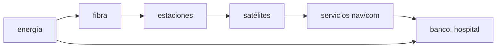

# B119-C16 — Protección de infraestructura crítica

<!-- nav:top -->
[🏠 Programa](../../../../README.md) · [📚 Bloque B119](../../../tronco-comun/B119-derecho-seguridad-y-geopolitica-espacial.md) · [← Anterior: B119-C15 — Interferencias y resiliencia de comunicaciones](../B119-C15-interferencias-y-resiliencia-de-comunicaciones/CLASE.md) · [Siguiente: B119-C17 — Conflictos y normas humanitarias aplicables →](../B119-C17-conflictos-y-normas-humanitarias-aplicables/CLASE.md)
<!-- /nav -->

## 1. Ubicación, nivel y alcance

Clase 16 del bloque B119. Nivel N3. Un país depende de servicios que a su vez dependen de satélites, estaciones terrenas, energía y redes. Esta clase representa esas dependencias como un grafo dirigido sintético de 12 nodos, calcula el alcance de cada falla y simula una falla en cascada con un umbral, y compara dos algoritmos de alcance para verificarlos. Es la base conceptual de la protección de infraestructura crítica. **Esta clase es educativa: no es asesoría legal, regulatoria ni financiera y no sustituye a un jurista, a una autoridad competente ni a un asesor.**

## 2. Por qué esta clase existe

C14 y C15 modelan amenazas sobre un enlace; esta clase muestra cómo una falla local se propaga, que ninguna clase anterior trata y que B122 desarrolla con proveedores y modelos defensivos. La decisión central: **¿qué nodos conviene proteger primero, dado cómo se propagan las fallas?**

## 3. Lo que podrás hacer al terminar

1. Relacionar la jurisdicción y la responsabilidad del Estado (arts. VI y VIII, consultados) con la protección de activos.
2. Representar dependencias como un grafo y calcular su alcance transitivo por dos métodos.
3. Simular una falla en cascada con umbral.
4. Ordenar nodos por criticidad y buscar el peor par de fallas.
5. Separar lo consultado (texto normativo con versión y fecha) de lo sintético o ilustrativo.

La evidencia es la **mapa de criticidad de una red sintética** del ejercicio 12 (sección 20).

## 4. Con qué llegas y cómo comprobarlo

1. ¿Qué es un grafo dirigido?
2. ¿Qué es el cierre transitivo?
3. ¿Qué es una búsqueda en anchura?
4. ¿Qué es un umbral?
5. ¿Qué es un punto único de falla?

<details>
<summary>Ver respuestas</summary>

1. Nodos unidos por flechas con sentido. 2. El conjunto de nodos alcanzables por cadenas de flechas. 3. Un recorrido que explora los vecinos por capas. 4. Un valor a partir del cual cambia el estado. 5. Un elemento cuya falla interrumpe todo lo que depende de él.
</details>

Con cuatro o cinco aciertos, sigue; si no, repasa los prerrequisitos.

## 5. Un caso de contexto y casos de referencia

La nota de la ONU (consultada el 2026-11-11) recoge la responsabilidad internacional del Estado por las actividades espaciales (art. VI) y su jurisdicción y control sobre los objetos registrados (art. VIII). **No se consultó ninguna definición legal de infraestructura crítica ni inventario real.** El **ejemplo conductor**: 12 nodos genéricos (energía, fibra, dos estaciones, tres satélites, centro de control, servicios de navegación y comunicación, un banco y un hospital) y una regla de cascada: un nodo cae si falla al menos la mitad de sus dependencias.

## 6. Vocabulario

Una **dependencia** es «X necesita Y». El **alcance transitivo** de Y es todo lo que depende de él directa o indirectamente. La **cascada** es la propagación de fallas. El **umbral** es la fracción de dependencias caídas que hace caer a un nodo. La **criticidad** mide cuántos nodos caen por una falla.

## 7. Modelo mental



*Descripción textual:* la energía alimenta la fibra y las estaciones; las estaciones operan los satélites; estos dan servicios de los que dependen el banco y el hospital.

Analogía: una cadena de fichas de dominó con algunas fichas conectadas a varias anteriores: cae si cae suficiente apoyo. Límite: las dependencias reales cambian con la hora, la redundancia y la reparación.

## 8. La explicación, paso a paso

### 8.1 Alcance y cascada

Cada nodo tiene un alcance transitivo (BFS y Warshall coinciden). La cascada con umbral 0,5 es más restrictiva que el alcance.

### 8.2 Nodo más crítico

`energia` provoca la caída de `11` nodos más (todos los demás). La fibra provoca `10`; la estación 1, `4`; el satélite A, `0`.

### 8.3 Dobles fallas

Excluyendo las raíces, el peor par es `estacion1+estacion2`, con `7` nodos adicionales caídos.

### 8.4 Redundancia

Los satélites B y C dan redundancia a los servicios, por lo que la caída de uno solo apenas afecta; la energía es un punto único de falla.

## 9. Magnitudes, símbolos y unidades

| Símbolo | Qué es | Unidad | Valor / nota |
|---|---|---|---|
| `N` | nodos | — | 12 |
| `u` | umbral de cascada | — | 0,5 |
| `c(x)` | nodos que caen por `x` | — | 11 (máx.) |
| `a(x)` | alcance transitivo | — | — |

## 10. Convenciones y referencias

Grafo con aristas «depende de»; nodos genéricos; cascada con umbral 0,5.

## 11. De dónde sale lo que afirmamos

| ID | Fuente | Localizador | Respalda | Estado |
|---|---|---|---|---|
| S3 | ONU, Biblioteca Audiovisual de Derecho Internacional, nota introductoria sobre el Tratado del Espacio Ultraterrestre, https://legal.un.org/avl/ha/tos/tos.html (WebFetch, consultada 2026-11-11; no discute los artículos V ni VII) | arts. VI y VIII | responsabilidad y jurisdicción del Estado sobre actividades y objetos | Consultada |
| — | Definiciones legales de infraestructura crítica | — | no consultadas | No consultado / ilustrativo |
| — | Red, dependencias y umbral | — | sintéticos | No consultado / ilustrativo |

Límites: no se consultó ninguna definición ni inventario real; el umbral 0,5 es ilustrativo. Texto normativo parafraseado de las páginas oficiales en la fecha indicada; el texto vinculante es el de la fuente oficial vigente.

## 12. Cómo ver la situación

| Magnitud | Valor |
|---|---|
| Nodo más crítico | energia (11 nodos) |
| Falla de la fibra | 10 nodos |
| Falla del satélite A | 0 nodos |
| Peor par sin raíces | estacion1+estacion2 (7) |

Descripción larga: la energía y la fibra son puntos únicos de falla; los satélites con redundancia pesan menos.

## 13. Ejemplo trabajado: falla de la estación 1

**Paso 1.** Cae `estacion1`. **Paso 2.** `sat_A` depende solo de ella: cae. `sat_B` depende de dos: cae la mitad (0,5): cae. **Paso 3.** `servicio_nav` (2 de 3) y `banco` (1 de 2) también caen; `servicio_com` (1 de 3) no. Total: `4` nodos.

## 14. Distintas formas de describirlo

**Por grafo:** nodos y aristas. **Por alcance:** transitivo. **Por dinámica:** cascada con umbral. **Por riesgo:** puntos únicos de falla.

## 15. Práctica guiada

**Ejercicio 1 · con los pasos indicados.** Lista las dependencias de `servicio_com`.

<details><summary>Solución comentada</summary>

`sat_B`, `sat_C`, `centro_control`.
</details>

**Ejercicio 2 · con una pista.** ¿Cae `servicio_com` si falla solo `sat_B`? *Pista:* umbral 0,5 sobre tres.

<details><summary>Solución comentada</summary>

No: 1/3 < 0,5.
</details>

**Ejercicio 3 · casi autónomo.** ¿Cae si fallan `sat_B` y `sat_C`?

<details><summary>Solución comentada</summary>

Sí: 2/3 ≥ 0,5.
</details>

## 16. Práctica autónoma, transferencia e integrador

**Ejercicio 4 · autónomo.** ¿Cuántos nodos dependen de `energia` directa o indirectamente?

<details><summary>Solución comentada</summary>

11.
</details>

**Ejercicio 5 · autónomo.** ¿Por qué `energia` y `fibra` encabezan la criticidad?

<details><summary>Solución comentada</summary>

Son raíces de las que dependen casi todos los demás.
</details>

**Ejercicio 6 · autónomo.** Sube el umbral a 0,8. ¿Cae `servicio_com` por `sat_B` y `sat_C`?

<details><summary>Solución comentada</summary>

No: 2/3 < 0,8.
</details>

**Ejercicio 7 · autónomo.** ¿Cómo mejorarías la red con una segunda fuente de energía?

<details><summary>Solución comentada</summary>

Duplicar la raíz; el nodo ya no sería un punto único de falla.
</details>

**Ejercicio 8 · autónomo.** ¿Qué algoritmos verifican el alcance?

<details><summary>Solución comentada</summary>

BFS y Warshall; coinciden.
</details>

**Ejercicio 9 · transferencia.** **Transferencia.** ¿Por qué un Estado debería conocer las dependencias de sus operadores?

<details><summary>Solución comentada</summary>

Porque responde de sus actividades (art. VI) y necesita saber qué falla puede propagarse.
</details>

**Ejercicio 10 · transferencia.** **Transferencia.** ¿Qué diferencia hay entre alcance transitivo y cascada?

<details><summary>Solución comentada</summary>

El alcance es todo lo que podría verse afectado; la cascada, lo que cae con el umbral.
</details>

**Ejercicio 11 · transferencia.** **Transferencia.** ¿Qué dato falta para pasar a una evaluación real?

<details><summary>Solución comentada</summary>

El inventario real, las dependencias verificadas y los tiempos de recuperación.
</details>

**Ejercicio 12 · integrador.** **Integrador.** Elabora tu *mapa de criticidad de una red sintética*: grafo, alcance, cascada, nodo más crítico y aviso de que es educativo.

<details><summary>Solución comentada</summary>

Secciones 8.1–8.4 y la salida del laboratorio.
</details>

## 17. Laboratorio: dependencias y cascada

El script [laboratorio.py](laboratorio.py) calcula el alcance de cada nodo por dos algoritmos y la cascada con umbral 0,5 (**comprueba** que BFS y Warshall dan el mismo alcance).

**Datos:** arts. VI y VIII (consultados 2026-11-11); red y umbral **sintéticos**. **Predice antes de ejecutar:** ¿qué nodo, al fallar, hará caer a más nodos? (una raíz del grafo.) **Ejecución del 2026-11-11 (Python 3.12.9):**

```text
Python 3.12.9 (biblioteca estandar)
Red SINTETICA de 12 nodos; art. VI y VIII consultados (2026-11-11); ninguna definicion legal de infraestructura critica consultada.
 nodo inicial        alcance transitivo   caen en cascada (umbral 0.5)
 energia                  11                       11
 fibra                    10                       10
 estacion1                 6                        4
 estacion2                 6                        6
 sat_A                     2                        0
 sat_B                     4                        0
 sat_C                     4                        0
 centro_control            3                        0
 servicio_nav              1                        1
 servicio_com              2                        2
 banco                     0                        0
 hospital                  0                        0
Mas critico por cascada: energia (11 nodos mas)
Peor par de fallas iniciales (sin las raices energia y fibra): estacion1 + estacion2 -> 7 nodos adicionales
CLAVES {"top": "energia", "ntop": 11, "par": "estacion1+estacion2", "npar": 7, "fibra": 10, "sat_A": 0, "est1": 4}
Pruebas superadas.
```

```bash
python programa/clases/B119/B119-C16-proteccion-de-infraestructura-critica/laboratorio.py
```

**Límites:** dependencias estáticas, sin recuperación ni tiempo; no representa ninguna red real.

## 18. Errores frecuentes y cómo corregirlos

**Confundir alcance con cascada.** Se corrige con el ejercicio 10.

**Olvidar la redundancia.** Se corrige con el ejercicio 7.

**Usar el umbral como dato real.** Se corrige con la sección 11.

**Ignorar las dependencias indirectas.** Se corrige con el ejercicio 4.

## 19. Cómo sabrás que vas bien

Tras la sección 8: ¿qué resultado esperabas en el ejemplo trabajado y cuál obtuviste? Si dudas, repasa la sección 13. Tras el laboratorio: ¿qué comprueba cada prueba? (ver la sección 17).

## 20. Qué entregas y cómo se evalúa

El producto es tu **mapa de criticidad de una red sintética** (ejercicio 12).

| Criterio | Inicial | En desarrollo | Logrado | Destacado |
|---|---|---|---|---|
| Conceptos | Los confunde | Parciales | Usa el vocabulario con precisión | Explica los límites del modelo |
| Cálculo | Sin unidades | Con errores | Resultados con unidades y tolerancia | Calcula casos nuevos |
| Verificación | Sin comprobar | Un caso | Contraste con una segunda vía | Interpreta las diferencias |
| Fuentes | Sin fuente | Sin fecha | Fuentes con versión, fecha y estado | Declara lo sintético y lo no consultado |
| Límites | No los nombra | Uno | Tres | Discute qué falta del modelo |

**Condiciones críticas (no se compensan con promedio):** citar la versión y la fecha del texto normativo consultado; rotular lo sintético y lo ilustrativo; no presentar un resultado como asesoría legal, regulatoria o financiera.

## 21. Ética, seguridad y límites

Clase educativa: **no es asesoría legal, regulatoria ni financiera**; no sustituye a un abogado, a la autoridad competente ni a un asesor, y ningún resultado debe usarse para decidir sobre una licencia, una reclamación, un contrato o una operación real. La clase no identifica infraestructura real ni sus debilidades; la red es genérica. Los modelos son simplificados y sus datos son sintéticos o ilustrativos; lo simulado nunca se presenta como observado. Accesibilidad: tablas equivalentes a las gráficas, fórmulas en texto, ejercicios sin conexión.

## 22. Para cerrar y seguir

La energía es el punto único de falla del grafo sintético: provoca `11` fallas adicionales. Queda una pregunta: ¿qué reglas humanitarias protegen esos activos si hay un conflicto?

**Glosario español–inglés.** infraestructura crítica · *critical infrastructure*; falla en cascada · *cascading failure*; punto único de falla · *single point of failure*; dependencia · *dependency*.

**Continuidad.** [B119-C17](../B119-C17-conflictos-y-normas-humanitarias-aplicables/CLASE.md): los conflictos y las normas humanitarias aplicables.

**Referencias:** ver sección 11.

<!-- nav:bottom -->
---

[← Anterior: B119-C15 — Interferencias y resiliencia de comunicaciones](../B119-C15-interferencias-y-resiliencia-de-comunicaciones/CLASE.md) · [📚 Bloque B119](../../../tronco-comun/B119-derecho-seguridad-y-geopolitica-espacial.md) · [Siguiente: B119-C17 — Conflictos y normas humanitarias aplicables →](../B119-C17-conflictos-y-normas-humanitarias-aplicables/CLASE.md)
<!-- /nav -->
