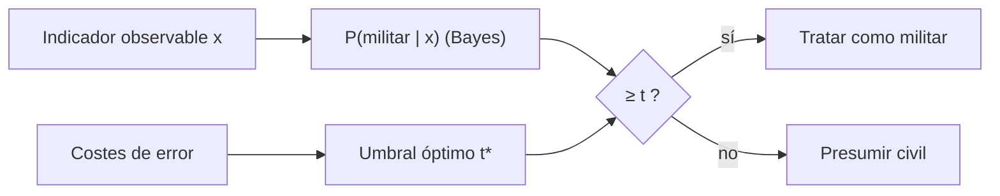

# B119-C17 — Conflictos y normas humanitarias aplicables

<!-- nav:top -->
[🏠 Programa](../../../../README.md) · [📚 Bloque B119](../../../tronco-comun/B119-derecho-seguridad-y-geopolitica-espacial.md) · [← Anterior: B119-C16 — Protección de infraestructura crítica](../B119-C16-proteccion-de-infraestructura-critica/CLASE.md) · [Siguiente: B119-C18 — Ética y derechos en actividades espaciales →](../B119-C18-etica-y-derechos-en-actividades-espaciales/CLASE.md)
<!-- /nav -->

## 1. Ubicación, nivel y alcance

Clase 17 del bloque B119. Nivel N3. El art. III del tratado de 1967 somete las actividades espaciales al derecho internacional, incluida la Carta de las Naciones Unidas, y por tanto al derecho internacional humanitario cuando hay conflicto. Esta clase no enseña operaciones: usa una población **sintética** de objetos de doble uso para mostrar, con la regla de Bayes, por qué cuando el coste de dañar a un civil es alto el umbral para tratar un objeto como militar debe ser alto y por qué la presuncion protectora existe. **Esta clase es educativa: no es asesoría legal, regulatoria ni financiera y no sustituye a un jurista, a una autoridad competente ni a un asesor.**

## 2. Por qué esta clase existe

C11 trata los límites militares del tratado; esta clase aborda cómo razonar la distinción bajo incertidumbre, un tema que ninguna clase del bloque cubre y que exige cautela jurídica. La decisión central: **¿cómo cambia el umbral de decisión cuando equivocarse en un sentido es mucho más grave que en el otro?**

## 3. Lo que podrás hacer al terminar

1. Ubicar el art. III como puerta de entrada del derecho internacional (consultado) y rotular lo no consultado.
2. Calcular la probabilidad posterior con el teorema de Bayes.
3. Obtener el umbral óptimo `t* = c_FP/(c_FP+c_FN)` y verificarlo numéricamente.
4. Leer una matriz de confusión con costes asimétricos.
5. Separar lo consultado (texto normativo con versión y fecha) de lo sintético o ilustrativo.

La evidencia es la **ficha de clasificación con matriz de confusión** del ejercicio 12 (sección 20).

## 4. Con qué llegas y cómo comprobarlo

1. ¿Qué dice el teorema de Bayes?
2. ¿Qué es un falso positivo?
3. ¿Qué es una matriz de confusión?
4. ¿Qué es el prior?
5. ¿Qué es la distinción en el derecho humanitario?

<details>
<summary>Ver respuestas</summary>

1. `P(A|x) = P(x|A)P(A)/P(x)`. 2. Clasificar como positivo algo que no lo es. 3. La tabla de aciertos y errores de un clasificador. 4. La probabilidad inicial de cada clase. 5. El principio de distinguir objetos civiles de militares; no se consultó en esta sesión.
</details>

Con cuatro o cinco aciertos, sigue; si no, repasa los prerrequisitos.

## 5. Un caso de contexto y casos de referencia

La nota de la ONU (consultada el 2026-11-11) resume el art. III del tratado: las actividades espaciales se realizan conforme al derecho internacional, incluida la Carta. **No se consultaron** los Convenios de Ginebra, sus Protocolos ni la práctica de los Estados: lo que se dice de distinción, precaución y presunción de carácter civil en caso de duda es conocimiento general **no verificado**. El **ejemplo conductor**: 100 000 objetos sintéticos de doble uso (10 % militares) con un indicador observable gaussiano (civil media 0, militar media 2) y costes ilustrativos de error 10 y 1.

## 6. Vocabulario

**Doble uso** es el que sirve a fines civiles y militares. El **umbral** `t` es la probabilidad posterior mínima para tratar como militar. Un **falso positivo** aquí es tratar como militar un objeto civil. La **presunción protectora** es tratar como civil en caso de duda. El **coste asimétrico** pondera más un error que el otro.

## 7. Modelo mental



*Descripción textual:* el indicador da una probabilidad posterior que se compara con un umbral fijado por los costes de error.

Analogía: un detector de humo con muy poca tolerancia a la falsa alarma o a la omisión según el lugar donde se instale. Límite: el derecho no se reduce a un umbral y las decisiones reales son humanas y jurídicas.

## 8. La explicación, paso a paso

### 8.1 Bayes

`P(militar|x) = 0,1 f_M(x)/[0,1 f_M(x) + 0,9 f_C(x)]`.

### 8.2 Umbral óptimo

Con costes 10 (falso positivo) y 1 (falso negativo): `t* = 10/11 = 0.9091`. El mejor umbral en una rejilla gruesa es `0.92`.

### 8.3 En el umbral óptimo

Precisión `0.947`, exhaustividad `0.103`, `58` civiles mal tratados y `9024` objetos militares no identificados sobre 100 000.

### 8.4 Lo que no es

Esta clase no dice cómo identificar objetivos; muestra que bajar el umbral sube los errores contra civiles. La regla jurídica concreta debe leerse en las fuentes (no consultadas).

## 9. Magnitudes, símbolos y unidades

| Símbolo | Qué es | Unidad | Valor / nota |
|---|---|---|---|
| `π` | prior de uso militar | — | 0,10 (ilustrativo) |
| `c_FP`, `c_FN` | costes de error | — | 10 y 1 |
| `t*` | umbral óptimo | — | 0.9091 |
| `N` | población sintética | — | 100 000 |

## 10. Convenciones y referencias

Probabilidades en [0,1]; costes sin unidad; semilla 119; población sintética.

## 11. De dónde sale lo que afirmamos

| ID | Fuente | Localizador | Respalda | Estado |
|---|---|---|---|---|
| S3 | ONU, Biblioteca Audiovisual de Derecho Internacional, nota introductoria sobre el Tratado del Espacio Ultraterrestre, https://legal.un.org/avl/ha/tos/tos.html (WebFetch, consultada 2026-11-11; no discute los artículos V ni VII) | art. III | las actividades espaciales se rigen por el derecho internacional, incluida la Carta | Consultada |
| — | Convenios de Ginebra, Protocolos, Manual de Tallin y práctica de los Estados | — | no consultados | No consultado / ilustrativo |
| — | Teorema de Bayes | — | no consultado en una fuente concreta; verificado numéricamente | No consultado / ilustrativo |
| — | Población, prior, costes | — | sintéticos | No consultado / ilustrativo |

Límites: no se consultó ningún texto de derecho humanitario; el modelo es un ejercicio estadístico, no una interpretación jurídica. Texto normativo parafraseado de las páginas oficiales en la fecha indicada; el texto vinculante es el de la fuente oficial vigente.

## 12. Cómo ver la situación

| Magnitud | Valor |
|---|---|
| `t*` | 0.9091 |
| Precisión en `t*` | 0.947 |
| Exhaustividad en `t*` | 0.103 |
| Falsos positivos en `t*` | 58 |

Descripción larga: un umbral alto casi elimina los errores contra civiles a costa de dejar sin identificar a la gran mayoría de los objetos militares: no hay umbral que elimine ambos errores.

## 13. Ejemplo trabajado: el umbral óptimo

**Paso 1.** `c_FP = 10`, `c_FN = 1`. **Paso 2.** `t* = 10/11 = 0.9091`. **Paso 3.** Solo se trata como militar si `P(militar|x) ≥ 0.9091`. **Paso 4.** El laboratorio confirma que ese umbral minimiza el coste.

## 14. Distintas formas de describirlo

**Por estadística:** posterior, umbral. **Por error:** FP y FN. **Por coste:** simétrico o asimétrico. **Por norma:** presunción protectora (no consultada).

## 15. Práctica guiada

**Ejercicio 1 · con los pasos indicados.** Calcula `t*` con `c_FP = 5` y `c_FN = 1`.

<details><summary>Solución comentada</summary>

`5/6 = 0,833`.
</details>

**Ejercicio 2 · con una pista.** Calcula `t*` con costes iguales. *Pista:* `1/(1+1)`.

<details><summary>Solución comentada</summary>

`0,5`.
</details>

**Ejercicio 3 · casi autónomo.** ¿Qué pasa con `t*` si el falso positivo cuesta 100 veces más?

<details><summary>Solución comentada</summary>

`100/101 = 0,990`: casi no se trata nada como militar.
</details>

## 16. Práctica autónoma, transferencia e integrador

**Ejercicio 4 · autónomo.** Calcula la precisión con 90 TP y 10 FP.

<details><summary>Solución comentada</summary>

`0,90`.
</details>

**Ejercicio 5 · autónomo.** Calcula la exhaustividad con 90 TP y 30 FN.

<details><summary>Solución comentada</summary>

`0,75`.
</details>

**Ejercicio 6 · autónomo.** ¿Por qué subir `t` reduce los FP?

<details><summary>Solución comentada</summary>

Porque exige más evidencia para clasificar como militar.
</details>

**Ejercicio 7 · autónomo.** ¿Qué efecto tiene un prior militar mayor sobre el posterior?

<details><summary>Solución comentada</summary>

Lo aumenta para un mismo `x`.
</details>

**Ejercicio 8 · autónomo.** ¿Qué fuente consultada abre la puerta al derecho humanitario?

<details><summary>Solución comentada</summary>

El art. III del tratado (S3).
</details>

**Ejercicio 9 · transferencia.** **Transferencia.** ¿Por qué la clase no da criterios para identificar objetos reales?

<details><summary>Solución comentada</summary>

No es su finalidad: ilustra razonamiento bajo incertidumbre con datos sintéticos.
</details>

**Ejercicio 10 · transferencia.** **Transferencia.** ¿Qué papel tiene la presunción de carácter civil en caso de duda?

<details><summary>Solución comentada</summary>

Protege a los civiles cuando la evidencia es insuficiente (principio no consultado aquí).
</details>

**Ejercicio 11 · transferencia.** **Transferencia.** ¿Por qué un buen clasificador estadístico no resuelve un problema jurídico?

<details><summary>Solución comentada</summary>

El derecho exige valoración humana, contexto y responsabilidad, no solo una probabilidad.
</details>

**Ejercicio 12 · integrador.** **Integrador.** Elabora tu *ficha de clasificación con matriz de confusión*: posterior, umbral, matriz en cinco umbrales y aviso de que es educativa y analítica.

<details><summary>Solución comentada</summary>

Secciones 8.1–8.4 y la salida del laboratorio.
</details>

## 17. Laboratorio: clasificación bajo incertidumbre

El script [laboratorio.py](laboratorio.py) clasifica 100 000 objetos sintéticos con cinco umbrales y busca el de menor coste (**comprueba** que el óptimo numérico coincide con `t*`).

**Datos:** art. III consultado (2026-11-11); población, prior y costes **sintéticos**. **Predice antes de ejecutar:** ¿cuál será el umbral de menor coste? (cercano a 0,91.) **Ejecución del 2026-11-11 (Python 3.12.9):**

```text
Python 3.12.9 (biblioteca estandar)
Poblacion SINTETICA (10 % militar); art. III consultado (2026-11-11); Convenios de Ginebra y Protocolos NO consultados.
Umbral optimo de Bayes t* = c_FP/(c_FP+c_FN) = 0.9091
   t      TP     FP     FN      TN    coste total   civiles tratados como militares
 0.300   6364   4187   3699   85750        45569      4.655 %
 0.500   4702   1638   5361   88299        21741      1.821 %
 0.800   2112    244   7951   89693        10391      0.271 %
 0.909   1039     58   9024   89879         9604      0.064 %
 0.950    562     15   9501   89922         9651      0.017 %
Mejor umbral en rejilla gruesa (0.50 a 0.98): 0.92 con coste 9592
En t*: precision 0.947 ; exhaustividad 0.103 ; falsos positivos 58
CLAVES {"t": "0.9091", "prec": "0.947", "rec": "0.103", "fp": 58, "fn": 9024, "mejor": "0.92"}
Pruebas superadas.
```

```bash
python programa/clases/B119/B119-C17-conflictos-y-normas-humanitarias-aplicables/laboratorio.py
```

**Límites:** indicador unidimensional gaussiano; costes asimétricos arbitrarios; no es una guía operativa.

## 18. Errores frecuentes y cómo corregirlos

**Tomar la matriz como criterio jurídico.** Se corrige con el ejercicio 11.

**Usar costes simétricos sin discutirlo.** Se corrige con el ejercicio 3.

**Citar principios humanitarios como verificados.** Se corrige con la sección 11.

**Confundir precisión y exhaustividad.** Se corrige con los ejercicios 4 y 5.

## 19. Cómo sabrás que vas bien

Tras la sección 8: ¿qué resultado esperabas en el ejemplo trabajado y cuál obtuviste? Si dudas, repasa la sección 13. Tras el laboratorio: ¿qué comprueba cada prueba? (ver la sección 17).

## 20. Qué entregas y cómo se evalúa

El producto es tu **ficha de clasificación con matriz de confusión** (ejercicio 12).

| Criterio | Inicial | En desarrollo | Logrado | Destacado |
|---|---|---|---|---|
| Conceptos | Los confunde | Parciales | Usa el vocabulario con precisión | Explica los límites del modelo |
| Cálculo | Sin unidades | Con errores | Resultados con unidades y tolerancia | Calcula casos nuevos |
| Verificación | Sin comprobar | Un caso | Contraste con una segunda vía | Interpreta las diferencias |
| Fuentes | Sin fuente | Sin fecha | Fuentes con versión, fecha y estado | Declara lo sintético y lo no consultado |
| Límites | No los nombra | Uno | Tres | Discute qué falta del modelo |

**Condiciones críticas (no se compensan con promedio):** citar la versión y la fecha del texto normativo consultado; rotular lo sintético y lo ilustrativo; no presentar un resultado como asesoría legal, regulatoria o financiera.

## 21. Ética, seguridad y límites

Clase educativa: **no es asesoría legal, regulatoria ni financiera**; no sustituye a un abogado, a la autoridad competente ni a un asesor, y ningún resultado debe usarse para decidir sobre una licencia, una reclamación, un contrato o una operación real. La clase es analítica, trabaja con datos sintéticos y no ofrece métodos para seleccionar objetivos. El derecho humanitario se estudia en fuentes oficiales y con asesoría especializada. Los modelos son simplificados y sus datos son sintéticos o ilustrativos; lo simulado nunca se presenta como observado. Accesibilidad: tablas equivalentes a las gráficas, fórmulas en texto, ejercicios sin conexión.

## 22. Para cerrar y seguir

Con costes asimétricos el umbral óptimo sintético es `0.9091` y los falsos positivos se reducen a `58`. Queda una pregunta: ¿qué marco ético más amplio guía las actividades espaciales?

**Glosario español–inglés.** doble uso · *dual use*; falso positivo · *false positive*; umbral · *threshold*; derecho humanitario · *humanitarian law*.

**Continuidad.** [B119-C18](../B119-C18-etica-y-derechos-en-actividades-espaciales/CLASE.md): la ética y los derechos en las actividades espaciales.

**Referencias:** ver sección 11.

<!-- nav:bottom -->
---

[← Anterior: B119-C16 — Protección de infraestructura crítica](../B119-C16-proteccion-de-infraestructura-critica/CLASE.md) · [📚 Bloque B119](../../../tronco-comun/B119-derecho-seguridad-y-geopolitica-espacial.md) · [Siguiente: B119-C18 — Ética y derechos en actividades espaciales →](../B119-C18-etica-y-derechos-en-actividades-espaciales/CLASE.md)
<!-- /nav -->
