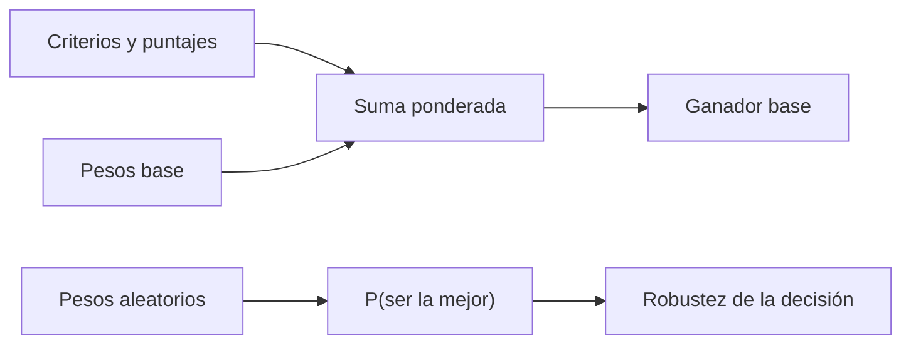

# B119-C18 — Ética y derechos en actividades espaciales

<!-- nav:top -->
[🏠 Programa](../../../../README.md) · [📚 Bloque B119](../../../tronco-comun/B119-derecho-seguridad-y-geopolitica-espacial.md) · [← Anterior: B119-C17 — Conflictos y normas humanitarias aplicables](../B119-C17-conflictos-y-normas-humanitarias-aplicables/CLASE.md) · [Siguiente: B119-C19 — Legislación comparada y casos nacionales →](../../../tronco-comun/B119-derecho-seguridad-y-geopolitica-espacial.md#b119-c19)
<!-- /nav -->

## 1. Ubicación, nivel y alcance

Clase 18 del bloque B119. Nivel N3. Las decisiones espaciales mezclan seguridad, equidad, ambiente, costo y transparencia, y los valores no se comparan por una fórmula única. Aquí usas una decisión multicriterio con puntajes sintéticos para tres opciones de política, ves quién gana con unos pesos base y, sobre todo, qué tan estable es esa elección cuando los pesos cambian, ligando la ética a los principios de igualdad y cooperación del tratado de 1967. **Esta clase es educativa: no es asesoría legal, regulatoria ni financiera y no sustituye a un jurista, a una autoridad competente ni a un asesor.**

## 2. Por qué esta clase existe

El art. I y el art. IX del tratado (consultados) fundan una ética de uso común y cooperación; ninguna clase anterior enseña a explicitar y someter a prueba los pesos de una decisión. La decisión central: **¿cuánto depende la opción preferida de los pesos que se dan a los criterios y quién debe fijarlos?**

## 3. Lo que podrás hacer al terminar

1. Relacionar los arts. I y IX con criterios de equidad y cooperación.
2. Calcular una suma ponderada y verificarla por dos caminos.
3. Estimar la probabilidad de ser la mejor opción con pesos aleatorios.
4. Hallar el peso de equidad en que cambia la preferencia.
5. Separar lo consultado (texto normativo con versión y fecha) de lo sintético o ilustrativo.

La evidencia es la **matriz multicriterio con análisis de sensibilidad** del ejercicio 12 (sección 20).

## 4. Con qué llegas y cómo comprobarlo

1. ¿Qué es un promedio ponderado?
2. ¿Qué es una distribución de Dirichlet?
3. ¿Qué es un análisis de sensibilidad?
4. ¿Qué es la bisección?
5. ¿Qué es un criterio?

<details>
<summary>Ver respuestas</summary>

1. Una suma de valores por pesos que suman 1. 2. Una distribución sobre vectores de pesos positivos que suman 1. 3. Variar los supuestos para ver si cambia la conclusión. 4. Un método que reduce a la mitad un intervalo que contiene la solución. 5. Un aspecto en el que se evalúan las opciones.
</details>

Con cuatro o cinco aciertos, sigue; si no, repasa los prerrequisitos.

## 5. Un caso de contexto y casos de referencia

La nota de la ONU (consultada el 2026-11-11) resume que la exploración y el uso del espacio son «la provincia de toda la humanidad» y están abiertos a todos los Estados en igualdad (art. I) y que los Estados cooperan y consideran los intereses de los demás (art. IX). **No se consultaron** códigos de ética profesional ni literatura de ética espacial. El **ejemplo conductor**: tres opciones sintéticas (A, B, C) puntuadas de 0 a 10 en cinco criterios con pesos base 0,30; 0,25; 0,20; 0,15 y 0,10.

## 6. Vocabulario

La **suma ponderada** combina puntajes. Un **peso** expresa la importancia relativa de un criterio. La **sensibilidad** muestra la estabilidad de la conclusión. La **equidad** aquí es el criterio de acceso y reparto justo. La **transparencia** es la apertura de información.

## 7. Modelo mental



*Descripción textual:* los puntajes y los pesos dan el ganador base; los pesos aleatorios muestran qué tan estable es esa elección.

Analogía: un jurado que da notas por separado: el resultado cambia según cuánto pese cada criterio. Límite: los pesos reflejan valores, no hechos; este modelo no los decide.

## 8. La explicación, paso a paso

### 8.1 Pesos base

Valores: A `6.700`, B `7.050`, C `6.750`. Gana `B`.

### 8.2 Sensibilidad

Con pesos aleatorios (Dirichlet uniforme), la probabilidad de ser la mejor es A `0.220`, B `0.485`, C `0.295`: la preferencia no es estable.

### 8.3 Punto de cruce

Con los demás pesos iguales, B supera a A cuando el peso de equidad es mayor que `0.1304`.

### 8.4 Quién decide

Los pesos son una decisión de valores: deberían fijarse con participación y no ser un parámetro oculto.

## 9. Magnitudes, símbolos y unidades

| Símbolo | Qué es | Unidad | Valor / nota |
|---|---|---|---|
| `w_i` | peso del criterio `i` | — | 0,30; 0,25; 0,20; 0,15; 0,10 |
| `s_ij` | puntaje de la opción `j` | 0–10 | ver laboratorio |
| `v_j` | valor de la opción | — | 6.700 / 7.050 / 6.750 |
| `N` | sorteos de pesos | — | 100 000 |

## 10. Convenciones y referencias

Puntajes de 0 a 10; pesos que suman 1; semilla 119. Opciones y puntajes sintéticos.

## 11. De dónde sale lo que afirmamos

| ID | Fuente | Localizador | Respalda | Estado |
|---|---|---|---|---|
| S3 | ONU, Biblioteca Audiovisual de Derecho Internacional, nota introductoria sobre el Tratado del Espacio Ultraterrestre, https://legal.un.org/avl/ha/tos/tos.html (WebFetch, consultada 2026-11-11; no discute los artículos V ni VII) | arts. I y IX | uso en beneficio de toda la humanidad, igualdad de acceso y cooperación | Consultada |
| — | Códigos de ética profesional; ética espacial | — | no consultados | No consultado / ilustrativo |
| — | Opciones, puntajes y pesos | — | sintéticos | No consultado / ilustrativo |

Límites: la ética se aborda solo mediante dos artículos de un tratado; no se consultó literatura ética. Texto normativo parafraseado de las páginas oficiales en la fecha indicada; el texto vinculante es el de la fuente oficial vigente.

## 12. Cómo ver la situación

| Magnitud | Valor |
|---|---|
| Ganador base | B |
| `P(A)` | 0.220 |
| `P(B)` | 0.485 |
| Cruce de equidad | 0.1304 |

Descripción larga: con los pesos base gana una opción, pero con pesos aleatorios ninguna domina claramente.

## 13. Ejemplo trabajado: valor de la opción B

**Paso 1.** Puntajes de B: 7, 8, 7, 5, 8. **Paso 2.** `0,30×7 + 0,25×8 + 0,20×7 + 0,15×5 + 0,10×8 = 2,1 + 2,0 + 1,4 + 0,75 + 0,8 = 7.050`. **Paso 3.** Se compara con A y C.

## 14. Distintas formas de describirlo

**Por criterio:** puntajes. **Por peso:** base y aleatorio. **Por robustez:** probabilidad de ganar. **Por punto de cruce:** umbral del peso.

## 15. Práctica guiada

**Ejercicio 1 · con los pasos indicados.** Calcula el valor de A con los pesos base.

<details><summary>Solución comentada</summary>

`6.700`.
</details>

**Ejercicio 2 · con una pista.** Calcula el valor de C. *Pista:* suma ponderada.

<details><summary>Solución comentada</summary>

`6.750`.
</details>

**Ejercicio 3 · casi autónomo.** ¿Quién gana con los pesos base?

<details><summary>Solución comentada</summary>

`B`.
</details>

## 16. Práctica autónoma, transferencia e integrador

**Ejercicio 4 · autónomo.** Si el peso de seguridad sube a 0,50, ¿gana más A? Explica.

<details><summary>Solución comentada</summary>

A tiene la mayor puntuación en seguridad; sube su ventaja.
</details>

**Ejercicio 5 · autónomo.** ¿Qué mide la probabilidad de ser la mejor con pesos aleatorios?

<details><summary>Solución comentada</summary>

La robustez de la elección.
</details>

**Ejercicio 6 · autónomo.** ¿Qué pasa si todos los pesos son iguales a 0,2?

<details><summary>Solución comentada</summary>

Gana quien tenga la mayor suma de puntajes: B (35).
</details>

**Ejercicio 7 · autónomo.** ¿Por qué los pesos deben sumar 1?

<details><summary>Solución comentada</summary>

Para que el valor esté en la misma escala que los puntajes.
</details>

**Ejercicio 8 · autónomo.** ¿Qué fuente justifica incluir la equidad como criterio?

<details><summary>Solución comentada</summary>

El art. I del tratado (S3).
</details>

**Ejercicio 9 · transferencia.** **Transferencia.** ¿Quién debe fijar los pesos de una decisión sobre acceso al espacio?

<details><summary>Solución comentada</summary>

No una sola parte: un proceso con participación de los afectados.
</details>

**Ejercicio 10 · transferencia.** **Transferencia.** ¿Por qué un modelo multicriterio no «resuelve» un dilema ético?

<details><summary>Solución comentada</summary>

Porque ordena opciones según pesos que son juicios de valor.
</details>

**Ejercicio 11 · transferencia.** **Transferencia.** ¿Qué criterio añadirías para la sostenibilidad a largo plazo?

<details><summary>Solución comentada</summary>

Un criterio de impacto intergeneracional con puntajes y peso explícitos.
</details>

**Ejercicio 12 · integrador.** **Integrador.** Elabora tu *matriz multicriterio con análisis de sensibilidad*: puntajes, ganador base, robustez, punto de cruce y aviso de que es educativa.

<details><summary>Solución comentada</summary>

Secciones 8.1–8.4 y la salida del laboratorio.
</details>

## 17. Laboratorio: decisión multicriterio y sensibilidad

El script [laboratorio.py](laboratorio.py) calcula la suma ponderada, simula 100 000 vectores de pesos y busca por bisección el peso de equidad de cruce (**comprueba** el valor por dos caminos y que las probabilidades suman 1).

**Datos:** arts. I y IX consultados (2026-11-11); opciones, puntajes y pesos **sintéticos**. **Predice antes de ejecutar:** ¿ganará la misma opción con pesos aleatorios que con los pesos base? (no necesariamente.) **Ejecución del 2026-11-11 (Python 3.12.9):**

```text
Python 3.12.9 (biblioteca estandar)
Opciones y puntajes SINTETICOS; arts. I y IX del tratado consultados (2026-11-11); codigos de etica NO consultados.
  opcion A: valor 6.700
  opcion B: valor 7.050
  opcion C: valor 6.750
Ganador con pesos base: B
Probabilidad de ser la mejor con pesos aleatorios: {'A': 0.22, 'B': 0.485, 'C': 0.295}
   peso de equidad 0.0: valores A=7.500, B=6.750, C=6.750
   peso de equidad 0.1: valores A=7.050, B=6.875, C=6.675
   peso de equidad 0.2: valores A=6.600, B=7.000, C=6.600
   peso de equidad 0.3: valores A=6.150, B=7.125, C=6.525
   peso de equidad 0.4: valores A=5.700, B=7.250, C=6.450
Peso de equidad a partir del cual B supera a A (otros pesos iguales): 0.1304
CLAVES {"vA": "6.700", "vB": "7.050", "vC": "6.750", "g": "B", "pA": "0.220", "pB": "0.485", "pC": "0.295", "cruce": "0.1304"}
Pruebas superadas.
```

```bash
python programa/clases/B119/B119-C18-etica-y-derechos-en-actividades-espaciales/laboratorio.py
```

**Límites:** puntajes dados; criterios independientes; sin incertidumbre en los puntajes; no es una recomendación.

## 18. Errores frecuentes y cómo corregirlos

**Ocultar los pesos.** Se corrige con 8.4.

**Tomar el ganador base como definitivo.** Se corrige con 8.2.

**Mezclar escalas de puntaje.** Se corrige con la sección 10.

**Creer que más criterios es mejor.** Se corrige con el ejercicio 11.

## 19. Cómo sabrás que vas bien

Tras la sección 8: ¿qué resultado esperabas en el ejemplo trabajado y cuál obtuviste? Si dudas, repasa la sección 13. Tras el laboratorio: ¿qué comprueba cada prueba? (ver la sección 17).

## 20. Qué entregas y cómo se evalúa

El producto es tu **matriz multicriterio con análisis de sensibilidad** (ejercicio 12).

| Criterio | Inicial | En desarrollo | Logrado | Destacado |
|---|---|---|---|---|
| Conceptos | Los confunde | Parciales | Usa el vocabulario con precisión | Explica los límites del modelo |
| Cálculo | Sin unidades | Con errores | Resultados con unidades y tolerancia | Calcula casos nuevos |
| Verificación | Sin comprobar | Un caso | Contraste con una segunda vía | Interpreta las diferencias |
| Fuentes | Sin fuente | Sin fecha | Fuentes con versión, fecha y estado | Declara lo sintético y lo no consultado |
| Límites | No los nombra | Uno | Tres | Discute qué falta del modelo |

**Condiciones críticas (no se compensan con promedio):** citar la versión y la fecha del texto normativo consultado; rotular lo sintético y lo ilustrativo; no presentar un resultado como asesoría legal, regulatoria o financiera.

## 21. Ética, seguridad y límites

Clase educativa: **no es asesoría legal, regulatoria ni financiera**; no sustituye a un abogado, a la autoridad competente ni a un asesor, y ningún resultado debe usarse para decidir sobre una licencia, una reclamación, un contrato o una operación real. Las opciones son inventadas y no representan decisiones reales de ningún Estado ni agencia. Los modelos son simplificados y sus datos son sintéticos o ilustrativos; lo simulado nunca se presenta como observado. Accesibilidad: tablas equivalentes a las gráficas, fórmulas en texto, ejercicios sin conexión.

## 22. Para cerrar y seguir

La opción `B` gana con los pesos base, pero la decisión cambia con los pesos. Queda una pregunta: ¿cómo difieren los marcos jurídicos nacionales que aplican estos principios?

**Glosario español–inglés.** decisión multicriterio · *multi-criteria decision analysis*; peso · *weight*; sensibilidad · *sensitivity*; equidad · *equity*.

**Continuidad.** [B119-C19](../B119-C19-legislacion-comparada-y-casos-nacionales/CLASE.md): la legislación comparada y los casos nacionales.

**Referencias:** ver sección 11.

<!-- nav:bottom -->
---

[← Anterior: B119-C17 — Conflictos y normas humanitarias aplicables](../B119-C17-conflictos-y-normas-humanitarias-aplicables/CLASE.md) · [📚 Bloque B119](../../../tronco-comun/B119-derecho-seguridad-y-geopolitica-espacial.md) · [Siguiente: B119-C19 — Legislación comparada y casos nacionales →](../../../tronco-comun/B119-derecho-seguridad-y-geopolitica-espacial.md#b119-c19)
<!-- /nav -->
