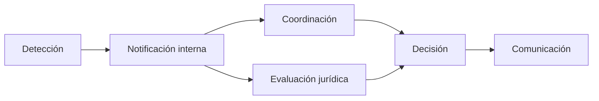

# B119-C20 — Simulación de respuesta institucional a incidentes

<!-- nav:top -->
[🏠 Programa](../../../../README.md) · [📚 Bloque B119](../../../tronco-comun/B119-derecho-seguridad-y-geopolitica-espacial.md) · [← Anterior: B119-C19 — Legislación comparada y casos nacionales](../B119-C19-legislacion-comparada-y-casos-nacionales/CLASE.md) · [Siguiente: B119-C21 — Cultura de seguridad aeroespacial y aprendizaje de incidentes →](../B119-C21-cultura-de-seguridad-aeroespacial-y-aprendizaje-de-incidentes/CLASE.md)
<!-- /nav -->

## 1. Ubicación, nivel y alcance

Clase 20 del bloque B119. Nivel N3. Cuando ocurre un incidente (un reingreso inesperado, una colisión, una interferencia), una institución debe detectarlo, notificarlo, coordinarse, decidir y comunicar. Esta clase simula esas cinco etapas con tiempos sintéticos, calcula la media y los percentiles del tiempo total y estima cuánto se gana al hacer en paralelo dos etapas que no dependen una de otra. El art. XI y el art. VI del Convenio de Registro dan el marco de información y ayuda. **Esta clase es educativa: no es asesoría legal, regulatoria ni financiera y no sustituye a un jurista, a una autoridad competente ni a un asesor.**

## 2. Por qué esta clase existe

Las clases anteriores estudian reglas; esta pone a prueba si una cadena de respuesta es suficientemente rápida. Es la clase integradora del bloque junto con la matriz de obligaciones (C33). La decisión central: **¿qué etapa conviene acortar o paralelizar para comunicar a tiempo y con cuánta confianza?**

## 3. Lo que podrás hacer al terminar

1. Enunciar los deberes de informar (art. XI) y de ayudar a identificar objetos (art. VI del Convenio de Registro).
2. Simular un proceso secuencial de cinco etapas y calcular media y percentiles.
3. Calcular la media analítica de la suma y del máximo de exponenciales y verificar.
4. Medir el efecto de paralelizar y la probabilidad de comunicar dentro de 24 h.
5. Separar lo consultado (texto normativo con versión y fecha) de lo sintético o ilustrativo.

La evidencia es la **cronograma simulado de respuesta con percentiles** del ejercicio 12 (sección 20).

## 4. Con qué llegas y cómo comprobarlo

1. ¿Qué es una distribución exponencial?
2. ¿Qué es un percentil?
3. ¿Qué es el máximo de dos tiempos?
4. ¿Cómo se suman las medias?
5. ¿Qué es un cuello de botella?

<details>
<summary>Ver respuestas</summary>

1. La de un tiempo de espera sin memoria con media `m`. 2. El valor bajo el cual queda esa fracción de los casos. 3. El tiempo de la tarea más lenta cuando se hacen a la vez. 4. La media de una suma es la suma de las medias. 5. La etapa que más limita el tiempo total.
</details>

Con cuatro o cinco aciertos, sigue; si no, repasa los prerrequisitos.

## 5. Un caso de contexto y casos de referencia

La nota de la ONU (consultada el 2026-11-11) recoge el art. XI: los Estados informan a la ONU, al público y a la comunidad científica sobre sus actividades en la mayor medida posible; y la página de UNOOSA del Convenio de Registro (art. VI) prevé ayuda en la identificación de objetos. **No se consultó ningún protocolo institucional.** El **ejemplo conductor**: cinco etapas con tiempos exponenciales de media 2, 1, 6, 3 y 1 horas (suma 13), más una evaluación jurídica de media 5 horas que puede hacerse en paralelo con la coordinación.

## 6. Vocabulario

Una **etapa** es un paso de la respuesta. El **tiempo total** es la suma de etapas secuenciales. **Paralelizar** es hacer etapas independientes a la vez, con tiempo igual al máximo. El **percentil 95** es el tiempo que se supera solo el 5 % de las veces. Un **cuello de botella** domina el tiempo.

## 7. Modelo mental



*Descripción textual:* tras detectar y notificar, la coordinación y la evaluación jurídica pueden ir en paralelo; ambas deben terminar antes de decidir y comunicar.

Analogía: una cocina donde varias preparaciones se hacen a la vez y el plato sale cuando termina la más lenta. Límite: en una institución real las etapas no son independientes y los tiempos no son exponenciales.

## 8. La explicación, paso a paso

### 8.1 Secuencial

Media `17.99 h` (analítica `18.00`); p95 `34.5 h`. La probabilidad de comunicar en 24 h es `0.790`.

### 8.2 Con paralelismo

Media `15.27 h` (analítica `15.27`); p95 `29.1 h`. P(comunicar en 24 h) = `0.883`.

### 8.3 Ahorro

Paralelizar ahorra `2.72 h` en promedio (`15.1 %`). La media del máximo de dos exponenciales es `a + b − ab/(a+b)`.

### 8.4 Lo que no mide

No incluye fallos de comunicación, decisiones políticas ni información incompleta, que suelen dominar en casos reales.

## 9. Magnitudes, símbolos y unidades

| Símbolo | Qué es | Unidad | Valor / nota |
|---|---|---|---|
| `m_k` | media de la etapa `k` | h | 2; 1; 6; 3; 1 |
| `m_J` | media de la evaluación jurídica | h | 5 |
| `E[T]` | media del tiempo total | h | 17.99 / 15.27 |
| p95 | percentil 95 | h | 34.5 / 29.1 |

## 10. Convenciones y referencias

Tiempos en horas; exponenciales con las medias indicadas; semilla 119; N = 200 000.

## 11. De dónde sale lo que afirmamos

| ID | Fuente | Localizador | Respalda | Estado |
|---|---|---|---|---|
| S3 | ONU, Biblioteca Audiovisual de Derecho Internacional, nota introductoria sobre el Tratado del Espacio Ultraterrestre, https://legal.un.org/avl/ha/tos/tos.html (WebFetch, consultada 2026-11-11; no discute los artículos V ni VII) | art. XI | información a la ONU, al público y a la comunidad científica | Consultada |
| S1 | UNOOSA, «Convention on Registration of Objects Launched into Outer Space» (página oficial), https://www.unoosa.org/oosa/en/ourwork/spacelaw/treaties/registration-convention.html (WebFetch, consultada 2026-11-11) | art. VI | ayuda a la identificación de objetos | Consultada |
| — | Protocolos institucionales reales | — | no consultados | No consultado / ilustrativo |
| — | Tiempos y estructura de la cadena | — | sintéticos | No consultado / ilustrativo |

Límites: la estructura y los tiempos son sintéticos; no se consultó ningún protocolo. Texto normativo parafraseado de las páginas oficiales en la fecha indicada; el texto vinculante es el de la fuente oficial vigente.

## 12. Cómo ver la situación

| Magnitud | Valor |
|---|---|
| Media secuencial | 17.99 h |
| Media en paralelo | 15.27 h |
| Ahorro | 2.72 h (15.1 %) |
| P(≤ 24 h) en paralelo | 0.883 |

Descripción larga: paralelizar una etapa independiente reduce la media y la cola del tiempo total.

## 13. Ejemplo trabajado: el máximo de dos etapas

**Paso 1.** `a = 6`, `b = 5`. **Paso 2.** `E[máx] = 6 + 5 − 30/11 = 8,27 h`. **Paso 3.** La suma sería 11 h: el ahorro es `2,73 h`. **Paso 4.** El resto de etapas suma 7 h.

## 14. Distintas formas de describirlo

**Por etapa:** media. **Por estructura:** serie o paralelo. **Por estadístico:** media, p90, p95. **Por objetivo:** P(≤ 24 h).

## 15. Práctica guiada

**Ejercicio 1 · con los pasos indicados.** Suma las medias de las cinco etapas.

<details><summary>Solución comentada</summary>

`2 + 1 + 6 + 3 + 1 = 13 h`.
</details>

**Ejercicio 2 · con una pista.** Añade la evaluación jurídica en serie. *Pista:* sumar 5.

<details><summary>Solución comentada</summary>

`18 h` (`18.00` en el modelo, que lo trata como etapa extra).
</details>

**Ejercicio 3 · casi autónomo.** Calcula `E[máx]` con medias 6 y 5.

<details><summary>Solución comentada</summary>

`8,27 h`.
</details>

## 16. Práctica autónoma, transferencia e integrador

**Ejercicio 4 · autónomo.** Calcula la media total con paralelismo.

<details><summary>Solución comentada</summary>

`15.27 h`.
</details>

**Ejercicio 5 · autónomo.** ¿Qué etapa es el mayor cuello de botella?

<details><summary>Solución comentada</summary>

La coordinación (media 6 h).
</details>

**Ejercicio 6 · autónomo.** ¿Qué pasa si se reduce la coordinación a 3 h?

<details><summary>Solución comentada</summary>

La media total baja unas 3 h; vuelve a simular para ver el efecto en el p95.
</details>

**Ejercicio 7 · autónomo.** ¿Por qué el p95 supera mucho a la media?

<details><summary>Solución comentada</summary>

Porque los tiempos exponenciales tienen cola larga.
</details>

**Ejercicio 8 · autónomo.** ¿Qué dice el art. XI de informar?

<details><summary>Solución comentada</summary>

Informar a la ONU, al público y a la comunidad científica en la mayor medida posible.
</details>

**Ejercicio 9 · transferencia.** **Transferencia.** ¿Por qué no se pueden paralelizar todas las etapas?

<details><summary>Solución comentada</summary>

Porque la decisión necesita el resultado de la coordinación y de la evaluación.
</details>

**Ejercicio 10 · transferencia.** **Transferencia.** ¿Qué haría una institución para acortar la detección?

<details><summary>Solución comentada</summary>

Mejor vigilancia y alertas automáticas; ver C13.
</details>

**Ejercicio 11 · transferencia.** **Transferencia.** ¿Qué límite tiene aplicar este modelo a un incidente real?

<details><summary>Solución comentada</summary>

Los tiempos reales no son independientes ni exponenciales y las decisiones son políticas.
</details>

**Ejercicio 12 · integrador.** **Integrador.** Elabora tu *cronograma simulado de respuesta con percentiles*: etapas, media, p95, ahorro por paralelismo y aviso de que es educativo.

<details><summary>Solución comentada</summary>

Secciones 8.1–8.4 y la salida del laboratorio.
</details>

## 17. Laboratorio: respuesta institucional simulada

El script [laboratorio.py](laboratorio.py) simula 200 000 incidentes con cinco etapas, en serie y con dos etapas en paralelo (**comprueba** las medias contra las fórmulas a tres errores estándar).

**Datos:** art. XI y art. VI consultados (2026-11-11); etapas y tiempos **sintéticos**. **Predice antes de ejecutar:** ¿cuánto bajará la media al paralelizar? (unas 2 a 3 horas.) **Ejecución del 2026-11-11 (Python 3.12.9):**

```text
Python 3.12.9 (biblioteca estandar)
Etapas SINTETICAS con tiempos exponenciales; art. XI y art. VI (Registro) consultados 2026-11-11; ningun protocolo real consultado.
               media [h]  mediana  p90    p95   media analitica
secuencial       17.99    16.44  29.56  34.50      18.00
en paralelo      15.27    13.94  24.94  29.09      15.27
Ahorro medio por paralelizar la evaluacion juridica: 2.72 h (15.1 %)
P(comunicar en 24 h): secuencial 0.7900 ; paralelo 0.8834
CLAVES {"ms": "17.99", "mp": "15.27", "p95s": "34.5", "p95p": "29.1", "ah": "2.72", "ahp": "15.1", "a24s": "0.790", "a24p": "0.883", "es": "18.00", "ep": "15.27"}
Pruebas superadas.
```

```bash
python programa/clases/B119/B119-C20-simulacion-de-respuesta-institucional-a-incidentes/laboratorio.py
```

**Límites:** etapas independientes con tiempos exponenciales; sin recursos limitados ni escalada política.

## 18. Errores frecuentes y cómo corregirlos

**Sumar el máximo como si fuera una suma.** Se corrige con el ejercicio 3.

**Mirar solo la media.** Se corrige con el ejercicio 7.

**Paralelizar etapas dependientes.** Se corrige con el ejercicio 9.

**Tomar los tiempos como reales.** Se corrige con la sección 11.

## 19. Cómo sabrás que vas bien

Tras la sección 8: ¿qué resultado esperabas en el ejemplo trabajado y cuál obtuviste? Si dudas, repasa la sección 13. Tras el laboratorio: ¿qué comprueba cada prueba? (ver la sección 17).

## 20. Qué entregas y cómo se evalúa

El producto es tu **cronograma simulado de respuesta con percentiles** (ejercicio 12).

| Criterio | Inicial | En desarrollo | Logrado | Destacado |
|---|---|---|---|---|
| Conceptos | Los confunde | Parciales | Usa el vocabulario con precisión | Explica los límites del modelo |
| Cálculo | Sin unidades | Con errores | Resultados con unidades y tolerancia | Calcula casos nuevos |
| Verificación | Sin comprobar | Un caso | Contraste con una segunda vía | Interpreta las diferencias |
| Fuentes | Sin fuente | Sin fecha | Fuentes con versión, fecha y estado | Declara lo sintético y lo no consultado |
| Límites | No los nombra | Uno | Tres | Discute qué falta del modelo |

**Condiciones críticas (no se compensan con promedio):** citar la versión y la fecha del texto normativo consultado; rotular lo sintético y lo ilustrativo; no presentar un resultado como asesoría legal, regulatoria o financiera.

## 21. Ética, seguridad y límites

Clase educativa: **no es asesoría legal, regulatoria ni financiera**; no sustituye a un abogado, a la autoridad competente ni a un asesor, y ningún resultado debe usarse para decidir sobre una licencia, una reclamación, un contrato o una operación real. El cronograma no evalúa a ninguna institución; todos los tiempos son sintéticos. Los modelos son simplificados y sus datos son sintéticos o ilustrativos; lo simulado nunca se presenta como observado. Accesibilidad: tablas equivalentes a las gráficas, fórmulas en texto, ejercicios sin conexión.

## 22. Para cerrar y seguir

La media sintética pasa de `17.99` a `15.27` horas al paralelizar. Queda una pregunta: ¿cómo se aprende de los incidentes para que la próxima respuesta sea mejor?

**Glosario español–inglés.** respuesta a incidentes · *incident response*; etapa · *stage*; percentil · *percentile*; cuello de botella · *bottleneck*.

**Continuidad.** [B119-C21](../B119-C21-cultura-de-seguridad-aeroespacial-y-aprendizaje-de-incidentes/CLASE.md): la cultura de seguridad aeroespacial y el aprendizaje de incidentes.

**Referencias:** ver sección 11.

<!-- nav:bottom -->
---

[← Anterior: B119-C19 — Legislación comparada y casos nacionales](../B119-C19-legislacion-comparada-y-casos-nacionales/CLASE.md) · [📚 Bloque B119](../../../tronco-comun/B119-derecho-seguridad-y-geopolitica-espacial.md) · [Siguiente: B119-C21 — Cultura de seguridad aeroespacial y aprendizaje de incidentes →](../B119-C21-cultura-de-seguridad-aeroespacial-y-aprendizaje-de-incidentes/CLASE.md)
<!-- /nav -->
