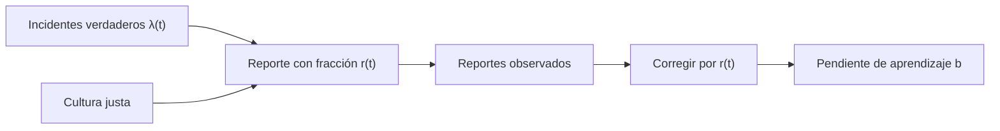

# B119-C21 — Cultura de seguridad aeroespacial y aprendizaje de incidentes

<!-- nav:top -->
[🏠 Programa](../../../../README.md) · [📚 Bloque B119](../../../tronco-comun/B119-derecho-seguridad-y-geopolitica-espacial.md) · [← Anterior: B119-C20 — Simulación de respuesta institucional a incidentes](../B119-C20-simulacion-de-respuesta-institucional-a-incidentes/CLASE.md) · [Siguiente: B119-C22 — Seguridad de instalaciones y operaciones de sitio de lanzamiento →](../B119-C22-seguridad-de-instalaciones-y-operaciones-de-sitio-de-lanzamiento/CLASE.md)
<!-- /nav -->

## 1. Ubicación, nivel y alcance

Clase 21 del bloque B119. Nivel N3. La seguridad no depende solo de reglas y cálculos: también de si la gente informa lo que ve y de si la organización aprende. Esta clase modela una organización **ficticia** cuya tasa verdadera de incidentes baja con el aprendizaje mientras sube la fracción que se reporta, y muestra la paradoja de que los reportes pueden aumentar aunque la seguridad mejore. Se ancla en el principio de informar del art. XI. **Esta clase es educativa: no es asesoría legal, regulatoria ni financiera y no sustituye a un jurista, a una autoridad competente ni a un asesor.**

## 2. Por qué esta clase existe

B88-C16 cubre la seguridad funcional técnica; ninguna clase trata la dimensión cultural, y los indicadores de reportes se malinterpretan con facilidad. La decisión central: **¿qué indicador permite saber si una organización aprende cuando los reportes dependen de la confianza para informar?**

## 3. Lo que podrás hacer al terminar

1. Relacionar el principio de informar (art. XI) con la cultura de reporte.
2. Ajustar una curva de aprendizaje `λ(t) = λ₁ t^(−b)` en escala log-log.
3. Distinguir la serie de reportes crudos de la serie corregida por la fracción reportada.
4. Reconocer la paradoja de que más reportes pueden significar mejor cultura.
5. Separar lo consultado (texto normativo con versión y fecha) de lo sintético o ilustrativo.

La evidencia es la **ficha de indicadores de cultura de seguridad** del ejercicio 12 (sección 20).

## 4. Con qué llegas y cómo comprobarlo

1. ¿Qué es una ley de potencia?
2. ¿Qué es una regresión log-log?
3. ¿Qué es una distribución de Poisson?
4. ¿Qué es la subnotificación?
5. ¿Qué es una cultura justa?

<details>
<summary>Ver respuestas</summary>

1. Una relación `y = a x^k`. 2. Un ajuste lineal de `log y` contra `log x`; da el exponente. 3. La de un conteo de eventos independientes a tasa constante. 4. Que solo se reporta una fracción de lo ocurrido. 5. Una en que se distingue el error de la conducta temeraria y se aprende sin castigar el reporte honesto.
</details>

Con cuatro o cinco aciertos, sigue; si no, repasa los prerrequisitos.

## 5. Un caso de contexto y casos de referencia

El art. XI del tratado de 1967 (nota de la ONU, consultada el 2026-11-11) pide informar en la mayor medida posible sobre las actividades espaciales. **No se consultó ninguna norma de seguridad ni estudio de cultura.** El **ejemplo conductor**: una organización ficticia con 100 unidades de exposición por año, tasa verdadera `λ(t) = 12 t^(−0,30)` incidentes por unidad de exposición (1200 esperados el año 1) y una fracción reportada que crece de 0,35 a 0,90 en 10 años. Todo es sintético.

## 6. Vocabulario

La **cultura de seguridad** son las actitudes y prácticas compartidas sobre el riesgo. La **fracción reportada** `r(t)` es la proporción de incidentes que se informan. La **curva de aprendizaje** muestra la baja de la tasa de fallas con la experiencia. Una **cultura justa** protege el reporte honesto. **Subnotificación** es informar menos de lo ocurrido.

## 7. Modelo mental



*Descripción textual:* los incidentes verdaderos pasan por el filtro de la fracción reportada; corregir por ella permite estimar el aprendizaje real.

Analogía: una alarma de humo más sensible: suena más al principio aunque haya menos incendios. Límite: en la realidad `r(t)` no se conoce y hay que estimarla.

## 8. La explicación, paso a paso

### 8.1 Dos curvas

Tasa verdadera: del año 1 (`1200` incidentes esperados) al año 10 (`601`). Reportes: año 1, `404`; año 10, `571`.

### 8.2 Pendientes

La pendiente verdadera es `-0.300`. De los reportes crudos se obtiene `0.136` (engañosa); corregidos por `r(t)`, `-0.285`.

### 8.3 La paradoja

Que los reportes bajen menos de lo que bajan los incidentes (o incluso suban) no significa que la seguridad empeore: puede significar que más gente informa.

### 8.4 Qué se necesita para medir

Un estimador de `r(t)` (encuestas, auditorías, comparación con registros independientes).

## 9. Magnitudes, símbolos y unidades

| Símbolo | Qué es | Unidad | Valor / nota |
|---|---|---|---|
| `λ₁` | tasa en el año 1 | incidentes por unidad de exposición | 12 |
| `b` | exponente de aprendizaje | — | 0,30 |
| `r(t)` | fracción reportada | — | 0,35 → 0,90 |
| exposición | unidades por año | — | 100 |

## 10. Convenciones y referencias

Años 1 a 10; tasa por unidad de exposición; semilla 119; organización ficticia.

## 11. De dónde sale lo que afirmamos

| ID | Fuente | Localizador | Respalda | Estado |
|---|---|---|---|---|
| S3 | ONU, Biblioteca Audiovisual de Derecho Internacional, nota introductoria sobre el Tratado del Espacio Ultraterrestre, https://legal.un.org/avl/ha/tos/tos.html (WebFetch, consultada 2026-11-11; no discute los artículos V ni VII) | art. XI | principio de informar sobre las actividades espaciales | Consultada |
| — | Normas de seguridad y estudios de cultura | — | no consultados | No consultado / ilustrativo |
| — | Relación de Duane | — | no consultada en una fuente concreta; verificada por recuperación del parámetro | No consultado / ilustrativo |
| — | Datos y organización | — | sintéticos | No consultado / ilustrativo |

Límites: no se consultó ninguna fuente de seguridad; `r(t)` es un supuesto sintético conocido por el modelo. Texto normativo parafraseado de las páginas oficiales en la fecha indicada; el texto vinculante es el de la fuente oficial vigente.

## 12. Cómo ver la situación

| Magnitud | Valor |
|---|---|
| Pendiente verdadera | -0.300 |
| Pendiente de reportes crudos | 0.136 |
| Pendiente corregida | -0.285 |
| Reportes año 1 → 10 | 404 → 571 |

Descripción larga: los reportes crudos subestiman el aprendizaje; corregidos, la pendiente se acerca a la verdadera.

## 13. Ejemplo trabajado: una pendiente log-log

**Paso 1.** `λ(1) = 12` y `λ(10) = 12·10^(−0,3) = 6,0`. **Paso 2.** Pendiente `= (log 6 − log 12)/(log 10 − log 1) = −0,301`. **Paso 3.** Coincide con `−b`.

## 14. Distintas formas de describirlo

**Por tasa:** verdadera u observada. **Por escala:** lineal o log-log. **Por cultura:** justa o punitiva. **Por indicador:** reportes, tasa corregida.

## 15. Práctica guiada

**Ejercicio 1 · con los pasos indicados.** Calcula `λ(4)`.

<details><summary>Solución comentada</summary>

`12·4^(−0,3) = 7,92`.
</details>

**Ejercicio 2 · con una pista.** Calcula `λ(10)`. *Pista:* `10^(−0,3) = 0,501`.

<details><summary>Solución comentada</summary>

`6,01`.
</details>

**Ejercicio 3 · casi autónomo.** Calcula la pendiente log-log entre los años 1 y 10.

<details><summary>Solución comentada</summary>

`−0,301`.
</details>

## 16. Práctica autónoma, transferencia e integrador

**Ejercicio 4 · autónomo.** Si `r = 0,5`, ¿cuántos reportes esperas con 12 incidentes?

<details><summary>Solución comentada</summary>

6.
</details>

**Ejercicio 5 · autónomo.** Corrige 18 reportes con `r = 0,6`.

<details><summary>Solución comentada</summary>

30 incidentes.
</details>

**Ejercicio 6 · autónomo.** ¿Qué pasa con los reportes si `r` sube más rápido que lo que baja `λ`?

<details><summary>Solución comentada</summary>

Suben.
</details>

**Ejercicio 7 · autónomo.** ¿Qué pendiente da un reporte de «cero incidentes» constante?

<details><summary>Solución comentada</summary>

Cero: no hay información de aprendizaje, solo silencio.
</details>

**Ejercicio 8 · autónomo.** ¿Qué consultaste para esta clase?

<details><summary>Solución comentada</summary>

Solo el principio de informar del art. XI.
</details>

**Ejercicio 9 · transferencia.** **Transferencia.** ¿Por qué castigar el reporte reduce el aprendizaje?

<details><summary>Solución comentada</summary>

Porque baja `r`, y la organización pierde datos sobre sus propios riesgos.
</details>

**Ejercicio 10 · transferencia.** **Transferencia.** ¿Qué indicadores usarías además de los reportes?

<details><summary>Solución comentada</summary>

Auditorías, simulacros, tiempos de cierre de acciones correctivas.
</details>

**Ejercicio 11 · transferencia.** **Transferencia.** ¿Por qué comparar la tasa entre organizaciones exige cuidado?

<details><summary>Solución comentada</summary>

Porque difieren su exposición y su fracción reportada.
</details>

**Ejercicio 12 · integrador.** **Integrador.** Elabora tu *ficha de indicadores de cultura de seguridad*: tasa, reportes, corrección, pendiente y aviso de que es educativa.

<details><summary>Solución comentada</summary>

Secciones 8.1–8.4 y la salida del laboratorio.
</details>

## 17. Laboratorio: aprendizaje y subnotificación

El script [laboratorio.py](laboratorio.py) simula diez años de reportes de una organización ficticia y ajusta la curva log-log con y sin corrección (**comprueba** la pendiente verdadera exacta y la corregida a 0,15).

**Datos:** art. XI consultado (2026-11-11); organización y datos **sintéticos**. **Predice antes de ejecutar:** ¿serán los reportes del año 10 menores que los del año 1? (no: serán mayores, 571 frente a 404.) **Ejecución del 2026-11-11 (Python 3.12.9):**

```text
Python 3.12.9 (biblioteca estandar)
Organizacion FICTICIA, datos SINTETICOS; art. XI consultado (2026-11-11); ninguna norma ni estudio de seguridad consultado.
 ano  incidentes verdaderos (esp.)  fraccion reportada  reportes observados
   1               1200.0                   0.35                  404
   2                974.7                   0.41                  405
   3                863.1                   0.47                  410
   4                791.7                   0.53                  429
   5                740.4                   0.59                  425
   6                701.0                   0.66                  465
   7                669.3                   0.72                  451
   8                643.1                   0.78                  513
   9                620.7                   0.84                  519
  10                601.4                   0.90                  571
Pendiente log-log: verdadera -0.300 ; de los reportes crudos 0.136 ; de los reportes corregidos por r(t) -0.285
Reportes del ano 1: 404 ; del ano 10: 571 ; incidentes verdaderos esperados 1200 y 601
CLAVES {"p0": "-0.300", "po": "0.136", "pc": "-0.285", "o1": 404, "o10": 571, "v1": "1200", "v10": "601"}
Pruebas superadas.
```

```bash
python programa/clases/B119/B119-C21-cultura-de-seguridad-aeroespacial-y-aprendizaje-de-incidentes/laboratorio.py
```

**Límites:** `r(t)` conocida; sin retardo ni correlación; no describe a ninguna organización.

## 18. Errores frecuentes y cómo corregirlos

**Leer más reportes como peor seguridad.** Se corrige con 8.3.

**Ignorar la subnotificación.** Se corrige con el ejercicio 5.

**Ajustar sin corregir.** Se corrige con 8.2.

**Confundir culpa con aprendizaje.** Se corrige con el ejercicio 9.

## 19. Cómo sabrás que vas bien

Tras la sección 8: ¿qué resultado esperabas en el ejemplo trabajado y cuál obtuviste? Si dudas, repasa la sección 13. Tras el laboratorio: ¿qué comprueba cada prueba? (ver la sección 17).

## 20. Qué entregas y cómo se evalúa

El producto es tu **ficha de indicadores de cultura de seguridad** (ejercicio 12).

| Criterio | Inicial | En desarrollo | Logrado | Destacado |
|---|---|---|---|---|
| Conceptos | Los confunde | Parciales | Usa el vocabulario con precisión | Explica los límites del modelo |
| Cálculo | Sin unidades | Con errores | Resultados con unidades y tolerancia | Calcula casos nuevos |
| Verificación | Sin comprobar | Un caso | Contraste con una segunda vía | Interpreta las diferencias |
| Fuentes | Sin fuente | Sin fecha | Fuentes con versión, fecha y estado | Declara lo sintético y lo no consultado |
| Límites | No los nombra | Uno | Tres | Discute qué falta del modelo |

**Condiciones críticas (no se compensan con promedio):** citar la versión y la fecha del texto normativo consultado; rotular lo sintético y lo ilustrativo; no presentar un resultado como asesoría legal, regulatoria o financiera.

## 21. Ética, seguridad y límites

Clase educativa: **no es asesoría legal, regulatoria ni financiera**; no sustituye a un abogado, a la autoridad competente ni a un asesor, y ningún resultado debe usarse para decidir sobre una licencia, una reclamación, un contrato o una operación real. La organización es ficticia; la clase no evalúa a ninguna entidad real ni a sus personas. Los modelos son simplificados y sus datos son sintéticos o ilustrativos; lo simulado nunca se presenta como observado. Accesibilidad: tablas equivalentes a las gráficas, fórmulas en texto, ejercicios sin conexión.

## 22. Para cerrar y seguir

La pendiente verdadera es `-0.300` y la de reportes crudos `0.136`: la cultura de reporte distorsiona lo que se ve. Queda una pregunta: ¿cómo se aseguran físicamente los lugares donde se lanza?

**Glosario español–inglés.** cultura de seguridad · *safety culture*; curva de aprendizaje · *learning curve*; subnotificación · *under-reporting*; cultura justa · *just culture*.

**Continuidad.** [B119-C22](../B119-C22-seguridad-de-instalaciones-y-operaciones-de-sitio-de-lanzamiento/CLASE.md): la seguridad del sitio de lanzamiento.

**Referencias:** ver sección 11.

<!-- nav:bottom -->
---

[← Anterior: B119-C20 — Simulación de respuesta institucional a incidentes](../B119-C20-simulacion-de-respuesta-institucional-a-incidentes/CLASE.md) · [📚 Bloque B119](../../../tronco-comun/B119-derecho-seguridad-y-geopolitica-espacial.md) · [Siguiente: B119-C22 — Seguridad de instalaciones y operaciones de sitio de lanzamiento →](../B119-C22-seguridad-de-instalaciones-y-operaciones-de-sitio-de-lanzamiento/CLASE.md)
<!-- /nav -->
