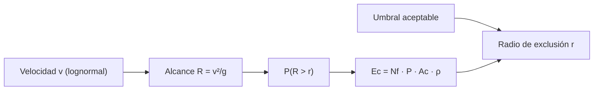

# B119-C22 — Seguridad de instalaciones y operaciones de sitio de lanzamiento

<!-- nav:top -->
[🏠 Programa](../../../../README.md) · [📚 Bloque B119](../../../tronco-comun/B119-derecho-seguridad-y-geopolitica-espacial.md) · [← Anterior: B119-C21 — Cultura de seguridad aeroespacial y aprendizaje de incidentes](../B119-C21-cultura-de-seguridad-aeroespacial-y-aprendizaje-de-incidentes/CLASE.md) · [Siguiente: B119-C23 — Protección ambiental de las actividades de lanzamiento →](../B119-C23-proteccion-ambiental-de-las-actividades-de-lanzamiento/CLASE.md)
<!-- /nav -->

## 1. Ubicación, nivel y alcance

Clase 22 del bloque B119. Nivel N3. Un lanzamiento puede fallar y esparcir fragmentos; la autoridad y el operador fijan zonas de exclusión para que el riesgo para terceros sea aceptable. Aquí calculas, con un modelo balístico simple y datos **sintéticos**, el alcance de los fragmentos, la probabilidad de superar una distancia, la esperanza de bajas fuera de una zona y el radio de exclusión que cumple un criterio **ilustrativo**. **Esta clase es educativa: no es asesoría legal, regulatoria ni financiera y no sustituye a un jurista, a una autoridad competente ni a un asesor.**

## 2. Por qué esta clase existe

B77-C19 solo ve seguridad de rango de forma conceptual; esta clase cuantifica el razonamiento y lo liga a la responsabilidad del Estado por actividades privadas (art. VI) y al régimen de daños (C03). La decisión central: **¿qué tamaño de zona de exclusión hace que la esperanza de bajas sea aceptable y cuánto crece si la población vecina aumenta?**

## 3. Lo que podrás hacer al terminar

1. Relacionar la zona de exclusión con la responsabilidad del Estado (arts. consultados).
2. Calcular el alcance balístico `R = v²/g` y la probabilidad de superar una distancia con una velocidad lognormal.
3. Verificar la probabilidad con Monte Carlo.
4. Despejar el radio de exclusión para una esperanza de bajas dada y su sensibilidad a la población.
5. Separar lo consultado (texto normativo con versión y fecha) de lo sintético o ilustrativo.

La evidencia es la **ficha de zona de exclusión sintética** del ejercicio 12 (sección 20).

## 4. Con qué llegas y cómo comprobarlo

1. ¿Qué es el alcance de un proyectil sin resistencia?
2. ¿Qué es una distribución lognormal?
3. ¿Qué es la función `erfc`?
4. ¿Qué es la esperanza de bajas?
5. ¿Qué es una cota superior?

<details>
<summary>Ver respuestas</summary>

1. `v² sin(2θ)/g`; es máximo a 45°. 2. La de una variable cuyo logaritmo es normal. 3. La función de error complementaria, usada para colas normales. 4. El número medio esperado de víctimas. 5. Un valor que el resultado real no excede.
</details>

Con cuatro o cinco aciertos, sigue; si no, repasa los prerrequisitos.

## 5. Un caso de contexto y casos de referencia

La nota de la ONU (consultada el 2026-11-11) recoge el art. VI (responsabilidad del Estado y autorización y supervisión de las actividades privadas) y el resumen de UNOOSA del Convenio de Responsabilidad (art. II) la responsabilidad absoluta por daños en la superficie. **No se consultó ninguna norma de seguridad de rango**: el umbral `10⁻⁴` es ilustrativo. El **ejemplo conductor**: 200 fragmentos con velocidad lognormal (mediana 70 m/s, `σ = 0,4`), 0,5 m² de área expuesta por persona y 100 personas por km² fuera de la zona.

## 6. Vocabulario

La **zona de exclusión** es el área cerrada a terceros durante el lanzamiento. El **alcance** `R` es la distancia horizontal de un fragmento. La **esperanza de bajas** `E_c` es el número medio de víctimas. El **área expuesta** `A_c` es la superficie efectiva de una persona. La **densidad** `ρ` es personas por área.

## 7. Modelo mental



*Descripción textual:* la velocidad da el alcance, del alcance la probabilidad de superar una distancia, de ella la esperanza de bajas, y se despeja el radio que cumple el umbral.

Analogía: el cerco alrededor de una obra: se pone a la distancia a la que ya casi nada llega. Límite: el viento, la resistencia y la dirección de los fragmentos cambian el área real.

## 8. La explicación, paso a paso

### 8.1 Alcance

Mediana de velocidad 70 m/s: alcance mediano sin resistencia `500 m` (cota superior).

### 8.2 Probabilidad de superar una distancia

`P(R > 5000 m) = 0.00199` (analítica; el Monte Carlo coincide a tres sigmas) y `E_c = 1.99e-05`.

### 8.3 Radio de exclusión

Para `E_c ≤ 10⁻⁴`: `r = 3213 m` (`3.21 km`). Con el doble de población: `3923 m` (`+22.1 %`).

### 8.4 Límites

El modelo ignora resistencia, dirección y fuentes de peligro distintas de los fragmentos (gases, onda de choque, reentrada).

## 9. Magnitudes, símbolos y unidades

| Símbolo | Qué es | Unidad | Valor / nota |
|---|---|---|---|
| `g` | gravedad | m/s² | 9,80665 |
| `v` | velocidad del fragmento | m/s | mediana 70 |
| `ρ` | densidad de personas | 1/m² | 10⁻⁴ |
| `r` | radio de exclusión | m | 3213 |

## 10. Convenciones y referencias

Distancias en m; velocidades en m/s; densidad en personas/m²; umbral ilustrativo `10⁻⁴`; semilla 119.

## 11. De dónde sale lo que afirmamos

| ID | Fuente | Localizador | Respalda | Estado |
|---|---|---|---|---|
| S3 | ONU, Biblioteca Audiovisual de Derecho Internacional, nota introductoria sobre el Tratado del Espacio Ultraterrestre, https://legal.un.org/avl/ha/tos/tos.html (WebFetch, consultada 2026-11-11; no discute los artículos V ni VII) | art. VI | responsabilidad y supervisión de actividades privadas | Consultada |
| S6 | UNOOSA, página del Convenio sobre Responsabilidad Internacional por Daños Causados por Objetos Espaciales, https://www.unoosa.org/oosa/en/ourwork/spacelaw/treaties/liability-convention.html (la lectura directa devolvió 404; solo resumen de búsqueda web, 2026-11-11) | art. II | responsabilidad absoluta por daños en la superficie (resumen de búsqueda) | Resumen de búsqueda |
| — | Normas de seguridad de rango y criterios de riesgo publicados | — | no consultados | No consultado / ilustrativo |
| — | Modelo balístico y lognormal | — | no consultados en una fuente concreta; verificados por Monte Carlo | No consultado / ilustrativo |
| — | Fragmentos, población y umbral | — | sintéticos | No consultado / ilustrativo |

Límites: no se consultó ninguna norma; las magnitudes son sintéticas y el modelo ignora la resistencia del aire. Texto normativo parafraseado de las páginas oficiales en la fecha indicada; el texto vinculante es el de la fuente oficial vigente.

## 12. Cómo ver la situación

| Magnitud | Valor |
|---|---|
| Alcance mediano | 500 m |
| `P(R > 5 km)` | 0.00199 |
| Radio de exclusión | 3.21 km |
| Con doble población | 3923 m (+22.1 %) |

Descripción larga: duplicar la población amplía el radio de exclusión en una fracción moderada (la cola de la distribución lo amortigua).

## 13. Ejemplo trabajado: el radio para Ec ≤ 10⁻⁴

**Paso 1.** `E_c = 200 · P(R>r) · 0,5 · 10⁻⁴`. **Paso 2.** `P(R>r) ≤ 10⁻⁴/(200 · 5×10⁻⁵) = 0,01`. **Paso 3.** El cuantil 0,99 de `R` da `r = 3213 m`.

## 14. Distintas formas de describirlo

**Por distancia:** alcance. **Por probabilidad:** cola. **Por riesgo:** esperanza de bajas. **Por decisión:** radio de exclusión.

## 15. Práctica guiada

**Ejercicio 1 · con los pasos indicados.** Calcula el alcance de un fragmento a 100 m/s.

<details><summary>Solución comentada</summary>

`10 000/9,80665 = 1020 m`.
</details>

**Ejercicio 2 · con una pista.** Calcula el alcance a 200 m/s. *Pista:* escala con `v²`.

<details><summary>Solución comentada</summary>

`4079 m`.
</details>

**Ejercicio 3 · casi autónomo.** Calcula `A_c ρ`.

<details><summary>Solución comentada</summary>

`0,5 × 10⁻⁴ = 5×10⁻⁵` impactos por fragmento que cae fuera.
</details>

## 16. Práctica autónoma, transferencia e integrador

**Ejercicio 4 · autónomo.** Si `P(R>r) = 0,01`, ¿cuánto vale `E_c`?

<details><summary>Solución comentada</summary>

`200 × 0,01 × 5×10⁻⁵ = 10⁻⁴`.
</details>

**Ejercicio 5 · autónomo.** ¿Qué pasa con `r` si `N_f` se duplica?

<details><summary>Solución comentada</summary>

Hace falta `P` mitad: `r` crece (cola de la lognormal).
</details>

**Ejercicio 6 · autónomo.** ¿Qué efecto tiene la resistencia del aire sobre el alcance real?

<details><summary>Solución comentada</summary>

Lo reduce: el modelo es una cota superior.
</details>

**Ejercicio 7 · autónomo.** ¿Qué dato no se consultó para fijar el umbral?

<details><summary>Solución comentada</summary>

La norma de seguridad de rango aplicable.
</details>

**Ejercicio 8 · autónomo.** ¿Qué artículo hace responsable al Estado de las actividades privadas?

<details><summary>Solución comentada</summary>

El art. VI del tratado de 1967.
</details>

**Ejercicio 9 · transferencia.** **Transferencia.** ¿Por qué la zona de exclusión también protege jurídicamente al operador?

<details><summary>Solución comentada</summary>

Porque reduce la probabilidad de daños a terceros por los que respondería (C03).
</details>

**Ejercicio 10 · transferencia.** **Transferencia.** ¿Qué otros peligros requieren zonas aparte?

<details><summary>Solución comentada</summary>

Reentrada de etapas, gases tóxicos y onda de choque.
</details>

**Ejercicio 11 · transferencia.** **Transferencia.** ¿Por qué la poblacion cercana debe informarse?

<details><summary>Solución comentada</summary>

Por seguridad y por el principio de informar; la gestión de comunicación se trata en C20.
</details>

**Ejercicio 12 · integrador.** **Integrador.** Elabora tu *ficha de zona de exclusión sintética*: alcance, cola, `E_c`, radio, sensibilidad y aviso de que es educativa.

<details><summary>Solución comentada</summary>

Secciones 8.1–8.4 y la salida del laboratorio.
</details>

## 17. Laboratorio: alcance de fragmentos y radio de exclusión

El script [laboratorio.py](laboratorio.py) calcula la cola de alcances con `erfc`, la verifica con 400 000 sorteos y despeja el radio que da `E_c ≤ 10⁻⁴` (**comprueba** el Monte Carlo y el radio por bisección).

**Datos:** art. VI y resumen de responsabilidad consultados (2026-11-11); modelo y umbral **sintéticos o ilustrativos**. **Predice antes de ejecutar:** ¿será el radio de exclusión mayor o menor que el alcance mediano? (mayor.) **Ejecución del 2026-11-11 (Python 3.12.9):**

```text
Python 3.12.9 (biblioteca estandar)
Fragmentos y poblacion SINTETICOS; art. VI y Convencion de Responsabilidad consultados (2026-11-11); ninguna norma de rango consultada; umbral 1e-4 ILUSTRATIVO.
Alcance mediano (sin resistencia): 500 m
  r [m]    P(R>r) analitica   Monte Carlo     Ec
   1000          0.19289      0.19284    1.93e-03
   2500          0.02208      0.02217    2.21e-04
   5000          0.00199      0.00199    1.99e-05
   8000          0.00026      0.00028    2.64e-06
  12000          0.00004      0.00003    3.54e-07
Radio de exclusion que da Ec <= 1e-04: 3213 m = 3.21 km
Con el doble de poblacion: radio 3923 m (+22.1 %)
CLAVES {"med": "500", "rex": "3213", "rexk": "3.21", "r2": "3923", "inc": "22.1", "p5": "0.00199", "ec5": "1.99e-05"}
Pruebas superadas.
```

```bash
python programa/clases/B119/B119-C22-seguridad-de-instalaciones-y-operaciones-de-sitio-de-lanzamiento/laboratorio.py
```

**Límites:** sin resistencia del aire ni dirección; un solo peligro; no es un análisis de seguridad de rango.

## 18. Errores frecuentes y cómo corregirlos

**Usar el alcance mediano como zona de seguridad.** Se corrige con 8.3.

**Olvidar elevar `v` al cuadrado.** Se corrige con el ejercicio 2.

**Tratar el umbral como norma.** Se corrige con la sección 11.

**Ignorar otros peligros.** Se corrige con el ejercicio 10.

## 19. Cómo sabrás que vas bien

Tras la sección 8: ¿qué resultado esperabas en el ejemplo trabajado y cuál obtuviste? Si dudas, repasa la sección 13. Tras el laboratorio: ¿qué comprueba cada prueba? (ver la sección 17).

## 20. Qué entregas y cómo se evalúa

El producto es tu **ficha de zona de exclusión sintética** (ejercicio 12).

| Criterio | Inicial | En desarrollo | Logrado | Destacado |
|---|---|---|---|---|
| Conceptos | Los confunde | Parciales | Usa el vocabulario con precisión | Explica los límites del modelo |
| Cálculo | Sin unidades | Con errores | Resultados con unidades y tolerancia | Calcula casos nuevos |
| Verificación | Sin comprobar | Un caso | Contraste con una segunda vía | Interpreta las diferencias |
| Fuentes | Sin fuente | Sin fecha | Fuentes con versión, fecha y estado | Declara lo sintético y lo no consultado |
| Límites | No los nombra | Uno | Tres | Discute qué falta del modelo |

**Condiciones críticas (no se compensan con promedio):** citar la versión y la fecha del texto normativo consultado; rotular lo sintético y lo ilustrativo; no presentar un resultado como asesoría legal, regulatoria o financiera.

## 21. Ética, seguridad y límites

Clase educativa: **no es asesoría legal, regulatoria ni financiera**; no sustituye a un abogado, a la autoridad competente ni a un asesor, y ningún resultado debe usarse para decidir sobre una licencia, una reclamación, un contrato o una operación real. La seguridad de un lanzamiento real requiere analistas, autoridad competente y normativa vigente; esta clase solo enseña el razonamiento. Los modelos son simplificados y sus datos son sintéticos o ilustrativos; lo simulado nunca se presenta como observado. Accesibilidad: tablas equivalentes a las gráficas, fórmulas en texto, ejercicios sin conexión.

## 22. Para cerrar y seguir

El radio sintético de exclusión es `3.21 km` y con el doble de población crece `22.1 %`. Queda una pregunta: ¿qué costo ambiental tiene lanzar?

**Glosario español–inglés.** zona de exclusión · *exclusion zone*; esperanza de bajas · *expected casualties*; alcance · *range*; sitio de lanzamiento · *launch site*.

**Continuidad.** [B119-C23](../B119-C23-proteccion-ambiental-de-las-actividades-de-lanzamiento/CLASE.md): la protección ambiental de las actividades de lanzamiento.

**Referencias:** ver sección 11.

<!-- nav:bottom -->
---

[← Anterior: B119-C21 — Cultura de seguridad aeroespacial y aprendizaje de incidentes](../B119-C21-cultura-de-seguridad-aeroespacial-y-aprendizaje-de-incidentes/CLASE.md) · [📚 Bloque B119](../../../tronco-comun/B119-derecho-seguridad-y-geopolitica-espacial.md) · [Siguiente: B119-C23 — Protección ambiental de las actividades de lanzamiento →](../B119-C23-proteccion-ambiental-de-las-actividades-de-lanzamiento/CLASE.md)
<!-- /nav -->
