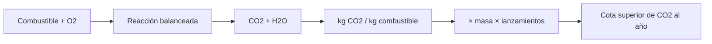

# B119-C23 — Protección ambiental de las actividades de lanzamiento

<!-- nav:top -->
[🏠 Programa](../../../../README.md) · [📚 Bloque B119](../../../tronco-comun/B119-derecho-seguridad-y-geopolitica-espacial.md) · [← Anterior: B119-C22 — Seguridad de instalaciones y operaciones de sitio de lanzamiento](../B119-C22-seguridad-de-instalaciones-y-operaciones-de-sitio-de-lanzamiento/CLASE.md) · [Siguiente: B119-C24 — Límites legales y de seguridad de la experimentación educativa →](../B119-C24-limites-legales-y-de-seguridad-de-la-experimentacion-educativa/CLASE.md)
<!-- /nav -->

## 1. Ubicación, nivel y alcance

Clase 23 del bloque B119. Nivel N3. Lanzar emite gases a la alta atmósfera y al suelo. Esta clase calcula con estequiometría cuánto CO₂ puede liberar un lanzamiento según el combustible, verificando el balance de masa, y lo escala a varios lanzamientos por año, siempre como **cota superior** y con una masa de combustible **sintética**. Se vincula con el art. IX del tratado, que menciona la protección del medio. No sustituye ningún estudio de impacto ambiental. **Esta clase es educativa: no es asesoría legal, regulatoria ni financiera y no sustituye a un jurista, a una autoridad competente ni a un asesor.**

## 2. Por qué esta clase existe

Ninguna clase de B118, B119 ni B124 trata el impacto ambiental de lanzar; esta fija el cálculo básico y sus límites antes de los estudios formales. La decisión central: **¿cuánto cambia la cota de CO₂ según el combustible y cuántos lanzamientos hacen falta para que la suma importe?**

## 3. Lo que podrás hacer al terminar

1. Escribir y balancear la combustión de queroseno, metano e hidrógeno.
2. Calcular kg de CO₂ y de O₂ por kg de combustible y verificar el balance de masa.
3. Escalar a lanzamientos por año como cota superior.
4. Listar lo que el modelo no incluye (combustión incompleta, otros contaminantes, efectos en la atmósfera alta).
5. Separar lo consultado (texto normativo con versión y fecha) de lo sintético o ilustrativo.

La evidencia es la **balance de emisiones de un lanzamiento sintético** del ejercicio 12 (sección 20).

## 4. Con qué llegas y cómo comprobarlo

1. ¿Qué es una masa molar?
2. ¿Qué es balancear una reacción?
3. ¿Qué es una cota superior?
4. ¿Qué es la combustión completa?
5. ¿Qué es el balance de masa?

<details>
<summary>Ver respuestas</summary>

1. La masa de un mol; se suma desde las masas atómicas. 2. Igualar los átomos de cada elemento en reactivos y productos. 3. Un valor que el resultado real no excede. 4. La que convierte todo el carbono en CO₂ y el hidrógeno en agua. 5. Que la masa de los reactivos es igual a la de los productos.
</details>

Con cuatro o cinco aciertos, sigue; si no, repasa los prerrequisitos.

## 5. Un caso de contexto y casos de referencia

La nota de la ONU (consultada el 2026-11-11) indica que el art. IX trata la cooperación y la consideración de los intereses de otros Estados, y señala que aborda brevemente la protección del medio espacial y de la Tierra frente a materia extraterrestre dañina. **No se consultó ninguna norma ambiental de lanzamiento, inventario de emisiones ni estudio de impacto.** El **ejemplo conductor**: un lanzamiento sintético con 100 t de queroseno (aproximado como C₁₂H₂₆) y 10, 50 y 100 lanzamientos por año.

## 6. Vocabulario

La **estequiometría** relaciona masas de reactivos y productos. Una **cota superior** acota por arriba. La **combustión incompleta** produce CO y hollín. Un **propergol** es combustible más oxidante. La **masa molar** `M` se expresa en g/mol.

## 7. Modelo mental



*Descripción textual:* la reacción balanceada da los kilogramos de CO₂ por kilogramo de combustible; se multiplica por la masa y por el número de lanzamientos para una cota anual.

Analogía: contar el carbono de un depósito de combustible: todo el carbono que entra puede salir como CO₂. Límite: no todo sale como CO₂ ni todo se emite a la misma altura, y esa altura importa para el clima.

## 8. La explicación, paso a paso

### 8.1 Queroseno aproximado

`C₁₂H₂₆ + 18,5 O₂ → 12 CO₂ + 13 H₂O`; `M = 170.340 g/mol`; O₂ estequiométrico `3.475 kg/kg`; CO₂ `3.100 kg/kg`. El balance de masa se cumple.

### 8.2 Otros combustibles

Metano: `2.743 kg CO₂/kg`. Hidrógeno: 0 kg de CO₂ (el vapor de agua y los óxidos de nitrógeno no se modelan).

### 8.3 Un lanzamiento y la flota

100 t de queroseno: CO₂ ≤ `310.0 t`. Con 50 lanzamientos por año, ≤ `15502 t`. Son cotas superiores.

### 8.4 Qué falta

Combustión incompleta, hollín, óxidos de nitrógeno, aluminio de los sólidos, altitud de la emisión y efectos en la estratosfera: se evalúan con estudios formales.

## 9. Magnitudes, símbolos y unidades

| Símbolo | Qué es | Unidad | Valor / nota |
|---|---|---|---|
| `M` | masa molar del queroseno aprox. | g/mol | 170.340 |
| `m_CO2` | CO₂ por kg de combustible | kg/kg | 3.100 |
| `m_F` | masa de combustible por lanzamiento | t | 100 |
| `n` | lanzamientos por año | 1/año | 10; 50; 100 |

## 10. Convenciones y referencias

Masas atómicas estándar (no consultadas); masas en kg o toneladas; cota superior de CO₂ de combustión completa.

## 11. De dónde sale lo que afirmamos

| ID | Fuente | Localizador | Respalda | Estado |
|---|---|---|---|---|
| S3 | ONU, Biblioteca Audiovisual de Derecho Internacional, nota introductoria sobre el Tratado del Espacio Ultraterrestre, https://legal.un.org/avl/ha/tos/tos.html (WebFetch, consultada 2026-11-11; no discute los artículos V ni VII) | art. IX | cooperación y mención de la protección del medio (nota) | Consultada |
| — | Normas ambientales de lanzamiento; inventarios de emisiones; estudios de impacto | — | no consultados | No consultado / ilustrativo |
| — | Masas atómicas y reacciones | — | no consultadas en una fuente concreta; verificadas por balance de masa | No consultado / ilustrativo |
| — | Masa de combustible y frecuencia | — | sintéticas | No consultado / ilustrativo |

Límites: no se consultó ningún estudio ambiental; el queroseno real es una mezcla y la combustión real es incompleta. Texto normativo parafraseado de las páginas oficiales en la fecha indicada; el texto vinculante es el de la fuente oficial vigente.

## 12. Cómo ver la situación

| Magnitud | Valor |
|---|---|
| CO₂ por kg de queroseno | 3.100 kg/kg |
| Un lanzamiento (100 t) | ≤ 310.0 t |
| 50 lanzamientos/año | ≤ 15502 t/año |
| CO₂ por kg de metano | 2.743 kg/kg |

Descripción larga: cada tonelada de queroseno puede liberar poco más de tres toneladas de CO₂; el hidrógeno no libera CO₂ pero tiene otros efectos.

## 13. Ejemplo trabajado: queroseno y metano

**Paso 1.** Queroseno: `12 × 44,009/170,34 = 3.100 kg/kg`. **Paso 2.** Metano: `44,009/16,043 = 2.743 kg/kg`. **Paso 3.** Para 100 t: `310.0 t` frente a `274,3 t`.

## 14. Distintas formas de describirlo

**Por reacción:** balanceada. **Por masa:** kg/kg. **Por escala:** lanzamiento, año. **Por límite:** cota superior.

## 15. Práctica guiada

**Ejercicio 1 · con los pasos indicados.** Calcula la masa molar de CO₂.

<details><summary>Solución comentada</summary>

`12,011 + 2 × 15,999 = 44,009 g/mol`.
</details>

**Ejercicio 2 · con una pista.** Calcula la masa molar de H₂O. *Pista:* `2 × 1,008 + 15,999`.

<details><summary>Solución comentada</summary>

`18,015 g/mol`.
</details>

**Ejercicio 3 · casi autónomo.** Calcula kg de CO₂ por kg de metano.

<details><summary>Solución comentada</summary>

`44,009/16,043 = 2.743`.
</details>

## 16. Práctica autónoma, transferencia e integrador

**Ejercicio 4 · autónomo.** Calcula el CO₂ de 100 t de queroseno.

<details><summary>Solución comentada</summary>

`310.0 t`.
</details>

**Ejercicio 5 · autónomo.** Calcula el CO₂ de 50 lanzamientos de 100 t.

<details><summary>Solución comentada</summary>

`15502 t`.
</details>

**Ejercicio 6 · autónomo.** ¿Cuánto O₂ estequiométrico hace falta por kg de queroseno?

<details><summary>Solución comentada</summary>

`3.475 kg`.
</details>

**Ejercicio 7 · autónomo.** ¿Por qué el CO₂ calculado es una cota superior?

<details><summary>Solución comentada</summary>

Porque la combustión real es incompleta y parte del carbono sale como CO o hollín.
</details>

**Ejercicio 8 · autónomo.** ¿Qué artículo del tratado consultado menciona el medio?

<details><summary>Solución comentada</summary>

El art. IX.
</details>

**Ejercicio 9 · transferencia.** **Transferencia.** ¿Por qué la altitud de la emisión importa más allá de la masa?

<details><summary>Solución comentada</summary>

Porque los efectos en la estratosfera difieren de los del suelo.
</details>

**Ejercicio 10 · transferencia.** **Transferencia.** ¿Qué contraste hay entre queroseno e hidrógeno?

<details><summary>Solución comentada</summary>

El hidrógeno no emite CO₂ pero emite vapor y requiere otra cadena de producción.
</details>

**Ejercicio 11 · transferencia.** **Transferencia.** ¿Por qué esta clase no basta para un estudio de impacto?

<details><summary>Solución comentada</summary>

Faltan otros contaminantes, la altitud, el ciclo de vida y la normativa aplicable.
</details>

**Ejercicio 12 · integrador.** **Integrador.** Elabora tu *balance de emisiones de un lanzamiento sintético*: reacciones, kg/kg, un lanzamiento, flota y aviso de que es educativo.

<details><summary>Solución comentada</summary>

Secciones 8.1–8.4 y la salida del laboratorio.
</details>

## 17. Laboratorio: balance de masa y emisiones

El script [laboratorio.py](laboratorio.py) balancea tres combustiones, verifica el balance de masa y escala el CO₂ a lanzamientos por año (**comprueba** la masa a `10⁻⁹` y `3,10 kg/kg` para el queroseno).

**Datos:** art. IX consultado (2026-11-11); masas atómicas estándar no consultadas; combustible y frecuencia **sintéticos**. **Predice antes de ejecutar:** ¿cuánto CO₂ por kg de queroseno? (algo más de tres kilogramos.) **Ejecución del 2026-11-11 (Python 3.12.9):**

```text
Python 3.12.9 (biblioteca estandar)
Combustion completa, cota superior de CO2; masas atomicas estandar (no consultadas); art. IX consultado (2026-11-11); ninguna norma ambiental consultada.
queroseno (C12H26, aproximado)   M = 170.340 g/mol ; O2 estequiometrico  3.475 kg/kg ; CO2  3.100 kg/kg ; balance de masa ok
metano (CH4)                     M =  16.043 g/mol ; O2 estequiometrico  3.989 kg/kg ; CO2  2.743 kg/kg ; balance de masa ok
hidrogeno (H2)                   M =   2.016 g/mol ; O2 estequiometrico  7.936 kg/kg ; CO2  0.000 kg/kg ; balance de masa ok
Un lanzamiento con 100 t de queroseno: CO2 <= 310.0 t
    10 lanzamientos/ano: CO2 <=     3100 t/ano
    50 lanzamientos/ano: CO2 <=    15502 t/ano
   100 lanzamientos/ano: CO2 <=    31003 t/ano
Metano: 274.3 t por 100 t ; hidrogeno: 0 t de CO2 (el vapor y otros efectos no se modelan)
CLAVES {"kq": "3.100", "km": "2.743", "oq": "3.475", "t1": "310.0", "t50": "15502", "mq": "170.340"}
Pruebas superadas.
```

```bash
python programa/clases/B119/B119-C23-proteccion-ambiental-de-las-actividades-de-lanzamiento/laboratorio.py
```

**Límites:** combustión completa, combustible aproximado, sin otros contaminantes ni altitud; no es un inventario.

## 18. Errores frecuentes y cómo corregirlos

**Olvidar el oxígeno del aire en el balance.** Se corrige con 8.1.

**Tomar la cota como emisión medida.** Se corrige con 8.4.

**Confundir masa de CO₂ con masa de carbono.** Se corrige con el ejercicio 1.

**Usar el queroseno como fórmula exacta.** Se corrige con la sección 10.

## 19. Cómo sabrás que vas bien

Tras la sección 8: ¿qué resultado esperabas en el ejemplo trabajado y cuál obtuviste? Si dudas, repasa la sección 13. Tras el laboratorio: ¿qué comprueba cada prueba? (ver la sección 17).

## 20. Qué entregas y cómo se evalúa

El producto es tu **balance de emisiones de un lanzamiento sintético** (ejercicio 12).

| Criterio | Inicial | En desarrollo | Logrado | Destacado |
|---|---|---|---|---|
| Conceptos | Los confunde | Parciales | Usa el vocabulario con precisión | Explica los límites del modelo |
| Cálculo | Sin unidades | Con errores | Resultados con unidades y tolerancia | Calcula casos nuevos |
| Verificación | Sin comprobar | Un caso | Contraste con una segunda vía | Interpreta las diferencias |
| Fuentes | Sin fuente | Sin fecha | Fuentes con versión, fecha y estado | Declara lo sintético y lo no consultado |
| Límites | No los nombra | Uno | Tres | Discute qué falta del modelo |

**Condiciones críticas (no se compensan con promedio):** citar la versión y la fecha del texto normativo consultado; rotular lo sintético y lo ilustrativo; no presentar un resultado como asesoría legal, regulatoria o financiera.

## 21. Ética, seguridad y límites

Clase educativa: **no es asesoría legal, regulatoria ni financiera**; no sustituye a un abogado, a la autoridad competente ni a un asesor, y ningún resultado debe usarse para decidir sobre una licencia, una reclamación, un contrato o una operación real. La clase informa sobre un cálculo básico; las decisiones de política ambiental requieren estudios y participación. Los modelos son simplificados y sus datos son sintéticos o ilustrativos; lo simulado nunca se presenta como observado. Accesibilidad: tablas equivalentes a las gráficas, fórmulas en texto, ejercicios sin conexión.

## 22. Para cerrar y seguir

Cada kilogramo de queroseno puede emitir hasta `3.100` kg de CO₂, y 100 t son hasta `310.0` t. Queda una pregunta: ¿qué límites tiene la experimentación educativa con cohetes?

**Glosario español–inglés.** estequiometría · *stoichiometry*; cota superior · *upper bound*; propergol · *propellant*; combustión incompleta · *incomplete combustion*.

**Continuidad.** [B119-C24](../B119-C24-limites-legales-y-de-seguridad-de-la-experimentacion-educativa/CLASE.md): los límites legales y de seguridad de la experimentación educativa.

**Referencias:** ver sección 11.

<!-- nav:bottom -->
---

[← Anterior: B119-C22 — Seguridad de instalaciones y operaciones de sitio de lanzamiento](../B119-C22-seguridad-de-instalaciones-y-operaciones-de-sitio-de-lanzamiento/CLASE.md) · [📚 Bloque B119](../../../tronco-comun/B119-derecho-seguridad-y-geopolitica-espacial.md) · [Siguiente: B119-C24 — Límites legales y de seguridad de la experimentación educativa →](../B119-C24-limites-legales-y-de-seguridad-de-la-experimentacion-educativa/CLASE.md)
<!-- /nav -->
