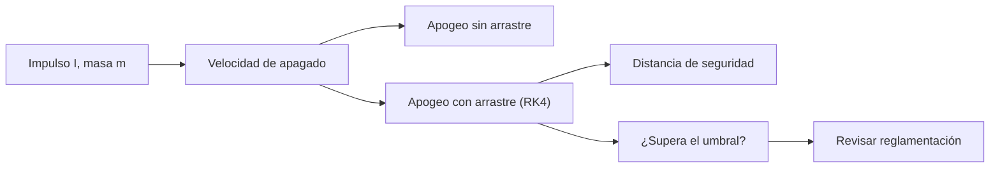

# B119-C24 — Límites legales y de seguridad de la experimentación educativa

<!-- nav:top -->
[🏠 Programa](../../../../README.md) · [📚 Bloque B119](../../../tronco-comun/B119-derecho-seguridad-y-geopolitica-espacial.md) · [← Anterior: B119-C23 — Protección ambiental de las actividades de lanzamiento](../B119-C23-proteccion-ambiental-de-las-actividades-de-lanzamiento/CLASE.md) · [Siguiente: B119-C25 — Derecho y marcos de recursos espaciales →](../../../tronco-comun/B119-derecho-seguridad-y-geopolitica-espacial.md#b119-c25)
<!-- /nav -->

## 1. Ubicación, nivel y alcance

Clase 24 del bloque B119. Nivel N3. Un experimento educativo con un cohete pequeño parece inocente, pero tiene límites de seguridad y legales: altura alcanzada, distancia a las personas y autorización de la actividad. Aquí calculas, con un cohete **sintético** de 100 g, el apogeo con y sin resistencia del aire a partir del impulso total, una distancia de seguridad **ilustrativa** y un umbral de altura que obligaría a revisar la reglamentación. No es una guía de construcción ni de motores. **Esta clase es educativa: no es asesoría legal, regulatoria ni financiera y no sustituye a un jurista, a una autoridad competente ni a un asesor.**

## 2. Por qué esta clase existe

Ninguna clase trata los límites de la experimentación educativa; el art. VI del tratado exige autorización y supervisión de las actividades no gubernamentales, y la escala pequeña no exime de ella. La decisión central: **¿hasta qué energía y altura puede llegar un experimento educativo antes de requerir autorización y medidas adicionales?**

## 3. Lo que podrás hacer al terminar

1. Relacionar el art. VI con la obligación de autorización incluso a escala educativa.
2. Calcular el apogeo sin resistencia con la fórmula analítica y con RK4.
3. Calcular el apogeo con resistencia cuadrática.
4. Estimar una distancia de seguridad ilustrativa y el umbral de revisión.
5. Separar lo consultado (texto normativo con versión y fecha) de lo sintético o ilustrativo.

La evidencia es la **ficha de límites de un experimento educativo** del ejercicio 12 (sección 20).

## 4. Con qué llegas y cómo comprobarlo

1. ¿Qué es el impulso total?
2. ¿Qué es un método RK4?
3. ¿Cómo se calcula la altura de ascenso libre?
4. ¿Qué es la resistencia cuadrática?
5. ¿Qué es una cota ilustrativa?

<details>
<summary>Ver respuestas</summary>

1. La integral del empuje en el tiempo, en N·s. 2. Un integrador numérico de cuarto orden. 3. `v²/(2g)`. 4. `½ ρ C_d A v²`. 5. Un valor didáctico, no una norma.
</details>

Con cuatro o cinco aciertos, sigue; si no, repasa los prerrequisitos.

## 5. Un caso de contexto y casos de referencia

La nota de la ONU (consultada el 2026-11-11) recoge el art. VI: las actividades de entidades no gubernamentales requieren autorización y supervisión continua del Estado. **No se consultó** reglamentación aeronáutica de ningún país, ni códigos de seguridad de cohetes aficionados, ni la clasificación oficial de motores. El **ejemplo conductor**: un cohete sintético de 0,10 kg con un empuje constante durante 1 s equivalente a un impulso total de 2,5 a 20 N·s (clases A a D en una convención conocida **no verificada**).

## 6. Vocabulario

El **impulso total** `I` es la integral del empuje. El **apogeo** es la altura máxima. La **resistencia** frena el cohete. La **distancia de seguridad** separa a las personas del lugar de lanzamiento. Un **umbral de revisión** es la altura o energía desde la cual conviene consultar la reglamentación.

## 7. Modelo mental



*Descripción textual:* el impulso y la masa dan la velocidad; de ella el apogeo con y sin arrastre; del apogeo la distancia de seguridad y la decisión de revisar la reglamentación.

Analogía: una cometa grande: aunque es un juego, hay reglas de dónde y cómo volarla. Límite: aquí la reglamentación real no se consultó.

## 8. La explicación, paso a paso

### 8.1 Sin resistencia

Con `F = I/t_b` y masa constante, la aceleración neta es `F/m − g`. El apogeo analítico de la clase D (20 N·s) es `1939.4 m`, y el numérico con `C_d = 0` coincide a menos del 0,1 %. Para la clase A, `19.4 m`.

### 8.2 Con resistencia

Con `C_d = 0,5`: A `17.2 m`, B `62.0 m`, C `135.5 m`, D `225.3 m`. La resistencia reduce mucho el apogeo de los impulsos mayores.

### 8.3 Distancia de seguridad y umbral

Distancia ilustrativa `0,5 × apogeo`: para D, `112.7 m`. Con el umbral ilustrativo de 150 m, superan la altura: `D`.

### 8.4 Lo que no es

No es una recomendación de construcción, de motores ni de lugares; la autoridad aeronáutica y las asociaciones fijan las reglas reales.

## 9. Magnitudes, símbolos y unidades

| Símbolo | Qué es | Unidad | Valor / nota |
|---|---|---|---|
| `I` | impulso total | N·s | 2,5 a 20 |
| `m` | masa | kg | 0,10 |
| `C_d` | coeficiente de arrastre | — | 0,5 |
| `A` | área frontal | m² | 3,0×10⁻³ |

## 10. Convenciones y referencias

SI; paso de integración 10⁻³ s; empuje constante 1 s; masa constante (simplificación).

## 11. De dónde sale lo que afirmamos

| ID | Fuente | Localizador | Respalda | Estado |
|---|---|---|---|---|
| S3 | ONU, Biblioteca Audiovisual de Derecho Internacional, nota introductoria sobre el Tratado del Espacio Ultraterrestre, https://legal.un.org/avl/ha/tos/tos.html (WebFetch, consultada 2026-11-11; no discute los artículos V ni VII) | art. VI | autorización y supervisión continua de actividades no gubernamentales | Consultada |
| — | Reglamentación aeronáutica; códigos de seguridad de cohetes aficionados; clasificación oficial de motores | — | no consultados | No consultado / ilustrativo |
| — | Cohete y motor | — | sintéticos | No consultado / ilustrativo |

Límites: no se consultó ninguna reglamentación; la distancia y el umbral son ilustrativos. Texto normativo parafraseado de las páginas oficiales en la fecha indicada; el texto vinculante es el de la fuente oficial vigente.

## 12. Cómo ver la situación

| Magnitud | Valor |
|---|---|
| Apogeo D sin arrastre | 1939.4 m |
| Apogeo D con arrastre | 225.3 m |
| Distancia ilustrativa (D) | 112.7 m |
| Superan 150 m | D |

Descripción larga: la resistencia reduce el apogeo, pero el impulso mayor aún cruza el umbral de revisión.

## 13. Ejemplo trabajado: la clase B

**Paso 1.** `F = 5/1 = 5 N`; `a = 5/0,1 − 9,81 = 40,2 m/s²`. **Paso 2.** `v_b = 40,2 m/s`; `y_b = 20,1 m`. **Paso 3.** `y = 20,1 + 40,2²/(2·9,81) = 102,5 m` sin arrastre; con arrastre el RK4 da `62.0 m`.

## 14. Distintas formas de describirlo

**Por energía:** impulso. **Por altura:** apogeo. **Por seguridad:** distancia y umbral. **Por jurídica:** autorización (art. VI).

## 15. Práctica guiada

**Ejercicio 1 · con los pasos indicados.** Calcula la aceleración neta para `I = 5 N·s`.

<details><summary>Solución comentada</summary>

`40,2 m/s²`.
</details>

**Ejercicio 2 · con una pista.** Calcula la velocidad de apagado de la clase B. *Pista:* `a·t_b`.

<details><summary>Solución comentada</summary>

`40,2 m/s`.
</details>

**Ejercicio 3 · casi autónomo.** Calcula el apogeo sin arrastre de la clase B.

<details><summary>Solución comentada</summary>

`102,5 m`.
</details>

## 16. Práctica autónoma, transferencia e integrador

**Ejercicio 4 · autónomo.** Calcula la distancia ilustrativa con apogeo `62.0 m`.

<details><summary>Solución comentada</summary>

La mitad: `62.0/2 = 31,0 m`.
</details>

**Ejercicio 5 · autónomo.** ¿Qué clase supera el umbral de 150 m con arrastre?

<details><summary>Solución comentada</summary>

`D`.
</details>

**Ejercicio 6 · autónomo.** ¿Qué pasa con el apogeo si se duplica la masa a 0,2 kg?

<details><summary>Solución comentada</summary>

Baja mucho: la aceleración neta se reduce y el apogeo disminuye.
</details>

**Ejercicio 7 · autónomo.** ¿Qué pasa si `C_d = 0`?

<details><summary>Solución comentada</summary>

El apogeo numérico iguala el analítico.
</details>

**Ejercicio 8 · autónomo.** ¿Qué consultaste de la normativa?

<details><summary>Solución comentada</summary>

Solo el art. VI del tratado.
</details>

**Ejercicio 9 · transferencia.** **Transferencia.** ¿Por qué la autorización importa aunque el cohete sea pequeño?

<details><summary>Solución comentada</summary>

Porque el Estado responde por las actividades de sus ciudadanos y existen riesgos para terceros y para el tráfico aéreo.
</details>

**Ejercicio 10 · transferencia.** **Transferencia.** ¿Qué haría un docente antes de un experimento real?

<details><summary>Solución comentada</summary>

Consultar la reglamentación y a una asociación reconocida, y usar productos certificados.
</details>

**Ejercicio 11 · transferencia.** **Transferencia.** ¿Por qué esta clase no da dimensiones ni propergoles?

<details><summary>Solución comentada</summary>

Su objetivo es el marco de seguridad y legal, no la construcción.
</details>

**Ejercicio 12 · integrador.** **Integrador.** Elabora tu *ficha de límites de un experimento educativo*: impulso, apogeo, distancia, umbral y aviso de que es educativa.

<details><summary>Solución comentada</summary>

Secciones 8.1–8.4 y la salida del laboratorio.
</details>

## 17. Laboratorio: apogeo y distancia de seguridad

El script [laboratorio.py](laboratorio.py) calcula el apogeo con RK4 y con la fórmula analítica para cuatro impulsos y estima la distancia de seguridad (**comprueba** el apogeo sin arrastre al 0,1 %).

**Datos:** art. VI consultado (2026-11-11); cohete, motor, distancia y umbral **sintéticos o ilustrativos**. **Predice antes de ejecutar:** ¿cuántas de las cuatro clases superarán 150 m con arrastre? (solo la de mayor impulso.) **Ejecución del 2026-11-11 (Python 3.12.9):**

```text
Python 3.12.9 (biblioteca estandar)
Cohete SINTETICO de 0.10 kg; art. VI consultado (2026-11-11); reglamentacion y clasificacion de motores NO consultadas.
  clase  impulso [N s]  apogeo sin arrastre [m]  numerico Cd=0   apogeo con Cd=0.5 [m]  distancia de seguridad ilustrativa [m]
A               2.5                     19.4           19.4                 17.2                            8.6
B               5.0                    102.5          102.4                 62.0                           31.0
C              10.0                    459.9          459.7                135.5                           67.7
D              20.0                   1939.4         1938.8                225.3                          112.7
Clases cuyo apogeo con arrastre supera 150 m (umbral ILUSTRATIVO): ['D']
CLAVES {"aB": "62.0", "aC": "135.5", "aD": "225.3", "anD": "1939.4", "sD": "112.7", "ex": "D", "aA": "17.2", "anA": "19.4"}
Pruebas superadas.
```

```bash
python programa/clases/B119/B119-C24-limites-legales-y-de-seguridad-de-la-experimentacion-educativa/laboratorio.py
```

**Límites:** masa constante, empuje constante, viento ausente; no es una guía de diseño ni de lanzamiento.

## 18. Errores frecuentes y cómo corregirlos

**Ignorar la resistencia.** Se corrige con 8.2.

**Tomar la distancia ilustrativa como norma.** Se corrige con la sección 11.

**Creer que lo pequeño no requiere autorización.** Se corrige con el ejercicio 9.

**Usar la clase para construir.** Se corrige con la sección 21.

## 19. Cómo sabrás que vas bien

Tras la sección 8: ¿qué resultado esperabas en el ejemplo trabajado y cuál obtuviste? Si dudas, repasa la sección 13. Tras el laboratorio: ¿qué comprueba cada prueba? (ver la sección 17).

## 20. Qué entregas y cómo se evalúa

El producto es tu **ficha de límites de un experimento educativo** (ejercicio 12).

| Criterio | Inicial | En desarrollo | Logrado | Destacado |
|---|---|---|---|---|
| Conceptos | Los confunde | Parciales | Usa el vocabulario con precisión | Explica los límites del modelo |
| Cálculo | Sin unidades | Con errores | Resultados con unidades y tolerancia | Calcula casos nuevos |
| Verificación | Sin comprobar | Un caso | Contraste con una segunda vía | Interpreta las diferencias |
| Fuentes | Sin fuente | Sin fecha | Fuentes con versión, fecha y estado | Declara lo sintético y lo no consultado |
| Límites | No los nombra | Uno | Tres | Discute qué falta del modelo |

**Condiciones críticas (no se compensan con promedio):** citar la versión y la fecha del texto normativo consultado; rotular lo sintético y lo ilustrativo; no presentar un resultado como asesoría legal, regulatoria o financiera.

## 21. Ética, seguridad y límites

Clase educativa: **no es asesoría legal, regulatoria ni financiera**; no sustituye a un abogado, a la autoridad competente ni a un asesor, y ningún resultado debe usarse para decidir sobre una licencia, una reclamación, un contrato o una operación real. Los experimentos con cohetes pueden causar daño: usa solo productos y procedimientos certificados, con supervisión y dentro de la ley. Esta clase no da instrucciones de construcción. Los modelos son simplificados y sus datos son sintéticos o ilustrativos; lo simulado nunca se presenta como observado. Accesibilidad: tablas equivalentes a las gráficas, fórmulas en texto, ejercicios sin conexión.

## 22. Para cerrar y seguir

Un impulso de 20 N·s lleva el cohete sintético a `225.3 m` con arrastre, sobre el umbral ilustrativo. Queda una pregunta: ¿cómo se regula la explotación de recursos del espacio?

**Glosario español–inglés.** impulso total · *total impulse*; apogeo · *apogee*; distancia de seguridad · *safety distance*; experimentación educativa · *educational experimentation*.

**Continuidad.** [B119-C25](../B119-C25-derecho-y-marcos-de-recursos-espaciales/CLASE.md): el derecho y los marcos de recursos espaciales.

**Referencias:** ver sección 11.

<!-- nav:bottom -->
---

[← Anterior: B119-C23 — Protección ambiental de las actividades de lanzamiento](../B119-C23-proteccion-ambiental-de-las-actividades-de-lanzamiento/CLASE.md) · [📚 Bloque B119](../../../tronco-comun/B119-derecho-seguridad-y-geopolitica-espacial.md) · [Siguiente: B119-C25 — Derecho y marcos de recursos espaciales →](../../../tronco-comun/B119-derecho-seguridad-y-geopolitica-espacial.md#b119-c25)
<!-- /nav -->
