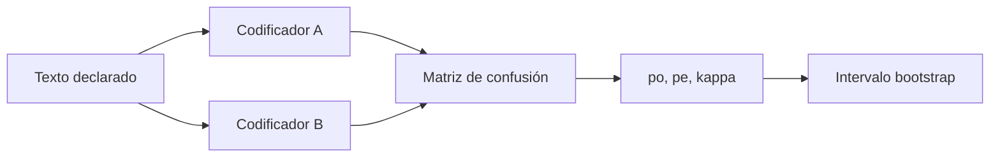

# B119-C26 — Doctrinas y políticas espaciales declaradas públicamente

<!-- nav:top -->
[🏠 Programa](../../../../README.md) · [📚 Bloque B119](../../../tronco-comun/B119-derecho-seguridad-y-geopolitica-espacial.md) · [← Anterior: B119-C25 — Derecho y marcos de recursos espaciales](../B119-C25-derecho-y-marcos-de-recursos-espaciales/CLASE.md) · [Siguiente: B119-C27 — Diplomacia y comunicación entre Estados ante incidentes espaciales →](../B119-C27-diplomacia-y-comunicacion-entre-estados-ante-incidentes-espaciales/CLASE.md)
<!-- /nav -->

## 1. Ubicación, nivel y alcance

Clase 26 del bloque B119. Nivel N3. Cada Estado publica documentos sobre su política espacial, y leerlos de manera sistemática exige un método para que dos lectores lleguen a conclusiones comparables. Aquí aprendes a construir un libro de códigos, a codificar 40 declaraciones **sintéticas** con dos codificadores y a medir su acuerdo con el kappa de Cohen, con un intervalo por remuestreo. No se analiza la doctrina de ningún Estado. **Esta clase es educativa: no es asesoría legal, regulatoria ni financiera y no sustituye a un jurista, a una autoridad competente ni a un asesor.**

## 2. Por qué esta clase existe

C11 y C12 tratan los límites militares y la historia; ninguna clase enseña a leer doctrinas públicas con rigor. La lectura real de documentos oficiales exige fuentes que no se consultaron aquí. La decisión central: **¿cuánta confianza merece una clasificación de textos cuando dos lectores no coinciden siempre?**

## 3. Lo que podrás hacer al terminar

1. Explicar por qué se lee una doctrina contra un marco (arts. IV y XI del tratado, consultados).
2. Construir un libro de códigos con categorías excluyentes.
3. Calcular el acuerdo observado, el acuerdo por azar y el kappa de Cohen, y verificar la fórmula por dos caminos.
4. Obtener un intervalo bootstrap y leer la matriz de confusión.
5. Separar lo consultado (texto normativo con versión y fecha) de lo sintético o ilustrativo.

La evidencia es la **libro de códigos con kappa de Cohen** del ejercicio 12 (sección 20).

## 4. Con qué llegas y cómo comprobarlo

1. ¿Qué es un libro de códigos?
2. ¿Qué es un acuerdo por azar?
3. ¿Qué es el bootstrap?
4. ¿Qué es una matriz de confusión?
5. ¿Qué es una categoría excluyente?

<details>
<summary>Ver respuestas</summary>

1. El conjunto de categorías y reglas para clasificar textos. 2. El acuerdo esperado si los codificadores clasificaran al azar según sus frecuencias. 3. Remuestrear los datos con reemplazo para estimar la incertidumbre. 4. Una tabla de las clasificaciones de un codificador contra las de otro. 5. Una tal que cada texto cae en una sola.
</details>

Con cuatro o cinco aciertos, sigue; si no, repasa los prerrequisitos.

## 5. Un caso de contexto y casos de referencia

La nota de la ONU (consultada el 2026-11-11) resume el art. IV (sin armas de destrucción masiva en el espacio; usos pacíficos de los cuerpos celestes) y el art. XI (informar en la mayor medida posible), un marco contra el que puede leerse una doctrina declarada. **No se consultó ninguna doctrina ni política espacial publicada por un Estado.** El **ejemplo conductor**: 40 declaraciones sintéticas con tema oculto entre cooperación, disuasión, defensa y comercio, y dos codificadores sintéticos que aciertan el tema con probabilidad 0,85.

## 6. Vocabulario

Una **doctrina declarada** es una posición publicada. Un **codificador** asigna categorías. El **acuerdo observado** `p_o` es la fracción de coincidencias. El **acuerdo por azar** `p_e` se calcula de las marginales. El **kappa** `κ = (p_o − p_e)/(1 − p_e)` corrige el azar.

## 7. Modelo mental



*Descripción textual:* dos codificadores leen los mismos textos; sus asignaciones forman una matriz; de ella salen el acuerdo, el kappa y su incertidumbre.

Analogía: dos jueces puntuando el mismo concurso: el porcentaje de coincidencia incluye aciertos por pura casualidad, que el kappa descuenta. Límite: coincidir no prueba que el código sea correcto, solo que es fiable.

## 8. La explicación, paso a paso

### 8.1 Acuerdo

`p_o = 0.625`, `p_e = 0.256`, `κ = 0.496`. Las dos fórmulas de `κ` coinciden a `10⁻¹²`.

### 8.2 Incertidumbre

Con 2000 remuestras, el intervalo del 95 % para `κ` es `[0.274; 0.694]`.

### 8.3 Frente a la verdad

Cada codificador tiene `κ` de `0.697` y `0.795` frente al tema oculto: en la práctica no se conoce la verdad y solo se mide el acuerdo.

### 8.4 Lo que no es

El kappa no dice qué declara un Estado ni si lo cumple; solo cuán fiable es un procedimiento de lectura.

## 9. Magnitudes, símbolos y unidades

| Símbolo | Qué es | Unidad | Valor / nota |
|---|---|---|---|
| `N` | declaraciones | — | 40 |
| `p_o` | acuerdo observado | — | 0.625 |
| `p_e` | acuerdo esperado por azar | — | 0.256 |
| `κ` | kappa de Cohen | — | 0.496 |

## 10. Convenciones y referencias

Categorías excluyentes: cooperación, disuasión, defensa, comercio. Semillas 119 y 120. Textos sintéticos.

## 11. De dónde sale lo que afirmamos

| ID | Fuente | Localizador | Respalda | Estado |
|---|---|---|---|---|
| S3 | ONU, Biblioteca Audiovisual de Derecho Internacional, nota introductoria sobre el Tratado del Espacio Ultraterrestre, https://legal.un.org/avl/ha/tos/tos.html (WebFetch, consultada 2026-11-11; no discute los artículos V ni VII) | arts. IV y XI | marco de lectura: ADM, usos pacíficos e información | Consultada |
| — | Doctrinas y políticas espaciales de cualquier Estado | — | no consultadas | No consultado / ilustrativo |
| — | Kappa de Cohen | — | no consultado en una fuente concreta; verificado por dos fórmulas y el caso de acuerdo perfecto | No consultado / ilustrativo |
| — | Declaraciones y codificadores | — | sintéticos | No consultado / ilustrativo |

Límites: no se leyó ninguna doctrina; los codificadores y los textos son sintéticos. Texto normativo parafraseado de las páginas oficiales en la fecha indicada; el texto vinculante es el de la fuente oficial vigente.

## 12. Cómo ver la situación

| Magnitud | Valor |
|---|---|
| `p_o` | 0.625 |
| `p_e` | 0.256 |
| `κ` | 0.496 |
| Intervalo 95 % | [0.274; 0.694] |

Descripción larga: el acuerdo observado es moderado y el kappa lo corrige a la baja al descontar el azar.

## 13. Ejemplo trabajado: un kappa a mano

**Paso 1.** `p_o = 0,80`, `p_e = 0,25`. **Paso 2.** `κ = (0,80 − 0,25)/(1 − 0,25) = 0,733`. **Paso 3.** Equivale a `1 − (1 − 0,80)/(1 − 0,25) = 0,733`.

## 14. Distintas formas de describirlo

**Por acuerdo:** observado y esperado. **Por categoría:** matriz de confusión. **Por incertidumbre:** bootstrap. **Por método:** libro de códigos.

## 15. Práctica guiada

**Ejercicio 1 · con los pasos indicados.** Calcula `κ` con `p_o = 0,9` y `p_e = 0,25`.

<details><summary>Solución comentada</summary>

`0,867`.
</details>

**Ejercicio 2 · con una pista.** Calcula `κ` con `p_o = p_e`. *Pista:* el numerador.

<details><summary>Solución comentada</summary>

0: el acuerdo es el del azar.
</details>

**Ejercicio 3 · casi autónomo.** Calcula `p_e` con cuatro categorías equiprobables en ambos codificadores.

<details><summary>Solución comentada</summary>

`4 × 0,25² = 0,25`.
</details>

## 16. Práctica autónoma, transferencia e integrador

**Ejercicio 4 · autónomo.** ¿Qué `κ` da el acuerdo perfecto?

<details><summary>Solución comentada</summary>

1.
</details>

**Ejercicio 5 · autónomo.** ¿Qué indica un `κ` negativo?

<details><summary>Solución comentada</summary>

Acuerdo peor que el del azar.
</details>

**Ejercicio 6 · autónomo.** Si `p_o` sube y `p_e` también, ¿sube `κ`?

<details><summary>Solución comentada</summary>

No necesariamente; depende de la diferencia relativa.
</details>

**Ejercicio 7 · autónomo.** ¿Para qué sirve el bootstrap aquí?

<details><summary>Solución comentada</summary>

Para estimar la incertidumbre de `κ` con pocos textos.
</details>

**Ejercicio 8 · autónomo.** ¿Qué consultaste sobre doctrinas?

<details><summary>Solución comentada</summary>

Nada: solo los arts. IV y XI como marco.
</details>

**Ejercicio 9 · transferencia.** **Transferencia.** ¿Por qué hace falta que las categorías sean excluyentes?

<details><summary>Solución comentada</summary>

Para que cada texto tenga una sola etiqueta y el acuerdo esté bien definido.
</details>

**Ejercicio 10 · transferencia.** **Transferencia.** ¿Qué riesgo hay en leer una doctrina con un libro de códigos mal diseñado?

<details><summary>Solución comentada</summary>

Que las categorías induzcan conclusiones y el acuerdo mida solo la convención.
</details>

**Ejercicio 11 · transferencia.** **Transferencia.** ¿Por qué un buen kappa no prueba que la interpretación sea correcta?

<details><summary>Solución comentada</summary>

Mide fiabilidad, no validez.
</details>

**Ejercicio 12 · integrador.** **Integrador.** Elabora tu *libro de códigos con kappa de Cohen*: categorías, matriz, `p_o`, `p_e`, `κ`, intervalo y aviso de que es educativo.

<details><summary>Solución comentada</summary>

Secciones 8.1–8.4 y la salida del laboratorio.
</details>

## 17. Laboratorio: acuerdo entre codificadores

El script [laboratorio.py](laboratorio.py) simula dos codificadores sobre 40 textos, calcula `κ` por dos fórmulas y un intervalo bootstrap (**comprueba** el acuerdo perfecto y la coincidencia de fórmulas).

**Datos:** arts. IV y XI consultados (2026-11-11); textos y codificadores **sintéticos**. **Predice antes de ejecutar:** ¿cuánto valdrá `κ`? (entre 0,4 y 0,6.) **Ejecución del 2026-11-11 (Python 3.12.9):**

```text
Python 3.12.9 (biblioteca estandar)
40 declaraciones SINTETICAS con tema oculto; art. IV y XI consultados (2026-11-11); ninguna doctrina real consultada.
Matriz de confusion entre codificadores (filas A, columnas B):
                 cooper   disuas   defens   comerc
cooperacion           7        1        0        2
disuasion             2        6        0        4
defensa               1        1        5        1
comercio              1        2        0        7
Acuerdo observado po = 0.625 ; esperado por azar pe = 0.256 ; kappa = 0.496
kappa de cada codificador frente a la verdad oculta: 0.697 y 0.795
Intervalo bootstrap del 95 % para kappa: [0.274, 0.694]
CLAVES {"po": "0.625", "pe": "0.256", "k": "0.496", "lo": "0.274", "hi": "0.694", "ka": "0.697", "kb": "0.795"}
Pruebas superadas.
```

```bash
python programa/clases/B119/B119-C26-doctrinas-y-politicas-espaciales-declaradas-publicamente/laboratorio.py
```

**Límites:** categorías simples, dos codificadores y errores simétricos; no analiza doctrinas reales.

## 18. Errores frecuentes y cómo corregirlos

**Reportar solo el porcentaje de acuerdo.** Se corrige con 8.1.

**Confundir fiabilidad con validez.** Se corrige con el ejercicio 11.

**Categorías solapadas.** Se corrige con el ejercicio 9.

**Usar pocas muestras sin intervalo.** Se corrige con 8.2.

## 19. Cómo sabrás que vas bien

Tras la sección 8: ¿qué resultado esperabas en el ejemplo trabajado y cuál obtuviste? Si dudas, repasa la sección 13. Tras el laboratorio: ¿qué comprueba cada prueba? (ver la sección 17).

## 20. Qué entregas y cómo se evalúa

El producto es tu **libro de códigos con kappa de Cohen** (ejercicio 12).

| Criterio | Inicial | En desarrollo | Logrado | Destacado |
|---|---|---|---|---|
| Conceptos | Los confunde | Parciales | Usa el vocabulario con precisión | Explica los límites del modelo |
| Cálculo | Sin unidades | Con errores | Resultados con unidades y tolerancia | Calcula casos nuevos |
| Verificación | Sin comprobar | Un caso | Contraste con una segunda vía | Interpreta las diferencias |
| Fuentes | Sin fuente | Sin fecha | Fuentes con versión, fecha y estado | Declara lo sintético y lo no consultado |
| Límites | No los nombra | Uno | Tres | Discute qué falta del modelo |

**Condiciones críticas (no se compensan con promedio):** citar la versión y la fecha del texto normativo consultado; rotular lo sintético y lo ilustrativo; no presentar un resultado como asesoría legal, regulatoria o financiera.

## 21. Ética, seguridad y límites

Clase educativa: **no es asesoría legal, regulatoria ni financiera**; no sustituye a un abogado, a la autoridad competente ni a un asesor, y ningún resultado debe usarse para decidir sobre una licencia, una reclamación, un contrato o una operación real. No se atribuyen posiciones a Estados reales; todos los textos son sintéticos. Los modelos son simplificados y sus datos son sintéticos o ilustrativos; lo simulado nunca se presenta como observado. Accesibilidad: tablas equivalentes a las gráficas, fórmulas en texto, ejercicios sin conexión.

## 22. Para cerrar y seguir

El kappa sintético es `0.496` con intervalo `[0.274; 0.694]`. Queda una pregunta: ¿cómo se comunican los Estados cuando ocurre un incidente?

**Glosario español–inglés.** doctrina · *doctrine*; libro de códigos · *codebook*; kappa de Cohen · *Cohen's kappa*; fiabilidad · *reliability*.

**Continuidad.** [B119-C27](../B119-C27-diplomacia-y-comunicacion-entre-estados-ante-incidentes-espaciales/CLASE.md): la diplomacia y la comunicación entre Estados ante incidentes.

**Referencias:** ver sección 11.

<!-- nav:bottom -->
---

[← Anterior: B119-C25 — Derecho y marcos de recursos espaciales](../B119-C25-derecho-y-marcos-de-recursos-espaciales/CLASE.md) · [📚 Bloque B119](../../../tronco-comun/B119-derecho-seguridad-y-geopolitica-espacial.md) · [Siguiente: B119-C27 — Diplomacia y comunicación entre Estados ante incidentes espaciales →](../B119-C27-diplomacia-y-comunicacion-entre-estados-ante-incidentes-espaciales/CLASE.md)
<!-- /nav -->
