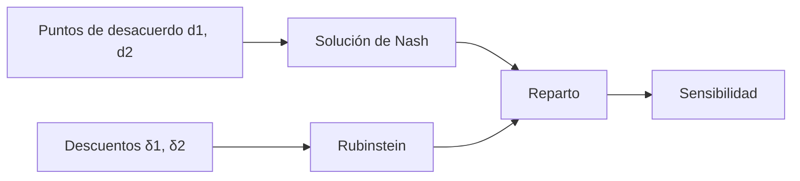

# B119-C27 — Diplomacia y comunicación entre Estados ante incidentes espaciales

<!-- nav:top -->
[🏠 Programa](../../../../README.md) · [📚 Bloque B119](../../../tronco-comun/B119-derecho-seguridad-y-geopolitica-espacial.md) · [← Anterior: B119-C26 — Doctrinas y políticas espaciales declaradas públicamente](../B119-C26-doctrinas-y-politicas-espaciales-declaradas-publicamente/CLASE.md) · [Siguiente: B119-C28 — Normas de comportamiento responsable en el espacio →](../B119-C28-normas-de-comportamiento-responsable-en-el-espacio/CLASE.md)
<!-- /nav -->

## 1. Ubicación, nivel y alcance

Clase 27 del bloque B119. Nivel N3. Tras un incidente espacial, los Estados no solo aplican reglas: negocian cómo notificar, cooperar y reparar. Esta clase modela esa negociación de forma **estilizada** con dos herramientas de teoría de juegos, la solución de Nash y las ofertas alternadas de Rubinstein, y muestra con datos **sintéticos** cómo el punto de desacuerdo y la paciencia de cada parte cambian el reparto. El art. IX del tratado (consultas y cooperación) es el marco. **Esta clase es educativa: no es asesoría legal, regulatoria ni financiera y no sustituye a un jurista, a una autoridad competente ni a un asesor.**

## 2. Por qué esta clase existe

C20 simula la respuesta institucional interna; la diplomacia entre Estados no está cubierta. Esta clase aporta el razonamiento básico de negociación sin pretender describir ninguna práctica. La decisión central: **¿cómo cambian el acuerdo la alternativa de cada parte y su impaciencia?**

## 3. Lo que podrás hacer al terminar

1. Citar el deber de consulta y cooperación del art. IX y de ayuda del art. VI del Convenio de Registro.
2. Calcular la solución de Nash con puntos de desacuerdo.
3. Calcular la solución de Rubinstein y verificarla con inducción hacia atrás.
4. Medir la sensibilidad al descuento (paciencia) de una parte.
5. Separar lo consultado (texto normativo con versión y fecha) de lo sintético o ilustrativo.

La evidencia es la **ficha de negociación con sensibilidad** del ejercicio 12 (sección 20).

## 4. Con qué llegas y cómo comprobarlo

1. ¿Qué es un punto de desacuerdo?
2. ¿Qué es el excedente?
3. ¿Qué es un factor de descuento?
4. ¿Qué es la inducción hacia atrás?
5. ¿Qué es una serie geométrica?

<details>
<summary>Ver respuestas</summary>

1. Lo que cada parte obtiene si no hay acuerdo. 2. Lo que se gana por acordar, respecto de los puntos de desacuerdo. 3. Cuánto vale hoy una unidad que se obtiene mañana (entre 0 y 1). 4. Resolver un juego desde el final hacia el principio. 5. Una suma de potencias de una razón, `1/(1 − r)` si `|r| < 1`.
</details>

Con cuatro o cinco aciertos, sigue; si no, repasa los prerrequisitos.

## 5. Un caso de contexto y casos de referencia

La nota de la ONU (consultada el 2026-11-11) recoge el art. IX: los Estados cooperan y se asisten con consideración a los intereses de los demás, y consultan cuando una actividad pueda causar interferencia perjudicial; y la página de UNOOSA del Convenio de Registro (art. VI) prevé ayuda para identificar objetos. **No se consultó práctica diplomática ni arbitral.** El **ejemplo conductor**: un excedente de 100 unidades de utilidad sintéticas a repartir entre dos Estados con puntos de desacuerdo 10 y 20, y factores de descuento 0,90 y 0,80 para las ofertas alternadas.

## 6. Vocabulario

La **solución de Nash** maximiza el producto de las ganancias sobre el desacuerdo. Las **ofertas alternadas** son un juego donde las partes proponen por turnos. El **factor de descuento** `δ` mide la paciencia. La **inducción hacia atrás** resuelve desde la última ronda.

## 7. Modelo mental



*Descripción textual:* los puntos de desacuerdo dan la solución de Nash; los descuentos dan la solución de Rubinstein; ambas producen un reparto y se analiza su sensibilidad.

Analogía: dos personas que reparten una torta: quien tiene mejor alternativa fuera de la mesa y quien es más paciente consigue más. Límite: los Estados no maximizan una sola utilidad y las reglas de la negociación no son tan limpias.

## 8. La explicación, paso a paso

### 8.1 Nash

Excedente `100 − 10 − 20 = 70`; cada parte recibe su desacuerdo más la mitad del excedente: Estado 1, `45.0`; Estado 2, `55.0`.

### 8.2 Rubinstein

El primer proponente obtiene `(1 − δ₂)/(1 − δ₁δ₂) = 0.7143` de la torta; el otro, `0.286`. La inducción hacia atrás da el mismo valor.

### 8.3 Paciencia

Si el Estado 2 se impacienta (`δ₂ = 0,6`), el primer proponente obtiene `0.8696`; si es muy paciente (`0,95`), `0.3448`.

### 8.4 Qué no es

Una negociación real incluye información privada, terceros y opinión pública; este modelo solo ilustra dos fuerzas.

## 9. Magnitudes, símbolos y unidades

| Símbolo | Qué es | Unidad | Valor / nota |
|---|---|---|---|
| `S` | excedente total | u.u. | 100 |
| `d₁`, `d₂` | puntos de desacuerdo | u.u. | 10; 20 |
| `δ₁`, `δ₂` | factores de descuento | — | 0,90; 0,80 |
| `x₁` | parte del primer proponente | — | 0.7143 |

## 10. Convenciones y referencias

Utilidades sintéticas en unidades arbitrarias; descuentos entre 0 y 1; torta normalizada a 1 en Rubinstein.

## 11. De dónde sale lo que afirmamos

| ID | Fuente | Localizador | Respalda | Estado |
|---|---|---|---|---|
| S3 | ONU, Biblioteca Audiovisual de Derecho Internacional, nota introductoria sobre el Tratado del Espacio Ultraterrestre, https://legal.un.org/avl/ha/tos/tos.html (WebFetch, consultada 2026-11-11; no discute los artículos V ni VII) | art. IX | cooperación, asistencia mutua y consultas | Consultada |
| S1 | UNOOSA, «Convention on Registration of Objects Launched into Outer Space» (página oficial), https://www.unoosa.org/oosa/en/ourwork/spacelaw/treaties/registration-convention.html (WebFetch, consultada 2026-11-11) | art. VI | ayuda en la identificación de objetos | Consultada |
| — | Práctica diplomática y arbitral | — | no consultada | No consultado / ilustrativo |
| — | Solución de Nash y de Rubinstein | — | no consultadas en una fuente concreta; verificadas por enumeración e inducción | No consultado / ilustrativo |
| — | Utilidades y descuentos | — | sintéticos | No consultado / ilustrativo |

Límites: el modelo es una estilización; no se consultó ninguna negociación real. Texto normativo parafraseado de las páginas oficiales en la fecha indicada; el texto vinculante es el de la fuente oficial vigente.

## 12. Cómo ver la situación

| Magnitud | Valor |
|---|---|
| Nash (Estado 1) | 45.0 |
| Nash (Estado 2) | 55.0 |
| Rubinstein (primer proponente) | 0.7143 |
| Con `δ₂ = 0,6` | 0.8696 |

Descripción larga: la parte del primer proponente crece cuando el otro es impaciente; Nash reparte el excedente por mitades.

## 13. Ejemplo trabajado: Rubinstein a mano

**Paso 1.** `δ₁ = 0,90`, `δ₂ = 0,80`. **Paso 2.** `(1 − 0,80)/(1 − 0,72) = 0,2/0,28 = 0.7143`. **Paso 3.** El otro obtiene `0.286`.

## 14. Distintas formas de describirlo

**Por desacuerdo:** Nash. **Por paciencia:** Rubinstein. **Por reparto:** partes. **Por sensibilidad:** variar `d` o `δ`.

## 15. Práctica guiada

**Ejercicio 1 · con los pasos indicados.** Calcula el excedente de Nash.

<details><summary>Solución comentada</summary>

`100 − 10 − 20 = 70`.
</details>

**Ejercicio 2 · con una pista.** Calcula la parte del Estado 1. *Pista:* `d₁ + 35`.

<details><summary>Solución comentada</summary>

`45.0`.
</details>

**Ejercicio 3 · casi autónomo.** Calcula la parte del Estado 2.

<details><summary>Solución comentada</summary>

`55.0`.
</details>

## 16. Práctica autónoma, transferencia e integrador

**Ejercicio 4 · autónomo.** Calcula Rubinstein con `δ₁ = δ₂ = 0,9`.

<details><summary>Solución comentada</summary>

`0,1/0,19 = 0,526`.
</details>

**Ejercicio 5 · autónomo.** ¿Qué pasa si `δ₂ → 0`?

<details><summary>Solución comentada</summary>

El primer proponente obtiene casi todo.
</details>

**Ejercicio 6 · autónomo.** ¿Qué pasa si sube `d₁` a 30 y `d₂` sigue en 20?

<details><summary>Solución comentada</summary>

El excedente baja a 50 y el Estado 1 recibe `30 + 25 = 55`.
</details>

**Ejercicio 7 · autónomo.** ¿Cuándo no hay acuerdo en Nash?

<details><summary>Solución comentada</summary>

Si `d₁ + d₂ > S`: no hay excedente.
</details>

**Ejercicio 8 · autónomo.** ¿Qué consultaste sobre diplomacia?

<details><summary>Solución comentada</summary>

El art. IX y el art. VI del Convenio de Registro.
</details>

**Ejercicio 9 · transferencia.** **Transferencia.** ¿Por qué el artículo IX de consultas reduce el desacuerdo?

<details><summary>Solución comentada</summary>

Porque obliga a conversar antes, lo que mejora la información y baja el coste del desacuerdo.
</details>

**Ejercicio 10 · transferencia.** **Transferencia.** ¿Por qué la impaciencia perjudica a quien la tiene?

<details><summary>Solución comentada</summary>

Porque el otro puede esperar y obtener un reparto mejor.
</details>

**Ejercicio 11 · transferencia.** **Transferencia.** ¿Qué limita aplicar este modelo a un incidente real?

<details><summary>Solución comentada</summary>

La información incompleta, los terceros y los valores no cuantificables.
</details>

**Ejercicio 12 · integrador.** **Integrador.** Elabora tu *ficha de negociación con sensibilidad*: Nash, Rubinstein, sensibilidad y aviso de que es educativa.

<details><summary>Solución comentada</summary>

Secciones 8.1–8.4 y la salida del laboratorio.
</details>

## 17. Laboratorio: Nash y Rubinstein

El script [laboratorio.py](laboratorio.py) calcula la solución de Nash por fórmula y enumeración y la de Rubinstein por fórmula e inducción hacia atrás (**comprueba** ambas).

**Datos:** art. IX y art. VI consultados (2026-11-11); utilidades y descuentos **sintéticos**. **Predice antes de ejecutar:** ¿obtendrá el Estado 1 más de la mitad en Rubinstein? (sí, es el proponente y más paciente.) **Ejecución del 2026-11-11 (Python 3.12.9):**

```text
Python 3.12.9 (biblioteca estandar)
Negociacion ESTILIZADA con utilidades SINTETICAS; art. IX y art. VI (Registro) consultados 2026-11-11; practica diplomatica NO consultada.
Nash: excedente 70; parte del Estado 1 = 45.0 ; del Estado 2 = 55.0
Rubinstein (descuentos 0.9/0.8): parte del primer proponente en horizonte infinito = 0.7143
Induccion hacia atras con 401 rondas: 0.714286
   descuento del Estado 2 = 0.60: parte del primer proponente = 0.8696
   descuento del Estado 2 = 0.80: parte del primer proponente = 0.7143
   descuento del Estado 2 = 0.95: parte del primer proponente = 0.3448
CLAVES {"n1": "45.0", "n2": "55.0", "rub": "0.7143", "rub2": "0.286", "s6": "0.8696", "s95": "0.3448"}
Pruebas superadas.
```

```bash
python programa/clases/B119/B119-C27-diplomacia-y-comunicacion-entre-estados-ante-incidentes-espaciales/laboratorio.py
```

**Límites:** información completa, dos jugadores, utilidades transferibles; no describe ninguna negociación real.

## 18. Errores frecuentes y cómo corregirlos

**Olvidar los puntos de desacuerdo.** Se corrige con 8.1.

**Confundir paciencia con debilidad.** Se corrige con 8.3.

**Aplicar el modelo a hechos reales.** Se corrige con la sección 21.

**Usar `δ = 1`.** Se corrige con el ejercicio 4.

## 19. Cómo sabrás que vas bien

Tras la sección 8: ¿qué resultado esperabas en el ejemplo trabajado y cuál obtuviste? Si dudas, repasa la sección 13. Tras el laboratorio: ¿qué comprueba cada prueba? (ver la sección 17).

## 20. Qué entregas y cómo se evalúa

El producto es tu **ficha de negociación con sensibilidad** (ejercicio 12).

| Criterio | Inicial | En desarrollo | Logrado | Destacado |
|---|---|---|---|---|
| Conceptos | Los confunde | Parciales | Usa el vocabulario con precisión | Explica los límites del modelo |
| Cálculo | Sin unidades | Con errores | Resultados con unidades y tolerancia | Calcula casos nuevos |
| Verificación | Sin comprobar | Un caso | Contraste con una segunda vía | Interpreta las diferencias |
| Fuentes | Sin fuente | Sin fecha | Fuentes con versión, fecha y estado | Declara lo sintético y lo no consultado |
| Límites | No los nombra | Uno | Tres | Discute qué falta del modelo |

**Condiciones críticas (no se compensan con promedio):** citar la versión y la fecha del texto normativo consultado; rotular lo sintético y lo ilustrativo; no presentar un resultado como asesoría legal, regulatoria o financiera.

## 21. Ética, seguridad y límites

Clase educativa: **no es asesoría legal, regulatoria ni financiera**; no sustituye a un abogado, a la autoridad competente ni a un asesor, y ningún resultado debe usarse para decidir sobre una licencia, una reclamación, un contrato o una operación real. Es un ejercicio de teoría de juegos con datos inventados; no se atribuyen posiciones a Estados reales. Los modelos son simplificados y sus datos son sintéticos o ilustrativos; lo simulado nunca se presenta como observado. Accesibilidad: tablas equivalentes a las gráficas, fórmulas en texto, ejercicios sin conexión.

## 22. Para cerrar y seguir

La parte del primer proponente es `0.7143` y la de Nash `45.0`. Queda una pregunta: ¿cómo se normaliza la conducta responsable entre Estados?

**Glosario español–inglés.** solución de Nash · *Nash bargaining solution*; ofertas alternadas · *alternating offers*; factor de descuento · *discount factor*; punto de desacuerdo · *disagreement point*.

**Continuidad.** [B119-C28](../B119-C28-normas-de-comportamiento-responsable-en-el-espacio/CLASE.md): las normas de comportamiento responsable en el espacio.

**Referencias:** ver sección 11.

<!-- nav:bottom -->
---

[← Anterior: B119-C26 — Doctrinas y políticas espaciales declaradas públicamente](../B119-C26-doctrinas-y-politicas-espaciales-declaradas-publicamente/CLASE.md) · [📚 Bloque B119](../../../tronco-comun/B119-derecho-seguridad-y-geopolitica-espacial.md) · [Siguiente: B119-C28 — Normas de comportamiento responsable en el espacio →](../B119-C28-normas-de-comportamiento-responsable-en-el-espacio/CLASE.md)
<!-- /nav -->
