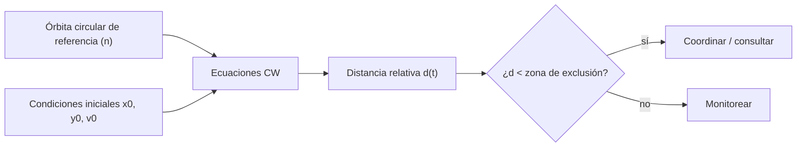

# B119-C28 — Normas de comportamiento responsable en el espacio

<!-- nav:top -->
[🏠 Programa](../../../../README.md) · [📚 Bloque B119](../../../tronco-comun/B119-derecho-seguridad-y-geopolitica-espacial.md) · [← Anterior: B119-C27 — Diplomacia y comunicación entre Estados ante incidentes espaciales](../B119-C27-diplomacia-y-comunicacion-entre-estados-ante-incidentes-espaciales/CLASE.md) · [Siguiente: B119-C29 — Escalada, desescalada y medidas de fomento de la confianza →](../B119-C29-escalada-desescalada-y-medidas-de-fomento-de-la-confianza/CLASE.md)
<!-- /nav -->

## 1. Ubicación, nivel y alcance

Clase 28 del bloque B119. Nivel N3. Cuando un satélite se acerca a otro, la distancia entre ambos y la forma en que cambia son datos de conducta: un acercamiento lento y previsible se entiende distinto de uno abrupto. Aquí usas las ecuaciones de Clohessy–Wiltshire para describir el movimiento relativo en órbita circular, calculas la distancia mínima en tres órbitas para dos condiciones iniciales sintéticas y la comparas con una zona de exclusión **ilustrativa**. El art. IX del tratado (consideración e consultas) es el marco; las normas de conducta responsable no se consultaron. **Esta clase es educativa: no es asesoría legal, regulatoria ni financiera y no sustituye a un jurista, a una autoridad competente ni a un asesor.**

## 2. Por qué esta clase existe

B119-C11 trata límites militares; las normas voluntarias de conducta responsable no tienen clase y se apoyan en conceptos físicos (distancia relativa, deriva, previsibilidad) que esta clase muestra. La decisión central: **¿qué condiciones iniciales mantienen al vecino a distancia constante y cuáles lo hacen derivar o acercarse?**

## 3. Lo que podrás hacer al terminar

1. Citar el deber de consideración y consulta del art. IX y rotular lo no consultado sobre normas de conducta.
2. Escribir las ecuaciones de movimiento relativo y su solución cerrada.
3. Verificar la solución cerrada con integración RK4 y calcular la deriva por órbita.
4. Comparar la distancia mínima con una zona de exclusión ilustrativa.
5. Separar lo consultado (texto normativo con versión y fecha) de lo sintético o ilustrativo.

La evidencia es la **ficha de maniobra de proximidad sintética** del ejercicio 12 (sección 20).

## 4. Con qué llegas y cómo comprobarlo

1. ¿Qué es el movimiento medio `n`?
2. ¿Qué es el sistema LVLH?
3. ¿Qué es una EDO lineal?
4. ¿Qué es una deriva secular?
5. ¿Qué es la transparencia en operaciones?

<details>
<summary>Ver respuestas</summary>

1. `√(GM/a³)`, la velocidad angular de una órbita circular. 2. Un sistema local con `x` radial e `y` a lo largo de la traza. 3. Una ecuación diferencial lineal en las variables; admite solución cerrada. 4. Un cambio que crece con el tiempo. 5. Compartir información sobre una maniobra para que sea previsible.
</details>

Con cuatro o cinco aciertos, sigue; si no, repasa los prerrequisitos.

## 5. Un caso de contexto y casos de referencia

La nota de la ONU (consultada el 2026-11-11) recoge el art. IX: los Estados consideran los intereses de los demás y realizan consultas internacionales previas si una actividad puede causar interferencia perjudicial a otras. **No se consultaron** resoluciones sobre normas de comportamiento responsable ni práctica de operaciones de proximidad; la distancia de exclusión de 200 m es ilustrativa. El **ejemplo conductor**: un satélite vecino a 0,5 km en la dirección radial y 1,5 km a lo largo de la traza de un satélite en órbita circular a 400 km de altura.

## 6. Vocabulario

El **movimiento relativo** describe la posición de un satélite respecto de otro. Las **ecuaciones de Clohessy–Wiltshire** lo aproximan para órbitas circulares y separaciones pequeñas. La **deriva** es el desplazamiento secular. La **zona de exclusión** es una distancia que no se cruza sin coordinación. La **previsibilidad** es la facilidad de anticipar una maniobra.

## 7. Modelo mental



*Descripción textual:* la órbita de referencia y las condiciones iniciales determinan la distancia relativa en el tiempo; se compara con una zona de exclusión para decidir si hace falta coordinar.

Analogía: dos corredores en una pista circular con velocidades casi iguales: si uno va ligeramente más rápido se acerca poco a poco. Límite: las ecuaciones son lineales y solo valen para separaciones pequeñas; no incluyen perturbaciones.

## 8. La explicación, paso a paso

### 8.1 Dinámica

`n = 1.1314e-03 rad/s`, período `92.56 min`. Con `ẏ(0) = −2 n x(0)` no hay deriva: la separación oscila y queda acotada.

### 8.2 Resultados

Sin deriva: distancia mínima en 3 órbitas `500.0 m`. Con velocidad relativa nula: `1568.4 m`, y al final `55050.9 m`: el vecino se aleja por la deriva `12π x₀ = 18.850 km` por órbita.

### 8.3 Verificación

La solución cerrada coincide con RK4 a menos de `10⁻⁶ km` en tres órbitas, y la deriva por órbita coincide con `12π x₀`.

### 8.4 Qué significa para la conducta

Acotada no significa segura: con `y₀ = 1,0 km` la misma geometría sin deriva pasa a `0.0 m` del origen. Una geometría sin deriva es previsible, pero cruzar una zona de exclusión sin avisar puede percibirse como amenaza; por eso el deber de consulta del art. IX.

## 9. Magnitudes, símbolos y unidades

| Símbolo | Qué es | Unidad | Valor / nota |
|---|---|---|---|
| `n` | movimiento medio | rad/s | 1.1314e-03 |
| `x₀`, `y₀` | posición relativa inicial | km | 0,5; 1,5 |
| `d_min` | distancia mínima | m | 500.0 / 1568.4 |
| zona | distancia de exclusión ilustrativa | m | 200 |

## 10. Convenciones y referencias

Km y s; LVLH; órbita circular; movimiento plano; separaciones pequeñas; semilla no aplica (determinista).

## 11. De dónde sale lo que afirmamos

| ID | Fuente | Localizador | Respalda | Estado |
|---|---|---|---|---|
| S3 | ONU, Biblioteca Audiovisual de Derecho Internacional, nota introductoria sobre el Tratado del Espacio Ultraterrestre, https://legal.un.org/avl/ha/tos/tos.html (WebFetch, consultada 2026-11-11; no discute los artículos V ni VII) | art. IX | consideración de los intereses de otros y consultas previas | Consultada |
| — | Normas de comportamiento responsable y práctica de operaciones de proximidad | — | no consultadas | No consultado / ilustrativo |
| — | Ecuaciones de Clohessy–Wiltshire | — | no consultadas en una fuente concreta; verificadas contra RK4 | No consultado / ilustrativo |
| — | Escenario y zona de exclusión | — | sintéticos / ilustrativos | No consultado / ilustrativo |

Límites: no se consultó ninguna norma; el modelo es lineal y sin perturbaciones; no es una guía de operaciones. Texto normativo parafraseado de las páginas oficiales en la fecha indicada; el texto vinculante es el de la fuente oficial vigente.

## 12. Cómo ver la situación

| Magnitud | Valor |
|---|---|
| Período | 92.56 min |
| `d_min` sin deriva | 500.0 m |
| `d_min` con velocidad nula | 1568.4 m |
| Deriva por órbita | 18.850 km |

Descripción larga: sin deriva la separación oscila entre cientos de metros y unos kilómetros; con velocidad relativa nula el vecino se aleja unos 19 km por órbita.

## 13. Ejemplo trabajado: la deriva por órbita

**Paso 1.** Con `ẏ₀ = 0` y `ẋ₀ = 0`: `y(P) − y₀ = 6(sin 2π − 2π) x₀ = −12π x₀`. **Paso 2.** Con `x₀ = 0,5 km`: `18.850 km`. **Paso 3.** El laboratorio confirma este valor.

## 14. Distintas formas de describirlo

**Por física:** CW. **Por condición:** con o sin deriva. **Por distancia:** mínima y final. **Por conducta:** previsibilidad y consulta.

## 15. Práctica guiada

**Ejercicio 1 · con los pasos indicados.** Calcula `n` para `a = 6778,137 km`.

<details><summary>Solución comentada</summary>

`1.1314e-03 rad/s`.
</details>

**Ejercicio 2 · con una pista.** Calcula el período en minutos. *Pista:* `2π/n/60`.

<details><summary>Solución comentada</summary>

`92.56 min`.
</details>

**Ejercicio 3 · casi autónomo.** Calcula la deriva por órbita para `x₀ = 0,2 km`.

<details><summary>Solución comentada</summary>

`12π × 0,2 = 7,54 km`.
</details>

## 16. Práctica autónoma, transferencia e integrador

**Ejercicio 4 · autónomo.** ¿Qué condición evita la deriva?

<details><summary>Solución comentada</summary>

`ẏ₀ = −2 n x₀`.
</details>

**Ejercicio 5 · autónomo.** ¿Qué distancia mínima se obtiene sin deriva?

<details><summary>Solución comentada</summary>

`500.0 m`.
</details>

**Ejercicio 6 · autónomo.** ¿Qué distancia mínima se obtiene con velocidad nula?

<details><summary>Solución comentada</summary>

`1568.4 m`.
</details>

**Ejercicio 7 · autónomo.** ¿Cruza la zona de 200 m el caso sin deriva con `y₀ = 1,5 km`?

<details><summary>Solución comentada</summary>

Sí o no según la salida del laboratorio: la mínima es `500.0 m`.
</details>

**Ejercicio 8 · autónomo.** ¿Qué consultaste sobre conducta?

<details><summary>Solución comentada</summary>

Solo el deber de consideración y consulta del art. IX.
</details>

**Ejercicio 9 · transferencia.** **Transferencia.** ¿Por qué la previsibilidad es relevante para la conducta responsable?

<details><summary>Solución comentada</summary>

Porque facilita distinguir una maniobra rutinaria de una potencialmente hostil.
</details>

**Ejercicio 10 · transferencia.** **Transferencia.** ¿Qué medidas de transparencia reducirían la ambigüedad de un acercamiento?

<details><summary>Solución comentada</summary>

Notificar la maniobra, compartir efemérides y mantener canales de comunicación.
</details>

**Ejercicio 11 · transferencia.** **Transferencia.** ¿Qué límites tiene CW para separaciones grandes?

<details><summary>Solución comentada</summary>

La linealización falla y hay que usar la dinámica kepleriana completa.
</details>

**Ejercicio 12 · integrador.** **Integrador.** Elabora tu *ficha de maniobra de proximidad sintética*: dinámica, dos condiciones, distancia mínima, deriva y aviso de que es educativa.

<details><summary>Solución comentada</summary>

Secciones 8.1–8.4 y la salida del laboratorio.
</details>

## 17. Laboratorio: movimiento relativo y distancia mínima

El script [laboratorio.py](laboratorio.py) evalúa la solución cerrada de CW y la compara con RK4 en tres órbitas para dos condiciones iniciales (**comprueba** el acuerdo a `10⁻⁶ km` y la deriva `12π x₀`).

**Datos:** art. IX consultado (2026-11-11); órbita, posición inicial y zona **sintéticas o ilustrativas**; constantes estándar no consultadas. **Predice antes de ejecutar:** ¿se aleja el vecino con velocidad relativa nula? (sí, por la deriva.) **Ejecución del 2026-11-11 (Python 3.12.9):**

```text
Python 3.12.9 (biblioteca estandar)
Escenario SINTETICO; art. IX consultado (2026-11-11); normas de conducta responsable y practica de proximidad NO consultadas; distancia de exclusion 200 m ILUSTRATIVA.
n = 1.131367e-03 rad/s ; periodo = 92.56 min
sin deriva (y'0 = -2 n x0)    : distancia minima en 3 orbitas    500.0 m ; al final    1581.1 m ; |cerrada - RK4| = 6.4e-14 km
con velocidad relativa nula   : distancia minima en 3 orbitas   1568.4 m ; al final   55050.9 m ; |cerrada - RK4| = 6.2e-13 km
Misma geometria sin deriva pero con y0 = 1.0 km: distancia minima 0.0 m (trayectoria acotada que pasa por el origen)
Cruza la zona de exclusion de 200 m: sin deriva no ; con velocidad nula no
Deriva a lo largo de la traza por orbita con x0 = 0.5 km y velocidad nula: 18.850 km (formula -12 pi x0)
CLAVES {"n": "1.1314e-03", "P": "92.56", "d0": "500.0", "d1": "1568.4", "df1": "55050.9", "der": "18.850", "dcol": "0.0"}
Pruebas superadas.
```

```bash
python programa/clases/B119/B119-C28-normas-de-comportamiento-responsable-en-el-espacio/laboratorio.py
```

**Límites:** movimiento plano, órbita circular, sin perturbaciones; no es una guía de operaciones de proximidad.

## 18. Errores frecuentes y cómo corregirlos

**Usar CW con separaciones grandes.** Se corrige con el ejercicio 11.

**Olvidar la condición sin deriva.** Se corrige con el ejercicio 4.

**Mezclar km y m.** Se corrige con la sección 10.

**Tomar la zona de 200 m como norma.** Se corrige con la sección 11.

## 19. Cómo sabrás que vas bien

Tras la sección 8: ¿qué resultado esperabas en el ejemplo trabajado y cuál obtuviste? Si dudas, repasa la sección 13. Tras el laboratorio: ¿qué comprueba cada prueba? (ver la sección 17).

## 20. Qué entregas y cómo se evalúa

El producto es tu **ficha de maniobra de proximidad sintética** (ejercicio 12).

| Criterio | Inicial | En desarrollo | Logrado | Destacado |
|---|---|---|---|---|
| Conceptos | Los confunde | Parciales | Usa el vocabulario con precisión | Explica los límites del modelo |
| Cálculo | Sin unidades | Con errores | Resultados con unidades y tolerancia | Calcula casos nuevos |
| Verificación | Sin comprobar | Un caso | Contraste con una segunda vía | Interpreta las diferencias |
| Fuentes | Sin fuente | Sin fecha | Fuentes con versión, fecha y estado | Declara lo sintético y lo no consultado |
| Límites | No los nombra | Uno | Tres | Discute qué falta del modelo |

**Condiciones críticas (no se compensan con promedio):** citar la versión y la fecha del texto normativo consultado; rotular lo sintético y lo ilustrativo; no presentar un resultado como asesoría legal, regulatoria o financiera.

## 21. Ética, seguridad y límites

Clase educativa: **no es asesoría legal, regulatoria ni financiera**; no sustituye a un abogado, a la autoridad competente ni a un asesor, y ningún resultado debe usarse para decidir sobre una licencia, una reclamación, un contrato o una operación real. La clase no describe maniobras operativas reales ni técnicas de aproximación a objetos reales. Los modelos son simplificados y sus datos son sintéticos o ilustrativos; lo simulado nunca se presenta como observado. Accesibilidad: tablas equivalentes a las gráficas, fórmulas en texto, ejercicios sin conexión.

## 22. Para cerrar y seguir

Sin deriva el vecino queda a `500.0` m como mínimo; con velocidad nula deriva `18.850` km por órbita. Queda una pregunta: ¿cómo evolucionan las tensiones cuando las acciones se leen como amenaza?

**Glosario español–inglés.** movimiento relativo · *relative motion*; zona de exclusión · *keep-out zone*; deriva · *drift*; previsibilidad · *predictability*.

**Continuidad.** [B119-C29](../B119-C29-escalada-desescalada-y-medidas-de-fomento-de-la-confianza/CLASE.md): la escalada, desescalada y medidas de fomento de la confianza.

**Referencias:** ver sección 11.

<!-- nav:bottom -->
---

[← Anterior: B119-C27 — Diplomacia y comunicación entre Estados ante incidentes espaciales](../B119-C27-diplomacia-y-comunicacion-entre-estados-ante-incidentes-espaciales/CLASE.md) · [📚 Bloque B119](../../../tronco-comun/B119-derecho-seguridad-y-geopolitica-espacial.md) · [Siguiente: B119-C29 — Escalada, desescalada y medidas de fomento de la confianza →](../B119-C29-escalada-desescalada-y-medidas-de-fomento-de-la-confianza/CLASE.md)
<!-- /nav -->
