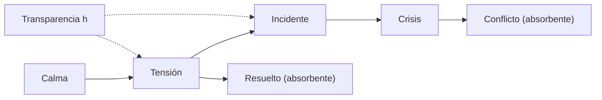

# B119-C29 — Escalada, desescalada y medidas de fomento de la confianza

<!-- nav:top -->
[🏠 Programa](../../../../README.md) · [📚 Bloque B119](../../../tronco-comun/B119-derecho-seguridad-y-geopolitica-espacial.md) · [← Anterior: B119-C28 — Normas de comportamiento responsable en el espacio](../B119-C28-normas-de-comportamiento-responsable-en-el-espacio/CLASE.md) · [Siguiente: B119-C30 — Atribución de incidentes y desinformación en el dominio espacial →](../B119-C30-atribucion-de-incidentes-y-desinformacion-en-el-dominio-espacial/CLASE.md)
<!-- /nav -->

## 1. Ubicación, nivel y alcance

Clase 29 del bloque B119. Nivel N3. Las crisis no saltan de golpe al conflicto: pasan por niveles, y cada nivel puede subir, bajar o quedarse. Aquí modelas una escalada **abstracta** como cadena de Markov con cuatro niveles y dos desenlaces (resuelto o conflicto), calculas con la matriz fundamental la probabilidad de conflicto y muestras con probabilidades **sintéticas** cuánto la reduce una medida de transparencia que desplaza la probabilidad de subir hacia la de bajar. No modela ninguna crisis real. **Esta clase es educativa: no es asesoría legal, regulatoria ni financiera y no sustituye a un jurista, a una autoridad competente ni a un asesor.**

## 2. Por qué esta clase existe

C28 y C27 tratan conductas y negociación; ninguna clase muestra la dinámica de escalada ni el valor de las medidas de confianza, que se apoyan en el principio de informar (art. XI) y consultar (art. IX). La decisión central: **¿cuánto reduce el riesgo de conflicto una medida que hace menos probable subir de nivel?**

## 3. Lo que podrás hacer al terminar

1. Relacionar el art. XI (informar) y el art. IX (consultas) con las medidas de transparencia.
2. Construir una matriz de transición con estados transitorios y absorbentes.
3. Calcular las probabilidades de absorción con la matriz fundamental y verificarlas con simulación.
4. Medir el efecto de la transparencia `h` sobre la probabilidad de conflicto.
5. Separar lo consultado (texto normativo con versión y fecha) de lo sintético o ilustrativo.

La evidencia es la **ficha de escalada con y sin transparencia** del ejercicio 12 (sección 20).

## 4. Con qué llegas y cómo comprobarlo

1. ¿Qué es una cadena de Markov?
2. ¿Qué es un estado absorbente?
3. ¿Qué es una matriz inversa?
4. ¿Qué es una probabilidad de absorción?
5. ¿Qué es la transparencia como medida de confianza?

<details>
<summary>Ver respuestas</summary>

1. Un proceso donde el siguiente estado depende solo del actual. 2. Uno del que no se sale. 3. La que, multiplicada por la original, da la identidad. 4. La de terminar en un estado absorbente dado. 5. Compartir información para reducir incertidumbre sobre intenciones.
</details>

Con cuatro o cinco aciertos, sigue; si no, repasa los prerrequisitos.

## 5. Un caso de contexto y casos de referencia

La nota de la ONU (consultada el 2026-11-11) recoge el art. XI (informar sobre actividades) y el art. IX (cooperación y consultas). **No se consultaron** documentos sobre medidas de transparencia y fomento de la confianza ni teoría de la disuasión. El **ejemplo conductor** es una cadena abstracta con niveles calma, tensión, incidente y crisis (pasos semanales sintéticos) y dos desenlaces absorbentes: resuelto y conflicto. La transparencia `h` reduce por `(1 − h)` las probabilidades de subir o de pasar a conflicto y traslada esa masa a bajar de nivel.

## 6. Vocabulario

El **nivel de escalada** es el estado de la tensión. La **desescalada** es bajar de nivel. Una **medida de fomento de la confianza** reduce la incertidumbre sobre las intenciones. La **matriz fundamental** `N = (I − Q)^−1` da las visitas esperadas a los estados transitorios. La **absorción** es terminar en resuelto o conflicto.

## 7. Modelo mental



*Descripción textual:* la tensión puede subir por incidente y crisis hasta el conflicto, o bajar y resolverse; la transparencia desplaza probabilidad de subir hacia bajar.

Analogía: una escalera con un barandal: cada peldaño puede subirse o bajarse, y las medidas de confianza hacen el descenso más fácil. Límite: las crisis reales no son procesos sin memoria ni tienen probabilidades fijas.

## 8. La explicación, paso a paso

### 8.1 Sin transparencia

Probabilidad de conflicto desde la tensión: `0.1775`; desde la crisis: `0.4704`.

### 8.2 Con transparencia

Con `h = 0,3`: `0.0663`. Con `h = 0,6`: `0.0121` (reducción `93.2 %`). La simulación coincide a tres sigmas.

### 8.3 Cómo se calcula

`B = (I − Q)^−1 R`, donde `Q` es la matriz entre estados transitorios y `R` la de salidas a absorbentes.

### 8.4 Lo que no es

Las probabilidades son inventadas; el resultado no predice ningún evento ni evalúa las medidas reales.

## 9. Magnitudes, símbolos y unidades

| Símbolo | Qué es | Unidad | Valor / nota |
|---|---|---|---|
| `h` | reducción por transparencia | — | 0; 0,3; 0,6 |
| `Q` | transiciones entre transitorios | — | 4×4 |
| `R` | salidas a absorbentes | — | 4×2 |
| `P_C` | probabilidad de conflicto | — | 0.1775 → 0.0121 |

## 10. Convenciones y referencias

Pasos semanales sintéticos; probabilidades por fila que suman 1; semilla 119.

## 11. De dónde sale lo que afirmamos

| ID | Fuente | Localizador | Respalda | Estado |
|---|---|---|---|---|
| S3 | ONU, Biblioteca Audiovisual de Derecho Internacional, nota introductoria sobre el Tratado del Espacio Ultraterrestre, https://legal.un.org/avl/ha/tos/tos.html (WebFetch, consultada 2026-11-11; no discute los artículos V ni VII) | arts. IX y XI | informar, consultar y cooperar como base de la transparencia | Consultada |
| — | Documentos de medidas de confianza; teoría de la disuasión | — | no consultados | No consultado / ilustrativo |
| — | Matriz fundamental | — | no consultada en una fuente concreta; verificada por simulación | No consultado / ilustrativo |
| — | Probabilidades de transición | — | sintéticas | No consultado / ilustrativo |

Límites: no se consultó ninguna fuente sobre medidas de confianza; la cadena es abstracta. Texto normativo parafraseado de las páginas oficiales en la fecha indicada; el texto vinculante es el de la fuente oficial vigente.

## 12. Cómo ver la situación

| Magnitud | Valor |
|---|---|
| `P_C` desde tensión, `h = 0` | 0.1775 |
| con `h = 0,3` | 0.0663 |
| con `h = 0,6` | 0.0121 |
| Reducción | 93.2 % |

Descripción larga: aumentar la transparencia reduce la probabilidad de conflicto de forma monótona en el modelo.

## 13. Ejemplo trabajado: una fila de la matriz

**Paso 1.** Desde tensión, `h = 0`: subir 0,20, bajar a calma 0,15, resuelto 0,15, quedarse 0,50. **Paso 2.** Con `h = 0,6`: subir `0,20 × 0,4 = 0,08`; bajar a calma `0,15 + 0,12 = 0,27`; resuelto 0,15; quedarse 0,50. **Paso 3.** La fila suma 1.

## 14. Distintas formas de describirlo

**Por estado:** niveles. **Por matriz:** `Q` y `R`. **Por desenlace:** resuelto o conflicto. **Por medida:** `h`.

## 15. Práctica guiada

**Ejercicio 1 · con los pasos indicados.** Comprueba que la fila de tensión con `h = 0` suma 1.

<details><summary>Solución comentada</summary>

`0,20 + 0,15 + 0,15 + 0,50 = 1`.
</details>

**Ejercicio 2 · con una pista.** Calcula la probabilidad de subir desde tensión con `h = 0,3`.

<details><summary>Solución comentada</summary>

`0,20 × 0,7 = 0,14`.
</details>

**Ejercicio 3 · casi autónomo.** ¿Qué es una probabilidad de absorción?

<details><summary>Solución comentada</summary>

La de terminar en cierto estado absorbente.
</details>

## 16. Práctica autónoma, transferencia e integrador

**Ejercicio 4 · autónomo.** ¿Qué pasa con `P_C` si `h = 1`?

<details><summary>Solución comentada</summary>

Se anula la subida y el paso a conflicto; no hay escalada.
</details>

**Ejercicio 5 · autónomo.** ¿Por qué la fila de cada estado debe sumar 1?

<details><summary>Solución comentada</summary>

Porque en cada paso ocurre exactamente una transición.
</details>

**Ejercicio 6 · autónomo.** ¿Qué fuente justifica el rol de informar?

<details><summary>Solución comentada</summary>

El art. XI del tratado.
</details>

**Ejercicio 7 · autónomo.** ¿Qué haría falta para estimar probabilidades reales?

<details><summary>Solución comentada</summary>

Datos históricos y juicio de expertos, que no se consultaron.
</details>

**Ejercicio 8 · autónomo.** ¿Qué relación tiene `h` con el art. IX?

<details><summary>Solución comentada</summary>

Las consultas y la cooperación son formas de transparencia.
</details>

**Ejercicio 9 · transferencia.** **Transferencia.** ¿Por qué la simulación confirma la matriz fundamental?

<details><summary>Solución comentada</summary>

Porque ambas calculan la misma probabilidad por caminos independientes.
</details>

**Ejercicio 10 · transferencia.** **Transferencia.** ¿Qué limita aplicar Markov a una crisis real?

<details><summary>Solución comentada</summary>

La memoria, los terceros y la naturaleza no repetitiva de las crisis.
</details>

**Ejercicio 11 · transferencia.** **Transferencia.** ¿Qué medida de transparencia usarías en una operación orbital?

<details><summary>Solución comentada</summary>

Notificar maniobras y compartir efemérides con anticipación (ver C28).
</details>

**Ejercicio 12 · integrador.** **Integrador.** Elabora tu *ficha de escalada con y sin transparencia*: matriz, absorción, simulación y aviso de que es educativa y abstracta.

<details><summary>Solución comentada</summary>

Secciones 8.1–8.4 y la salida del laboratorio.
</details>

## 17. Laboratorio: cadena de escalada y transparencia

El script [laboratorio.py](laboratorio.py) calcula con la matriz fundamental la probabilidad de conflicto para tres niveles de transparencia y la verifica con 200 000 simulaciones (**comprueba** a tres sigmas).

**Datos:** arts. IX y XI consultados (2026-11-11); cadena y probabilidades **sintéticas**. **Predice antes de ejecutar:** ¿cuánto bajará la probabilidad de conflicto con `h = 0,6`? (a menos de la mitad.) **Ejecución del 2026-11-11 (Python 3.12.9):**

```text
Python 3.12.9 (biblioteca estandar)
Cadena de Markov ABSTRACTA con probabilidades SINTETICAS; art. XI y IX consultados 2026-11-11; textos de fomento de la confianza NO consultados.
transparencia h = 0.0: P(conflicto) desde calma 0.1775 ; tension 0.1775 (simulado 0.1766) ; incidente 0.3107 ; crisis 0.4704
transparencia h = 0.3: P(conflicto) desde calma 0.0663 ; tension 0.0663 (simulado 0.0664) ; incidente 0.1373 ; crisis 0.2895
transparencia h = 0.6: P(conflicto) desde calma 0.0121 ; tension 0.0121 (simulado 0.0120) ; incidente 0.0348 ; crisis 0.1369
Reduccion de P(conflicto) desde tension con h = 0.6: 93.2 %
CLAVES {"c0": "0.1775", "c3": "0.0663", "c6": "0.0121", "red": "93.2", "cris0": "0.4704", "cris6": "0.1369"}
Pruebas superadas.
```

```bash
python programa/clases/B119/B119-C29-escalada-desescalada-y-medidas-de-fomento-de-la-confianza/laboratorio.py
```

**Límites:** cadena homogénea y sin memoria; no representa ninguna crisis real.

## 18. Errores frecuentes y cómo corregirlos

**Tomar las probabilidades como datos.** Se corrige con la sección 11.

**Olvidar normalizar las filas.** Se corrige con el ejercicio 5.

**Creer que la transparencia elimina el riesgo.** Se corrige con el ejercicio 4 y 8.4.

**Confundir `Q` con `R`.** Se corrige con 8.3.

## 19. Cómo sabrás que vas bien

Tras la sección 8: ¿qué resultado esperabas en el ejemplo trabajado y cuál obtuviste? Si dudas, repasa la sección 13. Tras el laboratorio: ¿qué comprueba cada prueba? (ver la sección 17).

## 20. Qué entregas y cómo se evalúa

El producto es tu **ficha de escalada con y sin transparencia** (ejercicio 12).

| Criterio | Inicial | En desarrollo | Logrado | Destacado |
|---|---|---|---|---|
| Conceptos | Los confunde | Parciales | Usa el vocabulario con precisión | Explica los límites del modelo |
| Cálculo | Sin unidades | Con errores | Resultados con unidades y tolerancia | Calcula casos nuevos |
| Verificación | Sin comprobar | Un caso | Contraste con una segunda vía | Interpreta las diferencias |
| Fuentes | Sin fuente | Sin fecha | Fuentes con versión, fecha y estado | Declara lo sintético y lo no consultado |
| Límites | No los nombra | Uno | Tres | Discute qué falta del modelo |

**Condiciones críticas (no se compensan con promedio):** citar la versión y la fecha del texto normativo consultado; rotular lo sintético y lo ilustrativo; no presentar un resultado como asesoría legal, regulatoria o financiera.

## 21. Ética, seguridad y límites

Clase educativa: **no es asesoría legal, regulatoria ni financiera**; no sustituye a un abogado, a la autoridad competente ni a un asesor, y ningún resultado debe usarse para decidir sobre una licencia, una reclamación, un contrato o una operación real. El modelo es abstracto y no describe a ningún Estado; no debe usarse para anticipar crisis reales. Los modelos son simplificados y sus datos son sintéticos o ilustrativos; lo simulado nunca se presenta como observado. Accesibilidad: tablas equivalentes a las gráficas, fórmulas en texto, ejercicios sin conexión.

## 22. Para cerrar y seguir

La transparencia reduce el riesgo sintético de conflicto de `0.1775` a `0.0121`. Queda una pregunta: ¿cómo se atribuye un incidente cuando la evidencia es incierta?

**Glosario español–inglés.** escalada · *escalation*; medida de fomento de la confianza · *confidence-building measure*; estado absorbente · *absorbing state*; cadena de Markov · *Markov chain*.

**Continuidad.** [B119-C30](../B119-C30-atribucion-de-incidentes-y-desinformacion-en-el-dominio-espacial/CLASE.md): la atribución de incidentes y la desinformación.

**Referencias:** ver sección 11.

<!-- nav:bottom -->
---

[← Anterior: B119-C28 — Normas de comportamiento responsable en el espacio](../B119-C28-normas-de-comportamiento-responsable-en-el-espacio/CLASE.md) · [📚 Bloque B119](../../../tronco-comun/B119-derecho-seguridad-y-geopolitica-espacial.md) · [Siguiente: B119-C30 — Atribución de incidentes y desinformación en el dominio espacial →](../B119-C30-atribucion-de-incidentes-y-desinformacion-en-el-dominio-espacial/CLASE.md)
<!-- /nav -->
