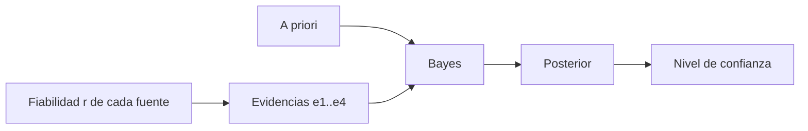

# B119-C30 — Atribución de incidentes y desinformación en el dominio espacial

<!-- nav:top -->
[🏠 Programa](../../../../README.md) · [📚 Bloque B119](../../../tronco-comun/B119-derecho-seguridad-y-geopolitica-espacial.md) · [← Anterior: B119-C29 — Escalada, desescalada y medidas de fomento de la confianza](../B119-C29-escalada-desescalada-y-medidas-de-fomento-de-la-confianza/CLASE.md) · [Siguiente: B119-C31 — Práctica estatal y costumbre internacional en el derecho espacial →](../B119-C31-practica-estatal-y-costumbre-internacional-en-el-derecho-espacial/CLASE.md)
<!-- /nav -->

## 1. Ubicación, nivel y alcance

Clase 30 del bloque B119. Nivel N3. Atribuir un incidente a un actor es una afirmación con consecuencias políticas y jurídicas, y la evidencia suele ser incompleta y manipulable. Aquí razonas con el teorema de Bayes sobre un incidente **sintético** con tres hipótesis y cuatro evidencias, compruebas que el orden de la evidencia no importa, mides cuánto cambia la conclusión según la fiabilidad de una fuente y concluyes qué nivel de confianza es sostenible. No se atribuye ningún incidente real. **Esta clase es educativa: no es asesoría legal, regulatoria ni financiera y no sustituye a un jurista, a una autoridad competente ni a un asesor.**

## 2. Por qué esta clase existe

B01-C19 trata la desinformación en general; la atribución técnica y política de incidentes espaciales no está cubierta. El art. VI del Convenio de Registro prevé reunir información para identificar objetos y circunstancias. La decisión central: **¿qué confianza justifica la evidencia disponible y cuánto depende de la fiabilidad de cada fuente?**

## 3. Lo que podrás hacer al terminar

1. Relacionar la identificación de objetos (art. VI del Convenio de Registro) con la atribución.
2. Aplicar Bayes con varias evidencias independientes y comprobar que el orden no importa.
3. Calcular la razón de verosimilitud conjunta y su logaritmo.
4. Medir el efecto de la fiabilidad de una fuente y del a priori sobre la conclusión.
5. Separar lo consultado (texto normativo con versión y fecha) de lo sintético o ilustrativo.

La evidencia es la **informe de atribución con razón de verosimilitud** del ejercicio 12 (sección 20).

## 4. Con qué llegas y cómo comprobarlo

1. ¿Qué es una verosimilitud?
2. ¿Qué es el a priori?
3. ¿Qué es una razón de verosimilitud?
4. ¿Qué es la independencia condicional?
5. ¿Qué es una fuente poco fiable?

<details>
<summary>Ver respuestas</summary>

1. La probabilidad de observar la evidencia si una hipótesis es cierta. 2. La probabilidad inicial de una hipótesis. 3. El cociente de las verosimilitudes de dos hipótesis. 4. Que las evidencias son independientes dado cada hipótesis. 5. Una cuyo informe puede ser ruido o engaño.
</details>

Con cuatro o cinco aciertos, sigue; si no, repasa los prerrequisitos.

## 5. Un caso de contexto y casos de referencia

La página de UNOOSA del Convenio de Registro (consultada el 2026-11-11) prevé (art. VI) que los Estados con medios de rastreo ayuden a identificar objetos dañinos o peligrosos, y que quien pide ayuda indique el momento, la naturaleza y las circunstancias del suceso. **No se consultó ningún método oficial de atribución ni caso real.** El **ejemplo conductor**: tres hipótesis sintéticas (falla técnica, actor A, actor B) con a priori 0,50; 0,25; 0,25, y cuatro evidencias con verosimilitudes inventadas.

## 6. Vocabulario

**Atribución** es asignar un hecho a un autor. El **posterior** es la probabilidad tras la evidencia. La **razón de verosimilitud** mide cuánto favorece una evidencia a una hipótesis. La **fiabilidad** `r` es la probabilidad de que una fuente informe correctamente. La **desinformación** introduce evidencia falsa.

## 7. Modelo mental



*Descripción textual:* el a priori y las evidencias, ponderadas por la fiabilidad de las fuentes, producen el posterior y de él el nivel de confianza.

Analogía: un detective que actualiza sus sospechas con cada pista, pesando cuánto confía en quien se la dio. Límite: las verosimilitudes aquí son inventadas; en la práctica son el punto más débil.

## 8. La explicación, paso a paso

### 8.1 Posterior

Con las cuatro evidencias: falla técnica `0.0562`, actor A `0.8090`, actor B `0.1348`. El actor A es la hipótesis más probable pero no supera un umbral de confianza alto (`0.8090`).

### 8.2 Razón de verosimilitud

La razón conjunta A : falla técnica es `28.80`. El orden de la evidencia no cambia el resultado (verificado con todas las permutaciones).

### 8.3 Fiabilidad

Si la imagen no verificada se descarta (`r = 0`), la probabilidad del actor A es `0.6792`; si se cree por completo (`r = 1`), `0.8090`.

### 8.4 Lo que se aprende

Una sola fuente dudosa puede mover la conclusión; la confianza debe declararse con su fundamento, y la atribución jurídica o política exige más que un número.

## 9. Magnitudes, símbolos y unidades

| Símbolo | Qué es | Unidad | Valor / nota |
|---|---|---|---|
| `P(H)` | a priori | — | 0,50; 0,25; 0,25 |
| `L` | razón de verosimilitud conjunta | — | 28.80 |
| `r` | fiabilidad de la fuente | — | 0 a 1 |
| `P(H|e)` | posterior | — | 0.8090 (A) |

## 10. Convenciones y referencias

Probabilidades en [0,1]; evidencias independientes dada la hipótesis; hipótesis y verosimilitudes sintéticas.

## 11. De dónde sale lo que afirmamos

| ID | Fuente | Localizador | Respalda | Estado |
|---|---|---|---|---|
| S1 | UNOOSA, «Convention on Registration of Objects Launched into Outer Space» (página oficial), https://www.unoosa.org/oosa/en/ourwork/spacelaw/treaties/registration-convention.html (WebFetch, consultada 2026-11-11) | art. VI | ayuda para identificar objetos y circunstancias del suceso | Consultada |
| S3 | ONU, Biblioteca Audiovisual de Derecho Internacional, nota introductoria sobre el Tratado del Espacio Ultraterrestre, https://legal.un.org/avl/ha/tos/tos.html (WebFetch, consultada 2026-11-11; no discute los artículos V ni VII) | art. XI | información pública sobre actividades | Consultada |
| — | Métodos oficiales de atribución y casos reales | — | no consultados | No consultado / ilustrativo |
| — | Teorema de Bayes | — | no consultado en una fuente concreta; verificado por actualización secuencial, conjunta y permutaciones | No consultado / ilustrativo |
| — | Hipótesis y verosimilitudes | — | sintéticas | No consultado / ilustrativo |

Límites: no se consultó ningún método de atribución; las verosimilitudes son inventadas. Texto normativo parafraseado de las páginas oficiales en la fecha indicada; el texto vinculante es el de la fuente oficial vigente.

## 12. Cómo ver la situación

| Magnitud | Valor |
|---|---|
| Posterior falla técnica | 0.0562 |
| Posterior actor A | 0.8090 |
| Posterior actor B | 0.1348 |
| Razón A : falla | 28.80 |

Descripción larga: ninguna hipótesis supera un nivel de confianza alto con la evidencia disponible.

## 13. Ejemplo trabajado: dos evidencias

**Paso 1.** A priori `(0,50; 0,25; 0,25)`. **Paso 2.** e1: `(0,10; 0,60; 0,20)` → productos `(0,05; 0,15; 0,05)`. **Paso 3.** Normalizar: `(0,20; 0,60; 0,20)`. **Paso 4.** Repetir con e2.

## 14. Distintas formas de describirlo

**Por probabilidad:** a priori y posterior. **Por razón:** de verosimilitud. **Por fuente:** fiabilidad. **Por confianza:** niveles.

## 15. Práctica guiada

**Ejercicio 1 · con los pasos indicados.** Multiplica el a priori por e1 y normaliza.

<details><summary>Solución comentada</summary>

`(0,20; 0,60; 0,20)`.
</details>

**Ejercicio 2 · con una pista.** Calcula la razón de verosimilitud de e1 entre A y la falla. *Pista:* `0,60/0,10`.

<details><summary>Solución comentada</summary>

`6`.
</details>

**Ejercicio 3 · casi autónomo.** Multiplica las razones A : falla de las cuatro evidencias.

<details><summary>Solución comentada</summary>

`28.80`.
</details>

## 16. Práctica autónoma, transferencia e integrador

**Ejercicio 4 · autónomo.** ¿Cambia el posterior si se invierte el orden de e1 y e2?

<details><summary>Solución comentada</summary>

No: la actualización es conmutativa.
</details>

**Ejercicio 5 · autónomo.** ¿Qué pasa con el posterior de A si la fiabilidad de e4 baja a 0?

<details><summary>Solución comentada</summary>

`0.6792`.
</details>

**Ejercicio 6 · autónomo.** ¿Qué pasa si el a priori de la falla técnica es 0,8?

<details><summary>Solución comentada</summary>

Baja el posterior de A; compruébalo con el script.
</details>

**Ejercicio 7 · autónomo.** ¿Qué nivel de confianza alcanza la hipótesis más probable?

<details><summary>Solución comentada</summary>

`0.8090`: insuficiente para un umbral alto.
</details>

**Ejercicio 8 · autónomo.** ¿Qué consultaste sobre atribución?

<details><summary>Solución comentada</summary>

Solo el art. VI del Convenio de Registro y el art. XI.
</details>

**Ejercicio 9 · transferencia.** **Transferencia.** ¿Por qué la atribución jurídica exige más que una probabilidad?

<details><summary>Solución comentada</summary>

Exige estándares de prueba, procedimientos y responsabilidad, no solo creencia.
</details>

**Ejercicio 10 · transferencia.** **Transferencia.** ¿Qué papel tiene la desinformación en este modelo?

<details><summary>Solución comentada</summary>

Introduce evidencia de baja fiabilidad que mueve el posterior.
</details>

**Ejercicio 11 · transferencia.** **Transferencia.** ¿Cómo reducirías la dependencia del a priori?

<details><summary>Solución comentada</summary>

Con más evidencia independiente y verificada.
</details>

**Ejercicio 12 · integrador.** **Integrador.** Elabora tu *informe de atribución con razón de verosimilitud*: hipótesis, evidencias, posterior, fiabilidad y aviso de que es educativo.

<details><summary>Solución comentada</summary>

Secciones 8.1–8.4 y la salida del laboratorio.
</details>

## 17. Laboratorio: atribución bayesiana

El script [laboratorio.py](laboratorio.py) calcula el posterior de tres hipótesis con cuatro evidencias y mide la sensibilidad a la fiabilidad de una fuente y al a priori (**comprueba** actualización secuencial, conjunta y todas las permutaciones).

**Datos:** art. VI del Convenio de Registro y art. XI consultados (2026-11-11); hipótesis y verosimilitudes **sintéticas**. **Predice antes de ejecutar:** ¿superará alguna hipótesis el 95 %? (no.) **Ejecución del 2026-11-11 (Python 3.12.9):**

```text
Python 3.12.9 (biblioteca estandar)
Incidente SINTETICO; art. VI (Registro) y XI consultados 2026-11-11; ningun metodo oficial de atribucion consultado.
Posterior con las cuatro evidencias (nombres de las hipotesis: falla_tecnica, actor_A, actor_B): [0.0562, 0.809, 0.1348]
Razon de verosimilitud conjunta A : falla = 28.80 ; log10 = 1.459
Efecto de la fiabilidad r de la imagen no verificada (e4) sobre P(actor_A):
   r = 0.0: posterior [0.0943, 0.6792, 0.2264]
   r = 0.3: posterior [0.0828, 0.7184, 0.1988]
   r = 0.6: posterior [0.0714, 0.7573, 0.1713]
   r = 1.0: posterior [0.0562, 0.809, 0.1348]
   a priori de falla tecnica 0.2: posterior de A = 0.8446
   a priori de falla tecnica 0.5: posterior de A = 0.8090
   a priori de falla tecnica 0.8: posterior de A = 0.6923
Alguna hipotesis supera 0.95? no (umbral ILUSTRATIVO)
CLAVES {"pf": "0.0562", "pa": "0.8090", "pb": "0.1348", "lr": "28.80", "r0": "0.6792", "r1": "0.8090", "m": "0.8090"}
Pruebas superadas.
```

```bash
python programa/clases/B119/B119-C30-atribucion-de-incidentes-y-desinformacion-en-el-dominio-espacial/laboratorio.py
```

**Límites:** evidencias independientes y verosimilitudes inventadas; no atribuye ningún hecho real.

## 18. Errores frecuentes y cómo corregirlos

**Tomar la verosimilitud como la probabilidad de la hipótesis.** Se corrige con la sección 6.

**Contar evidencias dependientes como independientes.** Se corrige con 8.4.

**Ignorar la fiabilidad de las fuentes.** Se corrige con 8.3.

**Presentar un número como veredicto.** Se corrige con el ejercicio 9.

## 19. Cómo sabrás que vas bien

Tras la sección 8: ¿qué resultado esperabas en el ejemplo trabajado y cuál obtuviste? Si dudas, repasa la sección 13. Tras el laboratorio: ¿qué comprueba cada prueba? (ver la sección 17).

## 20. Qué entregas y cómo se evalúa

El producto es tu **informe de atribución con razón de verosimilitud** (ejercicio 12).

| Criterio | Inicial | En desarrollo | Logrado | Destacado |
|---|---|---|---|---|
| Conceptos | Los confunde | Parciales | Usa el vocabulario con precisión | Explica los límites del modelo |
| Cálculo | Sin unidades | Con errores | Resultados con unidades y tolerancia | Calcula casos nuevos |
| Verificación | Sin comprobar | Un caso | Contraste con una segunda vía | Interpreta las diferencias |
| Fuentes | Sin fuente | Sin fecha | Fuentes con versión, fecha y estado | Declara lo sintético y lo no consultado |
| Límites | No los nombra | Uno | Tres | Discute qué falta del modelo |

**Condiciones críticas (no se compensan con promedio):** citar la versión y la fecha del texto normativo consultado; rotular lo sintético y lo ilustrativo; no presentar un resultado como asesoría legal, regulatoria o financiera.

## 21. Ética, seguridad y límites

Clase educativa: **no es asesoría legal, regulatoria ni financiera**; no sustituye a un abogado, a la autoridad competente ni a un asesor, y ningún resultado debe usarse para decidir sobre una licencia, una reclamación, un contrato o una operación real. La atribución de incidentes reales es un acto con consecuencias graves; esta clase usa datos inventados y no señala a ningún actor. Los modelos son simplificados y sus datos son sintéticos o ilustrativos; lo simulado nunca se presenta como observado. Accesibilidad: tablas equivalentes a las gráficas, fórmulas en texto, ejercicios sin conexión.

## 22. Para cerrar y seguir

Con la evidencia sintética ninguna hipótesis supera `0.8090` de confianza. Queda una pregunta: ¿cómo se forma una costumbre jurídica a partir de la práctica de los Estados?

**Glosario español–inglés.** atribución · *attribution*; razón de verosimilitud · *likelihood ratio*; a priori · *prior*; desinformación · *disinformation*.

**Continuidad.** [B119-C31](../B119-C31-practica-estatal-y-costumbre-internacional-en-el-derecho-espacial/CLASE.md): la práctica estatal y la costumbre internacional.

**Referencias:** ver sección 11.

<!-- nav:bottom -->
---

[← Anterior: B119-C29 — Escalada, desescalada y medidas de fomento de la confianza](../B119-C29-escalada-desescalada-y-medidas-de-fomento-de-la-confianza/CLASE.md) · [📚 Bloque B119](../../../tronco-comun/B119-derecho-seguridad-y-geopolitica-espacial.md) · [Siguiente: B119-C31 — Práctica estatal y costumbre internacional en el derecho espacial →](../B119-C31-practica-estatal-y-costumbre-internacional-en-el-derecho-espacial/CLASE.md)
<!-- /nav -->
