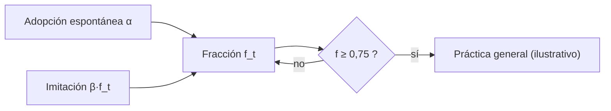

# B119-C31 — Práctica estatal y costumbre internacional en el derecho espacial

<!-- nav:top -->
[🏠 Programa](../../../../README.md) · [📚 Bloque B119](../../../tronco-comun/B119-derecho-seguridad-y-geopolitica-espacial.md) · [← Anterior: B119-C30 — Atribución de incidentes y desinformación en el dominio espacial](../B119-C30-atribucion-de-incidentes-y-desinformacion-en-el-dominio-espacial/CLASE.md) · [Siguiente: B119-C32 — Interpretación de tratados internacionales →](../B119-C32-interpretacion-de-tratados-internacionales/CLASE.md)
<!-- /nav -->

## 1. Ubicación, nivel y alcance

Clase 31 del bloque B119. Nivel N3. Parte del derecho internacional no está escrito en tratados sino que nace de lo que los Estados hacen de manera general y de que lo consideran obligatorio. Aquí estudias, con un modelo de difusión **sintético**, cómo una práctica se extiende entre 190 Estados genéricos por iniciativa propia e imitación, calculas cuánto tarda en volverse general según un umbral **ilustrativo** y verificas la versión estocástica contra la determinista. No determina si existe una norma consuetudinaria real. **Esta clase es educativa: no es asesoría legal, regulatoria ni financiera y no sustituye a un jurista, a una autoridad competente ni a un asesor.**

## 2. Por qué esta clase existe

B119 presenta los tratados; no enseña la costumbre ni la práctica estatal, que complementan a los tratados en un campo donde los Estados no son partes de todos ellos. La decisión central: **¿qué factores aceleran o frenan que una práctica se vuelva general?**

## 3. Lo que podrás hacer al terminar

1. Describir los dos elementos de la costumbre (práctica y convicción jurídica) rotulándolos como conocimiento general no verificado.
2. Modelar la difusión con adopción espontánea e imitación.
3. Verificar el modelo estocástico contra la recurrencia determinista.
4. Calcular el tiempo hasta un umbral ilustrativo y su sensibilidad a la imitación.
5. Separar lo consultado (texto normativo con versión y fecha) de lo sintético o ilustrativo.

La evidencia es la **curva de difusión de una práctica sintética** del ejercicio 12 (sección 20).

## 4. Con qué llegas y cómo comprobarlo

1. ¿Qué es la costumbre internacional?
2. ¿Qué es una curva logística?
3. ¿Qué es una recurrencia?
4. ¿Qué es una media de simulaciones?
5. ¿Qué es un umbral?

<details>
<summary>Ver respuestas</summary>

1. Una fuente de derecho formada por práctica general aceptada como derecho (concepto general, no consultado aquí). 2. Una curva en S: crece despacio, luego rápido y se satura. 3. Una fórmula que da el siguiente valor desde el anterior. 4. El promedio de muchas corridas independientes. 5. Un valor que marca un cambio de categoría.
</details>

Con cuatro o cinco aciertos, sigue; si no, repasa los prerrequisitos.

## 5. Un caso de contexto y casos de referencia

Las notas consultadas (UNOOSA y legal.un.org, 2026-11-11) muestran principios de los tratados cuya extensión a Estados no partes es objeto de debate; **ese debate, el art. 38 del Estatuto de la Corte Internacional de Justicia, la jurisprudencia y la práctica estatal no se consultaron**. Los dos elementos de la costumbre se mencionan como conocimiento general no verificado. El **ejemplo conductor**: 190 Estados genéricos y una práctica con adopción espontánea de 1 % anual y un efecto de imitación de 0,25; el umbral ilustrativo de «práctica general» es el 75 %.

## 6. Vocabulario

La **práctica estatal** es lo que hacen los Estados. La **opinio juris** es la convicción de que es obligatorio. La **difusión** es la expansión de una práctica. La **imitación** es adoptar porque otros adoptan. El **umbral de generalidad** aquí es una convención didáctica.

## 7. Modelo mental



*Descripción textual:* la adopción espontánea y la imitación hacen crecer la fracción de adoptantes hasta cruzar un umbral ilustrativo de generalidad.

Analogía: una moda que se extiende: pocos la adoptan al principio, luego muchos por imitación. Límite: la costumbre exige también convicción jurídica, que este modelo no representa.

## 8. La explicación, paso a paso

### 8.1 La curva

A los 15 años: determinista `0.5926`, media de 400 corridas `0.5833`. A los 30 años: `0.9914`.

### 8.2 Tiempo hasta el umbral

Determinista: `18` años. Media estocástica: `18.20` años.

### 8.3 Sensibilidad

Con imitación débil (`β = 0,05`) se tardan `50` años; con fuerte (`β = 0,40`), `13`.

### 8.4 Lo que falta

La opinio juris, la práctica de los Estados especialmente afectados y la oposición persistente: el modelo no los incluye.

## 9. Magnitudes, símbolos y unidades

| Símbolo | Qué es | Unidad | Valor / nota |
|---|---|---|---|
| `N` | Estados | — | 190 |
| `α` | adopción espontánea | 1/año | 0,01 |
| `β` | imitación | 1/año | 0,25 |
| umbral | práctica general ilustrativa | — | 0,75 |

## 10. Convenciones y referencias

Periodos anuales sintéticos; semilla 119; 400 corridas; Estados genéricos.

## 11. De dónde sale lo que afirmamos

| ID | Fuente | Localizador | Respalda | Estado |
|---|---|---|---|---|
| S3 | ONU, Biblioteca Audiovisual de Derecho Internacional, nota introductoria sobre el Tratado del Espacio Ultraterrestre, https://legal.un.org/avl/ha/tos/tos.html (WebFetch, consultada 2026-11-11; no discute los artículos V ni VII) | principios de la nota | contexto: principios de tratados cuyo alcance a no partes es debatido | Consultada |
| S2 | UNOOSA, «Agreement Governing the Activities of States on the Moon and Other Celestial Bodies» (página oficial), https://www.unoosa.org/oosa/en/ourwork/spacelaw/treaties/moon-agreement.html (WebFetch, consultada 2026-11-11) | art. 12 y vigencia | el acuerdo sobre la Luna no vincula a todos los Estados | Consultada |
| — | Estatuto de la CIJ, jurisprudencia, doctrina y práctica estatal sobre costumbre | — | no consultados | No consultado / ilustrativo |
| — | Modelo de difusión | — | no consultado en una fuente concreta; verificado contra la recurrencia determinista | No consultado / ilustrativo |
| — | Estados, parámetros y umbral | — | sintéticos / ilustrativos | No consultado / ilustrativo |

Límites: no se consultó ninguna fuente sobre costumbre; el modelo no incluye opinio juris. Texto normativo parafraseado de las páginas oficiales en la fecha indicada; el texto vinculante es el de la fuente oficial vigente.

## 12. Cómo ver la situación

| Magnitud | Valor |
|---|---|
| Tiempo determinista | 18 años |
| Tiempo estocástico medio | 18.20 años |
| `f(15)` | 0.5926 |
| `β = 0,05` | 50 años |

Descripción larga: la imitación acelera mucho la difusión, y la simulación confirma la curva determinista.

## 13. Ejemplo trabajado: un paso de la recurrencia

**Paso 1.** `f₀ = 0`: `f₁ = 0 + 1×(0,01 + 0) = 0,01`. **Paso 2.** `f₂ = 0,01 + 0,99×(0,01 + 0,0025) = 0,0224`. **Paso 3.** La curva acelera con `f`.

## 14. Distintas formas de describirlo

**Por curva:** f(t). **Por tiempo:** hasta el umbral. **Por mecanismo:** espontáneo e imitación. **Por elemento jurídico:** práctica y opinio juris.

## 15. Práctica guiada

**Ejercicio 1 · con los pasos indicados.** Calcula `f₁` con `α = 0,01`.

<details><summary>Solución comentada</summary>

`0,01`.
</details>

**Ejercicio 2 · con una pista.** Calcula `f₂`. *Pista:* `f₁ + (1 − f₁)(α + β f₁)`.

<details><summary>Solución comentada</summary>

`0,0224`.
</details>

**Ejercicio 3 · casi autónomo.** ¿Qué pasa con la difusión si `β = 0`?

<details><summary>Solución comentada</summary>

Solo hay adopción espontánea: es mucho más lenta.
</details>

## 16. Práctica autónoma, transferencia e integrador

**Ejercicio 4 · autónomo.** ¿Cuánto tarda si `β = 0,40`?

<details><summary>Solución comentada</summary>

`13` años.
</details>

**Ejercicio 5 · autónomo.** ¿Cuánto tarda si `β = 0,05`?

<details><summary>Solución comentada</summary>

`50` años.
</details>

**Ejercicio 6 · autónomo.** ¿Por qué la media estocástica coincide con la determinista?

<details><summary>Solución comentada</summary>

Por la ley de los grandes números con 190 Estados y 400 corridas.
</details>

**Ejercicio 7 · autónomo.** ¿Qué elemento de la costumbre falta en el modelo?

<details><summary>Solución comentada</summary>

La convicción de obligatoriedad (opinio juris).
</details>

**Ejercicio 8 · autónomo.** ¿Qué fuente de derecho no consultaste?

<details><summary>Solución comentada</summary>

El Estatuto de la CIJ y la jurisprudencia.
</details>

**Ejercicio 9 · transferencia.** **Transferencia.** ¿Por qué una práctica general no basta para crear costumbre?

<details><summary>Solución comentada</summary>

Porque debe aceptarse como derecho, no como simple cortesía.
</details>

**Ejercicio 10 · transferencia.** **Transferencia.** ¿Qué papel tienen los Estados especialmente afectados?

<details><summary>Solución comentada</summary>

Su práctica pesa más al evaluar la generalidad (concepto general no consultado).
</details>

**Ejercicio 11 · transferencia.** **Transferencia.** ¿Qué opinas del umbral del 75 %?

<details><summary>Solución comentada</summary>

Es una convención didáctica; el derecho no fija un porcentaje.
</details>

**Ejercicio 12 · integrador.** **Integrador.** Elabora tu *curva de difusión de una práctica sintética*: modelo, verificación, tiempo hasta el umbral, sensibilidad y aviso de que es educativa.

<details><summary>Solución comentada</summary>

Secciones 8.1–8.4 y la salida del laboratorio.
</details>

## 17. Laboratorio: difusión de una práctica entre Estados genéricos

El script [laboratorio.py](laboratorio.py) compara una recurrencia determinista con 400 corridas estocásticas de 190 Estados (**comprueba** la media a 15 años a 0,02 y el tiempo al umbral a 1,5 años).

**Datos:** notas de UNOOSA y legal.un.org consultadas (2026-11-11), sin fuentes de costumbre; Estados, parámetros y umbral **sintéticos**. **Predice antes de ejecutar:** ¿cuántos años tardará la práctica en superar el 75 %? (unos dos decenios.) **Ejecución del 2026-11-11 (Python 3.12.9):**

```text
Python 3.12.9 (biblioteca estandar)
190 Estados GENERICOS; practica y umbral ILUSTRATIVOS; Estatuto de la CIJ, jurisprudencia y practica estatal NO consultados (notas de UNOOSA y legal.un.org consultadas 2026-11-11).
 ano   f determinista   f media (400 corridas)
   0         0.0000         0.0000
   5         0.0790         0.0812
  10         0.2734         0.2751
  15         0.5926         0.5833
  20         0.8561         0.8456
  30         0.9914         0.9895
Tiempo hasta f >= 0.75: determinista 18 anos ; media estocastica 18.20 anos (dispersion 8 anos)
   beta = 0.05: anos hasta f >= 0.75: 50
   beta = 0.15: anos hasta f >= 0.75: 25
   beta = 0.25: anos hasta f >= 0.75: 18
   beta = 0.40: anos hasta f >= 0.75: 13
CLAVES {"td": 18, "ts": "18.20", "f15": "0.5926", "m15": "0.5833", "t05": 50, "t40": 13, "f30": "0.9914"}
Pruebas superadas.
```

```bash
python programa/clases/B119/B119-C31-practica-estatal-y-costumbre-internacional-en-el-derecho-espacial/laboratorio.py
```

**Límites:** sin opinio juris, sin heterogeneidad entre Estados y con parámetros constantes; no determina ninguna norma real.

## 18. Errores frecuentes y cómo corregirlos

**Equiparar práctica con costumbre.** Se corrige con el ejercicio 9.

**Tomar el 75 % como umbral jurídico.** Se corrige con el ejercicio 11.

**Olvidar la dispersión estocástica.** Se corrige con 8.2.

**Citar la costumbre sin fuentes.** Se corrige con la sección 11.

## 19. Cómo sabrás que vas bien

Tras la sección 8: ¿qué resultado esperabas en el ejemplo trabajado y cuál obtuviste? Si dudas, repasa la sección 13. Tras el laboratorio: ¿qué comprueba cada prueba? (ver la sección 17).

## 20. Qué entregas y cómo se evalúa

El producto es tu **curva de difusión de una práctica sintética** (ejercicio 12).

| Criterio | Inicial | En desarrollo | Logrado | Destacado |
|---|---|---|---|---|
| Conceptos | Los confunde | Parciales | Usa el vocabulario con precisión | Explica los límites del modelo |
| Cálculo | Sin unidades | Con errores | Resultados con unidades y tolerancia | Calcula casos nuevos |
| Verificación | Sin comprobar | Un caso | Contraste con una segunda vía | Interpreta las diferencias |
| Fuentes | Sin fuente | Sin fecha | Fuentes con versión, fecha y estado | Declara lo sintético y lo no consultado |
| Límites | No los nombra | Uno | Tres | Discute qué falta del modelo |

**Condiciones críticas (no se compensan con promedio):** citar la versión y la fecha del texto normativo consultado; rotular lo sintético y lo ilustrativo; no presentar un resultado como asesoría legal, regulatoria o financiera.

## 21. Ética, seguridad y límites

Clase educativa: **no es asesoría legal, regulatoria ni financiera**; no sustituye a un abogado, a la autoridad competente ni a un asesor, y ningún resultado debe usarse para decidir sobre una licencia, una reclamación, un contrato o una operación real. Los Estados son genéricos; la clase no afirma nada sobre la práctica de ningún Estado real. Los modelos son simplificados y sus datos son sintéticos o ilustrativos; lo simulado nunca se presenta como observado. Accesibilidad: tablas equivalentes a las gráficas, fórmulas en texto, ejercicios sin conexión.

## 22. Para cerrar y seguir

La práctica sintética tarda `18` años en superar el umbral ilustrativo. Queda una pregunta: ¿cómo se interpreta un texto que admite varias lecturas?

**Glosario español–inglés.** costumbre internacional · *customary international law*; práctica estatal · *state practice*; opinio juris · *opinio juris*; difusión · *diffusion*.

**Continuidad.** [B119-C32](../B119-C32-interpretacion-de-tratados-internacionales/CLASE.md): la interpretación de tratados internacionales.

**Referencias:** ver sección 11.

<!-- nav:bottom -->
---

[← Anterior: B119-C30 — Atribución de incidentes y desinformación en el dominio espacial](../B119-C30-atribucion-de-incidentes-y-desinformacion-en-el-dominio-espacial/CLASE.md) · [📚 Bloque B119](../../../tronco-comun/B119-derecho-seguridad-y-geopolitica-espacial.md) · [Siguiente: B119-C32 — Interpretación de tratados internacionales →](../B119-C32-interpretacion-de-tratados-internacionales/CLASE.md)
<!-- /nav -->
