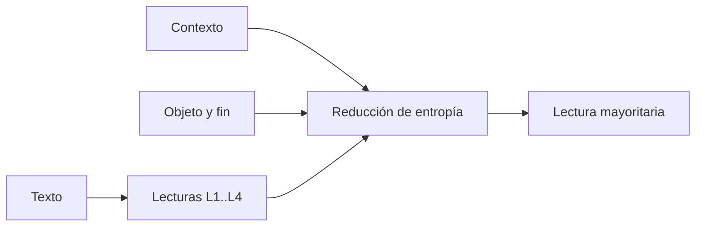

# B119-C32 — Interpretación de tratados internacionales

<!-- nav:top -->
[🏠 Programa](../../../../README.md) · [📚 Bloque B119](../../../tronco-comun/B119-derecho-seguridad-y-geopolitica-espacial.md) · [← Anterior: B119-C31 — Práctica estatal y costumbre internacional en el derecho espacial](../B119-C31-practica-estatal-y-costumbre-internacional-en-el-derecho-espacial/CLASE.md) · [Siguiente: B119-C33 — Matriz comparativa de obligaciones jurídicas por actor →](../B119-C33-matriz-comparativa-de-obligaciones-juridicas-por-actor/CLASE.md)
<!-- /nav -->

## 1. Ubicación, nivel y alcance

Clase 32 del bloque B119. Nivel N3. Los tratados usan términos como «patrimonio común», «régimen internacional» o «reparto equitativo» cuyo alcance no se lee igual en todas partes. Interpretar es un método jurídico que combina el texto, su contexto y su objeto y fin. Aquí mides, con un panel **ficticio** de 40 lectores y una cláusula **sintética**, cuán ambigua es una frase con la entropía de Shannon y cuánto reduce la ambigüedad añadir contexto y objeto y fin. No interpretas ningún tratado real. **Esta clase es educativa: no es asesoría legal, regulatoria ni financiera y no sustituye a un jurista, a una autoridad competente ni a un asesor.**

## 2. Por qué esta clase existe

B119 enseña los tratados y su contenido, no el método para interpretarlos, que el rol de derecho espacial exige; la regla general de interpretación se menciona como conocimiento no verificado. La decisión central: **¿cuánta ambigüedad queda en una cláusula y qué fuentes de interpretación la reducen más?**

## 3. Lo que podrás hacer al terminar

1. Identificar términos del art. 11 del Acuerdo sobre la Luna que requieren interpretación (consultado).
2. Calcular la entropía de una distribución de lecturas y verificar sus límites (0 y 2 bits).
3. Medir la reducción de entropía al añadir contexto y objeto y fin.
4. Calcular la información mutua y reconocer los límites de un panel.
5. Separar lo consultado (texto normativo con versión y fecha) de lo sintético o ilustrativo.

La evidencia es la **análisis de ambigüedad de una cláusula sintética** del ejercicio 12 (sección 20).

## 4. Con qué llegas y cómo comprobarlo

1. ¿Qué es la entropía de Shannon?
2. ¿Cuánto vale la entropía máxima con 4 opciones?
3. ¿Qué es el contexto de una cláusula?
4. ¿Qué es el objeto y fin de un tratado?
5. ¿Qué es la información mutua?

<details>
<summary>Ver respuestas</summary>

1. `H = −Σ p log₂ p`, la incertidumbre de una distribución, en bits. 2. `log₂ 4 = 2` bits. 3. El texto que la rodea y los instrumentos relacionados. 4. Lo que busca lograr; se infiere de su texto y preámbulo. 5. Cuánto reduce la entropía conocer otra variable.
</details>

Con cuatro o cinco aciertos, sigue; si no, repasa los prerrequisitos.

## 5. Un caso de contexto y casos de referencia

La página de UNOOSA del Acuerdo sobre la Luna (consultada el 2026-11-11) habla de «patrimonio común de la humanidad», «régimen internacional» y «reparto equitativo»: términos que requieren interpretación. **No se consultaron** la Convención de Viena sobre el Derecho de los Tratados, la jurisprudencia ni la doctrina; la regla general de interpretación (buena fe, sentido corriente en su contexto y a la luz del objeto y fin) se cita como conocimiento general no verificado. El **ejemplo conductor**: una cláusula sintética («el operador cooperará de manera razonable») con cuatro lecturas posibles que 40 lectores ficticios eligen bajo tres condiciones.

## 6. Vocabulario

La **interpretación** asigna sentido a un texto. La **ambigüedad** es la coexistencia de varias lecturas plausibles. La **entropía** mide cuánta incertidumbre hay entre lecturas. El **contexto** y el **objeto y fin** son fuentes que restringen la lectura. La **información mutua** es la reducción de entropía.

## 7. Modelo mental



*Descripción textual:* el texto admite varias lecturas; el contexto y el objeto y fin reducen la entropía y fortalecen una lectura.

Analogía: adivinar una palabra de un crucigrama: cada pista nueva elimina opciones. Límite: la interpretación jurídica no es un concurso de votos; un panel mide ambigüedad, no corrección.

## 8. La explicación, paso a paso

### 8.1 Tres condiciones

Solo el texto: `H = 1.985` bits (peso de la lectura mayoritaria `0.300`). Con contexto: `1.839`. Con contexto y objeto y fin: `1.385` (peso `0.650`).

### 8.2 Información mutua

Entropía marginal `H(X) = 1.829` bits; condicional `1.737`; información mutua `0.092` bits: conocer las condiciones reduce la incertidumbre.

### 8.3 Verificaciones

Una distribución uniforme da 2 bits y una degenerada 0 bits; `H(X|condición) ≤ H(X)` se cumple.

### 8.4 Qué no mide

Una lectura mayoritaria no es necesariamente la correcta; la interpretación autorizada depende de las reglas y de quien las aplique.

## 9. Magnitudes, símbolos y unidades

| Símbolo | Qué es | Unidad | Valor / nota |
|---|---|---|---|
| `p_i` | frecuencia de la lectura `i` | — | ver laboratorio |
| `H` | entropía | bits | 1.985 → 1.385 |
| `H_máx` | entropía máxima con 4 lecturas | bits | 2 |
| `I` | información mutua | bits | 0.092 |

## 10. Convenciones y referencias

Logaritmo en base 2; panel de 40 lectores ficticios; lecturas L1 a L4.

## 11. De dónde sale lo que afirmamos

| ID | Fuente | Localizador | Respalda | Estado |
|---|---|---|---|---|
| S2 | UNOOSA, «Agreement Governing the Activities of States on the Moon and Other Celestial Bodies» (página oficial), https://www.unoosa.org/oosa/en/ourwork/spacelaw/treaties/moon-agreement.html (WebFetch, consultada 2026-11-11) | art. 11 | términos que requieren interpretación: patrimonio común, régimen internacional, reparto equitativo | Consultada |
| — | Convención de Viena sobre el Derecho de los Tratados (arts. 31–33), jurisprudencia y doctrina | — | no consultadas | No consultado / ilustrativo |
| — | Entropía de Shannon | — | no consultada en una fuente concreta; verificada por los casos uniforme y degenerado | No consultado / ilustrativo |
| — | Cláusula, lecturas y panel | — | ficticios | No consultado / ilustrativo |

Límites: no se consultó ninguna regla de interpretación; el panel y la cláusula son ficticios. Texto normativo parafraseado de las páginas oficiales en la fecha indicada; el texto vinculante es el de la fuente oficial vigente.

## 12. Cómo ver la situación

| Magnitud | Valor |
|---|---|
| `H` solo texto | 1.985 bits |
| `H` con contexto | 1.839 bits |
| `H` con contexto y objeto y fin | 1.385 bits |
| Información mutua | 0.092 bits |

Descripción larga: cada fuente adicional reduce la ambigüedad y fortalece una lectura, pero no la elimina.

## 13. Ejemplo trabajado: la entropía de un caso

**Paso 1.** Solo el texto: `(10, 12, 8, 10)/40`. **Paso 2.** `H = −Σ p log₂ p = 1.985` bits. **Paso 3.** Cercana al máximo de 2 bits: casi uniforme.

## 14. Distintas formas de describirlo

**Por texto:** términos ambiguos. **Por fuente:** texto, contexto, objeto y fin. **Por medida:** entropía y peso mayoritario. **Por método:** regla general (no consultada).

## 15. Práctica guiada

**Ejercicio 1 · con los pasos indicados.** Calcula `H` de una distribución uniforme de 4 lecturas.

<details><summary>Solución comentada</summary>

2 bits.
</details>

**Ejercicio 2 · con una pista.** Calcula `H` si todos eligen L2.

<details><summary>Solución comentada</summary>

0 bits.
</details>

**Ejercicio 3 · casi autónomo.** Calcula `p` de la lectura mayoritaria solo con el texto.

<details><summary>Solución comentada</summary>

`12/40 = 0,30`.
</details>

## 16. Práctica autónoma, transferencia e integrador

**Ejercicio 4 · autónomo.** Calcula `H` para `(20, 20, 0, 0)/40`. *Pista:* dos lecturas igual de probables.

<details><summary>Solución comentada</summary>

1 bit.
</details>

**Ejercicio 5 · autónomo.** ¿Qué condición reduce más la entropía?

<details><summary>Solución comentada</summary>

La de texto + contexto + objeto y fin.
</details>

**Ejercicio 6 · autónomo.** ¿Qué dice `H(X|C) ≤ H(X)`?

<details><summary>Solución comentada</summary>

Que conocer la condición no aumenta la incertidumbre.
</details>

**Ejercicio 7 · autónomo.** ¿Qué consultaste sobre interpretación?

<details><summary>Solución comentada</summary>

Solo los términos del art. 11 de la Luna que requieren interpretación.
</details>

**Ejercicio 8 · autónomo.** ¿Qué regla general no consultaste?

<details><summary>Solución comentada</summary>

La de la Convención de Viena (buena fe, sentido corriente, contexto, objeto y fin).
</details>

**Ejercicio 9 · transferencia.** **Transferencia.** ¿Por qué un panel de lectores no zanja la interpretación de un tratado?

<details><summary>Solución comentada</summary>

Porque mide opiniones, no la regla de interpretación aplicable ni la voluntad de las partes.
</details>

**Ejercicio 10 · transferencia.** **Transferencia.** ¿Por qué «patrimonio común» es un término de interpretación difícil?

<details><summary>Solución comentada</summary>

Porque admite lecturas distintas sobre propiedad, reparto y régimen.
</details>

**Ejercicio 11 · transferencia.** **Transferencia.** ¿Qué otras fuentes usarías para reducir la ambigüedad?

<details><summary>Solución comentada</summary>

Trabajos preparatorios, práctica posterior y jurisprudencia (no consultados).
</details>

**Ejercicio 12 · integrador.** **Integrador.** Elabora tu *análisis de ambigüedad de una cláusula sintética*: tres condiciones, entropías, información mutua y aviso de que es educativo.

<details><summary>Solución comentada</summary>

Secciones 8.1–8.4 y la salida del laboratorio.
</details>

## 17. Laboratorio: entropía de lecturas

El script [laboratorio.py](laboratorio.py) calcula la entropía de las lecturas de un panel ficticio bajo tres condiciones y la información mutua (**comprueba** los casos uniforme y degenerado y que `H(X|C) ≤ H(X)`).

**Datos:** art. 11 del Acuerdo sobre la Luna consultado (2026-11-11); cláusula, lecturas y panel **ficticios**. **Predice antes de ejecutar:** ¿se acercará la entropía solo con el texto a los 2 bits? (sí, casi uniforme.) **Ejecución del 2026-11-11 (Python 3.12.9):**

```text
Python 3.12.9 (biblioteca estandar)
Panel de 40 lectores FICTICIOS, clausula SINTETICA; art. 11 de la Luna consultado (2026-11-11); Convencion de Viena (arts. 31-33) y jurisprudencia NO consultadas.
condicion                              L1   L2   L3   L4   H [bits]   H/2
solo el texto                          10   12    8   10      1.985  0.993
texto + contexto                        6   18   10    6      1.839  0.920
texto + contexto + objeto y fin         3   26    9    2      1.385  0.692
Entropia marginal H(X) = 1.829 bits ; entropia condicional H(X|condicion) = 1.737 bits ; informacion mutua I = 0.092 bits
Lectura mayoritaria por condicion: {'solo el texto': 'L2', 'texto + contexto': 'L2', 'texto + contexto + objeto y fin': 'L2'}
Peso de la lectura mayoritaria: {'solo el texto': 0.3, 'texto + contexto': 0.45, 'texto + contexto + objeto y fin': 0.65}
CLAVES {"h1": "1.985", "h2": "1.839", "h3": "1.385", "hm": "1.829", "hc": "1.737", "mi": "0.092", "s3": "0.650", "s1": "0.300"}
Pruebas superadas.
```

```bash
python programa/clases/B119/B119-C32-interpretacion-de-tratados-internacionales/laboratorio.py
```

**Límites:** lecturas discretas, panel pequeño y sin ponderación jurídica; no interpreta ningún tratado.

## 18. Errores frecuentes y cómo corregirlos

**Confundir ambigüedad con error.** Se corrige con 8.4.

**Tomar la mayoría como la lectura correcta.** Se corrige con el ejercicio 9.

**Calcular la entropía con logaritmo natural y dar bits.** Se corrige con la sección 10.

**Citar la regla de interpretación como verificada.** Se corrige con la sección 11.

## 19. Cómo sabrás que vas bien

Tras la sección 8: ¿qué resultado esperabas en el ejemplo trabajado y cuál obtuviste? Si dudas, repasa la sección 13. Tras el laboratorio: ¿qué comprueba cada prueba? (ver la sección 17).

## 20. Qué entregas y cómo se evalúa

El producto es tu **análisis de ambigüedad de una cláusula sintética** (ejercicio 12).

| Criterio | Inicial | En desarrollo | Logrado | Destacado |
|---|---|---|---|---|
| Conceptos | Los confunde | Parciales | Usa el vocabulario con precisión | Explica los límites del modelo |
| Cálculo | Sin unidades | Con errores | Resultados con unidades y tolerancia | Calcula casos nuevos |
| Verificación | Sin comprobar | Un caso | Contraste con una segunda vía | Interpreta las diferencias |
| Fuentes | Sin fuente | Sin fecha | Fuentes con versión, fecha y estado | Declara lo sintético y lo no consultado |
| Límites | No los nombra | Uno | Tres | Discute qué falta del modelo |

**Condiciones críticas (no se compensan con promedio):** citar la versión y la fecha del texto normativo consultado; rotular lo sintético y lo ilustrativo; no presentar un resultado como asesoría legal, regulatoria o financiera.

## 21. Ética, seguridad y límites

Clase educativa: **no es asesoría legal, regulatoria ni financiera**; no sustituye a un abogado, a la autoridad competente ni a un asesor, y ningún resultado debe usarse para decidir sobre una licencia, una reclamación, un contrato o una operación real. El panel es ficticio; la interpretación de tratados reales corresponde a quienes tienen competencia para ello. Los modelos son simplificados y sus datos son sintéticos o ilustrativos; lo simulado nunca se presenta como observado. Accesibilidad: tablas equivalentes a las gráficas, fórmulas en texto, ejercicios sin conexión.

## 22. Para cerrar y seguir

La entropía baja de `1.985` a `1.385` bits al añadir contexto y objeto y fin. Queda una pregunta: ¿qué obligaciones recaen en cada actor?

**Glosario español–inglés.** interpretación de tratados · *treaty interpretation*; ambigüedad · *ambiguity*; entropía · *entropy*; objeto y fin · *object and purpose*.

**Continuidad.** [B119-C33](../B119-C33-matriz-comparativa-de-obligaciones-juridicas-por-actor/CLASE.md): la matriz comparativa de obligaciones por actor.

**Referencias:** ver sección 11.

<!-- nav:bottom -->
---

[← Anterior: B119-C31 — Práctica estatal y costumbre internacional en el derecho espacial](../B119-C31-practica-estatal-y-costumbre-internacional-en-el-derecho-espacial/CLASE.md) · [📚 Bloque B119](../../../tronco-comun/B119-derecho-seguridad-y-geopolitica-espacial.md) · [Siguiente: B119-C33 — Matriz comparativa de obligaciones jurídicas por actor →](../B119-C33-matriz-comparativa-de-obligaciones-juridicas-por-actor/CLASE.md)
<!-- /nav -->
