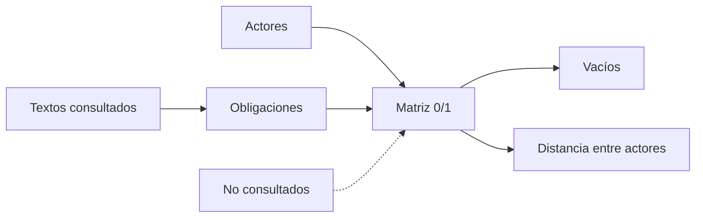

# B119-C33 — Matriz comparativa de obligaciones jurídicas por actor

<!-- nav:top -->
[🏠 Programa](../../../../README.md) · [📚 Bloque B119](../../../tronco-comun/B119-derecho-seguridad-y-geopolitica-espacial.md) · [← Anterior: B119-C32 — Interpretación de tratados internacionales](../B119-C32-interpretacion-de-tratados-internacionales/CLASE.md) · [Siguiente: B119-C34 — Equidad de acceso al espacio →](../B119-C34-equidad-de-acceso-al-espacio/CLASE.md)
<!-- /nav -->

## 1. Ubicación, nivel y alcance

Clase 33 del bloque B119. Nivel N3. Un tratado no obliga a «todos»: obliga a ciertos actores a hacer o abstenerse de ciertas cosas. Aquí construyes una matriz de 6 actores por 10 obligaciones con **solo lo consultado** en el bloque, detectas obligaciones sin destinatario, actores sin obligaciones directas (el operador privado, a quien el tratado alcanza a través del Estado) y calculas qué actores se parecen más. Las obligaciones no consultadas se listan aparte. Es una lectura didáctica, no una opinión jurídica. **Esta clase es educativa: no es asesoría legal, regulatoria ni financiera y no sustituye a un jurista, a una autoridad competente ni a un asesor.**

## 2. Por qué esta clase existe

B119 presenta los instrumentos uno por uno; distinguir qué obligaciones recaen en Estados y en operadores exige compararlos sistemáticamente. Esta clase integra las clases C01 a C11 y es la evidencia de portafolio del bloque. La decisión central: **¿quién debe qué, y qué obligaciones o actores quedan sin cubrir en lo que se consultó?**

## 3. Lo que podrás hacer al terminar

1. Asignar obligaciones a actores citando artículos consultados.
2. Calcular totales por fila y columna y verificar la igualdad de los totales.
3. Detectar obligaciones sin destinatario y actores sin obligaciones directas.
4. Comparar actores por distancia de Hamming y listar lo no consultado.
5. Separar lo consultado (texto normativo con versión y fecha) de lo sintético o ilustrativo.

La evidencia es la **matriz actor × obligación con vacíos señalados** del ejercicio 12 (sección 20).

## 4. Con qué llegas y cómo comprobarlo

1. ¿Qué es una matriz de incidencia?
2. ¿Qué es la distancia de Hamming?
3. ¿Qué obligación impone el art. VI?
4. ¿Qué es una obligación directa?
5. ¿Qué es un vacío normativo?

<details>
<summary>Ver respuestas</summary>

1. Una tabla 0/1 que indica si un actor tiene una obligación. 2. El número de posiciones en que difieren dos vectores binarios. 3. Que el Estado responda por las actividades y autorice y supervise las privadas (S3). 4. La que el texto impone al actor sin pasar por otro. 5. Una situación sin norma aplicable (aquí, solo respecto de lo consultado).
</details>

Con cuatro o cinco aciertos, sigue; si no, repasa los prerrequisitos.

## 5. Un caso de contexto y casos de referencia

La matriz usa **solo** los textos consultados el 2026-11-11: la nota de la ONU sobre el tratado de 1967 (arts. II, IV, VI, VIII, IX, XI), la página de UNOOSA del Convenio de Registro (arts. II a IV), la del Acuerdo sobre la Luna (arts. 3, 11 y 12), el resumen del Convenio de Responsabilidad (arts. II y III) y la página de la UIT-R. **No se consultaron** el Acuerdo de Salvamento, el art. VII del tratado, el Reglamento de Radiocomunicaciones ni ninguna ley nacional. El **ejemplo conductor** es una matriz de seis actores (Estados de lanzamiento y de registro, operador privado, organización internacional, Secretario General de la ONU y administración de telecomunicaciones) por diez obligaciones.

## 6. Vocabulario

Un **actor** es quien tiene obligaciones. Una **obligación directa** se impone en el texto al actor. El **Estado de lanzamiento** y el **Estado de registro** pueden ser distintos. Un **vacío** es una celda o fila sin cobertura. La **distancia de Hamming** compara perfiles de obligaciones.

## 7. Modelo mental



*Descripción textual:* los textos consultados dan obligaciones que se asignan a actores en una matriz; de ella salen los vacíos y las distancias; lo no consultado queda fuera, rotulado.

Analogía: el reparto de tareas de un equipo: cada tarea debe tener responsable y cada persona sabe qué le toca. Límite: el reparto real tiene matices y obligaciones indirectas que una celda 0/1 no muestra.

## 8. La explicación, paso a paso

### 8.1 La matriz

Total de `18` unos en `60` celdas (cobertura `0.300`). El Estado de lanzamiento tiene `7` obligaciones directas y el Estado de registro `7`.

### 8.2 Vacíos

Ninguna obligación queda sin destinatario. El **operador privado** no tiene obligaciones directas: el tratado lo alcanza mediante la autorización y supervisión del Estado (art. VI). `3` obligaciones tienen un único destinatario.

### 8.3 Actores parecidos

Los más parecidos son `Operador_privado y Organizacion_internacional` (distancia `1`) porque ambos tienen perfiles casi vacíos; los dos Estados difieren en 4 obligaciones (VI, VIII, registro y responsabilidad).

### 8.4 Lo que falta

El Acuerdo de Salvamento, el art. VII, el Reglamento de Radiocomunicaciones y las leyes nacionales, que añadirían obligaciones, también para el operador (vía licencias).

## 9. Magnitudes, símbolos y unidades

| Símbolo | Qué es | Unidad | Valor / nota |
|---|---|---|---|
| filas | actores | — | 6 |
| columnas | obligaciones | — | 10 |
| unos | celdas con obligación directa | — | 18 |
| `d_H` | distancia de Hamming mínima | — | 1 |

## 10. Convenciones y referencias

1 = obligación directa en lo consultado; 0 = no directa. Artículos citados con su instrumento. Lectura didáctica.

## 11. De dónde sale lo que afirmamos

| ID | Fuente | Localizador | Respalda | Estado |
|---|---|---|---|---|
| S3 | ONU, Biblioteca Audiovisual de Derecho Internacional, nota introductoria sobre el Tratado del Espacio Ultraterrestre, https://legal.un.org/avl/ha/tos/tos.html (WebFetch, consultada 2026-11-11; no discute los artículos V ni VII) | arts. II, IV, VI, VIII, IX, XI | obligaciones del tratado de 1967 | Consultada |
| S1 | UNOOSA, «Convention on Registration of Objects Launched into Outer Space» (página oficial), https://www.unoosa.org/oosa/en/ourwork/spacelaw/treaties/registration-convention.html (WebFetch, consultada 2026-11-11) | arts. II, III, IV | registro y notificación | Consultada |
| S2 | UNOOSA, «Agreement Governing the Activities of States on the Moon and Other Celestial Bodies» (página oficial), https://www.unoosa.org/oosa/en/ourwork/spacelaw/treaties/moon-agreement.html (WebFetch, consultada 2026-11-11) | arts. 3, 11, 12 | usos pacíficos, recursos y jurisdicción | Consultada |
| S6 | UNOOSA, página del Convenio sobre Responsabilidad Internacional por Daños Causados por Objetos Espaciales, https://www.unoosa.org/oosa/en/ourwork/spacelaw/treaties/liability-convention.html (la lectura directa devolvió 404; solo resumen de búsqueda web, 2026-11-11) | arts. II y III | responsabilidad del Estado de lanzamiento (resumen de búsqueda) | Resumen de búsqueda |
| S4 | UIT-R, Departamento de Servicios Espaciales, https://www.itu.int/en/ITU-R/space/Pages/default.aspx (WebFetch, consultada 2026-11-11) | notificación y coordinación | obligaciones de las administraciones ante la UIT | Consultada |
| — | Acuerdo de Salvamento, art. VII del tratado, Reglamento de Radiocomunicaciones y leyes nacionales | — | no consultados | No consultado / ilustrativo |
| — | Asignación de celdas | — | lectura didáctica | No consultado / ilustrativo |

Límites: la matriz es una lectura de textos parafraseados; faltan instrumentos clave no consultados. Texto normativo parafraseado de las páginas oficiales en la fecha indicada; el texto vinculante es el de la fuente oficial vigente.

## 12. Cómo ver la situación

| Magnitud | Valor |
|---|---|
| Unos en la matriz | 18 de 60 |
| Estado de lanzamiento | 7 obligaciones |
| Estado de registro | 7 obligaciones |
| Actores más parecidos | Operador_privado y Organizacion_internacional |

Descripción larga: las obligaciones recaen sobre los Estados; el operador privado queda alcanzado solo de forma indirecta.

## 13. Ejemplo trabajado: una celda y su fundamento

**Paso 1.** Obligación: «registrar y notificar a la ONU». **Paso 2.** Texto: art. II del Convenio de Registro (S1). **Paso 3.** Destinatario directo: Estado de registro (celda 1) y Secretario General en lo de llevar el registro central (art. III). **Paso 4.** Operador privado: celda 0, aunque el Estado puede exigirle datos.

## 14. Distintas formas de describirlo

**Por actor:** perfil de obligaciones. **Por obligación:** destinatarios. **Por vacío:** sin destinatario o sin obligaciones. **Por fuente:** consultada o no.

## 15. Práctica guiada

**Ejercicio 1 · con los pasos indicados.** Suma las obligaciones directas del Estado de registro.

<details><summary>Solución comentada</summary>

`7`.
</details>

**Ejercicio 2 · con una pista.** Suma las del Estado de lanzamiento. *Pista:* cuenta los unos de su fila.

<details><summary>Solución comentada</summary>

`7`.
</details>

**Ejercicio 3 · casi autónomo.** ¿Cuántas celdas tiene la matriz?

<details><summary>Solución comentada</summary>

`6 × 10 = 60`.
</details>

## 16. Práctica autónoma, transferencia e integrador

**Ejercicio 4 · autónomo.** ¿Por qué el operador privado tiene una fila de ceros?

<details><summary>Solución comentada</summary>

Porque en lo consultado las obligaciones recaen en el Estado, que debe autorizarlo y supervisarlo.
</details>

**Ejercicio 5 · autónomo.** ¿Qué obligación tiene un único destinatario? Cuenta cuántas hay.

<details><summary>Solución comentada</summary>

`3`.
</details>

**Ejercicio 6 · autónomo.** Calcula la distancia de Hamming entre Estado de lanzamiento y Estado de registro.

<details><summary>Solución comentada</summary>

4: difieren en VI, VIII, registro y responsabilidad.
</details>

**Ejercicio 7 · autónomo.** Añade el Acuerdo de Salvamento como columna. ¿Qué debes rotular?

<details><summary>Solución comentada</summary>

Que no se consultó y por eso no se asigna.
</details>

**Ejercicio 8 · autónomo.** ¿Qué instrumento fundamenta la obligación de notificar frecuencias?

<details><summary>Solución comentada</summary>

El procedimiento de la UIT (S4); el Reglamento no se consultó.
</details>

**Ejercicio 9 · transferencia.** **Transferencia.** ¿Por qué un operador puede estar obligado aunque la fila sea cero?

<details><summary>Solución comentada</summary>

Por la ley nacional y la licencia, que trasladan las obligaciones del Estado.
</details>

**Ejercicio 10 · transferencia.** **Transferencia.** ¿Cómo usarías la matriz para preparar el cumplimiento de un operador?

<details><summary>Solución comentada</summary>

Identificando qué obligaciones del Estado debe cumplir mediante su licencia.
</details>

**Ejercicio 11 · transferencia.** **Transferencia.** ¿Qué riesgo hay en leer 0 como «sin obligación»?

<details><summary>Solución comentada</summary>

Que oculta obligaciones indirectas o de instrumentos no consultados.
</details>

**Ejercicio 12 · integrador.** **Integrador.** Elabora tu *matriz actor × obligación con vacíos señalados*: matriz, totales, vacíos, actores parecidos, lista de no consultados y aviso de que es educativa.

<details><summary>Solución comentada</summary>

Secciones 8.1–8.4 y la salida del laboratorio.
</details>

## 17. Laboratorio: matriz de obligaciones y vacíos

El script [laboratorio.py](laboratorio.py) verifica los totales de la matriz, detecta vacíos y compara actores por distancia de Hamming (**comprueba** la igualdad de totales y la simetría).

**Datos:** textos consultados el 2026-11-11 (ver sección 11); asignación de celdas **didáctica**. **Predice antes de ejecutar:** ¿qué actor no tendrá obligaciones directas? (el operador privado.) **Ejecución del 2026-11-11 (Python 3.12.9):**

```text
Python 3.12.9 (biblioteca estandar)
Matriz DIDACTICA con obligaciones consultadas (2026-11-11); Acuerdo de Salvamento, art. VII, Reglamento de Radiocomunicaciones y leyes nacionales NO consultados.
 obligaciones por actor: {'Estado_de_lanzamiento': 7, 'Estado_de_registro': 7, 'Operador_privado': 0, 'Organizacion_internacional': 1, 'Secretario_General_ONU': 2, 'Administracion_de_telecomunicaciones': 1}
 obligaciones sin destinatario directo: ninguna
 actores sin obligaciones directas: ['Operador_privado']
 obligaciones con un unico destinatario: 3 -> ['jurisdiccion_y_registro_del_objeto (VIII)', 'responder_por_danos (Resp. II-III)', 'notificar_frecuencias (UIT)']
 Actores mas parecidos por distancia de Hamming: Operador_privado y Organizacion_internacional (d = 1)
 Cobertura: 18 unos de 60 celdas = 0.300
CLAVES {"total": 18, "celdas": 60, "cob": "0.300", "nl": 7, "nr": 7, "nu": 3, "par": "Operador_privado y Organizacion_internacional", "dh": 1}
Pruebas superadas.
```

```bash
python programa/clases/B119/B119-C33-matriz-comparativa-de-obligaciones-juridicas-por-actor/laboratorio.py
```

**Límites:** matriz binaria; sin instrumentos no consultados ni leyes nacionales; no es una opinión jurídica.

## 18. Errores frecuentes y cómo corregirlos

**Leer la matriz como exhaustiva.** Se corrige con 8.4.

**Atribuir obligaciones del Estado al operador sin ley nacional.** Se corrige con el ejercicio 9.

**Olvidar citar el artículo de cada celda.** Se corrige con el ejemplo trabajado.

**Confundir Estado de lanzamiento y de registro.** Se corrige con el vocabulario.

## 19. Cómo sabrás que vas bien

Tras la sección 8: ¿qué resultado esperabas en el ejemplo trabajado y cuál obtuviste? Si dudas, repasa la sección 13. Tras el laboratorio: ¿qué comprueba cada prueba? (ver la sección 17).

## 20. Qué entregas y cómo se evalúa

El producto es tu **matriz actor × obligación con vacíos señalados** (ejercicio 12).

| Criterio | Inicial | En desarrollo | Logrado | Destacado |
|---|---|---|---|---|
| Conceptos | Los confunde | Parciales | Usa el vocabulario con precisión | Explica los límites del modelo |
| Cálculo | Sin unidades | Con errores | Resultados con unidades y tolerancia | Calcula casos nuevos |
| Verificación | Sin comprobar | Un caso | Contraste con una segunda vía | Interpreta las diferencias |
| Fuentes | Sin fuente | Sin fecha | Fuentes con versión, fecha y estado | Declara lo sintético y lo no consultado |
| Límites | No los nombra | Uno | Tres | Discute qué falta del modelo |

**Condiciones críticas (no se compensan con promedio):** citar la versión y la fecha del texto normativo consultado; rotular lo sintético y lo ilustrativo; no presentar un resultado como asesoría legal, regulatoria o financiera.

## 21. Ética, seguridad y límites

Clase educativa: **no es asesoría legal, regulatoria ni financiera**; no sustituye a un abogado, a la autoridad competente ni a un asesor, y ningún resultado debe usarse para decidir sobre una licencia, una reclamación, un contrato o una operación real. La matriz es una herramienta de estudio; los actores reales deben consultar el texto vigente y a sus asesores. Los modelos son simplificados y sus datos son sintéticos o ilustrativos; lo simulado nunca se presenta como observado. Accesibilidad: tablas equivalentes a las gráficas, fórmulas en texto, ejercicios sin conexión.

## 22. Para cerrar y seguir

De `60` celdas, `18` tienen obligación directa; el operador privado queda alcanzado solo a través del Estado. Queda una pregunta: ¿cómo se reparten los beneficios y el acceso entre actores desiguales?

**Glosario español–inglés.** obligación · *obligation*; actor · *actor*; vacío normativo · *legal gap*; distancia de Hamming · *Hamming distance*.

**Continuidad.** [B119-C34](../B119-C34-equidad-de-acceso-al-espacio/CLASE.md): la equidad de acceso al espacio.

**Referencias:** ver sección 11.

<!-- nav:bottom -->
---

[← Anterior: B119-C32 — Interpretación de tratados internacionales](../B119-C32-interpretacion-de-tratados-internacionales/CLASE.md) · [📚 Bloque B119](../../../tronco-comun/B119-derecho-seguridad-y-geopolitica-espacial.md) · [Siguiente: B119-C34 — Equidad de acceso al espacio →](../B119-C34-equidad-de-acceso-al-espacio/CLASE.md)
<!-- /nav -->
